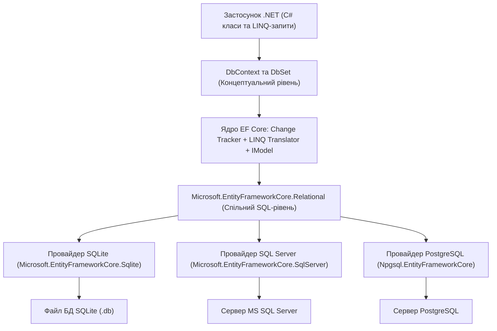

# 1.1. Що таке Entity Framework Core

- **Глава:** 01. Вступ до Entity Framework Core
- **Джерело Metanit:** [https://metanit.com/sharp/efcore/1.1.php](https://metanit.com/sharp/efcore/1.1.php)
- **Код прикладу:** [`Lesson_1_01_WhatIsEfCore.cs`](../../src/01_Introduction/Lesson_1_01_WhatIsEfCore.cs)
- **Запуск уроку:** `dotnet run --project src/EFCoreMastery.ConsoleApp -- 1.1`
- **Шпаргалка глави:** [Runs.md](Runs.md)

## Мета уроку

Зрозуміти призначення Entity Framework Core як сучасної ORM-технології платформи .NET, розібратися з ключовими концепціями (сутність, властивості, первинні ключі, асоціативні зв'язки, трансляція LINQ у SQL), вивчити екосистему NuGet-пакетів EF Core та навчитися інспектувати внутрішню модель метаданих (`IModel`) у SQLite.

## Детальний теоретичний матеріал

### Що таке ORM та місце EF Core у стеку .NET

**Entity Framework Core (EF Core)** — це легковагова, розширювана та кросплатформна технологія об'єктно-реляційного відображення (**ORM** — *Object-Relational Mapping*) від компанії Microsoft для доступу до даних.

Головна задача ORM полягає в усуненні так званого *імпедансного розриву* (*impedance mismatch*) між об'єктно-орієнтованою моделлю мови C# та реляційною моделлю бази даних:

- **На фізичному рівні (у СУБД)** ми маємо справу з таблицями, рядками, стовпцями, індексами, первинними та зовнішніми ключами, а також із діалектами SQL.
- **На концептуальному рівні (у коді C#)** EF Core дозволяє працювати з даними як зі звичайними класами, властивостями та колекціями об'єктів.

Ключові властивості EF Core:

1. **Універсальність платформ:** працює поверх .NET у консольних застосунках, ASP.NET Core, WPF, WinForms, MAUI тощо.
2. **Кросплатформність:** підтримує Windows, Linux і macOS.
3. **Відкритий вихідний код:** проєкт розвивається відкрито на GitHub ([github.com/dotnet/efcore](https://github.com/dotnet/efcore)) синхронно з релізами платформи .NET (актуальна гілка EF Core 10.0).
4. **Незалежність від конкретної СУБД (універсальний API):** код бізнес-логіки (запити LINQ, додавання, оновлення, збереження через `DbContext`) не залежить від конкретного рушія БД. При міграції, наприклад, із SQLite на PostgreSQL чи MS SQL Server, змінюється передусім підключений NuGet-провайдер та конфігурація в `OnConfiguring` / DI, тоді як основний код роботи з даними залишається тим самим.

### Ключові концепції EF Core

1. **Сутність (Entity):** центральна концепція EF Core. Це звичайний C#-клас (POCO — *Plain Old CLR Object*), який описує предметну область і відображається на таблицю (або представлення) у базі даних. Кожен екземпляр класу відповідає одному рядку таблиці.
2. **Властивості (Properties):** представляють атрибути сутності та зіставляються зі стовпцями таблиці. Це можуть бути як прості типи (`int`, `string`, `decimal`, `DateTime`, `bool`), так і комплексні/складені типи (Complex Types / Owned Entities).
3. **Ключ (Primary Key):** одна або кілька властивостей, що унікально ідентифікують кожен екземпляр сутності. У реляційній БД це первинний ключ таблиці (`PRIMARY KEY`). Без визначеного ключа EF Core не зможе відстежувати зміни сутності для `INSERT`/`UPDATE`/`DELETE` (окрім спеціальних *Keyless Entity Types* для читання).
4. **Асоціативні зв'язки (Relationships):** сутності можуть посилатися одна на одну, утворюючи зв'язки:
   - **Один-до-одного (`1:1`)** — наприклад, `User` і `UserProfile`.
   - **Один-до-багатьох (`1:N`)** — наприклад, `Category` і `Product`.
   - **Багато-до-багатьох (`M:N`)** — наприклад, `Student` і `Course` (через проміжну таблицю зв'язків).
   У базі даних ці зв'язки реалізуються через зовнішні ключі (`FOREIGN KEY`).
5. **LINQ-запити та трансляція у SQL:** замість ручного складання рядків SQL розробник пише типізовані C#-вирази LINQ (`Where`, `OrderBy`, `Select`, `Join`, `GroupBy`). Під час виконання дерево виразів LINQ (`IQueryable<T>`) аналізується рушієм EF Core та провайдером БД і транслюється в оптимізований SQL-запит конкретного діалекту.

### Екосистема NuGet-пакетів EF Core

Функціональність EF Core модульна і розбита на окремі пакети. Зазвичай розробник встановлює пакет потрібного **провайдера БД**, який транзитивно підтягує базові пакети ядра:

| NuGet-пакет | Призначення |
| --- | --- |
| `Microsoft.EntityFrameworkCore` | Основне ядро EF Core (Change Tracker, LINQ-рушій, `DbContext`, `DbSet<T>`). |
| `Microsoft.EntityFrameworkCore.Abstractions` | Набір абстракцій і атрибутів (наприклад, `[Index]`, `[Owned]`), не залежних від конкретної СУБД. |
| `Microsoft.EntityFrameworkCore.Relational` | Спільні компоненти для всіх реляційних провайдерів (мапінг таблиць, SQL-генерація, міграції). |
| `Microsoft.EntityFrameworkCore.Sqlite` | Провайдер для SQLite, що включає нативні бінарні файли рушія SQLite (`e_sqlite3`). |
| `Microsoft.EntityFrameworkCore.Sqlite.Core` | Провайдер SQLite **без** нативних бінарних файлів (коли рушій постачається окремо). |
| `Microsoft.EntityFrameworkCore.Sqlite.NetTopologySuite` | Підтримка просторових/географічних типів (Spatial Types) у SQLite. |
| `Microsoft.EntityFrameworkCore.SqlServer` | Офіційний провайдер для Microsoft SQL Server та Azure SQL Database. |
| `Microsoft.EntityFrameworkCore.SqlServer.NetTopologySuite` | Підтримка географічних типів у SQL Server. |
| `Microsoft.EntityFrameworkCore.Cosmos` | Провайдер для нереляційної документо-орієнтованої БД Azure Cosmos DB. |
| `Microsoft.EntityFrameworkCore.InMemory` | Провайдер бази даних в оперативній пам'яті (лише для простих unit-тестів). |
| `Microsoft.EntityFrameworkCore.Tools` | Команди PowerShell для Visual Studio Package Manager Console (`Add-Migration`, `Update-Database`, `Scaffold-DbContext`). |
| `Microsoft.EntityFrameworkCore.Design` | Компоненти часу розробки (Design-time) для роботи з міграціями та реверс-інжинірингом через .NET CLI (`dotnet ef`). |
| `Microsoft.EntityFrameworkCore.Proxies` | Підтримка динамічних проксі для «лінивого» завантаження (*Lazy Loading*) та проксі відстеження змін. |
| `Microsoft.EntityFrameworkCore.Analyzers` | Roslyn-аналізатори коду C#, які попереджають про потенційні помилки використання EF Core ще на етапі компіляції. |

> [!NOTE]
> Для сторонніх СУБД існують популярні незалежні провайдери: `Npgsql.EntityFrameworkCore.PostgreSQL` (PostgreSQL), `Pomelo.EntityFrameworkCore.MySql` або `MySql.EntityFrameworkCore` (MySQL/MariaDB), `Oracle.EntityFrameworkCore` (Oracle) тощо.

## Діаграма / Архітектура процесу

Нижче зображено багаторівневу архітектуру взаємодії застосунку .NET із базою даних через Entity Framework Core:



## Покроковий розбір прикладів коду

У файлі [`Lesson_1_01_WhatIsEfCore.cs`](../../src/01_Introduction/Lesson_1_01_WhatIsEfCore.cs) продемонстровано, як EF Core перетворює C#-класи на схему БД та транслює LINQ-запити.

### Крок 1. Визначення сутності та контексту (`L1_1`)
Клас `Product` містить три властивості: `Id`, `Title`, `Price`. Оскільки властивість називається `Id`, EF Core за конвенцією автоматично робить її первинним ключем з автоінкрементом (`AUTOINCREMENT` / `ROWID`). Контекст `IntroContext` приймає рядок підключення через primary constructor і передає його в `optionsBuilder.UseSqlServer(connectionString)`.

### Крок 2. Перевірка активного провайдера БД
```csharp
Console.WriteLine($"Поточний провайдер: {db.Database.ProviderName}");
```
Властивість `db.Database.ProviderName` повертає `Microsoft.EntityFrameworkCore.Sqlite`. Це підтверджує, що ядро EF Core використовує саме SQLite-провайдер.

### Крок 3. Інспекція скомпільованої моделі метаданих (`db.Model`)
EF Core будує внутрішній граф метаданих `IModel` під час першого звернення до контексту. У прикладі ми перебираємо всі типи сутностей (`db.Model.GetEntityTypes()`), отримуємо ім'я таблиці (`entityType.GetTableName()`), первинний ключ (`entityType.FindPrimaryKey()`) та детальний мапінг кожної властивості (`prop.GetColumnName()`, `prop.GetColumnType()`, `prop.IsNullable`):
- `Id (Int32)` → стовпець `"Id"`, тип SQLite: `INTEGER`, `Nullable: False`
- `Title (String)` → стовпець `"Title"`, тип SQLite: `TEXT`, `Nullable: False` (через увімкнений `<Nullable>enable</Nullable>` і тип `string` без `?`)
- `Price (Decimal)` → стовпець `"Price"`, тип SQLite: `TEXT`, `Nullable: False`

### Крок 4. Додавання даних та LINQ-вибірка
```csharp
db.Products.AddRange(
    new L1_1.Product { Title = "Ноутбук", Price = 32500m },
    new L1_1.Product { Title = "Клавіатура", Price = 1850m },
    new L1_1.Product { Title = "Монітор", Price = 11200m }
);
db.SaveChanges();
```
Після виклику `SaveChanges()` виконуються `INSERT`-команди, і властивості `Id` у створених об'єктах автоматично заповнюються згенерованими базою даних значеннями.

Далі виконується LINQ-запит:
```csharp
var expensiveProducts = db.Products
    .Where(p => p.Price > 2000m)
    .OrderByDescending(p => p.Price)
    .ToList();
```
Цей вираз транслюється провайдером SQLite у приблизно такий SQL:
```sql
SELECT "p"."Id", "p"."Price", "p"."Title"
FROM "Products" AS "p"
WHERE "p"."Price" > '2000.0'
ORDER BY "p"."Price" DESC
```
*(Примітка: про те, як SQLite поводиться з `decimal`, читайте нижче).*

## Особливості роботи в SQLite

| Аспект | SQLite | MS SQL Server |
| --- | --- | --- |
| **Архітектура** | Вбудована файлова БД (один файл `.db`), без окремого сервера. | Клієнт-серверна СУБД (окрема служба / процес). |
| **Система типів** | Динамічна типізація з 4 базовими класами зберігання: `INTEGER`, `TEXT`, `REAL`, `BLOB`. | Сувора статична типізація (`INT`, `NVARCHAR(MAX)`, `DECIMAL(18,2)`, `DATETIME2` тощо). |
| **Тип `decimal`** | Зберігається як `TEXT` (оскільки немає точного десяткового типу, а `REAL` дає похибку округлення). | Має нативний точний тип `DECIMAL(18, 2)`. |
| **Тип `bool`** | Зберігається як `INTEGER` (`0` або `1`). | Має нативний тип `BIT`. |
| **Встановлення пакета** | `Microsoft.EntityFrameworkCore.Sqlite` (включає рушій `e_sqlite3`). | `Microsoft.EntityFrameworkCore.SqlServer`. |

## Типові помилки, підводні камені та Best Practices

1. **Обмеження `decimal` у SQLite:** Оскільки `decimal` зберігається як `TEXT`, порівняння та сортування (`>` / `ORDER BY`) на рівні SQLite можуть працювати лексикографічно (як рядки) або взагалі блокуватися в складних агрегаціях (`Sum`, `Average`, `Min`, `Max`). Для фінансових обчислень у SQLite часто використовують конвертер у `long` (копійки) або `double` (якщо допустима похибка), або виконують агрегацію в пам'яті після `.AsEnumerable()`.
2. **Не використовуйте `InMemory` для тестування реляційної логіки:** Провайдер `Microsoft.EntityFrameworkCore.InMemory` не перевіряє зовнішні ключі, унікальні індекси та обмеження `NOT NULL`, і не підтримує транзакції. Для реалістичних інтеграційних тестів краще використовувати SQLite у режимі в пам'яті (`Data Source=:memory:`).
3. **Не забувайте про згенерований SQL:** Хоча EF Core дозволяє не писати SQL вручну, завжди перевіряйте згенеровані запити (через логування або `ToQueryString()`), щоб уникнути проблеми `N+1` запитів або завантаження зайвих даних у пам'ять (*Client Evaluation*).
4. **Додавайте тільки потрібний провайдер:** Не потрібно встановлювати `Microsoft.EntityFrameworkCore` окремо, якщо ви вже встановлюєте `Microsoft.EntityFrameworkCore.Sqlite` — базове ядро та `Relational` підтягнуться автоматично.

---
<!-- lesson-nav -->
[Шпаргалка глави (Runs.md)](Runs.md) | [Зміст курсу (README)](../../README.md) | [1.2. Перший застосунок на EF Core](1_02_FirstApp.md) →
