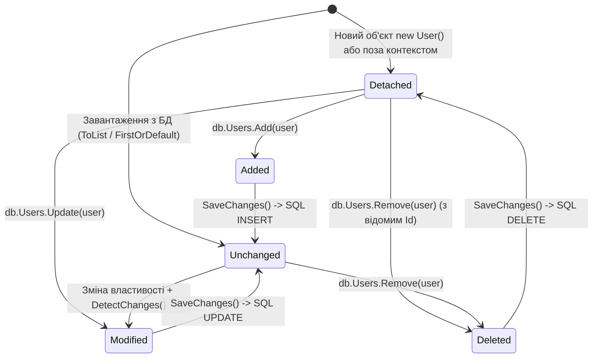

# 1.4. Основні операції з даними. CRUD

- **Глава:** 01. Вступ до Entity Framework Core
- **Джерело Metanit:** [https://metanit.com/sharp/efcore/1.4.php](https://metanit.com/sharp/efcore/1.4.php)
- **Код прикладу:** [`Lesson_1_04_CrudOperations.cs`](../../src/01_Introduction/Lesson_1_04_CrudOperations.cs)
- **Запуск уроку:** `dotnet run --project src/EFCoreMastery.ConsoleApp -- 1.4`
- **Шпаргалка глави:** [Runs.md](Runs.md)

## Мета уроку

Опанувати базові операції з даними **CRUD** (*Create, Read, Update, Delete*) в Entity Framework Core, зрозуміти механізм відстеження станів сутностей (`EntityState` та `ChangeTracker`), навчитися розрізняти відстежуваний (*Connected*) та від'єднаний (*Disconnected*) сценарії оновлення, а також застосовувати пакетні та асинхронні методи.

## Детальний теоретичний матеріал

Більшість операцій із базою даних зводяться до чотирьох базових дій — **CRUD**:
- **C**reate (створення/додавання)
- **R**ead (читання/вибірка)
- **U**pdate (оновлення/редагування)
- **D**elete (видалення)

В EF Core усі ці операції виконуються через `DbSet<TEntity>` та внутрішній механізм відстеження змін (**Change Tracker**), який веде облік стану (`EntityState`) кожної сутності, що потрапила під контроль контексту.

### Зведена таблиця CRUD-методів та станів `EntityState`

| Операція | Метод `DbSet<T>` / дія | Початковий `EntityState` | Стан після `SaveChanges()` | SQL-команда |
| --- | --- | --- | --- | --- |
| **Create (1 об'єкт)** | `db.Users.Add(user)` | `Added` | `Unchanged` | `INSERT INTO ...` |
| **Create (пакет)** | `db.Users.AddRange(u1, u2)` | `Added` | `Unchanged` | Пакетний `INSERT INTO ...` |
| **Read** | `db.Users.ToList()` / `FirstOrDefault()` | `Unchanged` | `Unchanged` | `SELECT ... FROM ...` |
| **Update (Connected)** | Зміна властивості відстежуваного об'єкта | `Modified` (лише змінені поля) | `Unchanged` | `UPDATE ... SET ...` |
| **Update (Disconnected)** | `db.Users.Update(user)` / `UpdateRange(...)` | `Modified` (усі поля) | `Unchanged` | `UPDATE ... SET ...` |
| **Delete (1 об'єкт)** | `db.Users.Remove(user)` | `Deleted` | `Detached` | `DELETE FROM ...` |
| **Delete (пакет)** | `db.Users.RemoveRange(u1, u2)` | `Deleted` | `Detached` | Пакетний `DELETE FROM ...` |

### Додавання даних (`Add` та `AddRange`)

Метод `db.Users.Add(entity)` переводить новий об'єкт у стан `EntityState.Added`. Саме в момент виклику `db.SaveChanges()` EF Core генерує SQL-інструкцію `INSERT` для всіх сутностей у стані `Added`, виконує її та заповнює згенеровані базою даних ключі (наприклад, `Id`).

Якщо потрібно додати декілька об'єктів за раз, використовуйте `AddRange(obj1, obj2)` або `AddRange(IEnumerable<T>)` — це дозволяє EF Core об'єднати команди в один пакетний запит до БД замість серії окремих викликів.

### Читання даних (`ToList`, `FirstOrDefault`)

При виконанні LINQ-запиту (наприклад, `db.Users.ToList()` або `db.Users.FirstOrDefault()`) EF Core завантажує рядки з БД, створює C#-об'єкти і поміщає їх у `ChangeTracker` зі станом `Unchanged`, зберігаючи копію початкових значень (*Original Values*).

### Редагування: відстежуваний (*Connected*) vs від'єднаний (*Disconnected*) сценарій

1. **Відстежуваний сценарій (у межах одного `DbContext`):**
   Коли об'єкт завантажено з БД через `db.Users.FirstOrDefault()`, контекст уже відстежує його. Якщо ви зміните `user.Name = "Bob";`, перед виконанням `SaveChanges()` спрацьовує `DetectChanges()`, який порівнює поточні значення властивостей із початковими. Сутність переходить у стан `Modified`, і EF Core генерує `UPDATE` **лише для змінених стовпців**. Викликати `db.Users.Update(user)` у цьому випадку не потрібно!

2. **Від'єднаний сценарій (різні екземпляри `DbContext`):**
   Якщо об'єкт отримано в одному блоці `using (var db1 = ...)`, а редагується в іншому `using (var db2 = ...)`, контекст `db2` нічого не знає про цей об'єкт (він для нього у стані `Detached`). Якщо просто змінити властивості й викликати `db2.SaveChanges()`, **у базі даних нічого не зміниться**.
   Щоб `db2` згенерував `UPDATE`, необхідно явно прикріпити об'єкт і позначити його як змінений:
   ```csharp
   db2.Users.Update(user);
   db2.SaveChanges();
   ```
   Аналогічно для масового оновлення існує `db2.Users.UpdateRange(u1, u2)`.

### Видалення даних (`Remove` та `RemoveRange`)

Метод `db.Users.Remove(user)` переводить сутність у стан `EntityState.Deleted`. При виклику `SaveChanges()` виконується `DELETE FROM "Users" WHERE "Id" = @p0`, після чого об'єкт переходить у стан `Detached` (більше не відстежується контекстом). Для видалення кількох сутностей використовується `RemoveRange(...)`.

### Асинхронний API

Для запобігання блокуванню потоків у реальних застосунках EF Core надає асинхронні аналоги (методи розширення з простору імен `Microsoft.EntityFrameworkCore`):
- `ToListAsync()`, `FirstOrDefaultAsync()`, `SingleOrDefaultAsync()`, `CountAsync()`
- `SaveChangesAsync()`
- `AddAsync()`, `AddRangeAsync()` *(Примітка: використовуйте `AddAsync` лише тоді, коли генератор ключів звертається до БД, наприклад `HiLo` у SQL Server; для звичайного `AUTOINCREMENT` у SQLite достатньо синхронного `Add`, оскільки він не виконує I/O).*

## Діаграма / Архітектура процесу

Життєвий цикл станів сутності (`EntityState`) під час виконання CRUD-операцій:



## Покроковий розбір прикладів коду

У файлі [`Lesson_1_04_CrudOperations.cs`](../../src/01_Introduction/Lesson_1_04_CrudOperations.cs) послідовно продемонстровано всі сценарії CRUD:

### Крок 1. Create (`Add` та `AddRange`)
```csharp
db.Users.Add(tom);
db.Users.AddRange(alice, kate);
db.SaveChanges();
```
Усі три об'єкти додаються в одній транзакції. Для кожного виконується `INSERT INTO "Users" ("Age", "Name") VALUES (@p0, @p1) RETURNING "Id";`.

### Крок 2. Read (`ToList`)
Відкривається новий контекст `db`, і `db.Users.ToList()` зчитує всі записи (`Tom`, `Alice`, `Kate`) через `SELECT`.

### Крок 3. Connected Update
```csharp
var user = db.Users.FirstOrDefault();
if (user is not null)
{
    user.Name = "Bob";
    user.Age = 44;
    db.SaveChanges();
}
```
Змінюється перший запис (`Tom` стає `Bob`). Оскільки об'єкт завантажено цим самим контекстом, `SaveChanges()` автоматично генерує:
```sql
UPDATE "Users"
SET "Age" = @p0, "Name" = @p1
WHERE "Id" = @p2;
```

### Крок 4. Disconnected Update
```csharp
L1_4.User? detachedUser;
using (var db1 = new L1_4.CrudContext(connectionString))
{
    detachedUser = db1.Users.FirstOrDefault(u => u.Name == "Alice");
}
...
using var db2 = new L1_4.CrudContext(connectionString);
db2.Users.Update(detachedUser);
db2.SaveChanges();
```
Об'єкт `detachedUser` пережив закриття `db1`. У новому контексті `db2` виклик `db2.Users.Update(detachedUser)` переводить усі його властивості у стан `Modified`, що призводить до виконання `UPDATE` для всіх стовпців (окрім первинного ключа `Id`).

### Крок 5. Delete (`Remove`)
```csharp
var user = db.Users.FirstOrDefault();
if (user is not null)
{
    db.Users.Remove(user);
    db.SaveChanges();
}
```
Перший користувач (`Bob`) позначається як `Deleted` і видаляється командою `DELETE FROM "Users" WHERE "Id" = @p0;`.

### Крок 6. Async API
Демонструється повний цикл з `AddRangeAsync`, `SaveChangesAsync`, `FirstOrDefaultAsync` та `ToListAsync` для користувачів `Sam` і `Mike`.

## Особливості роботи в SQLite

- **Автоматичні транзакції в `SaveChanges()`:** У SQLite весь пакет команд (`AddRange`, `RemoveRange` тощо) усередині одного `SaveChanges()` виконується в одній транзакції (`BEGIN TRANSACTION ... COMMIT`), що гарантує принцип «усе або нічого».
- **Блокування на рівні файлу:** На відміну від SQL Server, який блокує окремі рядки або сторінки, SQLite блокує весь файл бази даних під час запису. При одночасному записі з кількох потоків або контекстів може виникнути `SQLite Error 5: 'database is locked'` (для зменшення ризику в реальних проєктах вмикають режим журналювання `PRAGMA journal_mode=WAL;`).

## Типові помилки, підводні камені та Best Practices

1. **Надлишкове використання `DbSet.Update()`:** Якщо ви вже завантажили сутність у поточному контексті, не викликайте `db.Users.Update(user)`. Метод `Update()` примусово позначає **всі** властивості як змінені, що генерує зайвий трафік і може перезаписати поля, які змінилися іншим процесом.
2. **Втрата змін у від'єднаному сценарії:** Якщо ви отримали об'єкт із веб-запиту (DTO → Entity) або з іншого `DbContext`, не забудьте прикріпити його через `Update()` або `Attach()` перед `SaveChanges()`.
3. **Завантаження сутності лише для видалення:** Щоб видалити запис за відомим `Id`, не обов'язково спочатку робити `SELECT` через `FirstOrDefault()`. Можна передати stub-сутність `db.Users.Remove(new User { Id = 5 })`, або у сучасному EF Core 7+ використати `db.Users.Where(u => u.Id == 5).ExecuteDelete()`, який виконує миттєвий `DELETE` без завантаження об'єкта в пам'ять.
4. **Не забувайте про `Microsoft.EntityFrameworkCore` для async-методів:** Методи `ToListAsync()` та `FirstOrDefaultAsync()` — це методи розширення, що знаходяться у просторі імен `Microsoft.EntityFrameworkCore`, а не `System.Linq`.

---
<!-- lesson-nav -->
← [2.16. Управління базою даних](2_16_DatabaseManagement.md) | [Шпаргалка глави (Runs.md)](Runs.md) | [Зміст курсу (README)](../../README.md) | [1.5. Конфігурація підключення](1_05_ConnectionConfiguration.md) →
