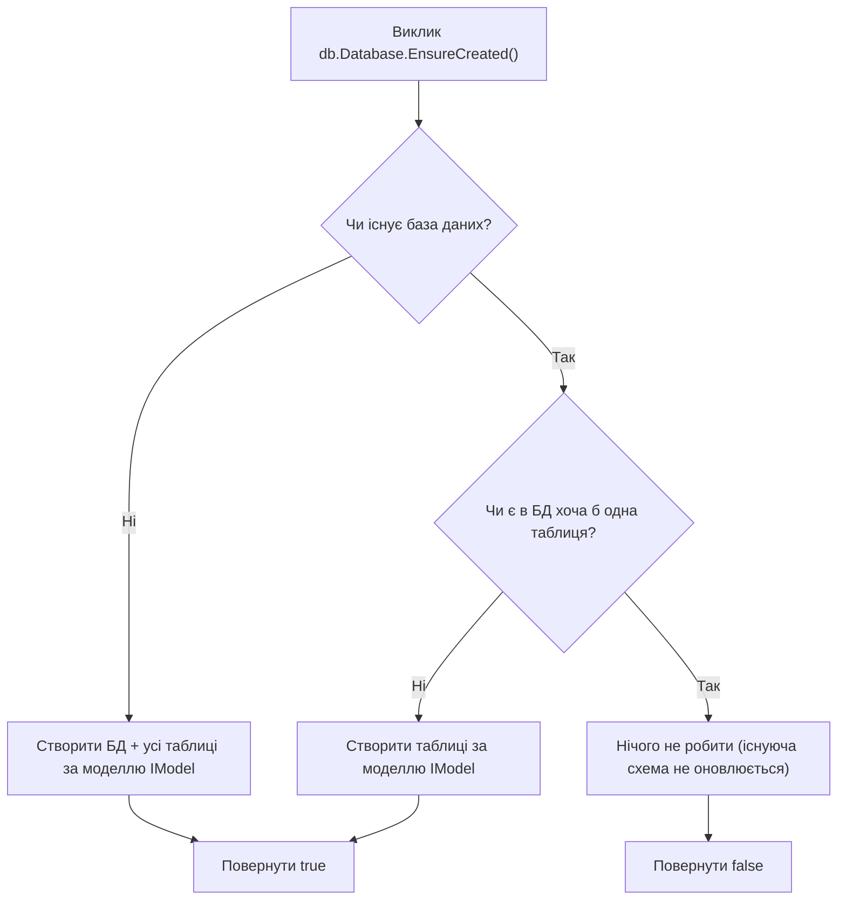

# 1.4. Управління базою даних

- **Глава:** 01. Вступ до Entity Framework Core
- **Джерело Metanit:** [https://metanit.com/sharp/efcore/2.16.php](https://metanit.com/sharp/efcore/2.16.php)
- **Код прикладу:** [`Lesson_1_04_DatabaseManagement.cs`](../../src/01_Introduction/Lesson_1_04_DatabaseManagement.cs)
- **Запуск уроку:** `dotnet run --project src/EFCoreMastery.ConsoleApp -- 1.4`
- **Шпаргалка глави:** [Runs.md](Runs.md)

## Мета уроку

Детально вивчити властивість `DbContext.Database` (тип `DatabaseFacade`) та її методи програмного керування життєвим циклом бази даних: `EnsureCreated`, `EnsureDeleted`, `CanConnect` і їхні асинхронні аналоги, а також зрозуміти різницю в поведінці між SQLite та клієнт-серверними СУБД.

## Детальний теоретичний матеріал

У класі `DbContext` визначено властивість `Database` типу `Microsoft.EntityFrameworkCore.Infrastructure.DatabaseFacade`. Вона надає програмний доступ до операцій рівня самої бази даних (створення, видалення, перевірка з'єднання, виконання транзакцій, застосування міграцій і сирих SQL-команд).

### Основні методи `DatabaseFacade` для керування БД

| Синхронний метод | Асинхронний метод | Повернений тип | Призначення |
| --- | --- | --- | --- |
| `EnsureCreated()` | `EnsureCreatedAsync()` | `bool` | Гарантує існування БД та її схеми за поточною моделлю. Повертає `true`, якщо БД/таблиці були створені цим викликом, і `false`, якщо вони вже існували. |
| `EnsureDeleted()` | `EnsureDeletedAsync()` | `bool` | Гарантує видалення БД. Повертає `true`, якщо БД існувала і була видалена, і `false`, якщо БД не існувало. |
| `CanConnect()` | `CanConnectAsync()` | `bool` | Перевіряє, чи можливо встановити фізичне з'єднання з базою даних (не кидає виняток при звичайній недоступності БД, а повертає `false`). |

### Логіка роботи `EnsureCreated()`

Метод `Database.EnsureCreated()` виконує перевірку за трьома сценаріями:
1. **База даних відсутня:** створюється сама БД (для SQLite — файл `.db`) та всі таблиці, індекси й зовнішні ключі, описані в моделі контексту. Метод повертає `true`.
2. **База даних існує, але не містить жодної таблиці (порожня):** у ній створюються всі таблиці згідно з моделлю. Метод повертає `true`.
3. **База даних існує і вже містить таблиці:** метод **не робить нічого** і повертає `false`. Навіть якщо ви додали нові властивості або класи моделей у C#, `EnsureCreated()` не змінить існуючі таблиці!

### Логіка роботи `EnsureDeleted()`

Метод `Database.EnsureDeleted()` перевіряє наявність БД і, якщо вона є, повністю її видаляє (разом з усіма таблицями та даними). Якщо БД уже відсутня — метод нічого не робить і повертає `false`.

Найчастіше `EnsureDeleted()` використовують у парі з `EnsureCreated()` для швидкого скидання БД до чистого стану під час прототипування або запуску автоматизованих тестів:
```csharp
db.Database.EnsureDeleted();
db.Database.EnsureCreated();
```
Ці методи можна викликати як усередині конструктора `DbContext`, так і зовні — там, де є посилання на екземпляр контексту.

### Перевірка доступності через `CanConnect()`

Метод `Database.CanConnect()` (та `CanConnectAsync()`) намагається відкрити з'єднання, використовуючи поточний рядок підключення та провайдер. Якщо з'єднання успішне — повертає `true`; якщо сервер недоступний, невірні облікові дані або БД не існує — повертає `false` без викидання винятку (за винятком критичних помилок конфігурації провайдера).

## Діаграма / Архітектура процесу

Алгоритм прийняття рішень усередині `Database.EnsureCreated()`:



## Покроковий розбір прикладів коду

У файлі [`Lesson_1_04_DatabaseManagement.cs`](../../src/01_Introduction/Lesson_1_04_DatabaseManagement.cs) продемонстровано як синхронні, так і асинхронні виклики `DatabaseFacade`.

### Крок 1. Синхронне видалення та створення БД
```csharp
bool deletedBefore = db.Database.EnsureDeleted();
bool createdFirst = db.Database.EnsureCreated();
bool createdSecond = db.Database.EnsureCreated();
```
- Перший виклик `EnsureDeleted()` видаляє файл `lesson_2_16.db`, якщо він залишився від попереднього запуску (повертає `true` або `false`).
- Перший виклик `EnsureCreated()` створює новий файл `.db` і таблицю `Users` (`CREATE TABLE "Users" (...)`) та повертає `true`.
- Другий виклик `EnsureCreated()` бачить, що таблиця вже є, не виконує жодного DDL-запиту і повертає `false`.

### Крок 2. Перевірка доступності (`CanConnect`)
```csharp
bool isAvailable = db.Database.CanConnect();
```
Після `EnsureCreated()` файл `lesson_2_16.db` фізично існує на диску, тому `CanConnect()` відкриває з'єднання SQLite і повертає `true`.

### Крок 3. Асинхронний сценарій
```csharp
bool deletedAsync = await db.Database.EnsureDeletedAsync();
bool createdAsync = await db.Database.EnsureCreatedAsync();
bool canConnectAsync = await db.Database.CanConnectAsync();
```
У реальних застосунках (ASP.NET Core, десктопні UI-програми) операції вводу-виводу з БД виконуються асинхронно, щоб не блокувати потік обробки запитів або інтерфейс користувача.

## Особливості роботи в SQLite

| Аспект | SQLite | MS SQL Server |
| --- | --- | --- |
| **`EnsureDeleted()`** | Фізично видаляє файл `.db` (а також пов'язані файли `-wal`, `-shm`) з файлової системи. | Виконує команду `DROP DATABASE [DbName]`, що потребує прав `db_owner` або `sysadmin` та відсутності активних з'єднань. |
| **`CanConnect()` при відсутній БД** | Якщо в рядку підключення не вказано `Mode=ReadOnly` або `Mode=ReadWrite`, драйвер SQLite може автоматично створити порожній файл при спробі відкриття або поводитися залежно від прав доступу до каталогу. | Якщо база даних не створена, `CanConnect()` повертає `false`. |
| **Зміна моделі після `EnsureCreated()`** | Оскільки `EnsureCreated()` не мігрує схему, для додавання нового стовпця в SQLite доведеться або перестворити файл через `EnsureDeleted()`, або перейти на міграції (`Migrate()`). | Те саме обмеження: `EnsureCreated()` не оновлює існуючу схему. |

## Типові помилки, підводні камені та Best Practices

1. **Несумісність `EnsureCreated()` та `Migrate()`:** Це одна з найпоширеніших помилок. `EnsureCreated()` створює таблиці напряму і **не** створює системну таблицю `__EFMigrationsHistory`. Якщо пізніше ви додасте міграції і викличете `db.Database.Migrate()`, EF Core спробує застосувати початкову міграцію з нуля і впаде з помилкою `SQLite Error 1: 'table "Users" already exists'`.
2. **Виклик `EnsureDeleted()` у конструкторі `DbContext`:** Навіть у навчальних проєктах тримати `EnsureDeleted()` усередині конструктора `DbContext` небезпечно — кожне створення контексту (наприклад, для простого `SELECT`) знищуватиме всю базу даних! Викликайте його явно лише в точці ініціалізації тестів.
3. **Використовуйте `await` без `.GetAwaiter().GetResult()` у реальних проєктах:** У консольному раннері цього курсу метод `ILesson.Run()` синхронний, тому застосовано `RunAsync().GetAwaiter().GetResult()`. У реальних застосунках робіть `Main` асинхронним (`static async Task Main`) і використовуйте повноцінний `await`.

---
<!-- lesson-nav -->
← [1.3. Підключення до існуючої бази даних](1_03_ExistingDatabase.md) | [Шпаргалка глави (Runs.md)](Runs.md) | [Зміст курсу (README)](../../README.md) | [1.5. Основні операції з даними. CRUD](1_05_CrudOperations.md) →
