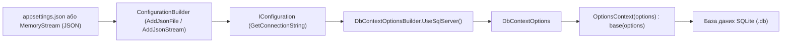

# 1.6. Конфігурація підключення

- **Глава:** 01. Вступ до Entity Framework Core
- **Джерело Metanit:** [https://metanit.com/sharp/efcore/1.5.php](https://metanit.com/sharp/efcore/1.5.php)
- **Код прикладу:** [`Lesson_1_06_ConnectionConfiguration.cs`](../../src/01_Introduction/Lesson_1_06_ConnectionConfiguration.cs)
- **Запуск уроку:** `dotnet run --project src/EFCoreMastery.ConsoleApp -- 1.6`
- **Шпаргалка глави:** [Runs.md](Runs.md)

## Мета уроку

Вивчити всі основні способи конфігурування підключення до бази даних в Entity Framework Core: перевизначення методу `OnConfiguring`, передача `DbContextOptions<TContext>` у конструктор базового класу та винесення рядка підключення у зовнішній JSON-файл (`appsettings.json`) за допомогою `ConfigurationBuilder`.

## Детальний теоретичний матеріал

Для того щоб `DbContext` міг взаємодіяти з базою даних, йому необхідно знати два параметри: який **провайдер БД** використовувати (`UseSqlite`, `UseSqlServer` тощо) та який **рядок підключення** (*Connection String*). В EF Core існують два принципово різних підходи до передачі цієї конфігурації.

### Спосіб 1. Перевизначення методу `OnConfiguring`

Клас контексту перевизначає метод `OnConfiguring(DbContextOptionsBuilder optionsBuilder)`:
```csharp
public class ApplicationContext : DbContext
{
    protected override void OnConfiguring(DbContextOptionsBuilder optionsBuilder)
    {
        optionsBuilder.UseSqlServer("Data Source=helloapp.db");
    }
}
```
Щоб не «зашивати» рядок підключення жорстко в код контексту, його можна передавати через конструктор самого контексту:
```csharp
public class ApplicationContext(string connectionString) : DbContext
{
    protected override void OnConfiguring(DbContextOptionsBuilder optionsBuilder)
    {
        optionsBuilder.UseSqlServer(connectionString);
    }
}
```
Цей спосіб простий і зручний для невеликих консольних утиліт або навчальних проєктів.

### Спосіб 2. Передача `DbContextOptions<TContext>` у конструктор

У промислових застосунках (особливо ASP.NET Core з Dependency Injection, а також у юніт-тестах) конфігурацію формують **зовні** та передають у конструктор базового класу `DbContext`:
```csharp
public class ApplicationContext : DbContext
{
    public ApplicationContext(DbContextOptions<ApplicationContext> options)
        : base(options)
    {
    }
}
```
Створення об'єкта `options` відбувається через `DbContextOptionsBuilder<TContext>`:
```csharp
var optionsBuilder = new DbContextOptionsBuilder<ApplicationContext>();
var options = optionsBuilder.UseSqlServer("Data Source=helloapp.db").Options;

using var db = new ApplicationContext(options);
```
Перевага цього підходу полягає в тому, що сам клас контексту повністю відв'язаний від конкретного провайдера та джерела рядка підключення. Наприклад, у продакшені ви можете передати туди `UseSqlServer(...)`, а в інтеграційних тестах — `UseSqlite("Data Source=:memory:")` без жодної зміни коду `ApplicationContext`.

### Спосіб 3. Винесення рядка підключення в `appsettings.json`

Зберігання рядка підключення у вихідному коді C# має суттєвий недолік — будь-яка зміна шляху до БД, імені сервера чи пароля вимагає перекомпіляції застосунку. Стандартна практика .NET — зберігати налаштування в зовнішньому JSON-файлі `appsettings.json`:

```json
{
  "ConnectionStrings": {
    "DefaultConnection": "Data Source=helloapp.db"
  }
}
```

Для зчитування цього файлу в консольному застосунку встановлюється NuGet-пакет `Microsoft.Extensions.Configuration.Json`:
```bash
dotnet add package Microsoft.Extensions.Configuration.Json
```
Далі використовується `ConfigurationBuilder`:
```csharp
var config = new ConfigurationBuilder()
    .SetBasePath(Directory.GetCurrentDirectory())
    .AddJsonFile("appsettings.json")
    .Build();

string? connectionString = config.GetConnectionString("DefaultConnection");
```
Метод розширення `GetConnectionString("DefaultConnection")` шукає ключ `"DefaultConnection"` саме всередині секції `"ConnectionStrings"`. Конфігурацію можна будувати як ззовні (перед створенням `DbContextOptions`), так і безпосередньо всередині `OnConfiguring`, якщо файл конфігурації один для всього контексту.

### Порівняльна таблиця підходів

| Критерій | `OnConfiguring` (без параметрів) | `OnConfiguring` + параметр у конструкторі | `DbContextOptions<T>` + `IConfiguration` |
| --- | --- | --- | --- |
| **Гнучкість зміни СУБД** | Низька (провайдер захардкоджений) | Середня (можна змінити рядок, але не провайдер) | Висока (зовнішній вибір і провайдера, і рядка) |
| **Сумісність із DI (ASP.NET Core)** | Незручно | Незручно | Повна (стандарт `AddDbContext<T>()`) |
| **Зручність для тестування** | Складно підмінити БД | Можна підмінити файл БД | Легко підмінити на SQLite `:memory:` |
| **Складність коду** | Мінімальна | Мінімальна | Трохи більше шаблонного коду |

## Діаграма / Архітектура процесу

Потік формування конфігурації підключення від зовнішнього JSON до `DbContext`:



## Покроковий розбір прикладів коду

У файлі [`Lesson_1_06_ConnectionConfiguration.cs`](../../src/01_Introduction/Lesson_1_06_ConnectionConfiguration.cs) реалізовано всі три підходи:

### Крок 1. Конфігурація через `OnConfiguring` (`OnConfiguringContext`)
```csharp
public class OnConfiguringContext(string connectionString) : DbContext
{
    public DbSet<User> Users => Set<User>();

    protected override void OnConfiguring(DbContextOptionsBuilder optionsBuilder)
    {
        optionsBuilder.UseSqlServer(connectionString);
    }
}
```
Контекст приймає рядок підключення через primary constructor і передає його в `UseSqlite`. Після `RecreateDatabase(db1)` додається користувач `Tom` і перевіряється `db1.Users.Count()`.

### Крок 2. Конфігурація через `DbContextOptions<OptionsContext>`
```csharp
var optionsBuilder = new DbContextOptionsBuilder<L1_5.OptionsContext>();
var options = optionsBuilder.UseSqlServer(connStr2).Options;

using (var db2 = new L1_5.OptionsContext(options))
```
Сам клас `OptionsContext` не перевизначає `OnConfiguring` і не знає про SQLite — він лише приймає `DbContextOptions<OptionsContext>` і передає їх у `base(options)`.

### Крок 3. `ConfigurationBuilder` + JSON-конфігурація
Щоб не створювати зайвих файлів `appsettings.json` на диску під час запуску навчального уроку, у прикладі формується JSON у пам'яті (`MemoryStream`) і передається в `AddJsonStream(jsonStream)`:
```csharp
var escapedConnStr = connStr3.Replace("\\", "\\\\");
var jsonConfig = $$"""
    {
      "ConnectionStrings": {
        "DefaultConnection": "{{escapedConnStr}}"
      }
    }
    """;

using var jsonStream = new MemoryStream(Encoding.UTF8.GetBytes(jsonConfig));
IConfiguration config = new ConfigurationBuilder()
    .AddJsonStream(jsonStream)
    .Build();

var resolvedConnStr = config.GetConnectionString("DefaultConnection");
```
Зверніть увагу на `connStr3.Replace("\\", "\\\\")`: у JSON зворотний слеш `\` у Windows-шляхах обов'язково має бути екранований як `\\`. Отриманий `resolvedConnStr` передається в `DbContextOptionsBuilder<OptionsContext>.UseSqlServer(...)`.

## Особливості роботи в SQLite

- **Копіювання `appsettings.json` у вихідний каталог:** У Visual Studio та `.csproj` для файлу `appsettings.json` необхідно вказати `Copy to Output Directory = Copy if newer` (або `<CopyToOutputDirectory>PreserveNewest</CopyToOutputDirectory>` у `.csproj`), інакше при запуску скомпільованої програми `AddJsonFile("appsettings.json")` викине `FileNotFoundException`.
- **Екранування шляхів у JSON:** У Windows шляхи SQLite виглядають як `Data Source=C:\db\app.db`. У JSON-рядку кожен `\` необхідно дублювати: `"Data Source=C:\\db\\app.db"`.
- **Параметри рядка підключення SQLite:** Окрім `Data Source`, у SQLite часто використовують `Mode=ReadWriteCreate` (за замовчуванням), `Cache=Shared`, `Pooling=True` (увімкнено з EF Core 6+).

## Типові помилки, підводні камені та Best Practices

1. **Конфлікт `DbContextOptions` та `OnConfiguring`:** Якщо ви передаєте `DbContextOptions<T>` у конструктор, але в класі контексту також залишили `OnConfiguring`, EF Core викличе `OnConfiguring` **після** конструктора і може перезаписати або доповнити зовнішні налаштування. Щоб уникнути конфліктів, перевіряйте стан конфігурації:
   ```csharp
   if (!optionsBuilder.IsConfigured)
   {
       optionsBuilder.UseSqlServer("Data Source=fallback.db");
   }
   ```
2. **Використання `Directory.GetCurrentDirectory()` замість `AppContext.BaseDirectory`:** Якщо консольний застосунок запущено з іншої робочої директорії (наприклад, через планувальник завдань або з кореня рішення), `Directory.GetCurrentDirectory()` вказуватиме не на папку з `.exe` та `appsettings.json`. Надійніше використовувати `AppContext.BaseDirectory`.
3. **Захист секретів:** Для SQLite рядок підключення зазвичай не містить паролів, але для SQL Server / PostgreSQL ніколи не зберігайте реальні паролі в `appsettings.json` у Git-репозиторії — використовуйте **User Secrets** (`dotnet user-secrets`) під час розробки або змінні середовища на сервері.

---
<!-- lesson-nav -->
← [1.5. Основні операції з даними. CRUD](1_05_CrudOperations.md) | [Шпаргалка глави (Runs.md)](Runs.md) | [Зміст курсу (README)](../../README.md) | [1.7. Логування операцій](1_07_Logging.md) →
