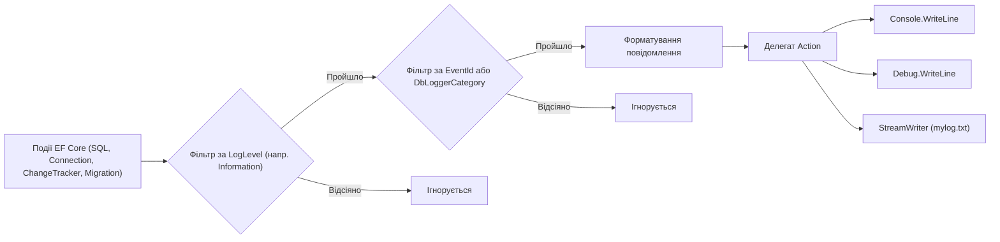

# 1.6. Логування операцій

- **Глава:** 01. Вступ до Entity Framework Core
- **Джерело Metanit:** [https://metanit.com/sharp/efcore/1.6.php](https://metanit.com/sharp/efcore/1.6.php)
- **Код прикладу:** [`Lesson_1_06_Logging.cs`](../../src/01_Introduction/Lesson_1_06_Logging.cs)
- **Запуск уроку:** `dotnet run --project src/EFCoreMastery.ConsoleApp -- 1.6`
- **Шпаргалка глави:** [Runs.md](Runs.md)

## Мета уроку

Навчитися відстежувати внутрішню роботу Entity Framework Core та переглядати згенеровані SQL-запити за допомогою вбудованого методу `LogTo()`, а також тонко налаштовувати фільтрацію повідомлень за рівнем важливості (`LogLevel`), ідентифікатором події (`EventId`: `CoreEventId`, `RelationalEventId`, `SqliteEventId`) та категорією (`DbLoggerCategory`).

## Детальний теоретичний матеріал

Розуміння того, який саме SQL генерує EF Core і скільки запитів відправляється до бази даних, є критично важливим для діагностики та оптимізації продуктивності. EF Core має простий вбудований механізм простого логування (*Simple Logging*) через метод `LogTo()` у `DbContextOptionsBuilder`.

### Метод `LogTo()` та приймачі логів

Метод `optionsBuilder.LogTo(...)` приймає делегат `Action<string>` — будь-який метод, що отримує рядок повідомлення і нічого не повертає:

1. **Виведення в консоль:**
   ```csharp
   optionsBuilder.LogTo(Console.WriteLine);
   ```
2. **Виведення у вікно Output в Visual Studio / Rider:**
   ```csharp
   optionsBuilder.LogTo(message => System.Diagnostics.Debug.WriteLine(message));
   ```
3. **Запис у текстовий файл через `StreamWriter`:**
   ```csharp
   public class ApplicationContext : DbContext
   {
       private readonly StreamWriter _logStream = new StreamWriter("mylog.txt", append: true);

       protected override void OnConfiguring(DbContextOptionsBuilder optionsBuilder)
       {
           optionsBuilder.UseSqlite("Data Source=helloapp.db");
           optionsBuilder.LogTo(_logStream.WriteLine);
       }

       public override void Dispose()
       {
           base.Dispose();
           _logStream.Dispose();
       }

       public override async ValueTask DisposeAsync()
       {
           await base.DisposeAsync();
           await _logStream.DisposeAsync();
       }
   }
   ```
   При роботі з `StreamWriter` усередині контексту обов'язково перевизначайте `Dispose()` та `DisposeAsync()`, щоб буфер записувався на диск і файл коректно закривався.

### Три способи фільтрації логів

За замовчуванням `LogTo()` виводить дуже багато технічної інформації (на рівні `LogLevel.Debug`). Метод має кілька перевантажень для точного відбору повідомлень:

#### 1. Фільтрація за рівнем важливості (`LogLevel`)
Використовується перерахування `Microsoft.Extensions.Logging.LogLevel`:

| Рівень | Призначення |
| --- | --- |
| `Trace` | Максимальна деталізація (внутрішні деталі побудови запитів, трекера). Лише для локальної розробки. |
| `Debug` | Детальна інформація для налагодження (**рівень за замовчуванням** для `LogTo`). |
| `Information` | Основний потік виконання операцій, включно з виконаними SQL-командами. |
| `Warning` | Попередження про небажані ситуації (наприклад, *Client Evaluation* або відсутність `Take` без `OrderBy`). |
| `Error` | Помилки та винятки, що виникли під час поточної операції. |
| `Critical` | Критичні збої (втрата даних, переповнення диска, збій ОС), які вимагають негайної реакції. |
| `None` | Повне вимкнення логування. |

Приклад:
```csharp
optionsBuilder.LogTo(Console.WriteLine, LogLevel.Information);
```

#### 2. Конкретизація за ідентифікатором події (`EventId`)
Кожна подія в EF Core має унікальний `EventId`, згрупований у класи з простору імен `Microsoft.EntityFrameworkCore.Diagnostics`:
- `CoreEventId` — події ядра EF Core, спільні для всіх БД (ініціалізація контексту, компіляція моделі, робота `ChangeTracker`).
- `RelationalEventId` — події, спільні для всіх реляційних БД (`CommandExecuted`, `CommandExecuting`, `ConnectionOpened`, `TransactionCommitted`).
- Провайдер-специфічні класи: `SqliteEventId` (для SQLite), `SqlServerEventId` (для MS SQL Server).

Приклад виведення **лише** виконаних SQL-команд:
```csharp
optionsBuilder.LogTo(Console.WriteLine, new[] { RelationalEventId.CommandExecuted });
```

#### 3. Фільтрація за категорією (`DbLoggerCategory`)
Категорії описують логічні підсистеми EF Core:

| Категорія | Що логує |
| --- | --- |
| `DbLoggerCategory.Database.Command.Name` | Виконання SQL-команд (текст SQL, час виконання). |
| `DbLoggerCategory.Database.Connection.Name` | Відкриття та закриття з'єднань із БД. |
| `DbLoggerCategory.Database.Transaction.Name` | Початок, фіксація (`Commit`) та відкат (`Rollback`) транзакцій. |
| `DbLoggerCategory.Update.Name` | Робота `DbContext.SaveChanges()`. |
| `DbLoggerCategory.Query.Name` | Компіляція та обробка LINQ-запитів (крім самого SQL). |
| `DbLoggerCategory.Migration.Name` | Операції міграцій. |
| `DbLoggerCategory.Model.Name` | Побудова та прив'язка моделі даних. |
| `DbLoggerCategory.Scaffolding.Name` | Реверс-інжиніринг існуючої БД. |
| `DbLoggerCategory.Infrastructure.Name` | Інші інфраструктурні повідомлення. |

Приклад комбінації категорії та рівня:
```csharp
optionsBuilder.LogTo(
    Console.WriteLine,
    new[] { DbLoggerCategory.Database.Command.Name },
    LogLevel.Information);
```

## Діаграма / Архітектура процесу

Конвеєр обробки та фільтрації діагностичних подій у `LogTo()`:



## Покроковий розбір прикладів коду

У файлі [`Lesson_1_06_Logging.cs`](../../src/01_Introduction/Lesson_1_06_Logging.cs) продемонстровано три рівні деталізації логів на прикладі `LoggedContext(DbContextOptions<LoggedContext> options)`:

### Підготовка
Спочатку через `PlainContext` (без логування) викликається `SqliteDbHelper.RecreateDatabase(initDb)`, щоб DDL-команди створення таблиці не засмічували консоль перед демонстрацією фільтрів.

### Крок 1. `LogTo` з `LogLevel.Information`
```csharp
var infoOptions = new DbContextOptionsBuilder<L1_6.LoggedContext>()
    .UseSqlite(connectionString)
    .LogTo(msg => Console.WriteLine($"  [LOG] {msg}"), LogLevel.Information)
    .Options;
```
При додаванні `Tom` і виклику `SaveChanges()` у лог потрапляють як ініціалізація контексту, так і виконаний SQL-запит `INSERT INTO "Users" ("Age", "Name") VALUES (@p0, @p1) RETURNING "Id";` із часом виконання в мілісекундах.

### Крок 2. Фільтрація за `RelationalEventId.CommandExecuted`
```csharp
var eventOptions = new DbContextOptionsBuilder<L1_6.LoggedContext>()
    .UseSqlite(connectionString)
    .LogTo(msg => Console.WriteLine($"  [SQL-EVENT] {msg}"), new[] { RelationalEventId.CommandExecuted })
    .Options;
```
При виконанні `db.Users.Where(u => u.Age >= 25).ToList()` у консоль виводиться **тільки** фінальна виконана SQL-команда `SELECT "u"."Id", "u"."Age", "u"."Name" FROM "Users" AS "u" WHERE "u"."Age" >= 25`, без жодного зайвого шуму про ініціалізацію чи з'єднання.

### Крок 3. Фільтрація за категорією `DbLoggerCategory.Database.Command`
```csharp
var categoryOptions = new DbContextOptionsBuilder<L1_6.LoggedContext>()
    .UseSqlite(connectionString)
    .LogTo(
        msg => Console.WriteLine($"  [CATEGORY] {msg}"),
        new[] { DbLoggerCategory.Database.Command.Name },
        LogLevel.Information)
    .Options;
```
Цей варіант фіксує всі події категорії `Database.Command` рівня `Information` і вище — як для `INSERT` (`SaveChanges()`), так і для `SELECT` (`ToList()`).

## Особливості роботи в SQLite

- **Специфічні події:** Замість `SqlServerEventId` (який використовується для MS SQL Server на Metanit) для SQLite існує `SqliteEventId` (`Microsoft.EntityFrameworkCore.Diagnostics.SqliteEventId`).
- **Синтаксис `RETURNING` у логах:** Під час вставки запису в SQLite у логах буде видно `INSERT INTO "Users" ("Age", "Name") VALUES (@p0, @p1) RETURNING "Id";` — так EF Core отримує згенерований автоінкрементний ключ за один запит.
- **Приховування значень параметрів:** За замовчуванням замість реальних значень `"Tom"` або `33` у тексті SQL відображаються заповнювачі `@p0='?'`, `@p1='?'`. Це зроблено для захисту персональних даних (PII).

## Типові помилки, підводні камені та Best Practices

1. **Увімкнення `EnableSensitiveDataLogging()` у продакшені:** Для локального налагодження можна додати `.EnableSensitiveDataLogging()`, щоб бачити реальні значення `@p0='33'`, `@p1='Tom'`. Проте **ніколи не залишайте** цей виклик у продакшені — паролі, токени та персональні дані користувачів потраплять у файли логів.
2. **Незакритий `StreamWriter`:** Якщо ви передаєте `logStream.WriteLine` у `LogTo` всередині `DbContext`, але забуваєте перевизначити `Dispose()` / `DisposeAsync()`, файл логів може виявитися порожнім або заблокованим після завершення роботи контексту.
3. **Продуктивність:** Логування на рівні `LogLevel.Trace` або `Debug` під високим навантаженням створює значне навантаження на CPU та диск. У продакшені обмежуйтеся `Warning`/`Error` або інтегруйтеся з `ILoggerFactory` (`UseLoggerFactory`).
4. **Не забувайте про `ToQueryString()`:** Якщо вам потрібно швидко подивитися SQL конкретного LINQ-запиту без увімкнення глобального `LogTo()`, викличте `var sql = db.Users.Where(...).ToQueryString();` (для запитів читання).

---
<!-- lesson-nav -->
← [1.5. Конфігурація підключення](1_05_ConnectionConfiguration.md) | [Шпаргалка глави (Runs.md)](Runs.md) | [Зміст курсу (README)](../../README.md) | [2.2. Управління схемою БД та міграції](2_02_Migrations.md) →
