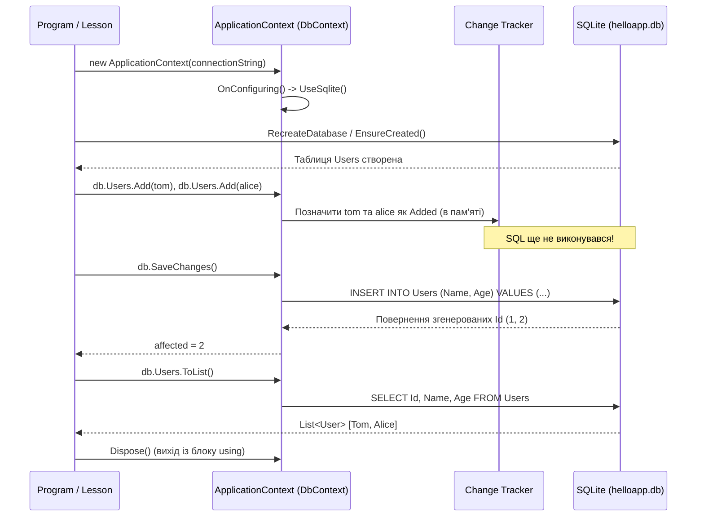

# 1.2. Перший застосунок на EF Core

- **Глава:** 01. Вступ до Entity Framework Core
- **Джерело Metanit:** [https://metanit.com/sharp/efcore/1.2.php](https://metanit.com/sharp/efcore/1.2.php)
- **Код прикладу:** [`Lesson_1_2_FirstApp.cs`](../../src/01_Introduction/Lesson_1_2_FirstApp.cs)

## Мета уроку

Створити перший повноцінний застосунок на Entity Framework Core з нуля: підключити провайдер SQLite, описати клас моделі (сутність), реалізувати контекст даних `DbContext`, налаштувати підключення через `OnConfiguring`, зберегти нові об'єкти в базу даних та зчитати їх назад за допомогою LINQ.

## Детальний теоретичний матеріал

### Покроковий алгоритм створення першого проєкту

Для старту роботи з EF Core у новому консольному проєкті достатньо виконати три базові кроки:

1. **Створення проєкту та встановлення пакета провайдера БД:**
   У .NET CLI проєкт створюється командою `dotnet new console -o helloapp`, після чого додається пакет конкретної СУБД (у нашому випадку SQLite):
   ```bash
   dotnet add package Microsoft.EntityFrameworkCore.Sqlite
   ```
   Опціонально для роботи з міграціями з командного рядка встановлюється глобальний інструмент `dotnet-ef`:
   ```bash
   dotnet tool install --global dotnet-ef
   ```
   У файлі проєкту (`.csproj`) з'являється запис `<PackageReference Include="Microsoft.EntityFrameworkCore.Sqlite" Version="..." />`.

2. **Опис класу моделі (Entity):**
   Модель — це звичайний клас C#, кожна властивість якого зіставляється зі стовпцем таблиці в базі даних.
   ```csharp
   public class User
   {
       public int Id { get; set; }
       public string? Name { get; set; }
       public int Age { get; set; }
   }
   ```
   **Конвенція первинного ключа:** EF Core вимагає, щоб сутність мала первинний ключ. За замовчуванням він шукає властивість з іменем `Id` або `<Ім'яКласу>Id` (наприклад, `UserId`). Якщо тип ключа числовий (`int`, `long`), СУБД автоматично налаштовує автоінкремент при вставці нового запису.

3. **Створення контексту даних (`DbContext`):**
   Взаємодія з базою даних відбувається через клас, успадкований від `Microsoft.EntityFrameworkCore.DbContext`.

### Основні класи простору імен `Microsoft.EntityFrameworkCore`

| Клас | Роль та призначення |
| --- | --- |
| `DbContext` | Головний клас-посередник між кодом та БД. Керує підключенням, відстеженням змін (*Change Tracker*), кешуванням сутностей першого рівня та виконанням транзакцій. Реалізує `IDisposable` та `IAsyncDisposable`. |
| `DbSet<TEntity>` | Представляє колекцію всіх сутностей певного типу в контексті (відповідає таблиці в БД). Через `DbSet<T>` будуються LINQ-запити та викликаються методи `Add`, `Update`, `Remove`. |
| `DbContextOptionsBuilder` | Будівельник конфігурації контексту. У методі `OnConfiguring` дозволяє вибрати провайдер (`UseSqlite`, `UseSqlServer` тощо), передати рядок підключення, увімкнути логування та інші опції. |

### Проблема Nullable Reference Types (`CS8618`) для `DbSet<T>`

У сучасних проєктах .NET за замовчуванням увімкнено `<Nullable>enable</Nullable>`. Якщо оголосити властивість як `public DbSet<User> Users { get; set; }`, компілятор видасть попередження `CS8618` (*Non-nullable property 'Users' must contain a non-null value when exiting constructor*), адже `DbContext` ініціалізує властивості `DbSet` автоматично через рефлексію всередині базового конструктора.

Metanit наводить два способи елегантного вирішення цієї проблеми:
1. **Через вираз-властивість `Set<T>()` (рекомендовано):**
   ```csharp
   public DbSet<User> Users => Set<User>();
   ```
   У цьому випадку немає сеттера, а метод `DbContext.Set<T>()` завжди повертає валідний екземпляр `DbSet<User>`.
2. **Через null-forgiving оператор `null!`:**
   ```csharp
   public DbSet<User> Users { get; set; } = null!;
   ```
   Функціонально обидва варіанти ідентичні, але перший не використовує придушення попереджень `null!`.

### Налаштування підключення та `Database.EnsureCreated()`

У методі `OnConfiguring` налаштовується рядок підключення:
```csharp
protected override void OnConfiguring(DbContextOptionsBuilder optionsBuilder)
{
    optionsBuilder.UseSqlite("Data Source=helloapp.db");
}
```
Параметр `Data Source=helloapp.db` вказує ім'я (або шлях) локального файлу SQLite.

У найпростіших застосунках (наприклад, на старті навчання) у конструкторі контексту часто викликають:
```csharp
public ApplicationContext() => Database.EnsureCreated();
```
Метод `EnsureCreated()` перевіряє, чи існує база даних. Якщо її немає — створює файл БД та всі таблиці згідно з моделлю. Якщо база даних вже існує — не робить нічого.

## Діаграма / Архітектура процесу

Життєвий цикл роботи першого застосунку з `ApplicationContext`:



## Покроковий розбір прикладів коду

Розглянемо реалізацію в [`Lesson_1_2_FirstApp.cs`](../../src/01_Introduction/Lesson_1_2_FirstApp.cs):

### Крок 1. Оголошення моделі `User` та контексту `ApplicationContext`
Модель `User` має поля `Id` (ключ), `Name` (nullable `string?`) та `Age` (`int`). Контекст `ApplicationContext` отримує `connectionString` у конструкторі, щоб навчальний проєкт міг ізольовано зберігати файл БД у папці `Databases/lesson_1_2.db`.

### Крок 2. Керування ресурсами через `using`
```csharp
using (var db = new L1_2.ApplicationContext(connectionString))
{
    SqliteDbHelper.RecreateDatabase(db);
    ...
}
```
Оскільки `DbContext` тримає некеровані ресурси (з'єднання з БД), блок `using` гарантує виклик `Dispose()` навіть у разі винятку. `RecreateDatabase(db)` видаляє стару БД і викликає `EnsureCreated()`, щоб кожен запуск уроку починався з чистого стану.

### Крок 3. Додавання об'єктів та збереження змін
```csharp
var tom = new L1_2.User { Name = "Tom", Age = 33 };
var alice = new L1_2.User { Name = "Alice", Age = 26 };

db.Users.Add(tom);
db.Users.Add(alice);

int affected = db.SaveChanges();
```
- Виклик `db.Users.Add(...)` **не робить запиту до БД** — він лише переводить об'єкт у стан `EntityState.Added` всередині `ChangeTracker`.
- Лише `db.SaveChanges()` формує транзакцію, генерує команди `INSERT` і повертає кількість змінених рядків (`affected == 2`).
- Після `SaveChanges()` властивості `tom.Id` та `alice.Id` автоматично оновлюються значеннями `1` та `2`.

SQL, який генерує SQLite-провайдер під час `SaveChanges()`:
```sql
INSERT INTO "Users" ("Age", "Name")
VALUES (@p0, @p1)
RETURNING "Id";
```

### Крок 4. Вибірка об'єктів із бази даних
```csharp
var users = db.Users.ToList();
```
Метод `ToList()` матеріалізує запит `DbSet<User>`, виконуючи:
```sql
SELECT "u"."Id", "u"."Age", "u"."Name"
FROM "Users" AS "u"
```
І виводить на консоль:
```text
1. Tom - 33
2. Alice - 26
```

## Особливості роботи в SQLite

- **Відносний шлях у `Data Source`:** Якщо вказати `UseSqlite("Data Source=helloapp.db")`, файл БД створюється у поточній робочій директорії процесу (для консольного застосунку це зазвичай `bin/Debug/net10.0/` або папка проєкту при `dotnet run`).
- **Автономність:** На відміну від MS SQL Server, де потрібна запущена служба (LocalDB, SQL Server Express або Docker-контейнер) і попереднє налаштування прав доступу, SQLite створює файл автоматично при першому відкритті з'єднання.
- **Символ `RETURNING`:** Сучасний SQLite (версії 3.35+) разом із EF Core використовує синтаксис `INSERT ... RETURNING "Id"` для ефективного отримання автоінкрементного ключа за один мережевий/файловий виклик (аналог `OUTPUT INSERTED.Id` у MS SQL Server).

## Типові помилки, підводні камені та Best Practices

1. **Забутий виклик `SaveChanges()`:** Новачки часто викликають `db.Users.Add(tom)`, але забувають `db.SaveChanges()`. У результаті дані залишаються лише в пам'яті й зникають після завершення програми.
2. **Використання `EnsureCreated()` разом із міграціями:** Якщо ви викликаєте `Database.EnsureCreated()` у конструкторі контексту, EF Core створює таблиці напряму без таблиці історії міграцій (`__EFMigrationsHistory`). Надалі команда `dotnet ef database update` завершиться помилкою, що таблиці вже існують. Використовуйте `EnsureCreated()` лише для швидких прототипів або тестів.
3. **Занадто довгий час життя `DbContext`:** Не створюйте один глобальний екземпляр `DbContext` на весь час роботи застосунку (особливо у веб-застосунках або багатопотоковому коді). `DbContext` не є потокобезпечним (*not thread-safe*), а його `ChangeTracker` накопичує всі прочитані об'єкти, що призводить до витоку пам'яті. Створюйте короткоживучі екземпляри на одну бізнес-операцію (одиниця роботи — *Unit of Work*).
