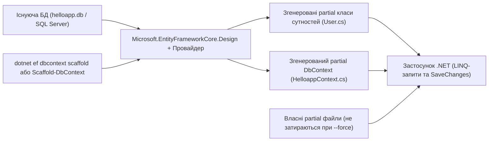

# 1.3. Підключення до існуючої бази даних

- **Глава:** 01. Вступ до Entity Framework Core
- **Джерело Metanit:** [https://metanit.com/sharp/efcore/1.3.php](https://metanit.com/sharp/efcore/1.3.php)
- **Код прикладу:** [`Lesson_1_3_ExistingDatabase.cs`](../../src/01_Introduction/Lesson_1_3_ExistingDatabase.cs)
- **Запуск уроку:** `dotnet run --project src/EFCoreMastery.ConsoleApp -- 1.3`
- **Шпаргалка глави:** [Runs.md](Runs.md)

## Мета уроку

Опанувати підхід **Database First** в Entity Framework Core: навчитися підключатися до заздалегідь створеної бази даних, зрозуміти механізм автоматичного реверс-інжинірингу (**Scaffolding**) за допомогою команд `Scaffold-DbContext` та `dotnet ef dbcontext scaffold`, а також вивчити структуру згенерованих `partial`-класів моделей і контексту.

## Детальний теоретичний матеріал

### Підходи до розробки: Code First vs Database First

У роботі з EF Core існують два основні сценарії проєктування бази даних:
1. **Code First (спочатку код):** розробник описує C#-класи моделей та `DbContext`, а EF Core створює таблиці в БД (через `EnsureCreated()` або міграції).
2. **Database First (спочатку база даних):** база даних уже існує (створена адміністратором БД, іншим сервісом або успадкована від старого проєкту), і завдання розробника — відобразити її структуру на C#-класи.

Коли в існуючій БД лише одна проста таблиця, класи моделей і `DbContext` можна написати вручну. Проте якщо база містить десятки таблиць зі складними зовнішніми ключами, складеними індексами та обмеженнями, ручне написання стає трудомістким і схильним до помилок. Для автоматизації цього процесу в EF Core існує **Reverse Engineering (Scaffolding)**.

### Необхідні пакети для Scaffolding

Щоб виконати реверс-інжиніринг існуючої БД SQLite, у проєкті мають бути встановлені два NuGet-пакети:
- `Microsoft.EntityFrameworkCore.Sqlite` — провайдер для роботи з SQLite під час виконання.
- `Microsoft.EntityFrameworkCore.Design` — інструментарій часу розробки (Design-time), необхідний для аналізу схеми БД та генерації C#-файлів (або `Microsoft.EntityFrameworkCore.Tools` для роботи в Package Manager Console Visual Studio).

```bash
dotnet add package Microsoft.EntityFrameworkCore.Sqlite
dotnet add package Microsoft.EntityFrameworkCore.Design
```

Для роботи через .NET CLI також має бути встановлений глобальний інструмент `dotnet-ef`:
```bash
dotnet tool install --global dotnet-ef
```

### Команди реверс-інжинірингу (Scaffolding)

Синтаксис команди залежить від обраного інструментарію:

| Середовище | Команда |
| --- | --- |
| **Visual Studio (Package Manager Console)** | `Scaffold-DbContext "Data Source=D:\helloapp.db" Microsoft.EntityFrameworkCore.Sqlite` |
| **.NET CLI (`dotnet-ef`)** | `dotnet ef dbcontext scaffold "Data Source=D:\helloapp.db" Microsoft.EntityFrameworkCore.Sqlite` |

Корисні додаткові параметри `dotnet ef dbcontext scaffold`:
- `-o Models` / `--output-dir Models` — зберегти згенеровані класи сутностей у папку `Models`.
- `--context-dir Data` — помістити клас контексту в окрему папку `Data`.
- `-c MyDbContext` / `--context MyDbContext` — задати власне ім'я класу контексту (за замовчуванням формується з імені БД + суфікс `Context`, наприклад `HelloappContext`).
- `-t Users -t Orders` / `--table ...` — згенерувати моделі лише для вибраних таблиць.
- `-f` / `--force` — перезаписати вже існуючі файли при повторному скафолдингу.
- `--data-annotations` — використовувати атрибути (`[Key]`, `[Required]`, `[MaxLength]`) замість або разом із Fluent API.

### Анатомія згенерованого коду

Після виконання команди скафолдер аналізує системні таблиці БД і створює:

1. **`partial class` для кожної таблиці:**
   ```csharp
   public partial class User
   {
       public long Id { get; set; }
       public string? Name { get; set; }
       public long Age { get; set; }
   }
   ```
   Модифікатор `partial` дозволяє розширювати сутність власними обчислюваними властивостями або методами в іншому файлі (наприклад, `User.Custom.cs`), щоб при повторному запуску скафолдингу ваші доповнення не затерлися.

2. **`partial class <DbName>Context : DbContext`:**
   - Містить два конструктори: без параметрів і з `DbContextOptions<TContext>` (для DI).
   - Оголошує `public virtual DbSet<User> Users { get; set; }`.
   - Перевизначає `OnConfiguring` із переданим рядком підключення.
   - Перевизначає `OnModelCreating(ModelBuilder modelBuilder)`, де за допомогою **Fluent API** описуються всі індекси, обмеження, значення за замовчуванням та зовнішні ключі, знайдені в БД, а в кінці викликається `OnModelCreatingPartial(modelBuilder)`.

## Діаграма / Архітектура процесу

Процес підключення до існуючої бази даних (Database First + Scaffolding):



## Покроковий розбір прикладів коду

У файлі [`Lesson_1_3_ExistingDatabase.cs`](../../src/01_Introduction/Lesson_1_3_ExistingDatabase.cs) ми моделюємо реальний сценарій **Database First** без зовнішніх файлів:

### Крок 1. Створення «зовнішньої» БД засобами чистого ADO.NET
```csharp
using (var rawConnection = new SqliteConnection(connectionString))
{
    rawConnection.Open();
    using var createCmd = rawConnection.CreateCommand();
    createCmd.CommandText = """
        CREATE TABLE Users (
            Id INTEGER PRIMARY KEY AUTOINCREMENT,
            Name TEXT NULL,
            Age INTEGER NOT NULL
        );
        INSERT INTO Users (Name, Age) VALUES ('Tom', 33);
        INSERT INTO Users (Name, Age) VALUES ('Alice', 26);
        """;
    createCmd.ExecuteNonQuery();
}
```
Тут EF Core ще взагалі не бере участі. Файл `lesson_1_3_existing.db` створюється та наповнюється сирим SQL через `Microsoft.Data.Sqlite` — так, ніби його створила інша система чи DBA.

### Крок 2. Опис моделі та контексту, що відповідають існуючій таблиці
Класи `L1_3.User` та `L1_3.ExistingDbContext` відтворюють структуру, яку генерує `Scaffold-DbContext` для SQLite:
- Властивості `Id` та `Age` мають тип `long` (оскільки `INTEGER` у SQLite є 64-бітним цілим числом).
- Класи позначені як `partial`, а в `OnModelCreating` передбачено виклик `OnModelCreatingPartial(modelBuilder)`.
- **Критично важливо:** у конструкторі `ExistingDbContext` **не викликається** `Database.EnsureCreated()`, оскільки база даних та таблиці вже існують!

### Крок 3. Читання існуючих даних та додавання нових через EF Core
```csharp
using (var db = new L1_3.ExistingDbContext(connectionString))
{
    var existingUsers = db.Users.ToList();
    ...
    db.Users.Add(new L1_3.User { Name = "Bob", Age = 29 });
    db.SaveChanges();
}
```
EF Core успішно підключається до існуючої таблиці `Users`, зчитує раніше вставлені записи `Tom` і `Alice` (SQL `SELECT "u"."Id", "u"."Age", "u"."Name" FROM "Users" AS "u"`), а потім додає новий запис `Bob` (`INSERT INTO "Users" ("Age", "Name") VALUES (@p0, @p1) RETURNING "Id"`), автоматично продовжуючи автоінкремент (`Id = 3`).

## Особливості роботи в SQLite

| Аспект | SQLite | MS SQL Server |
| --- | --- | --- |
| **Мапінг цілих чисел при скафолдингу** | Стовпець `INTEGER` може зберігати до 8 байтів (64 біти), тому `Scaffold-DbContext` генерує `long` (`Int64`). | Стовпець `INT` генерує `int` (`Int32`), а `BIGINT` — `long` (`Int64`). |
| **Схеми таблиць (`dbo`)** | SQLite не підтримує схеми (Schemas), усі таблиці знаходяться в плоскому просторі імен бази. | Таблиці групуються за схемами (за замовчуванням `dbo.Users`), що відображається в `ToTable("Users", "dbo")`. |
| **Зовнішні ключі та обмеження** | Скафолдер зчитує метадані через `PRAGMA table_info` / `PRAGMA foreign_key_list`. | Зчитує системні представлення `INFORMATION_SCHEMA` та `sys.*`. |

## Типові помилки, підводні камені та Best Practices

1. **Ніколи не викликайте `EnsureCreated()` або `EnsureDeleted()` при роботі з існуючою БД:** У проєкті Database First схема керується ззовні. Випадковий виклик `EnsureDeleted()` знищить продуктивні дані.
2. **Рядок підключення у згенерованому `OnConfiguring`:** Скафолдер вставляє рядок підключення прямо в код і додає директиви `#warning To protect potentially sensitive information in your connection string...`. Обов'язково видаліть захардкоджений рядок підключення та передавайте його через конфігурацію (`IConfiguration`) або DI.
3. **Втрата ручних правок при повторному скафолдингу:** Якщо ви відредагуєте згенеровані файли напряму, а потім запустите `dotnet ef dbcontext scaffold ... --force`, ваші зміни зникнуть. Використовуйте механізм `partial`-класів і `partial void OnModelCreatingPartial(...)` в окремих файлах.
4. **Невідповідність типів даних:** Якщо ви пишете модель вручну для існуючої БД SQLite, пам'ятайте про сумісність типів (наприклад, `INTEGER` у SQLite безпечно читається і в `int`, і в `long`, але якщо значення перевищить `int.MaxValue`, читання в `int` спричинить переповнення).

---
<!-- lesson-nav -->
← [1.2. Перший застосунок на EF Core](1_2_FirstApp.md) | [Шпаргалка глави (Runs.md)](Runs.md) | [Зміст курсу (README)](../../README.md) | [2.16. Управління базою даних](2_16_DatabaseManagement.md) →
