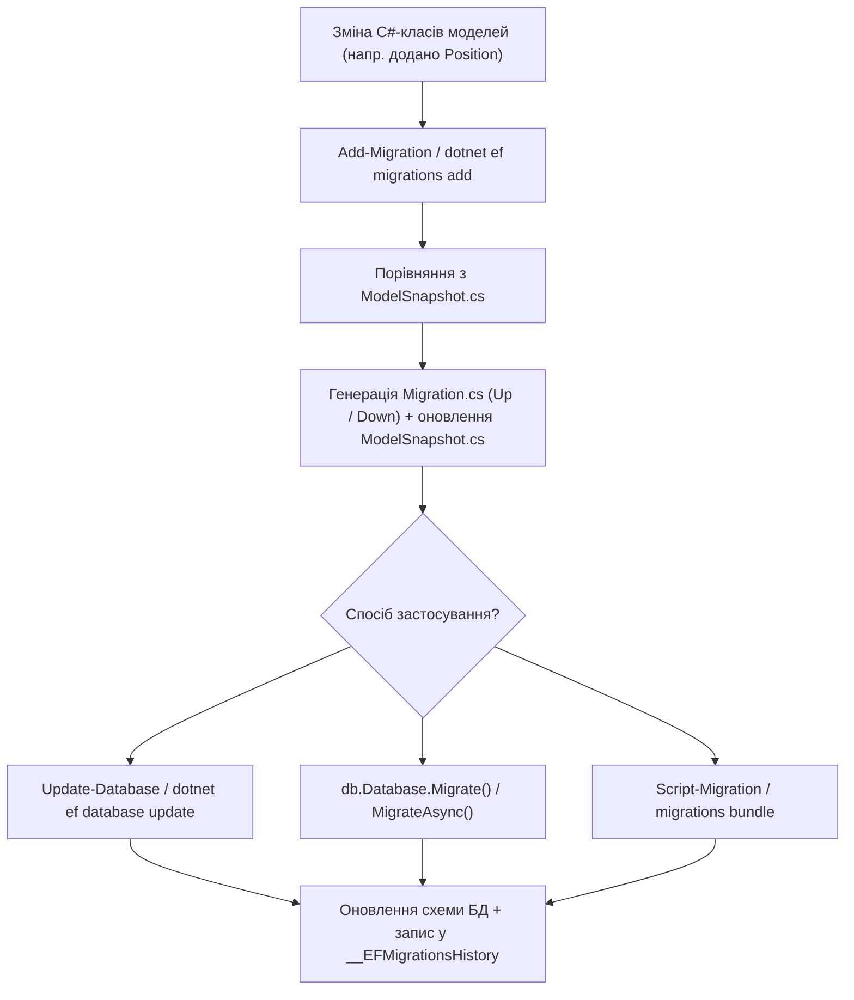

# 2.2. Управління схемою БД та міграції

- **Глава:** 01. Вступ до Entity Framework Core
- **Джерело Metanit:** [https://metanit.com/sharp/efcore/2.2.php](https://metanit.com/sharp/efcore/2.2.php)
- **Код прикладу:** [`Lesson_2_2_Migrations.cs`](../../src/01_Introduction/Lesson_2_2_Migrations.cs)

## Мета уроку

Зрозуміти, чому при еволюції моделей даних виникає розсинхронізація зі схемою БД, вивчити три підходи до її усунення, детально розібрати механізм **міграцій (Migrations)** в EF Core, команди CLI та Package Manager Console, роль `ModelSnapshot` і таблиці `__EFMigrationsHistory`, роботу з `IDesignTimeDbContextFactory`, бандли міграцій та програмну інспекцію через `DatabaseFacade`.

## Детальний теоретичний матеріал

### Проблема еволюції моделі даних

Припустимо, початково модель `User` мала властивості `Id`, `Name`, `Age`, і на її основі було створено таблицю `Users` у базі даних. Згодом у клас `User` додається нова властивість `Position` (або `IsMarried`). Якщо спробувати виконати запит до БД без оновлення таблиці, програма впаде з помилкою, оскільки стовпця `Position` у таблиці `Users` не існує.

Існують три способи вирішення цієї проблеми:
1. **Ручне редагування БД (SQL-скрипти або GUI-інструменти, наприклад DB Browser for SQLite):**
   - *Плюси:* повний контроль, збереження існуючих даних.
   - *Мінуси:* високий ризик людської помилки (одруківки, невідповідність типів SQL ↔ C#), трудомісткість при великій кількості змін.
2. **`Database.EnsureDeleted()` + `Database.EnsureCreated()`:**
   - *Плюси:* миттєво створює нову схему.
   - *Мінуси:* **повністю знищує всі дані** в базі даних. Неприйнятно для продакшену.
3. **Міграції (Migrations):**
   - *Плюси:* автоматично обчислюють різницю між старою та новою моделлю, формують контрольований план переходу (C#-код), **зберігають існуючі дані** та підтримують відкат змін.

### Інструментарій та основні команди міграцій

Для роботи з міграціями необхідні:
- У Visual Studio (Package Manager Console): пакет `Microsoft.EntityFrameworkCore.Tools`.
- У .NET CLI (`dotnet ef`): пакет `Microsoft.EntityFrameworkCore.Design` у проєкті та глобальний інструмент `dotnet tool install --global dotnet-ef`.

| Операція | Visual Studio (PMC) | .NET CLI (`dotnet ef`) |
| --- | --- | --- |
| Створити нову міграцію | `Add-Migration <Name>` | `dotnet ef migrations add <Name>` |
| Застосувати міграції до БД | `Update-Database` | `dotnet ef database update` |
| Відкотити до конкретної міграції | `Update-Database <TargetMigration>` | `dotnet ef database update <TargetMigration>` |
| Видалити останню незастосовану міграцію | `Remove-Migration` | `dotnet ef migrations remove` |
| Згенерувати SQL-скрипт міграцій | `Script-Migration` | `dotnet ef migrations script` |
| Створити виконуваний бандл міграцій | `Bundle-Migration` | `dotnet ef migrations bundle` |

### Анатомія папки `Migrations` та таблиця `__EFMigrationsHistory`

Після першої команди `Add-Migration InitialCreate` у проєкті з'являється папка `Migrations` із двома типами файлів:
1. **`XXXXXXXXXXXXXX_InitialCreate.cs`** (де префікс — часова мітка UTC):
   Містить клас міграції з двома методами:
   - `Up(MigrationBuilder migrationBuilder)` — описує перехід до нової схеми (`CreateTable`, `AddColumn`, `CreateIndex` тощо).
   - `Down(MigrationBuilder migrationBuilder)` — описує зворотний перехід для відкату (`DropTable`, `DropColumn`).
2. **`<ContextName>ModelSnapshot.cs`:**
   Зберігає актуальний «знімок» усієї моделі C# у вигляді Fluent API. При створенні наступної міграції EF Core порівнює поточні класи моделей саме з цим знімком (а не з живою БД), щоб визначити, які поля додано, змінено чи видалено.

У самій базі даних при застосуванні міграцій EF Core створює службову таблицю **`__EFMigrationsHistory`** зі стовпцями `MigrationId` та `ProductVersion`. У ній фіксується кожна вже виконана міграція, щоб не застосовувати її повторно.

### Програмне застосування (`Migrate()`) та SQL-скрипти

- **У коді застосунку:** `db.Database.Migrate()` або `await db.Database.MigrateAsync()` автоматично застосовує всі очікуючі міграції під час старту програми (зручно для десктопних/мобільних програм із локальним SQLite, але в багатоінстансних веб-сервісах краще застосовувати міграції окремим кроком CI/CD).
- **SQL-скрипти:** `dotnet ef migrations script` генерує чистий SQL-файл для перевірки адміністратором БД. Для безпечного повторного запуску в продакшені використовують прапорець `--idempotent` (перевіряє `__EFMigrationsHistory` перед кожною міграцією).
- **Бандл міграцій (EF Core 6+):** `dotnet ef migrations bundle` компілює міграції в автономний виконуваний файл (`efbundle.exe` / `efbundle`), який можна запускати на сервері без встановленого .NET SDK чи вихідного коду.

### `IDesignTimeDbContextFactory<TContext>`

Якщо єдиний конструктор вашого `DbContext` приймає `DbContextOptions<TContext>` (а конфігурація, наприклад, зчитується з `appsettings.json` у `Program.cs`), інструменти `dotnet ef` під час розробки не зможуть створити контекст і видадуть помилку:
> *Unable to create an object of type 'ApplicationContext'.*

Для вирішення цієї проблеми в проєкт додають фабрику часу розробки:
```csharp
public class SampleContextFactory : IDesignTimeDbContextFactory<ApplicationContext>
{
    public ApplicationContext CreateDbContext(string[] args)
    {
        var config = new ConfigurationBuilder()
            .SetBasePath(Directory.GetCurrentDirectory())
            .AddJsonFile("appsettings.json")
            .Build();

        var optionsBuilder = new DbContextOptionsBuilder<ApplicationContext>();
        optionsBuilder.UseSqlite(config.GetConnectionString("DefaultConnection"));

        return new ApplicationContext(optionsBuilder.Options);
    }
}
```
Інфраструктура EF Core автоматично знаходить цей клас під час виконання `Add-Migration` чи `Update-Database`.

## Діаграма / Архітектура процесу

Життєвий цикл міграцій у Entity Framework Core:



## Покроковий розбір прикладів коду

Оскільки в одному навчальному проєкті `EFCoreMastery.Ch01.Introduction` міститься багато окремих контекстів для різних уроків, у файлі [`Lesson_2_2_Migrations.cs`](../../src/01_Introduction/Lesson_2_2_Migrations.cs) продемонстровано програмний API інспекції міграцій та генерації DDL-скрипта через `DatabaseFacade`:

### Крок 1. Інспекція стану міграцій
```csharp
var allMigrations = db.Database.GetMigrations().ToList();
var appliedMigrations = db.Database.GetAppliedMigrations().ToList();
var pendingMigrations = db.Database.GetPendingMigrations().ToList();
```
- `GetMigrations()` повертає список усіх класів міграцій, знайдених у збірці для поточного контексту.
- `GetAppliedMigrations()` робить запит до таблиці `__EFMigrationsHistory` у БД і повертає вже застосовані міграції.
- `GetPendingMigrations()` повертає різницю (міграції, які є в коді, але ще не застосовані в БД).

Оскільки в навчальному уроці БД створюється через `SqliteDbHelper.RecreateDatabase(db)` (який використовує `EnsureCreated()`), усі три списки дорівнюють `0`.

### Крок 2. Генерація DDL-скрипта поточної схеми (`GenerateCreateScript`)
```csharp
string createScript = db.Database.GenerateCreateScript();
Console.WriteLine(createScript.Trim());
```
Метод `GenerateCreateScript()` генерує повний SQL-код створення таблиць для поточної моделі `MigrationDemoContext` (із моделлю `User`, що має поле `Position`):
```sql
CREATE TABLE "Users" (
    "Id" INTEGER NOT NULL CONSTRAINT "PK_Users" PRIMARY KEY AUTOINCREMENT,
    "Name" TEXT NULL,
    "Age" INTEGER NOT NULL,
    "Position" TEXT NULL
);
```

### Крок 3. Перевірка роботи з оновленою моделлю
Далі в таблицю додається запис `Tom (33) — Developer`, що підтверджує відповідність стовпця `Position` у SQLite властивості `User.Position`.

## Особливості роботи в SQLite

| Аспект | SQLite | MS SQL Server |
| --- | --- | --- |
| **Обмеження `ALTER TABLE`** | SQLite має обмежену підтримку `ALTER TABLE` (наприклад, зміна типу стовпця або обмежень). | Повноцінна підтримка `ALTER TABLE ... ALTER COLUMN` / `DROP COLUMN`. |
| **Як EF Core обходить обмеження** | Для складних змін стовпців провайдер SQLite автоматично генерує «перебудову таблиці»: створює тимчасову таблицю з новою схемою, копіює туди дані (`INSERT INTO ... SELECT ...`), видаляє стару таблицю і перейменовує тимчасову. | Виконує прямі DDL-команди `ALTER TABLE`. |
| **Початкове створення файлу БД** | При першому `Update-Database` файл `.db` створюється автоматично. Якщо файл уже існує і був створений через `EnsureCreated()`, перша міграція впаде з помилкою. | БД створюється на сервері, якщо її не було; при конфлікті таблиць так само виникне помилка. |

## Типові помилки, підводні камені та Best Practices

1. **Змішування `EnsureCreated()` та міграцій:** Якщо в конструкторі контексту залишити `Database.EnsureCreated()`, то при спробі виконати `Update-Database` або `db.Database.Migrate()` виникне помилка, оскільки таблиці вже існують без таблиці `__EFMigrationsHistory`. Оберіть **один** підхід.
2. **Видалення файлів міграцій вручну з папки `Migrations/`:** Не видаляйте файли `.cs` із папки `Migrations/` просто так — це зламає узгодженість із `ModelSnapshot.cs`. Для видалення останньої ще не застосованої міграції використовуйте `Remove-Migration` / `dotnet ef migrations remove`.
3. **Кілька `DbContext` в одному проєкті:** Якщо у проєкті більше одного класу `DbContext`, завжди вказуйте цільовий контекст у команді:
   ```bash
   dotnet ef migrations add InitialCreate --context ApplicationContext
   ```
4. **Рев'ю згенерованих міграцій перед застосуванням:** Інструмент міграцій може не розпізнати перейменування стовпця і згенерувати `DropColumn` + `AddColumn` (що призведе до втрати даних у цьому стовпці!) замість `RenameColumn`. Завжди переглядайте методи `Up()` та `Down()` перед запуском `Update-Database`.
