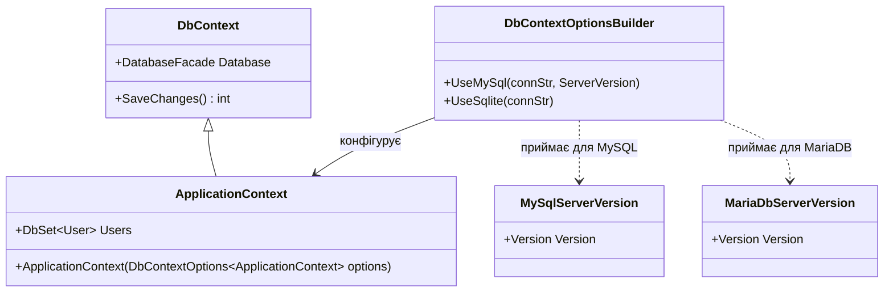
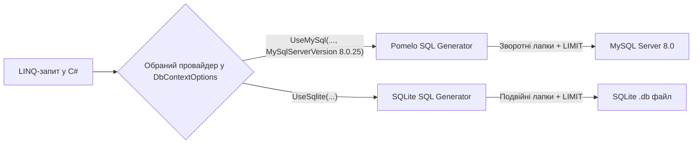

# 2.2. Провайдер MySQL (та адаптація під SQLite)

- **Глава:** 02. Провайдери баз даних
- **Джерело Metanit:** [https://metanit.com/sharp/efcore/7.2.php](https://metanit.com/sharp/efcore/7.2.php)
- **Код прикладу:** [Lesson_2_02_MySqlProvider.cs](../../src/02_DatabaseProviders/Lesson_2_02_MySqlProvider.cs)
- **Запуск уроку:** `dotnet run --project src/EFCoreMastery.ConsoleApp -- 2.2`
- **Шпаргалка глави:** [Runs.md](Runs.md)

---

## Мета уроку

Ознайомитися з підключенням Entity Framework Core до СКБД **MySQL** (та сумісної з нею **MariaDB**), порівняти доступні NuGet-провайдери (`Pomelo.EntityFrameworkCore.MySql` та офіційний `MySql.EntityFrameworkCore` від Oracle), зрозуміти призначення об'єкта `ServerVersion` / `MySqlServerVersion`, розібрати параметри рядка підключення та перевірити роботу контексту й генерацію SQL на прикладі SQLite.

---

## Детальний теоретичний матеріал

### 1. Вибір NuGet-пакета для MySQL

На відміну від MS SQL Server або SQLite, провайдер для MySQL не розробляється командою Microsoft. В екосистемі .NET існують два основні пакети:

| Характеристика | `Pomelo.EntityFrameworkCore.MySql` | `MySql.EntityFrameworkCore` |
| :--- | :--- | :--- |
| **Розробник** | Спільнота (Pomelo Foundation) | Корпорація Oracle (офіційний) |
| **Рекомендація** | **Основний рекомендований вибір** | Використовується рідше |
| **ADO.NET-драйвер** | `MySqlConnector` (високопродуктивний, повністю асинхронний) | `MySql.Data` |
| **Підтримка функцій EF Core** | Повна та оперативна підтримка нових релізів EF Core (включаючи `ExecuteUpdate`/`ExecuteDelete`, JSON, MariaDB) | Історично відстає з релізами та підтримкою окремих LINQ-трансляцій |
| **Сумісність з MariaDB** | Повна (через `MariaDbServerVersion`) | Обмежена |

Встановлення рекомендованого пакета:

```bash
# Через .NET CLI
dotnet add package Pomelo.EntityFrameworkCore.MySql

# Або через Package Manager Console
Install-Package Pomelo.EntityFrameworkCore.MySql
```

### 2. Рядок підключення та обов'язковий параметр `ServerVersion`

У провайдері `Pomelo.EntityFrameworkCore.MySql` метод розширення `UseMySql(...)` приймає **два обов'язкові параметри**:

```csharp
optionsBuilder.UseMySql(
    "server=localhost;user=root;password=123456789;database=usersdb;",
    new MySqlServerVersion(new Version(8, 0, 25)));
```

#### Параметри рядка підключення MySQL

| Параметр | Приклад значення | Призначення |
| :--- | :--- | :--- |
| `server` (`Host`) | `localhost` | Адреса сервера MySQL (може бути IP або ім'я Docker-сервісу). |
| `port` | `3306` | Порт сервера (за замовчуванням `3306`, можна опустити, якщо стандартний). |
| `database` | `usersdb` | Назва бази даних на сервері. |
| `user` (`Uid`) | `root` | Ім'я користувача в СКБД MySQL. |
| `password` (`Pwd`) | `123456789` | Пароль користувача. |
| `CharSet` | `utf8mb4` | Кодування з'єднання (у сучасних версіях Pomelo та MySQL 8+ за замовчуванням `utf8mb4`, необхідне для кирилиці та емодзі). |
| `SslMode` | `Preferred` / `Required` | Режим TLS-шифрування підключення. |

#### Навіщо передавати `ServerVersion`?

Різні версії MySQL (наприклад, 5.7 проти 8.0) та MariaDB (10.x, 11.x) мають різний набір можливостей SQL:
- підтримка `CHECK`-обмежень з'явилася лише у MySQL 8.0.16;
- віконні функції (`ROW_NUMBER() OVER ...`) та CTE (`WITH ...`) — з MySQL 8.0 / MariaDB 10.2;
- `JSON`-оператори та `RETURNING` мають суттєві відмінності між MySQL та MariaDB.

Тому Pomelo вимагає об'єкт `ServerVersion` (наприклад, `new MySqlServerVersion(new Version(8, 0, 25))` або `new MariaDbServerVersion(new Version(10, 11, 0))`), щоб точно знати, який діалект SQL генерувати.

Також існує статичний метод автовизначення:
```csharp
var connectionString = "server=localhost;user=root;password=123456789;database=usersdb;";
optionsBuilder.UseMySql(connectionString, ServerVersion.AutoDetect(connectionString));
```
> **Увага:** `ServerVersion.AutoDetect(...)` відкриває з'єднання до сервера під час конфігурування, щоб запитати його версію. Це зручно для швидкого старту, але ускладнює роботу у середовищах без доступу до БД (наприклад, при генерації міграцій у CI/CD).

### 3. Ініціалізація БД у прикладі Metanit

У прикладі з Metanit 7.2 виклик `Database.EnsureCreated()` розміщений безпосередньо у конструкторі `ApplicationContext()`:

```csharp
public class ApplicationContext : DbContext
{
    public DbSet<User> Users { get; set; } = null!;

    public ApplicationContext()
    {
        Database.EnsureCreated();
    }

    protected override void OnConfiguring(DbContextOptionsBuilder optionsBuilder)
    {
        optionsBuilder.UseMySql(
            "server=localhost;user=root;password=123456789;database=usersdb;",
            new MySqlServerVersion(new Version(8, 0, 25)));
    }
}
```

У реальних проєктах викликати `EnsureCreated()` у конструкторі `DbContext` не рекомендується, оскільки конструктор виконуватиме перевірку схеми при створенні **кожного** екземпляра контексту (наприклад, на кожен HTTP-запит). Краще виконувати ініціалізацію або міграції один раз на старті програми.

---

## Діаграма / Архітектура процесу

### Взаємодія `DbContext` з провайдером MySQL (`Pomelo`) та SQLite



### Потік визначення версії та генерації SQL у Pomelo vs SQLite



---

## Покроковий розбір прикладів коду

Розглянемо реалізацію у [Lesson_2_02_MySqlProvider.cs](../../src/02_DatabaseProviders/Lesson_2_02_MySqlProvider.cs):

1. **Конфігурація зовнішніх `DbContextOptions`:**
   ```csharp
   var connectionString = SqliteDbHelper.GetConnectionString("ch02_lesson_7_2");
   var options = new DbContextOptionsBuilder<ApplicationContext>()
       .UseSqlite(connectionString)
       .Options;
   ```
   Замість `UseMySql(...)` із `MySqlServerVersion`, що потребує запущеного сервера MySQL, урок передає `UseSqlite(connectionString)` у конструктор `ApplicationContext`.

2. **Крок 1 — Перестворення БД та збереження об'єктів:**
   - `SqliteDbHelper.RecreateDatabase(db)` гарантує чистий стан таблиці `"Users"`.
   - Виводиться активний провайдер (`Microsoft.EntityFrameworkCore.Sqlite`) та пояснення еквівалентної конфігурації для `Pomelo.EntityFrameworkCore.MySql`.
   - Створюються два користувачі (`Tom`, `33` та `Alice`, `26`), додаються через `db.Users.AddRange(user1, user2)` і фіксуються у БД викликом `db.SaveChanges()`.

3. **Крок 2 — Вибірка збережених записів:**
   Новий екземпляр `ApplicationContext(options)` виконує `db.Users.ToList()` і виводить:
   ```text
   Список об'єктів:
   1.Tom - 33
   2.Alice - 26
   ```

4. **Крок 3 — Порівняння SQL-діалектів через `ToQueryString()`:**
   ```csharp
   int minAge = 20;
   var query = db.Users
       .Where(u => u.Age >= minAge && u.Name != null)
       .OrderByDescending(u => u.Age)
       .Take(5);

   Console.WriteLine(query.ToQueryString());
   ```

   **Згенерований SQLite SQL:**
   ```sql
   DECLARE @__minAge_0 INT = 20;
   DECLARE @__p_1 INT = 5;

   SELECT "u"."Id", "u"."Age", "u"."Name"
   FROM "Users" AS "u"
   WHERE "u"."Age" >= @__minAge_0 AND "u"."Name" IS NOT NULL
   ORDER BY "u"."Age" DESC
   LIMIT @__p_1
   ```

   **Еквівалентний MySQL SQL (Pomelo):**
   ```sql
   SET @__minAge_0 = 20;
   SET @__p_1 = 5;

   SELECT `u`.`Id`, `u`.`Age`, `u`.`Name`
   FROM `Users` AS `u`
   WHERE (`u`.`Age` >= @__minAge_0) AND (`u`.`Name` IS NOT NULL)
   ORDER BY `u`.`Age` DESC
   LIMIT @__p_1;
   ```
   Зверніть увагу на заміну подвійних лапок `"..."` на зворотні лапки `` `...` `` (backticks), які є стандартом для MySQL.

---

## Особливості роботи в SQLite та порівняння з MySQL

| Аспект | MySQL (`Pomelo.EntityFrameworkCore.MySql`) | SQLite (`Microsoft.EntityFrameworkCore.Sqlite`) |
| :--- | :--- | :--- |
| **Екранування ідентифікаторів** | Зворотні лапки: `` `Users`.`Name` `` | Подвійні лапки: `"Users"."Name"` |
| **Автоінкремент PK** | `INT NOT NULL AUTO_INCREMENT` | `INTEGER NOT NULL CONSTRAINT ... AUTOINCREMENT` |
| **Версія сервера** | Обов'язковий `MySqlServerVersion` / `MariaDbServerVersion` | Не вимагається (рушій вбудований у пакет) |
| **Порівняння рядків (Collation)** | За замовчуванням **нечутливе до регістру** (`utf8mb4_0900_ai_ci`): `"tom" == "Tom"` | За замовчуванням **чутливе до регістру** (`BINARY`) для `=`, але `LIKE` нечутливий для ASCII |
| **Тип `string` без довжини** | `longtext` (якщо не задано `MaxLength` або не є ключем/індексом) | `TEXT` |
| **Булеві значення (`bool`)** | `TINYINT(1)` | `INTEGER` (`0` або `1`) |
| **Конкурентність** | Повноцінний багатопотоковий сервер (InnoDB row-level locking) | Одночасний запис блокує файл БД |

---

## Типові помилки, підводні камені та Best Practices

1. **Невідповідність версій `Pomelo.EntityFrameworkCore.MySql` та `EF Core`:**
   Pomelo випускає окремі гілки під кожну мажорну версію EF Core (8.0.x для EF Core 8, 9.0.x для EF Core 9). Спроба встановити пакет іншої мажорної версії призведе до конфлікту залежностей NuGet або помилки `MissingMethodException` під час виконання.

2. **Проблеми з `ServerVersion.AutoDetect` при роботі з `dotnet ef`:**
   Якщо ви використовуєте `ServerVersion.AutoDetect(connStr)` у `Program.cs` або `OnConfiguring`, команда `dotnet ef migrations add` може впасти, якщо сервер MySQL у цей момент вимкнений.
   - **Best Practice:** явно вказуйте версію `new MySqlServerVersion(new Version(8, 0, 36))` або читайте її з конфігурації.

3. **Довжина індексованих рядкових колонок у MySQL:**
   У MySQL (InnoDB) існує обмеження на максимальний розмір індексу (зазвичай 3072 байти, що при `utf8mb4` становить ~768 символів). Якщо ви робите `string` первинним ключем або індексом без `[MaxLength(255)]`, MySQL може видати помилку `Specified key was too long`.

4. **Нечутливість до регістру в MySQL vs SQLite:**
   Запити на кшталт `.Where(u => u.Name == "tom")` у MySQL за замовчуванням знайдуть `"Tom"`, а в SQLite — ні. Якщо потрібна однакова поведінка незалежно від провайдера, використовуйте явне порівняння або нормалізацію даних.

---
<!-- lesson-nav -->
← [2.1. Провайдер MS SQL Server (та адаптація під SQLite)](2_01_SqlServerProvider.md) | [Шпаргалка глави (Runs.md)](Runs.md) | [Зміст курсу (README)](../../README.md) | [2.3. Провайдер PostgreSQL (та адаптація під SQLite)](2_03_PostgreSqlProvider.md) →
