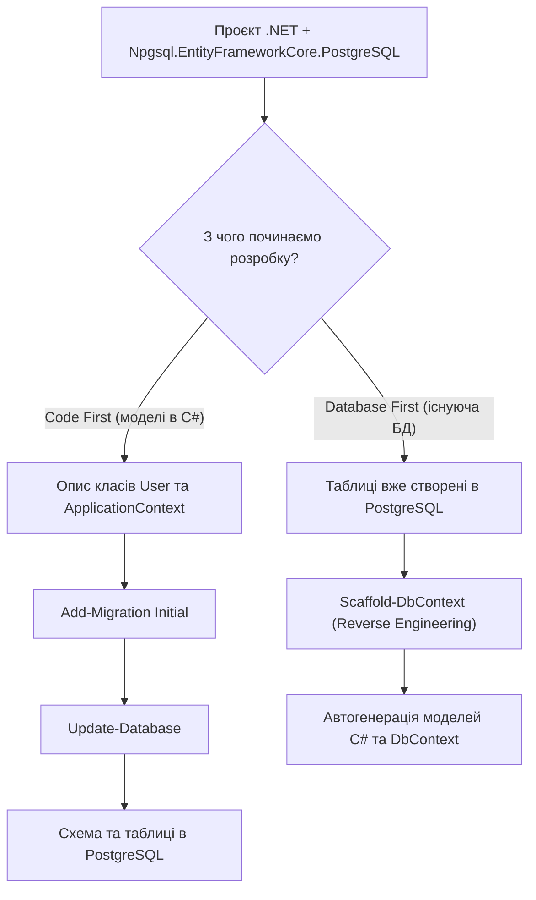
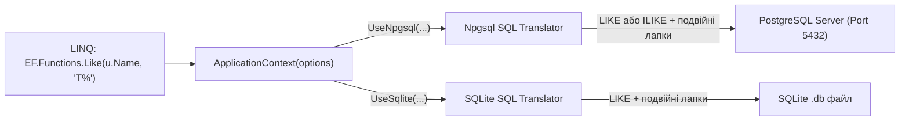

# 2.3. Провайдер PostgreSQL (та адаптація під SQLite)

- **Глава:** 02. Провайдери баз даних
- **Джерело Metanit:** [https://metanit.com/sharp/efcore/7.3.php](https://metanit.com/sharp/efcore/7.3.php)
- **Код прикладу:** [Lesson_2_03_PostgreSqlProvider.cs](../../src/02_DatabaseProviders/Lesson_2_03_PostgreSqlProvider.cs)
- **Запуск уроку:** `dotnet run --project src/EFCoreMastery.ConsoleApp -- 2.3`
- **Шпаргалка глави:** [Runs.md](Runs.md)

---

## Мета уроку

Навчитися підключати Entity Framework Core до **PostgreSQL** за допомогою провайдера `Npgsql.EntityFrameworkCore.PostgreSQL`, розібрати структуру рядка підключення, опанувати два ключові сценарії роботи зі схемою БД з Metanit — **Code First (міграції)** та **Database First (`Scaffold-DbContext`)**, а також порівняти діалект PostgreSQL із SQLite на реальному прикладі.

---

## Детальний теоретичний матеріал

### 1. Встановлення провайдера Npgsql

Для роботи з PostgreSQL у .NET використовується офіційний високопродуктивний open-source провайдер **Npgsql**:

```bash
# Через .NET CLI
dotnet add package Npgsql.EntityFrameworkCore.PostgreSQL

# Або через Package Manager Console
Install-Package Npgsql.EntityFrameworkCore.PostgreSQL
```

Провайдер базується на низькорівневому драйвері `Npgsql`, який безпосередньо реалізує бінарний протокол PostgreSQL, забезпечуючи високу швидкість роботи та підтримку специфічних типів PostgreSQL (масиви, `jsonb`, `uuid`, діапазони тощо).

### 2. Рядок підключення (Connection String)

У методі розширення `UseNpgsql(...)` передається рядок підключення такого вигляду:

```text
Host=localhost;Port=5432;Database=usersdb;Username=postgres;Password=пароль_от_postgres
```

| Параметр | Приклад значення | Детальне призначення |
| :--- | :--- | :--- |
| `Host` (`Server`) | `localhost` | Хост або IP-адреса сервера PostgreSQL. |
| `Port` | `5432` | TCP-порт сервера (стандартний порт PostgreSQL — `5432`). |
| `Database` | `usersdb` | Назва бази даних на сервері PostgreSQL. |
| `Username` (`User ID`) | `postgres` | Ім'я ролі/користувача (стандартний суперкористувач — `postgres`). |
| `Password` | `123456789` | Пароль користувача. |
| `Include Error Detail` | `true` | *(Опціонально для розробки)* Додає детальні повідомлення від сервера PostgreSQL у винятки `PostgresException`. |
| `SSL Mode` | `Require` / `Disable` | Керує TLS-шифруванням (для хмарних БД на кшталт Azure/AWS/Supabase зазвичай потрібен `Require`). |

### 3. Конфігурація контексту (Metanit vs Зовнішні `DbContextOptions`)

У прикладі з Metanit контекст налаштовується через `OnConfiguring`:

```csharp
using Microsoft.EntityFrameworkCore;

public class ApplicationContext : DbContext
{
    public DbSet<User> Users { get; set; } = null!;

    public ApplicationContext()
    {
        Database.EnsureCreated();
    }

    protected override void OnConfiguring(DbContextOptionsBuilder optionsBuilder)
    {
        optionsBuilder.UseNpgsql(
            "Host=localhost;Port=5432;Database=usersdb;Username=postgres;Password=123456789");
    }
}
```

У цьому навчальному репозиторії `ApplicationContext` приймає `DbContextOptions<ApplicationContext>` через конструктор, що дозволяє легко замінити `UseNpgsql(...)` на `UseSqlite(...)` без зміни жодного рядка в моделях чи запитах.

### 4. Міграції та підключення до існуючої БД (Reverse Engineering)

У параграфі 7.3 на Metanit окремо розглядаються два робочі процеси керування схемою PostgreSQL. Для обох сценаріїв потрібен пакет інструментів **`Microsoft.EntityFrameworkCore.Tools`** (для Package Manager Console у Visual Studio) або глобальна утиліта **`dotnet-ef`** (для CLI):

```bash
dotnet add package Microsoft.EntityFrameworkCore.Tools
```

#### Сценарій А: Міграції (Code First)

Коли ви прибираєте `Database.EnsureCreated()` і хочете керувати змінами схеми через міграції:

| Дія | Package Manager Console (Visual Studio) | .NET CLI (термінал) |
| :--- | :--- | :--- |
| Створити початкову міграцію | `Add-Migration Initial` | `dotnet ef migrations add Initial` |
| Застосувати міграцію до БД | `Update-Database` | `dotnet ef database update` |

#### Сценарій Б: Підключення до існуючої БД (Database First / Scaffolding)

Якщо база даних PostgreSQL уже існує на сервері, EF Core може автоматично згенерувати класи моделей і `DbContext`:

```powershell
# Package Manager Console (назву провайдера можна передати одразу або ввести на запит "Provider:")
Scaffold-DbContext "Host=localhost;Port=5432;Database=usersdb;Username=postgres;Password=123456789" Npgsql.EntityFrameworkCore.PostgreSQL

# Або через .NET CLI
dotnet ef dbcontext scaffold "Host=localhost;Port=5432;Database=usersdb;Username=postgres;Password=123456789" Npgsql.EntityFrameworkCore.PostgreSQL -o Models
```

---

## Діаграма / Архітектура процесу

### Два підходи до роботи зі схемою БД у PostgreSQL (Code First vs Database First)



### Спільна абстракція `DbContext` для PostgreSQL та SQLite



---

## Покроковий розбір прикладів коду

Розглянемо реалізацію у [Lesson_2_03_PostgreSqlProvider.cs](../../src/02_DatabaseProviders/Lesson_2_03_PostgreSqlProvider.cs):

1. **Конфігурація та ініціалізація БД:**
   ```csharp
   var connectionString = SqliteDbHelper.GetConnectionString("ch02_lesson_7_3");
   var options = new DbContextOptionsBuilder<ApplicationContext>()
       .UseSqlite(connectionString)
       .Options;
   ```
   У першому блоці `using` викликається `SqliteDbHelper.RecreateDatabase(db)`, виводиться `db.Database.ProviderName` (`Microsoft.EntityFrameworkCore.Sqlite`), а також додаються тестові користувачі `Tom` (33) та `Alice` (26) за допомогою `AddRange` і `SaveChanges()`.

2. **Читання даних:**
   У другому блоці `using` виконується `db.Users.ToList()` і виводиться список:
   ```text
   Users list:
   1.Tom - 33
   2.Alice - 26
   ```

3. **Генерація SQL для `EF.Functions.Like` та `ToQueryString()`:**
   ```csharp
   var query = db.Users
       .Where(u => u.Name != null && EF.Functions.Like(u.Name, "T%"))
       .OrderBy(u => u.Id);

   Console.WriteLine(query.ToQueryString());
   ```

   **Очікуваний SQL у SQLite (`UseSqlite`):**
   ```sql
   SELECT "u"."Id", "u"."Age", "u"."Name"
   FROM "Users" AS "u"
   WHERE "u"."Name" IS NOT NULL AND "u"."Name" LIKE 'T%'
   ORDER BY "u"."Id"
   ```

   **Еквівалентний SQL у PostgreSQL (`UseNpgsql`):**
   ```sql
   SELECT u."Id", u."Age", u."Name"
   FROM "Users" AS u
   WHERE u."Name" IS NOT NULL AND u."Name" LIKE 'T%'
   ORDER BY u."Id"
   ```
   А якщо в PostgreSQL використати специфічний метод провайдера `EF.Functions.ILike(u.Name, "t%")` для пошуку без урахування регістру, Npgsql згенерує:
   ```sql
   WHERE u."Name" IS NOT NULL AND u."Name" ILIKE 't%'
   ```

---

## Особливості роботи в SQLite та порівняння з PostgreSQL

На перший погляд синтаксис SQL у SQLite та PostgreSQL дуже схожий (обидві СКБД використовують подвійні лапки `"..."` для екранування ідентифікаторів), але поведінка движків має принципові відмінності:

| Аспект | PostgreSQL (`UseNpgsql`) | SQLite (`UseSqlite`) |
| :--- | :--- | :--- |
| **Регістр ідентифікаторів у лапках** | `"Users"` та `"users"` — **різні таблиці** (сувора чутливість до регістру) | Нечутливі до регістру імен таблиць і колонок |
| **Автоінкремент PK** | `integer GENERATED BY DEFAULT AS IDENTITY` (у старих версіях `SERIAL`) | `INTEGER PRIMARY KEY AUTOINCREMENT` |
| **Пошук за шаблоном (`LIKE` / `ILIKE`)** | `LIKE` **чутливий** до регістру; для регістронезалежного пошуку є `ILIKE` (`EF.Functions.ILike`) | `LIKE` **нечутливий** до регістру для ASCII-символів |
| **Типи `DateTime`** | `timestamp with time zone` (`timestamptz`) — у Npgsql 6+ вимагає `DateTimeKind.Utc` | Зберігається як `TEXT` у форматі ISO-8601 без жорсткої перевірки `DateTimeKind` |
| **Специфічні типи** | Масиви (`text[]`, `int[]`), `jsonb`, `uuid`, `inet` | Базові 4 класи зберігання (`TEXT`, `INTEGER`, `REAL`, `BLOB`) |
| **Схеми БД** | Повна підтримка (`public`, власні схеми) | Не підтримуються |

---

## Типові помилки, підводні камені та Best Practices

1. **Помилка `DateTime` з `Kind=Local` або `Unspecified` у Npgsql 6+:**
   Починаючи з версії Npgsql 6.0, запис `DateTime` із `DateTimeKind.Local` чи `Unspecified` у колонку `timestamp with time zone` викликає `InvalidCastException` (`Cannot write DateTime with Kind=Local to PostgreSQL type 'timestamp with time zone'`).
   - **Best Practice:** завжди використовуйте `DateTime.UtcNow` (`DateTimeKind.Utc`) або тип `DateTimeOffset` з нульовим зміщенням.

2. **Проблема регістру імен (`"Users"` vs `users`):**
   У PostgreSQL неекрановані імена автоматично зводяться до нижнього регістру (`users`), а EF Core за замовчуванням генерує імена в PascalCase у подвійних лапках (`"Users"`). Якщо ви пишете сирі SQL-запити вручну без лапок (`SELECT * FROM Users`), PostgreSQL шукатиме таблицю `users` і поверне помилку `relation "users" does not exist`.
   - **Best Practice:** для проєктів на PostgreSQL часто підключають пакет `EFCore.NamingConventions` з опцією `.UseSnakeCaseNamingConvention()`, щоб усі таблиці та колонки в БД мали вигляд `users`, `first_name` тощо.

3. **Змішування `EnsureCreated()` і міграцій:**
   Якщо база даних була створена через `Database.EnsureCreated()`, у ній відсутня таблиця історії міграцій `__EFMigrationsHistory`, тому подальше застосування `Update-Database` завершиться помилкою. Використовуйте або `EnsureCreated()` (для швидких прототипів/тестів), або міграції (для реальної розробки).

---
<!-- lesson-nav -->
← [2.2. Провайдер MySQL (та адаптація під SQLite)](2_02_MySqlProvider.md) | [Шпаргалка глави (Runs.md)](Runs.md) | [Зміст курсу (README)](../../README.md) | [3.1. Моделі, Fluent API та анотації даних](../03_ModelsAndMapping/3_01_ModelsAndFluentApi.md) →
