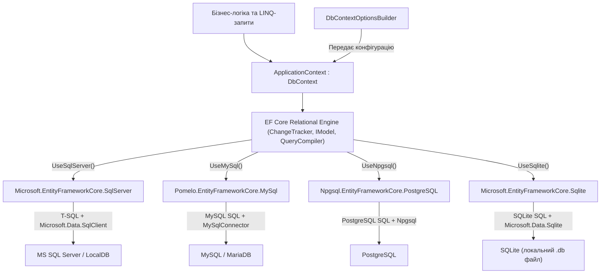
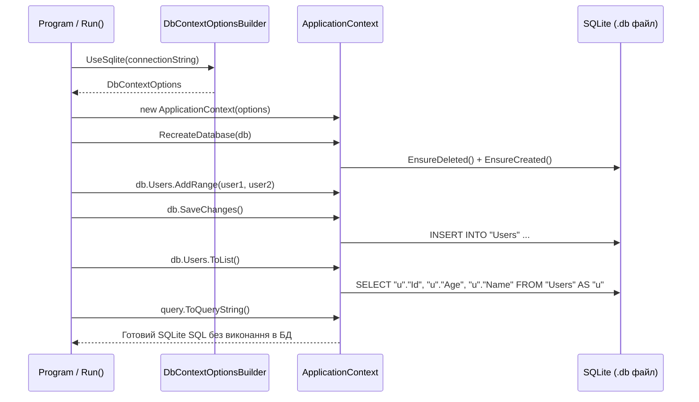

# 7.1. Провайдер MS SQL Server (та адаптація під SQLite)

- **Глава:** 02. Провайдери баз даних
- **Джерело Metanit:** [https://metanit.com/sharp/efcore/7.1.php](https://metanit.com/sharp/efcore/7.1.php)
- **Код прикладу:** [Lesson_7_01_SqlServerProvider.cs](../../src/02_DatabaseProviders/Lesson_7_01_SqlServerProvider.cs)
- **Запуск уроку:** `dotnet run --project src/EFCoreMastery.ConsoleApp -- 7.1`
- **Шпаргалка глави:** [Runs.md](Runs.md)

---

## Мета уроку

Навчитися підключати Entity Framework Core до **MS SQL Server** за допомогою офіційного провайдера `Microsoft.EntityFrameworkCore.SqlServer`, детально розібрати структуру рядка підключення (`Server`, `Database`, `Trusted_Connection`, `TrustServerCertificate`), зрозуміти архітектуру абстрагування провайдерів у `DbContext` та побачити на практиці, як передача зовнішніх `DbContextOptions` дозволяє виконати ідентичний бізнес-код у локальному середовищі на **SQLite** без зміни сутностей і запитів.

---

## Детальний теоретичний матеріал

### 1. Роль провайдера бази даних в архітектурі EF Core

Entity Framework Core спроєктований за принципом **плагін-архітектури (Database Provider Model)**. Ядро `Microsoft.EntityFrameworkCore` містить загальні механізми роботи ORM:
- побудову моделі метаданих (`IModel`);
- відстеження змін об'єктів (`ChangeTracker`);
- базовий конвеєр виконання запитів LINQ;
- інфраструктуру `DbContext` та `DbSet<TEntity>`.

Проте саме **провайдер бази даних** відповідає за взаємодію з конкретною СКБД:
1. **Трансляція LINQ у SQL-діалект**: перетворення дерева виразів (Expression Tree) у валідний **T-SQL** (для MS SQL Server), **MySQL**, **PostgreSQL** або **SQLite**.
2. **Зіставлення типів (Type Mapping)**: перетворення типів .NET (`string`, `int`, `DateTime`, `decimal`, `Guid`) на типи колонок конкретної СКБД (`nvarchar(max)`, `int`, `datetime2`, `decimal(18,2)`, `uniqueidentifier`).
3. **Генерація DDL (міграції та `EnsureCreated`)**: формування команд `CREATE TABLE`, `ALTER TABLE`, обмежень `PRIMARY KEY`, `IDENTITY(1,1)` тощо.
4. **Низькорівневий транспорт (ADO.NET)**: провайдер EF Core використовує відповідний ADO.NET-драйвер (для MS SQL Server це `Microsoft.Data.SqlClient`).

### 2. Встановлення провайдера MS SQL Server

Для роботи з MS SQL Server до проєкту необхідно додати офіційний NuGet-пакет **`Microsoft.EntityFrameworkCore.SqlServer`**:

```bash
# Через .NET CLI
dotnet add package Microsoft.EntityFrameworkCore.SqlServer

# Або через Package Manager Console (Visual Studio)
Install-Package Microsoft.EntityFrameworkCore.SqlServer
```

Цей пакет транзитивно підтягує:
- `Microsoft.EntityFrameworkCore.Relational` — спільну інфраструктуру для всіх реляційних СКБД;
- `Microsoft.Data.SqlClient` — сучасний офіційний ADO.NET-драйвер для SQL Server;
- методи розширення для `DbContextOptionsBuilder`, зокрема `UseSqlServer(...)`.

> **Важливо щодо версіонування:** мажорна версія `Microsoft.EntityFrameworkCore.SqlServer` має збігатися з версією `Microsoft.EntityFrameworkCore` (наприклад, `8.0.x` або `9.0.x`).

### 3. Параметри рядка підключення (Connection String)

У посібнику Metanit використовується рядок підключення до локального рушія **LocalDB**:

```text
Server=(localdb)\mssqllocaldb;Database=helloappdb;Trusted_Connection=True;
```

Нижче наведено розширений довідник основних параметрів рядка підключення для `Microsoft.Data.SqlClient`:

| Параметр (та синоніми) | Приклад значення | Детальне призначення |
| :--- | :--- | :--- |
| `Server` (`Data Source`) | `(localdb)\mssqllocaldb` | Адреса сервера або ім'я екземпляра. `(localdb)\mssqllocaldb` — легковагий рушій розробки (Windows); `.\SQLEXPRESS` — SQL Server Express; `localhost,1433` — локальний або Docker-контейнер. |
| `Database` (`Initial Catalog`) | `helloappdb` | Назва цільової бази даних на сервері. Якщо БД не існує, `EnsureCreated()` або `Update-Database` створять її автоматично. |
| `Trusted_Connection` (`Integrated Security`) | `True` (`SSPI`) | Використовує автентифікацію Windows (поточний обліковий запис ОС) замість логіна й пароля SQL Server. |
| `User ID` / `Password` | `sa` / `StrongPass!1` | Облікові дані SQL-автентифікації (використовуються на Linux/macOS, у Docker та продакшені замість `Trusted_Connection=True`). |
| `TrustServerCertificate` | `True` | Дозволяє довіряти самопідписаному сертифікату сервера. У `Microsoft.Data.SqlClient` 4.0+ шифрування (`Encrypt=True`) увімкнене за замовчуванням, тому локальні підключення без цього параметра часто падають з помилкою SSL. |
| `Encrypt` | `False` / `True` / `Optional` | Керує обов'язковістю TLS-шифрування каналу зв'язку. Для продакшену рекомендується `Encrypt=True` з валідним сертифікатом. |
| `MultipleActiveResultSets` | `True` | Дозволяє тримати кілька активних `DataReader` в одному з'єднанні (MARS), що іноді потрібно при Lazy Loading, але не рекомендується без потреби. |

### 4. Два підходи до конфігурації `DbContext`

#### Підхід А: Внутрішня конфігурація через `OnConfiguring` (як на Metanit)

```csharp
using Microsoft.EntityFrameworkCore;

public class User
{
    public int Id { get; set; }
    public string? Name { get; set; }
    public int Age { get; set; }
}

public class ApplicationContext : DbContext
{
    public DbSet<User> Users { get; set; } = null!;

    protected override void OnConfiguring(DbContextOptionsBuilder optionsBuilder)
    {
        optionsBuilder.UseSqlServer(
            @"Server=(localdb)\mssqllocaldb;Database=helloappdb;Trusted_Connection=True;");
    }
}
```

Цей варіант зручний для простих навчальних скриптів, але жорстко прив'язує `ApplicationContext` до одного провайдера (`UseSqlServer`) і фіксованого рядка підключення.

#### Підхід Б: Зовнішня конфігурація через `DbContextOptions<TContext>` (Best Practice)

```csharp
public class ApplicationContext : DbContext
{
    public DbSet<User> Users { get; set; } = null!;

    public ApplicationContext(DbContextOptions<ApplicationContext> options)
        : base(options)
    {
    }
}
```

Передача `DbContextOptions<ApplicationContext>` через конструктор дозволяє:
- конфігурувати провайдер ззовні (у `Program.cs`, через DI `AddDbContext<ApplicationContext>(...)` або вручну через `DbContextOptionsBuilder<ApplicationContext>`);
- легко перемикати MS SQL Server (продакшен), PostgreSQL/MySQL або SQLite (локальний запуск, CI/CD, інтеграційні тести) без жодної зміни в коді `DbContext` чи моделей.

### 5. Діагностика активного провайдера та SQL-запиту

EF Core надає два важливі інструменти діагностики:
- `db.Database.ProviderName` — повертає рядок із назвою активного провайдера (`Microsoft.EntityFrameworkCore.SqlServer`, `Microsoft.EntityFrameworkCore.Sqlite`, `Npgsql.EntityFrameworkCore.PostgreSQL`, `Pomelo.EntityFrameworkCore.MySql`). Також доступні допоміжні методи перевірки: `db.Database.IsSqlServer()`, `db.Database.IsSqlite()` тощо.
- `query.ToQueryString()` — повертає точний SQL-запит (разом з оголошенням параметрів), який EF Core сформує для поточного провайдера ще **до** його фактичного виконання в БД.

---

## Діаграма / Архітектура процесу

### Архітектура абстракції `DbContext` над різними провайдерами БД



### Послідовність виконання уроку `Lesson_7_1_SqlServerProvider`



---

## Покроковий розбір прикладів коду

Розглянемо реалізацію у файлі [Lesson_7_01_SqlServerProvider.cs](../../src/02_DatabaseProviders/Lesson_7_01_SqlServerProvider.cs):

1. **Ізольована модель `User` та контекст `ApplicationContext`:**
   - Клас `User` містить три властивості: `Id` (первинний ключ за конвенцією), `Name` (`string?`) та `Age` (`int`).
   - `ApplicationContext` приймає `DbContextOptions<ApplicationContext>` через конструктор, а закоментований блок у класі демонструє точний синтаксис `OnConfiguring` з `UseSqlServer(...)` із Metanit.

2. **Крок 1 — Створення `DbContextOptions`, перестворення БД та вставка даних:**
   ```csharp
   var connectionString = SqliteDbHelper.GetConnectionString("ch02_lesson_7_1");
   var options = new DbContextOptionsBuilder<ApplicationContext>()
       .UseSqlite(connectionString)
       .Options;
   ```
   У першому блоці `using (var db = new ApplicationContext(options))`:
   - `SqliteDbHelper.RecreateDatabase(db)` викликає `EnsureDeleted()` та `EnsureCreated()`, гарантуючи чисту схему таблиці `"Users"`.
   - Виводиться `db.Database.ProviderName` (`Microsoft.EntityFrameworkCore.Sqlite`) та довідкова інформація про еквівалент для MS SQL Server.
   - Додаються два об'єкти (`Tom`, `33` і `Alice`, `26`) через `db.Users.AddRange(user1, user2)` та зберігаються через `db.SaveChanges()`.

3. **Крок 2 — Читання даних у новому екземплярі контексту:**
   ```csharp
   using (var db = new ApplicationContext(options))
   {
       var users = db.Users.ToList();
       ...
   }
   ```
   Створення окремого `ApplicationContext` (як у прикладі Metanit) гарантує, що об'єкти справді завантажуються з бази даних, а не беруться з локального кешу відстеження (`ChangeTracker`) попереднього контексту.

   Очікуваний консольний вивід:
   ```text
   Users list:
   1.Tom - 33
   2.Alice - 26
   ```

4. **Крок 3 — Інспекція згенерованого SQL через `ToQueryString()`:**
   ```csharp
   int minAge = 25;
   var query = db.Users
       .Where(u => u.Age > minAge)
       .OrderBy(u => u.Name)
       .Take(10);

   Console.WriteLine(query.ToQueryString());
   ```

   **Очікуваний SQL для SQLite (`UseSqlite`):**
   ```sql
   DECLARE @__minAge_0 INT = 25;
   DECLARE @__p_1 INT = 10;

   SELECT "u"."Id", "u"."Age", "u"."Name"
   FROM "Users" AS "u"
   WHERE "u"."Age" > @__minAge_0
   ORDER BY "u"."Name"
   LIMIT @__p_1
   ```

   **Еквівалентний SQL для MS SQL Server (`UseSqlServer`):**
   ```sql
   DECLARE @__minAge_0 int = 25;
   DECLARE @__p_1 int = 10;

   SELECT TOP(@__p_1) [u].[Id], [u].[Age], [u].[Name]
   FROM [Users] AS [u]
   WHERE [u].[Age] > @__minAge_0
   ORDER BY [u].[Name]
   ```

---

## Особливості роботи в SQLite та порівняння з іншими провайдерами

Оскільки навчальний репозиторій запускається без зовнішнього сервера MS SQL Server, код виконується на **SQLite**. Нижче наведено порівняльну таблицю ключових відмінностей:

| Аспект | MS SQL Server (`UseSqlServer`) | SQLite (`UseSqlite`) |
| :--- | :--- | :--- |
| **NuGet-пакет** | `Microsoft.EntityFrameworkCore.SqlServer` | `Microsoft.EntityFrameworkCore.Sqlite` |
| **Екранування імен** | Квадратні дужки: `[Users]`, `[Name]` | Подвійні лапки: `"Users"`, `"Name"` |
| **Автоінкремент PK** | `INT IDENTITY(1, 1)` | `INTEGER PRIMARY KEY AUTOINCREMENT` |
| **Обмеження вибірки** | `SELECT TOP(@p) ...` або `OFFSET @skip ROWS FETCH NEXT @take ROWS ONLY` | `LIMIT @p` (або `LIMIT @take OFFSET @skip`) |
| **Типізація** | Сувора типізація: `nvarchar(max)`, `int`, `datetime2`, `decimal(18,2)`, `bit` | Динамічна (афінна) типізація: `TEXT`, `INTEGER`, `REAL`, `BLOB` |
| **Схеми (Schemas)** | Підтримуються (`[dbo].[Users]`, `[sales].[Orders]`) | Не підтримуються (ігноруються провайдером) |
| **Конкурентний запис** | Повноцінне блокування рядків/таблиць, транзакції MVCC/Snapshot | Блокування на рівні всього файлу БД під час запису |
| **Інфраструктура** | Потрібен LocalDB (Windows), SQL Server або Docker | Файлова БД у папці `Databases/` без окремого сервера |

---

## Типові помилки, підводні камені та Best Practices

1. **Помилка SSL-сертифіката в `Microsoft.Data.SqlClient` (EF Core 7+):**
   Починаючи з `Microsoft.Data.SqlClient` 4.0, параметр `Encrypt=True` увімкнений за замовчуванням. При підключенні до локального SQL Server без валідного TLS-сертифіката виникає виняток `The certificate chain was issued by an authority that is not trusted`.
   - **Рішення:** для локальної розробки додайте `TrustServerCertificate=True;` або `Encrypt=False;` до рядка підключення.

2. **Прив'язка до `LocalDB` на Linux або macOS:**
   `(localdb)\mssqllocaldb` — це компонент виключно для Windows. На macOS/Linux або в CI-пайплайнах використовуйте Docker-контейнер із SQL Server (`mcr.microsoft.com/mssql/server`) або перемикайте тести на SQLite.

3. **Жорстке кодування рядка підключення в `OnConfiguring`:**
   Ніколи не зберігайте паролі продакшен-сервера у вихідному коді `OnConfiguring`. Використовуйте конструктор із `DbContextOptions<TContext>` та передавайте рядок підключення з `appsettings.json`, змінних середовища або User Secrets.

4. **Перевірка згенерованого SQL перед релізом:**
   Навіть якщо бізнес-код працює на SQLite, перед деплоєм на MS SQL Server обов'язково тестуйте міграції та складні LINQ-запити (особливо `decimal`, `DateTimeOffset`, `GroupBy`, `StringComparison`) саме на реальному екземплярі SQL Server, оскільки діалекти й точність типів відрізняються.

---
<!-- lesson-nav -->
← [2.2. Управління схемою БД та міграції](../01_Introduction/2_02_Migrations.md) | [Шпаргалка глави (Runs.md)](Runs.md) | [Зміст курсу (README)](../../README.md) | [7.2. Провайдер MySQL (та адаптація під SQLite)](7_02_MySqlProvider.md) →
