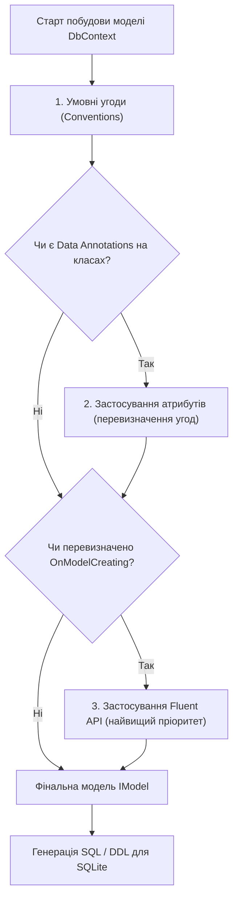

# 2.1. Моделі, Fluent API та анотації даних

- **Глава:** 03. Створення моделей в EF Core
- **Джерело Metanit:** [https://metanit.com/sharp/efcore/2.1.php](https://metanit.com/sharp/efcore/2.1.php)
- **Код прикладу:** [`Lesson_2_01_ModelsAndFluentApi.cs`](../../src/03_ModelsAndMapping/Lesson_2_01_ModelsAndFluentApi.cs)
- **Запуск уроку:** `dotnet run --project src/EFCoreMastery.ConsoleApp -- 2.1`
- **Шпаргалка глави:** [Runs.md](Runs.md)

---

## Мета уроку

Зрозуміти концепцію **моделі** в Entity Framework Core та опанувати три фундаментальні механізми конфігурації, за допомогою яких EF Core зіставляє C#-класи з таблицями та стовпцями реляційної бази даних: **умовні угоди (Conventions)**, **анотації даних (Data Annotations)** та **Fluent API**, а також засвоїти правила їхнього пріоритету при виникненні конфліктів.

---

## Детальний теоретичний матеріал

### Що таке модель в Entity Framework Core

**Модель** в Entity Framework Core — це внутрішня метаінформаційна структура (об'єкт `IModel`), яка описує всі типи сутностей (класи C#), їхні властивості, ключі, обмеження, індекси та зв'язки між ними, якими керує контекст даних `DbContext`.

На основі цієї моделі EF Core виконує дві ключові задачі:
1. **Генерація схеми БД (DDL):** створення таблиць, стовпців, первинних і зовнішніх ключів, обмежень `NOT NULL`, значень за замовчуванням тощо через міграції або `Database.EnsureCreated()`.
2. **Трансляція запитів та відстеження змін (DML):** перетворення LINQ-запитів у SQL (`SELECT`, `INSERT`, `UPDATE`, `DELETE`) та матеріалізація рядків таблиці у C#-об'єкти.

Усі сутності в EF Core визначаються як звичайні C#-класи (POCO — Plain Old CLR Objects). Щоб EF Core знав, як саме зіставити клас `User` із таблицею `Users`, застосовуються три підходи.

### Три підходи до конфігурації моделі

| Критерій | Умовні угоди (Conventions) | Анотації даних (Data Annotations) | Fluent API |
| :--- | :--- | :--- | :--- |
| **Де описується** | Автоматичні правила всередині EF Core | Атрибути безпосередньо в класах сутностей | Метод `OnModelCreating(ModelBuilder)` у `DbContext` або `IEntityTypeConfiguration<T>` |
| **Простори імен** | Вбудовано в `Microsoft.EntityFrameworkCore` | `System.ComponentModel.DataAnnotations` та `System.ComponentModel.DataAnnotations.Schema` | `Microsoft.EntityFrameworkCore` (`ModelBuilder`) |
| **Пріоритет** | Найнижчий (базовий рівень) | Середній (перевизначає умовні угоди) | Найвищий (перевизначає і угоди, і анотації) |
| **Переваги** | Мінімум коду, працює «з коробки» | Наочність біля властивостей; атрибути валідації (`[Required]`, `[MaxLength]`) часто повторно використовуються в ASP.NET Core / UI | Повний контроль над усіма можливостями EF Core; доменні класи залишаються «чистими» (без залежності від БД) |
| **Обмеження** | Не підходить для нестандартних імен чи складних правил БД | Підтримує лише базові налаштування (немає налаштування каскадного видалення, складених ключів до EF Core 7, фільтрованих індексів тощо) | Потребує більше коду в конфігурації; правила винесені окремо від класу сутності |

#### 1. Умовні угоди (Conventions)

EF Core за замовчуванням застосовує низку правил (conventions), які дозволяють працювати без жодного додаткового налаштування:
- Ім'я таблиці відповідає імені властивості `DbSet<T>` у контексті даних (наприклад, `DbSet<User> Users` $\rightarrow$ таблиця `Users`).
- Назви стовпців збігаються з назвами публічних властивостей класу (`Name` $\rightarrow$ `Name`, `Age` $\rightarrow$ `Age`).
- Властивість з іменем `Id` або `<ClassName>Id` (наприклад, `UserId`) автоматично вважається первинним ключем (`PRIMARY KEY`) із автогенерацією значень для числових типів.
- Типи властивостей C# зіставляються з типами даних обраної СУБД (`int` $\rightarrow$ `INTEGER` у SQLite або `int` у SQL Server).

#### 2. Анотації даних (Data Annotations)

Анотації — це C#-атрибути, які накладаються безпосередньо на клас сутності або його властивості. Більшість атрибутів знаходяться у просторах імен:
- `System.ComponentModel.DataAnnotations` (наприклад, `[Key]`, `[Required]`, `[MaxLength]`, `[StringLength]`)
- `System.ComponentModel.DataAnnotations.Schema` (наприклад, `[Table]`, `[Column]`, `[NotMapped]`, `[ForeignKey]`)

Приклад перейменування стовпця за допомогою `[Column("user_id")]`:

```csharp
using System.ComponentModel.DataAnnotations.Schema;

public class User
{
    [Column("user_id")]
    public int Id { get; set; }

    public string? Name { get; set; }
    public int Age { get; set; }
}
```

#### 3. Fluent API

**Fluent API** — це набір методів розширення для `ModelBuilder`, які викликаються у перевизначеному методі `OnModelCreating(ModelBuilder modelBuilder)` класу `DbContext`. Назва «Fluent» («плинний») походить від можливості будувати ланцюжки викликів:

```csharp
protected override void OnModelCreating(ModelBuilder modelBuilder)
{
    modelBuilder.Entity<User>()
        .Property(u => u.Name)
        .HasDefaultValue("Anonymous");

    base.OnModelCreating(modelBuilder);
}
```

> [!TIP]
> У реальних комерційних проєктах (особливо з архітектурою Clean Architecture або DDD) перевагу віддають **Fluent API**, щоб не «забруднювати» доменні класи атрибутами інфраструктури бази даних.

### Правило пріоритету конфігурацій

Якщо одну й ту саму властивість або таблицю налаштовано одночасно кількома способами, EF Core розв'язує конфлікти за чіткою ієрархією:

1. Спочатку формується базова модель за **умовними угодами (Conventions)**.
2. Потім поверх них накладаються **анотації даних (Data Annotations)**, перевизначаючи угоди.
3. Останнім застосовується **Fluent API**, який має найвищий пріоритет і перевизначає будь-які попередні налаштування (зокрема й анотації).

Наприклад, якщо на властивості стоїть `[Column("user_id")]`, а у Fluent API вказано `.Property(u => u.Id).HasColumnName("pk_id")`, то в базі даних стовпець отримає ім'я `pk_id`.

---

## Діаграма / Архітектура процесу

На діаграмі нижче показано послідовність побудови моделі EF Core та розв'язання пріоритету між умовними угодами, анотаціями даних і Fluent API:



---

## Покроковий розбір прикладів коду

У файлі [`Lesson_2_01_ModelsAndFluentApi.cs`](../../src/03_ModelsAndMapping/Lesson_2_01_ModelsAndFluentApi.cs) реалізовано демонстрацію поєднання всіх трьох підходів.

### Крок 1. Визначення сутності `L2_1.User`

```csharp
public class User
{
    [Column("user_id")]
    public int Id { get; set; }

    public string? Name { get; set; }
    public int Age { get; set; }
}
```
- `Id` розпізнається як первинний ключ за **умовною угодою**, але його ім'я стовпця перевизначено через **анотацію** `[Column("user_id")]`.
- `Name` та `Age` налаштовуються за **умовними угодами** (типи та імена стовпців збігаються з властивостями).

### Крок 2. Налаштування `ApplicationContext` та Fluent API

```csharp
protected override void OnModelCreating(ModelBuilder modelBuilder)
{
    modelBuilder.Entity<User>()
        .Property(u => u.Name)
        .HasDefaultValue("Anonymous");

    base.OnModelCreating(modelBuilder);
}
```
- Метод `OnModelCreating` через **Fluent API** додає значення за замовчуванням `"Anonymous"` для стовпця `Name`.
- Виклик `base.OnModelCreating(modelBuilder)` є доброю практикою (особливо якщо контекст успадковується від `IdentityDbContext` або базового контексту).

### Крок 3. Створення БД, додавання даних та перевірка DDL

У методі `Run()`:
1. `SqliteDbHelper.RecreateDatabase(db)` гарантує чисту БД перед уроком (`EnsureDeleted()` + `EnsureCreated()`).
2. `db.Users.AddRange(...)` додає двох користувачів (`Tom`, `Alice`), а `db.SaveChanges()` виконує `INSERT INTO "Users" ("Age", "Name") VALUES ... RETURNING "user_id"`.
3. Запит до системної таблиці `sqlite_master`:
   ```sql
   SELECT sql AS Value FROM sqlite_master WHERE type='table' AND name='Users'
   ```
   показує реальний DDL, згенерований EF Core для SQLite:
   ```sql
   CREATE TABLE "Users" (
       "user_id" INTEGER NOT NULL CONSTRAINT "PK_Users" PRIMARY KEY AUTOINCREMENT,
       "Name" TEXT NULL DEFAULT 'Anonymous',
       "Age" INTEGER NOT NULL
   )
   ```
4. Далі `db.Users.AsNoTracking().ToList()` зчитує дані без відстеження змін і виводить `user_id`, `Name` та `Age` у консоль.

---

## Особливості роботи в SQLite

| Аспект | Поведінка в SQLite | Порівняння з MS SQL Server |
| :--- | :--- | :--- |
| **Типи даних стовпців** | `int` $\rightarrow$ `INTEGER`, `string?` $\rightarrow$ `TEXT` | `int` $\rightarrow$ `int`, `string?` $\rightarrow$ `nvarchar(max)` |
| **Автоінкремент ключа** | `INTEGER NOT NULL CONSTRAINT "PK_Users" PRIMARY KEY AUTOINCREMENT` | `int NOT NULL IDENTITY(1, 1)` |
| **Значення за замовчуванням** | `DEFAULT 'Anonymous'` у DDL таблиці | `DEFAULT N'Anonymous'` у DDL таблиці |
| **Чутливість до регістру імен** | Імена таблиць та стовпців у подвійних лапках `"user_id"` | Імена у квадратних дужках `[user_id]` |
| **Інспекція схеми** | Системна таблиця `sqlite_master` | Системні представлення `INFORMATION_SCHEMA.TABLES` / `sys.tables` |

Загалом самі механізми **Conventions**, **Data Annotations** та **Fluent API** працюють на рівні побудови абстрактної моделі EF Core, тому їхня логіка та пріоритетність у SQLite абсолютно ідентичні MS SQL Server або PostgreSQL.

---

## Типові помилки, підводні камені та Best Practices

1. **Конфлікт між анотаціями та Fluent API.** Якщо розробник змінив ім'я стовпця у Fluent API, але забув старий атрибут `[Column("...")]` у класі сутності, може виникнути плутанина під час читання коду. *Best Practice:* оберіть один основний стиль конфігурації для проєкту (бажано Fluent API) і не дублюйте однакові правила в обох місцях.
2. **Виклик `OnModelCreating` при кожному запиті?** Ні — `OnModelCreating` викликається **один раз** при першому створенні екземпляра `DbContext` для певної моделі, після чого збудована модель `IModel` кешується на рівні застосунку. Не варто покладатися на динамічні змінні всередині `OnModelCreating`, якщо не налаштовано власний `IModelCacheKeyFactory`.
3. **Забутий `using System.ComponentModel.DataAnnotations.Schema;`.** Атрибути `[Key]` та `[Required]` знаходяться в `System.ComponentModel.DataAnnotations`, тоді як `[Table]`, `[Column]`, `[NotMapped]` — у підпросторі `.Schema`.
4. **Надмірне розростання `OnModelCreating`.** Коли сутностей стає десятки, писати всю конфігурацію в одному методі незручно. Для цього в EF Core існує інтерфейс `IEntityTypeConfiguration<T>`, який детально розглядається в уроці **2.13**.

---
<!-- lesson-nav -->
← [7.3. Провайдер PostgreSQL (та адаптація під SQLite)](../02_DatabaseProviders/7_03_PostgreSqlProvider.md) | [Шпаргалка глави (Runs.md)](Runs.md) | [Зміст курсу (README)](../../README.md) | [2.3. Визначення моделей](2_03_DefiningModels.md) →
