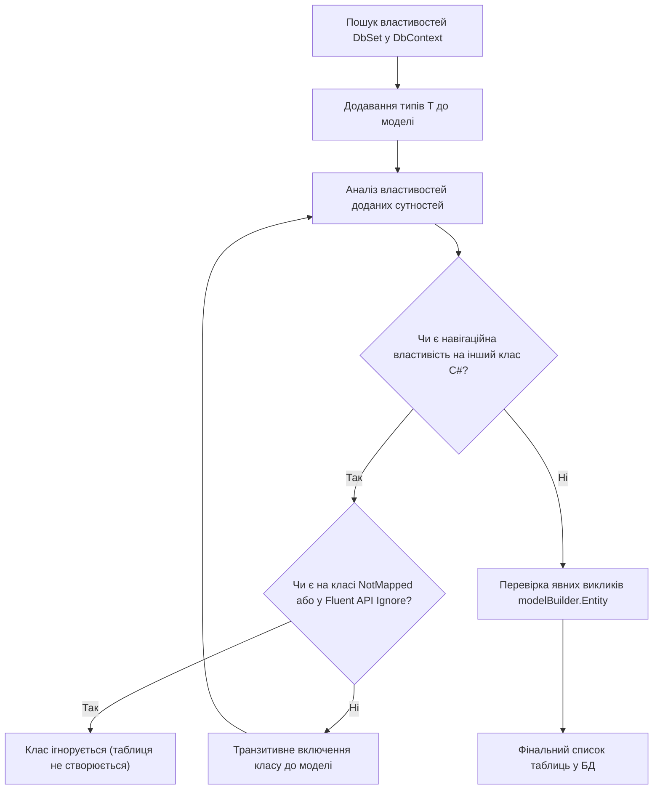

# 2.3. Визначення моделей

- **Глава:** 03. Створення моделей в EF Core
- **Джерело Metanit:** [https://metanit.com/sharp/efcore/2.3.php](https://metanit.com/sharp/efcore/2.3.php)
- **Код прикладу:** [`Lesson_2_03_DefiningModels.cs`](../../src/03_ModelsAndMapping/Lesson_2_03_DefiningModels.cs)
- **Запуск уроку:** `dotnet run --project src/EFCoreMastery.ConsoleApp -- 2.3`
- **Шпаргалка глави:** [Runs.md](Runs.md)

---

## Мета уроку

Навчитися керувати складом моделі EF Core: зрозуміти всі способи автоматичного та явного включення C#-класів до моделі бази даних, коректно оголошувати властивості `DbSet<T>` з увімкненими Nullable Reference Types (NRT), а також виключати зайві класи з моделі за допомогою `[NotMapped]` та `modelBuilder.Ignore<T>()`.

---

## Детальний теоретичний матеріал

### Способи включення сутностей у модель

EF Core не сканує всю збірку в пошуках будь-яких класів. Натомість він будує граф моделі, відштовхуючись від класу `DbContext`. Сутність потрапляє до моделі (і для неї створюється таблиця в БД) одним із трьох способів:

| Спосіб включення | Синтаксис | Ім'я таблиці за замовчуванням | Як звертатися в коді |
| :--- | :--- | :--- | :--- |
| **1. Через `DbSet<T>` у `DbContext`** | `public DbSet<User> Users => Set<User>();` | За іменем властивості `DbSet` (`Users`) | `db.Users` |
| **2. Через навігаційну властивість** | `public Company? Company { get; set; }` усередині `User` | За іменем класу (`Company`) | Через навігацію `user.Company` або `db.Set<Company>()` |
| **3. Явно через Fluent API** | `modelBuilder.Entity<Country>();` в `OnModelCreating` | За іменем класу (`Country`) | `db.Set<Country>()` |

#### Детальніше про транзитивне включення (через навігацію)
Якщо сутність `User` входить до моделі через `DbSet<User>`, і в ній є властивість посилального типу `public Company? Company { get; set; }` (або колекція `List<Order>`), EF Core автоматично вважає `Company` (або `Order`) іншою сутністю моделі та будує для неї таблицю й зовнішній ключ, навіть якщо у `DbContext` немає `DbSet<Company>`.

#### Доступ до сутності без `DbSet<T>`
Якщо тип `Country` додано до моделі лише через `modelBuilder.Entity<Country>()` або через навігаційну властивість, ви все одно можете виконувати для нього CRUD-операції напряму через метод контексту `Set<T>()`:

```csharp
db.Set<Country>().Add(new Country { Name = "Ukraine" });
var countries = db.Set<Country>().ToList();
```

### Nullable Reference Types (NRT) та оголошення `DbSet<T>`

Починаючи з **.NET 6 / C# 10**, у нових проєктах за замовчуванням увімкнено `<Nullable>enable</Nullable>`. Якщо оголосити набір даних класичним способом:

```csharp
public DbSet<User> Users { get; set; }
```

компілятор видасть попередження **CS8618**: *«Non-nullable property 'Users' must contain a non-null value when exiting constructor»*. Оскільки EF Core ініціалізує властивості `DbSet<T>` автоматично всередині конструктора `DbContext` (або вони не повинні бути `null`), є два рекомендовані способи усунути попередження:

1. **Пригнічення через `null!` (null-forgiving operator):**
   ```csharp
   public DbSet<User> Users { get; set; } = null!;
   ```
   Цей варіант найчастіше використовується у прикладах на Metanit.
2. **Властивість лише для читання з викликом `Set<T>()` (Expression-bodied property):**
   ```csharp
   public DbSet<User> Users => Set<User>();
   ```
   Це найчистіший сучасний підхід, рекомендований командою EF Core: немає жодних `null!`, а метод `Set<T>()` завжди повертає кешований екземпляр `DbSet<T>`.

### Виключення сутності з моделі

Іноді клас-сутність містить навігаційну властивість на допоміжний клас (наприклад, `TempBadge` або `AuditLog`), який використовується лише в оперативній пам'яті застосунку і **не повинен** мати таблиці в базі даних.

Щоб запобігти створенню таблиці та зовнішнього ключа, застосовують один із двох способів:

1. **Анотація даних `[NotMapped]`** (простір імен `System.ComponentModel.DataAnnotations.Schema`):
   ```csharp
   [NotMapped]
   public class TempBadge
   {
       public int Code { get; set; }
   }
   ```
   Також атрибут `[NotMapped]` можна ставити безпосередньо над навігаційною властивістю в класі `User`.
2. **Fluent API — метод `Ignore<T>()`** у `OnModelCreating`:
   ```csharp
   protected override void OnModelCreating(ModelBuilder modelBuilder)
   {
       modelBuilder.Ignore<AuditLog>();
   }
   ```
   Цей підхід зручний, коли ви не хочете або не можете змінювати вихідний код класу `AuditLog` (наприклад, він знаходиться в іншій бібліотеці).

---

## Діаграма / Архітектура процесу

Діаграма ілюструє алгоритм, за яким EF Core визначає, які класи C# стануть таблицями в базі даних:



---

## Покроковий розбір прикладів коду

У файлі [`Lesson_2_03_DefiningModels.cs`](../../src/03_ModelsAndMapping/Lesson_2_03_DefiningModels.cs) створено два окремих контексти даних, щоб наочно показати включення та виключення сутностей.

### Частина 1. `InclusionContext` — три способи включення

- `public DbSet<User> Users { get; set; } = null!;` — включає `User` (таблиця `Users`).
- `User` має властивість `public Company? Company { get; set; }` — автоматично включає `Company` без `DbSet<Company>` (таблиця `Company`).
- `OnModelCreating` викликає `modelBuilder.Entity<Country>();` — явно включає `Country` (таблиця `Country`).
- У `Run()` ми додаємо об'єкт `Country` через `db.Set<L2_3.Country>().Add(...)` і перевіряємо список таблиць запитом:
  ```sql
  SELECT name AS Value FROM sqlite_master WHERE type='table' AND name NOT LIKE 'sqlite_%' ORDER BY name
  ```
  Очікуваний результат: `Company`, `Country`, `Users`.

### Частина 2. `ExclusionContext` — виключення сутностей

- Сутність `UserWithExcluded` має дві посилальні властивості: `TempBadge? Badge` та `AuditLog? LastAudit`.
- Клас `TempBadge` позначено атрибутом `[NotMapped]`.
- Клас `AuditLog` виключено через `modelBuilder.Ignore<AuditLog>()` в `OnModelCreating`.
- Запит до `sqlite_master` підтверджує, що у базі створено **лише одну таблицю `Users`**, а стовпців зовнішніх ключів для `Badge` та `LastAudit` у ній немає.

---

## Особливості роботи в SQLite

- Логіка формування списку сутностей (включення через `DbSet`, навігацію, `Entity<T>()`, а також виключення через `[NotMapped]` і `Ignore<T>()`) відбувається на етапі побудови метаданих `ModelBuilder` **до генерації SQL**, тому в SQLite вона працює абсолютно так само, як у MS SQL Server.
- У SQLite внутрішні службові таблиці (наприклад, `sqlite_sequence`, яка створюється автоматично при використанні `AUTOINCREMENT`) починаються з префікса `sqlite_`, тому в діагностичних запитах до `sqlite_master` їх фільтрують умовою `name NOT LIKE 'sqlite_%'`.

---

## Типові помилки, підводні камені та Best Practices

1. **Неочікувана поява зайвих таблиць у БД.** Якщо додати до сутності властивість на кшталт `public UserDto? TempData { get; set; }` або `public ValidationResult? LastValidation { get; set; }` і забути `[NotMapped]`, EF Core спробує включити `UserDto` / `ValidationResult` до моделі та впаде з помилкою, якщо в того немає первинного ключа `Id`.
2. **Різниця в іменах таблиць.** Зверніть увагу: сутність із `DbSet<User> Users` отримує таблицю в множині (`Users`), тоді як сутність `Company`, включена лише через навігацію або `modelBuilder.Entity<Company>()`, отримує таблицю в однині (`Company`), якщо не задати ім'я явно через `.ToTable("Companies")`.
3. **Уникайте `= null!;` на користь `=> Set<T>()`.** Оголошення `public DbSet<User> Users => Set<User>();` позбавляє від «магічного» пригнічення попереджень компілятора і робить контекст безпечнішим при рефакторингу.

---
<!-- lesson-nav -->
← [2.1. Моделі, Fluent API та анотації даних](2_01_ModelsAndFluentApi.md) | [Шпаргалка глави (Runs.md)](Runs.md) | [Зміст курсу (README)](../../README.md) | [2.4. Властивості сутності](2_04_EntityProperties.md) →
