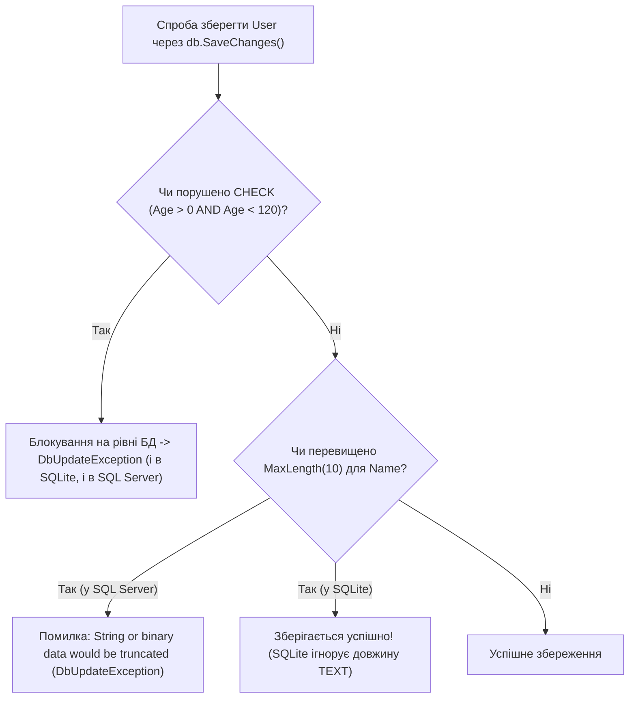

# 2.9. Обмеження властивостей

- **Глава:** 03. Створення моделей в EF Core
- **Джерело Metanit:** [https://metanit.com/sharp/efcore/2.9.php](https://metanit.com/sharp/efcore/2.9.php)
- **Код прикладу:** [`Lesson_2_09_PropertyConstraints.cs`](../../src/03_ModelsAndMapping/Lesson_2_09_PropertyConstraints.cs)
- **Запуск уроку:** `dotnet run --project src/EFCoreMastery.ConsoleApp -- 2.9`
- **Шпаргалка глави:** [Runs.md](Runs.md)

---

## Мета уроку

Навчитися накладати додаткові обмеження на значення стовпців у базі даних: задавати бізнес-правила через `CHECK`-обмеження (`HasCheckConstraint`) та обмежувати максимальну довжину рядків і масивів байтів (`[MaxLength]`, `HasMaxLength`), а також чітко розуміти принципову різницю в поведінці цих обмежень між MS SQL Server та SQLite.

---

## Детальний теоретичний матеріал

Окрім обмежень `NOT NULL`, `PRIMARY KEY` та `UNIQUE`, реляційні бази даних підтримують обмеження перевірки (`CHECK`) і обмеження розміру даних.

### 1. Обмеження `CHECK` (`HasCheckConstraint`)

Обмеження `CHECK` дозволяє задати довільний SQL-вираз, який має бути істинним (`TRUE`) для кожного рядка таблиці. Якщо при `INSERT` або `UPDATE` умова порушується, СУБД відхиляє операцію, а EF Core викидає `DbUpdateException`.

У сучасних версіях EF Core (починаючи з EF Core 7) метод `HasCheckConstraint` викликається всередині перевантаження `ToTable(Action<TableBuilder<T>>)`:

```csharp
modelBuilder.Entity<User>()
    .ToTable(t => t.HasCheckConstraint("ValidAge", "Age > 0 AND Age < 120"));
```

Параметри методу `HasCheckConstraint`:
1. `name` (`"ValidAge"`) — унікальне ім'я обмеження `CONSTRAINT` у таблиці.
2. `sql` (`"Age > 0 AND Age < 120"`) — SQL-умова перевірки.

На одній таблиці можна задати скільки завгодно `CHECK`-обмежень, викликаючи `t.HasCheckConstraint(...)` кілька разів.

### 2. Обмеження довжини (`[MaxLength]` та `HasMaxLength`)

Обмеження максимальної довжини застосовується виключно до властивостей типу `string` або `byte[]`. Воно впливає на тип стовпця в СУБД (наприклад, `nvarchar(50)` замість `nvarchar(max)` у SQL Server) та може використовуватися клієнтською/серверною валідацією.

| Підхід | Синтаксис | Примітка |
| :--- | :--- | :--- |
| **Анотація даних** | `[MaxLength(10)]` (`System.ComponentModel.DataAnnotations`) | Також використовується валідатором ASP.NET Core |
| **Fluent API** | `modelBuilder.Entity<User>().Property(u => u.Email).HasMaxLength(50);` | Пріоритет вищий за `[MaxLength]` |

#### Атрибут `[MinLength]` та `[StringLength]`
- `[MinLength(3)]` перевіряється **лише** валідаторами на рівні C# (наприклад, `Validator.TryValidateObject` або ModelState в ASP.NET Core), але **не створює** жодних обмежень у схемі БД (для мінімальної довжини в БД потрібно використовувати `HasCheckConstraint("MinNameLen", "LENGTH(Name) >= 3")`).
- `[StringLength(50, MinimumLength = 3)]` задає `MaxLength(50)` для БД і мінімальну довжину для C#-валідації.

---

## Діаграма / Архітектура процесу

На схемі показано, як `CHECK` та `MaxLength` обробляються під час збереження даних у SQLite порівняно з SQL Server:



---

## Покроковий розбір прикладів коду

У файлі [`Lesson_2_09_PropertyConstraints.cs`](../../src/03_ModelsAndMapping/Lesson_2_09_PropertyConstraints.cs) продемонстровано обидва типи обмежень:

1. **Конфігурація сутності `L2_9.User`:**
   - `Name` має `[MaxLength(10)]`.
   - `Email` у `OnModelCreating` має `.HasMaxLength(50)`.
   - Таблиця `Users` має `ToTable(t => t.HasCheckConstraint("ValidAge", "Age > 0 AND Age < 120"))`.

2. **Згенерований DDL у SQLite:**
   ```sql
   CREATE TABLE "Users" (
       "Id" INTEGER NOT NULL CONSTRAINT "PK_Users" PRIMARY KEY AUTOINCREMENT,
       "Name" TEXT NULL,
       "Email" TEXT NULL,
       "Age" INTEGER NOT NULL,
       CONSTRAINT "ValidAge" CHECK (Age > 0 AND Age < 120)
   )
   ```
   Зверніть увагу на `Name` та `Email`: попри `[MaxLength(10)]` і `HasMaxLength(50)`, їхній тип у SQLite — просто `TEXT NULL`.

3. **Перевірка в методі `Run()`:**
   - `Tom` з `Age = 30` зберігається успішно.
   - `Bob` з `Age = 123` порушує `CHECK (Age > 0 AND Age < 120)`. SQLite повертає помилку `SQLite Error 19: 'CHECK constraint failed: ValidAge'`, загорнуту в `DbUpdateException`.
   - Після `catch` обов'язково викликається `db.ChangeTracker.Clear()`, щоб видалити невалідного `Bob` із черги на збереження.
   - Далі додається користувач із `Name` довжиною 32 символи (`"ДужеДовгеІм'яПонадДесятьСимволів"`), і попри `[MaxLength(10)]`, SQLite успішно зберігає його без помилок.

---

## Особливості роботи в SQLite

| Обмеження | Поведінка в SQLite | Поведінка в MS SQL Server |
| :--- | :--- | :--- |
| **`HasCheckConstraint`** | **Повністю підтримується.** Генерується `CONSTRAINT "..." CHECK (...)`, порушення блокується з кодом помилки `19`. | **Повністю підтримується.** Порушення блокується СУБД. |
| **`[MaxLength]` / `HasMaxLength`** | **Ігнорується на рівні БД!** У SQLite немає фіксованих типів на кшталт `varchar(50)` — усі рядки зберігаються як `TEXT` довільної довжини (навіть якщо в DDL написати `VARCHAR(10)`, SQLite усе одно дозволить довший рядок через динамічну типізацію). | **Суворо перевіряється!** Стовпець отримує тип `nvarchar(10)`, і спроба вставити 11+ символів викликає `DbUpdateException` (*String or binary data would be truncated*). |

---

## Типові помилки, підводні камені та Best Practices

1. **Покладатися на `[MaxLength]` у SQLite для захисту БД.** Якщо ваш застосунок працює з SQLite (або використовує SQLite в інтеграційних тестах), пам'ятайте, що база даних **не зупинить** занадто довгий рядок. Завжди додавайте серверну валідацію (DataAnnotations `Validator.TryValidateObject`, FluentValidation або `CHECK (LENGTH("Name") <= 10)`).
2. **Забутий `ChangeTracker.Clear()` після `DbUpdateException`.** Якщо після невдалого `SaveChanges()` не від'єднати або не виправити невалідну сутність у `ChangeTracker`, наступний виклик `SaveChanges()` знову спробує виконати той самий невалідний `INSERT` і впаде з тією самою помилкою.
3. **Застарілий синтаксис `HasCheckConstraint`.** У старих версіях EF Core (до 7.0) `HasCheckConstraint` викликався напряму на `EntityTypeBuilder`. У сучасних версіях EF Core 7/8/9+ його слід викликати всередині `ToTable(t => t.HasCheckConstraint(...))`.

---
<!-- lesson-nav -->
← [2.8. Генерація значень властивостей і стовпців](2_08_ValueGeneration.md) | [Шпаргалка глави (Runs.md)](Runs.md) | [Зміст курсу (README)](../../README.md) | [2.13. Конфігурація моделей (IEntityTypeConfiguration)](2_13_ModelConfiguration.md) →
