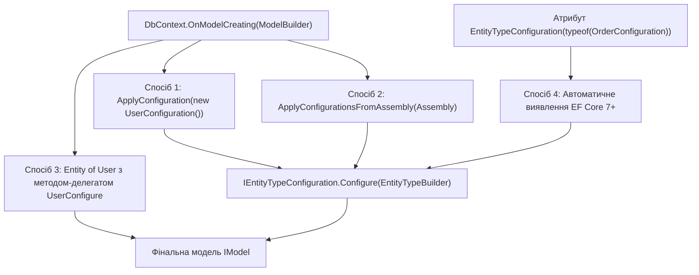

# 2.13. Конфігурація моделей (`IEntityTypeConfiguration`)

- **Глава:** 03. Створення моделей в EF Core
- **Джерело Metanit:** [https://metanit.com/sharp/efcore/2.13.php](https://metanit.com/sharp/efcore/2.13.php)
- **Код прикладу:** [`Lesson_2_13_ModelConfiguration.cs`](../../src/03_ModelsAndMapping/Lesson_2_13_ModelConfiguration.cs)
- **Запуск уроку:** `dotnet run --project src/EFCoreMastery.ConsoleApp -- 2.13`
- **Шпаргалка глави:** [Runs.md](Runs.md)

---

## Мета уроку

Навчитися професійно організовувати та масштабувати код Fluent API-конфігурації: виносити налаштування кожної сутності з перевантаженого методу `OnModelCreating` в окремі класи за допомогою інтерфейсу `IEntityTypeConfiguration<T>`, використовувати `ApplyConfiguration()`, `ApplyConfigurationsFromAssembly()`, методи-делегати та атрибут `[EntityTypeConfiguration]`.

---

## Детальний теоретичний матеріал

У навчальних прикладах із 1–2 сутностями весь код Fluent API легко поміщається в методі `OnModelCreating(ModelBuilder modelBuilder)`. Проте в реальних проєктах, де є десятки або сотні таблиць зі складними зв'язками, індексами та обмеженнями, `OnModelCreating` швидко перетворюється на файл на тисячі рядків, який важко підтримувати.

EF Core пропонує кілька способів декомпозиції конфігурації моделі:

### 1. Окремі класи з `IEntityTypeConfiguration<T>` (рекомендований стандарт)

Для кожної сутності створюється окремий клас, який реалізує інтерфейс `IEntityTypeConfiguration<TEntity>` (простір імен `Microsoft.EntityFrameworkCore`):

```csharp
using Microsoft.EntityFrameworkCore;
using Microsoft.EntityFrameworkCore.Metadata.Builders;

public class UserConfiguration : IEntityTypeConfiguration<User>
{
    public void Configure(EntityTypeBuilder<User> builder)
    {
        builder.ToTable("People");
        builder.Property(p => p.Id).HasColumnName("user_id");
        builder.Property(p => p.Name).IsRequired();
    }
}
```

Підключити такі класи до `DbContext` можна двома способами:

| Метод у `OnModelCreating` | Опис | Коли використовувати |
| :--- | :--- | :--- |
| **`modelBuilder.ApplyConfiguration(new UserConfiguration());`** | Явно реєструє кожен клас конфігурації | Коли в одній збірці є кілька різних `DbContext` і потрібно чітко контролювати, які конфігурації до якого контексту належать |
| **`modelBuilder.ApplyConfigurationsFromAssembly(typeof(AppContext).Assembly);`** | Автоматично сканує вказану збірку, знаходить усі класи `IEntityTypeConfiguration<T>` із конструктором без параметрів і застосовує їх | У більшості реальних проєктів з одним основним `DbContext`, щоб не забувати реєструвати нові конфігурації вручну |

### 2. Винесення в окремі методи-делегати

Якщо не хочеться створювати окремі файли/класи, можна розбити `OnModelCreating` на приватні методи всередині `DbContext`, передаючи їх у `modelBuilder.Entity<T>(Action<EntityTypeBuilder<T>>)`:

```csharp
protected override void OnModelCreating(ModelBuilder modelBuilder)
{
    modelBuilder.Entity<User>(UserConfigure);
}

private void UserConfigure(EntityTypeBuilder<User> builder)
{
    builder.ToTable("People");
    builder.Property(p => p.Id).HasColumnName("user_id");
}
```

### 3. Атрибут `[EntityTypeConfiguration]` (EF Core 7+)

Починаючи з EF Core 7, можна прив'язати клас конфігурації безпосередньо до класу сутності за допомогою атрибута `[EntityTypeConfiguration(typeof(...))]`:

```csharp
[EntityTypeConfiguration(typeof(OrderConfiguration))]
public class Order
{
    public int Id { get; set; }
    public string? Number { get; set; }
}
```
У цьому разі в `DbContext` взагалі **не потрібно** перевизначати `OnModelCreating` або викликати `ApplyConfiguration` — EF Core знайде `OrderConfiguration` автоматично, коли включить `Order` до моделі.

---

## Діаграма / Архітектура процесу

На діаграмі показано способи організації Fluent API-конфігурації в EF Core:



---

## Покроковий розбір прикладів коду

У файлі [`Lesson_2_13_ModelConfiguration.cs`](../../src/03_ModelsAndMapping/Lesson_2_13_ModelConfiguration.cs) реалізовано два контексти для демонстрації обох підходів:

1. **`ApplyConfigContext` (`ApplyConfiguration`):**
   - Клас `UserConfiguration : IEntityTypeConfiguration<User>` перейменовує таблицю на `People`, стовпець `Id` на `user_id` і робить `Name` обов'язковим.
   - Клас `CompanyConfiguration : IEntityTypeConfiguration<Company>` перейменовує таблицю на `Enterprises` і робить `Name` обов'язковим.
   - У `OnModelCreating` обидві конфігурації підключаються точково:
     ```csharp
     modelBuilder.ApplyConfiguration(new UserConfiguration());
     modelBuilder.ApplyConfiguration(new CompanyConfiguration());
     ```
   - Запит до `sqlite_master` підтверджує створення таблиць `Enterprises` і `People`.

2. **`AttributeConfigContext` (`[EntityTypeConfiguration]`):**
   - Сутність `Order` позначена атрибутом `[EntityTypeConfiguration(typeof(OrderConfiguration))]`.
   - Клас `AttributeConfigContext` не містить методу `OnModelCreating` взагалі — лише `public DbSet<Order> Orders => Set<Order>();`.
   - Попри це, EF Core застосовує `OrderConfiguration`, створюючи таблицю `CustomerOrders` із `Number TEXT NOT NULL`:
     ```sql
     CREATE TABLE "CustomerOrders" (
         "Id" INTEGER NOT NULL CONSTRAINT "PK_CustomerOrders" PRIMARY KEY AUTOINCREMENT,
         "Number" TEXT NOT NULL
     )
     ```

---

## Особливості роботи в SQLite

- Механізми декомпозиції конфігурації (`IEntityTypeConfiguration<T>`, `ApplyConfiguration`, `ApplyConfigurationsFromAssembly`, `[EntityTypeConfiguration]`) працюють на рівні побудови моделі EF Core і жодним чином не залежать від провайдера БД — у SQLite вони працюють так само, як у SQL Server або PostgreSQL.

---

## Типові помилки, підводні камені та Best Practices

1. **Пастка `ApplyConfigurationsFromAssembly` у багатоконтекстних проєктах.** Якщо в одній збірці є кілька різних `DbContext` (як у нашому навчальному проєкті з десятками уроків, або в мікросервісах із різними контекстами для різних БД), виклик `ApplyConfigurationsFromAssembly` підтягне в поточний контекст конфігурації сутностей з інших контекстів і створить зайві таблиці! У таких випадках використовуйте точковий `ApplyConfiguration(...)` або фільтруйте класи за простором імен.
2. **Змішування домену та інфраструктури при `[EntityTypeConfiguration]`.** Хоча `[EntityTypeConfiguration]` дуже зручний, він змушує доменний клас `Order` залежати від `Microsoft.EntityFrameworkCore` і знати про існування `OrderConfiguration`. Якщо ви дотримуєтеся Clean Architecture, краще тримати класи `*Configuration` в шарі Infrastructure і підключати їх через `ApplyConfigurationsFromAssembly` у `DbContext`.
3. **Забутий публічний конструктор без параметрів у `*Configuration`.** Для роботи `ApplyConfigurationsFromAssembly` та `[EntityTypeConfiguration]` клас конфігурації повинен мати публічний конструктор без параметрів.

---
<!-- lesson-nav -->
← [2.9. Обмеження властивостей](2_9_PropertyConstraints.md) | [Шпаргалка глави (Runs.md)](Runs.md) | [Зміст курсу (README)](../../README.md) | [2.14. Ініціалізація бази даних початковими даними](2_14_DataSeeding.md) →
