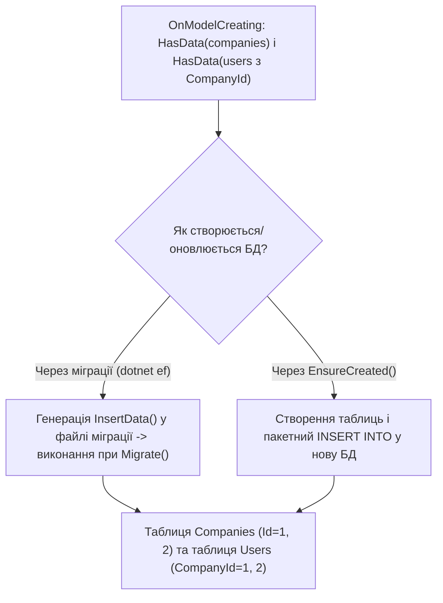

# 2.14. Ініціалізація бази даних початковими даними

- **Глава:** 03. Створення моделей в EF Core
- **Джерело Metanit:** [https://metanit.com/sharp/efcore/2.14.php](https://metanit.com/sharp/efcore/2.14.php)
- **Код прикладу:** [`Lesson_2_14_DataSeeding.cs`](../../src/03_ModelsAndMapping/Lesson_2_14_DataSeeding.cs)
- **Запуск уроку:** `dotnet run --project src/EFCoreMastery.ConsoleApp -- 2.14`
- **Шпаргалка глави:** [Runs.md](Runs.md)

---

## Мета уроку

Навчитися наповнювати базу даних початковими (еталонними) даними за допомогою методу `HasData()` у `OnModelCreating`, розуміти, коли саме ці дані потрапляють до БД (міграції vs `EnsureCreated()`), а також знати ключові обмеження `HasData()` при роботі зі зв'язаними сутностями та первинними ключами.

---

## Детальний теоретичний матеріал

У багатьох застосунках база даних одразу після розгортання повинна містити базові довідкові дані: ролі користувачів (`Admin`, `User`), статуси замовлень, країни або тестових користувачів. У EF Core цей процес називається **Data Seeding** (початкове заповнення даними).

Класичний спосіб налаштування початкових даних у моделі — виклик методу `HasData()` у `OnModelCreating`:

```csharp
protected override void OnModelCreating(ModelBuilder modelBuilder)
{
    modelBuilder.Entity<User>().HasData(
        new User { Id = 1, Name = "Tom", Age = 23 },
        new User { Id = 2, Name = "Alice", Age = 26 },
        new User { Id = 3, Name = "Sam", Age = 28 }
    );
}
```

### Коли виконується ініціалізація `HasData()`

Дані, передані в `HasData()`, потрапляють у базу даних **лише у двох сценаріях**:
1. **Під час застосування міграцій (`Add-Migration` / `dotnet ef migrations add` + `Database.Migrate()`):** EF Core порівнює стан `HasData()` із попередньою міграцією і автоматично генерує в коді міграції операції `migrationBuilder.InsertData(...)`, `UpdateData(...)` або `DeleteData(...)`.
2. **Під час виклику `Database.EnsureCreated()`:** якщо бази даних ще не існує, EF Core створює таблиці та одразу вставляє всі записи з `HasData()`.

> [!IMPORTANT]
> Якщо база даних **вже існує** і міграції не використовуються, повторний виклик `EnsureCreated()` нічого не зробить — нові записи з `HasData()` не додадуться.

### Три головні правила та обмеження `HasData()`

| Правило | Пояснення | Приклад помилки |
| :--- | :--- | :--- |
| **1. Обов'язкове явне задання первинного ключа (`Id`)** | Навіть якщо в БД увімкнено автогенерацію (`AUTOINCREMENT` / `IDENTITY`), для кожного об'єкта в `HasData()` **потрібно явно вказати** `Id` (не `0`!). | `new User { Name = "Tom" }` без `Id` викличе `InvalidOperationException` |
| **2. Зв'язки задаються через зовнішній ключ, а не навігаційну властивість** | Для пов'язаних сутностей не можна писати `Company = microsoft`. Потрібно передавати скалярне значення зовнішнього ключа `CompanyId = microsoft.Id`. | `new User { Id = 1, Company = microsoft }` викличе помилку конфігурації |
| **3. Значення мають бути статичними та детермінованими** | Не використовуйте `DateTime.Now`, `Guid.NewGuid()` або випадкові числа в `HasData()`. Інакше при кожному створенні міграції EF Core бачитиме «нові» дані і генеруватиме зайвий `UpdateData`. | `CreatedAt = DateTime.Now` |

---

## Діаграма / Архітектура процесу

На діаграмі показано зв'язок між початковими даними `Company` і `User` та шлях їх потрапляння в БД:



---

## Покроковий розбір прикладів коду

У файлі [`Lesson_2_14_DataSeeding.cs`](../../src/03_ModelsAndMapping/Lesson_2_14_DataSeeding.cs) продемонстровано ініціалізацію двох зв'язаних таблиць (`Companies` та `Users`).

1. **Оголошення моделей:**
   - `Company` має `Id`, `Name` та колекцію `Users`.
   - `User` має `Id`, `Name`, `Age`, зовнішній ключ `int? CompanyId` та навігаційну властивість `Company? Company`.

2. **Налаштування `HasData` в `OnModelCreating`:**
   ```csharp
   var microsoft = new Company { Id = 1, Name = "Microsoft" };
   var google = new Company { Id = 2, Name = "Google" };

   var tom = new User { Id = 1, Name = "Tom", Age = 23, CompanyId = microsoft.Id };
   var alice = new User { Id = 2, Name = "Alice", Age = 26, CompanyId = microsoft.Id };
   var sam = new User { Id = 3, Name = "Sam", Age = 28, CompanyId = google.Id };

   modelBuilder.Entity<Company>().HasData(microsoft, google);
   modelBuilder.Entity<User>().HasData(tom, alice, sam);
   ```
   Зверніть увагу: спочатку в моделі вказано `Id` для всіх об'єктів, а зв'язок задано саме через `CompanyId = microsoft.Id`.

3. **Виконання у `Run()`:**
   - `SqliteDbHelper.RecreateDatabase(db)` видаляє стару БД і викликає `EnsureCreated()`, що автоматично виконує `INSERT INTO "Companies"` та `INSERT INTO "Users"`.
   - Далі `db.Users.Include(u => u.Company).AsNoTracking().OrderBy(u => u.Id).ToList()` зчитує вже наявні в БД записи і виводить:
     - `[1] Tom (23 р.) — компанія: Microsoft`
     - `[2] Alice (26 р.) — компанія: Microsoft`
     - `[3] Sam (28 р.) — компанія: Google`

---

## Особливості роботи в SQLite

- У SQLite вставка явних значень у стовпець `INTEGER PRIMARY KEY AUTOINCREMENT` працює напряму звичайним `INSERT INTO "Companies" ("Id", "Name") VALUES (1, 'Microsoft'), (2, 'Google')`.
- На відміну від **MS SQL Server**, де EF Core для вставки явного `Id` у `IDENTITY`-стовпець змушений генерувати команди `SET IDENTITY_INSERT [Companies] ON;` ... `OFF;`, у SQLite жодних додаткових інструкцій не потрібно, а лічильник `sqlite_sequence` автоматично оновлюється до максимального вставленого `Id`.

---

## Типові помилки, підводні камені та Best Practices

1. **Передача навігаційної властивості замість зовнішнього ключа.** Навіть якщо у вашому C#-класі немає властивості `CompanyId` (використовується тіньовий зовнішній ключ), у `HasData()` все одно не можна передавати `Company = microsoft` — у такому разі доводиться передавати анонімний об'єкт `new { Id = 1, Name = "Tom", Age = 23, CompanyId = 1 }`. Найзручніше завжди явно оголошувати властивість зовнішнього ключа (`CompanyId`) у класі сутності.
2. **Використання `HasData` для великих або динамічних даних.** `HasData()` зберігає всі дані безпосередньо в згенерованому C#-коді міграцій і в `ModelSnapshot`. Для тисяч тестових записів, завантаження з JSON/CSV або асинхронної ініціалізації після запуску краще використовувати окремий метод ініціалізації (`DbInitializer`) або нові методи EF Core 9+ `UseSeeding()` / `UseAsyncSeeding()`.
3. **Забутий `Id` або `Id = 0`.** У `HasData()` первинний ключ є обов'язковим для кожного елемента і не може дорівнювати значенню за замовчуванням (`0`).

---
<!-- lesson-nav -->
← [2.13. Конфігурація моделей (IEntityTypeConfiguration)](2_13_ModelConfiguration.md) | [Шпаргалка глави (Runs.md)](Runs.md) | [Зміст курсу (README)](../../README.md) | [3.1. Зовнішні ключі та навігаційні властивості](../04_Relations/3_1_ForeignKeysAndNavigation.md) →
