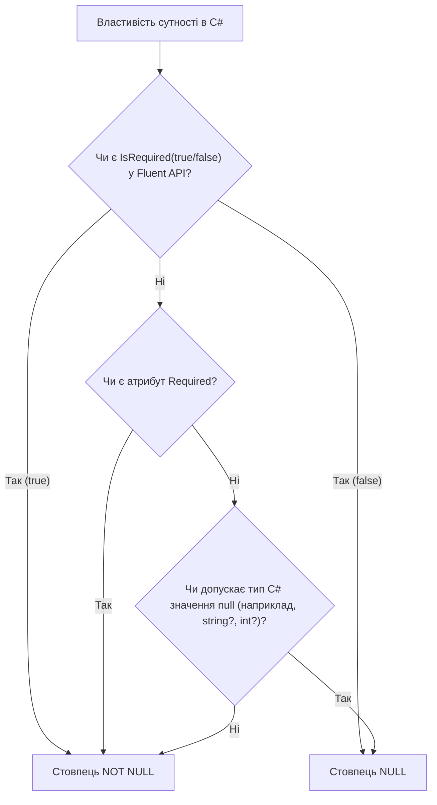

# 2.15. Обов'язкові та необов'язкові властивості

- **Глава:** 03. Створення моделей в EF Core
- **Джерело Metanit:** [https://metanit.com/sharp/efcore/2.15.php](https://metanit.com/sharp/efcore/2.15.php)
- **Код прикладу:** [`Lesson_2_15_RequiredAndOptional.cs`](../../src/03_ModelsAndMapping/Lesson_2_15_RequiredAndOptional.cs)
- **Запуск уроку:** `dotnet run --project src/EFCoreMastery.ConsoleApp -- 2.15`
- **Шпаргалка глави:** [Runs.md](Runs.md)

---

## Мета уроку

Зрозуміти, як EF Core перетворює систему типів C# (Nullable Reference Types та `Nullable<T>`) на обмеження `NOT NULL` і `NULL` у стовпцях бази даних, а також як явно керувати обов'язковістю властивостей за допомогою атрибута `[Required]` та методу Fluent API `IsRequired()`.

---

## Детальний теоретичний матеріал

У реляційній базі даних кожен стовпець таблиці може або допускати значення `NULL` (необов'язковий), або забороняти його через обмеження `NOT NULL` (обов'язковий). EF Core автоматично визначає це правило за типом властивості в C#, але дозволяє перевизначити його.

### 1. Поведінка за замовчуванням (Conventions)

Коли в `.csproj` увімкнено контекст nullable-типів посилань (`<Nullable>enable</Nullable>`):

| Тип властивості в C# | Приклад | Статус у моделі EF Core | Стовпець у SQLite |
| :--- | :--- | :--- | :--- |
| Значимий не-nullable тип | `int Age` | Обов'язкова (`Required`) | `INTEGER NOT NULL` |
| Значимий nullable тип (`Nullable<T>`) | `int? Age` | Необов'язкова (`Optional`) | `INTEGER NULL` |
| Посилальний не-nullable тип | `string Name` | Обов'язкова (`Required`) | `TEXT NOT NULL` |
| Посилальний nullable тип | `string? Company` | Необов'язкова (`Optional`) | `TEXT NULL` |

> [!NOTE]
> У старих проєктах, де `<Nullable>disable</Nullable>`, тип `string` вважається nullable за замовчуванням, тому без `[Required]` або `IsRequired()` стовпець у БД буде `NULL`.

### 2. Явне налаштування обов'язковості

Іноді властивість у C# має тип `string?` (щоб не отримувати попереджень компілятора до ініціалізації об'єкта), але в базі даних вона повинна бути строго **обов'язковою (`NOT NULL`)**.

Це можна налаштувати двома способами:

#### Анотація даних `[Required]`
Атрибут `[Required]` знаходиться у просторі імен `System.ComponentModel.DataAnnotations`:

```csharp
using System.ComponentModel.DataAnnotations;

public class User
{
    public int Id { get; set; }

    [Required]
    public string? Email { get; set; }
}
```
Окрім створення `NOT NULL` у БД, `[Required]` також використовується механізмами валідації моделей в ASP.NET Core MVC / Blazor / Minimal APIs.

#### Fluent API — метод `IsRequired()`
У методі `OnModelCreating` можна викликати `IsRequired(bool required = true)`:

```csharp
modelBuilder.Entity<User>()
    .Property(u => u.Login)
    .IsRequired(); // еквівалентно .IsRequired(true)
```
Також `IsRequired(false)` дозволяє зробити **необов'язковою** в БД навіть ту властивість, яка в C# оголошена без `?` (хоча на практиці краще, щоб тип у C# відповідав схемі БД).

### Що відбувається при порушенні `NOT NULL`?

Якщо в об'єкті залишити обов'язкову властивість `string? Email = null` і викликати `db.SaveChanges()`:
1. EF Core сформує і надішле `INSERT INTO "Users" ... VALUES (..., NULL, ...)`.
2. Сама база даних (SQLite) заблокує запит і поверне помилку цілісності.
3. EF Core обгорне помилку провайдера у виняток `Microsoft.EntityFrameworkCore.DbUpdateException`.

---

## Діаграма / Архітектура процесу

Діаграма показує, як EF Core визначає `NULL` / `NOT NULL` для властивості сутності:



---

## Покроковий розбір прикладів коду

У файлі [`Lesson_2_15_RequiredAndOptional.cs`](../../src/03_ModelsAndMapping/Lesson_2_15_RequiredAndOptional.cs) на прикладі класу `L2_15.User` продемонстровано всі чотири комбінації:

1. **Оголошення властивостей у `User`:**
   - `Name` (`string`, ініціалізовано `string.Empty`) $\rightarrow$ `NOT NULL` за типом C#.
   - `Email` (`string?` + `[Required]`) $\rightarrow$ `NOT NULL` завдяки атрибуту.
   - `Login` (`string?` + `.IsRequired()` у Fluent API) $\rightarrow$ `NOT NULL` завдяки Fluent API.
   - `Company` (`string?` без атрибутів) $\rightarrow$ `NULL` дозволено.
   - `Age` (`int`) $\rightarrow$ `NOT NULL` за типом C#.

2. **Згенерований DDL у SQLite:**
   Запит до `sqlite_master` показує:
   ```sql
   CREATE TABLE "Users" (
       "Id" INTEGER NOT NULL CONSTRAINT "PK_Users" PRIMARY KEY AUTOINCREMENT,
       "Name" TEXT NOT NULL,
       "Email" TEXT NOT NULL,
       "Login" TEXT NOT NULL,
       "Company" TEXT NULL,
       "Age" INTEGER NOT NULL
   )
   ```

3. **Успішне збереження та перехоплення `DbUpdateException`:**
   - Користувач `Tom` із `Company = null` зберігається без помилок.
   - Користувач `Bob` із `Email = null` викликає виняток `DbUpdateException`, у `InnerException` якого міститься повідомлення від SQLite: `SQLite Error 19: 'NOT NULL constraint failed: Users.Email'.`

---

## Особливості роботи в SQLite

- SQLite повноцінно підтримує обмеження `NOT NULL` на рівні схеми таблиці, і поведінка тут ідентична MS SQL Server.
- При порушенні `NOT NULL` SQLite повертає код помилки `19` (`SQLITE_CONSTRAINT`), а провайдер `Microsoft.Data.Sqlite` генерує `SqliteException`, який EF Core загортає в `DbUpdateException`.

---

## Типові помилки, підводні камені та Best Practices

1. **Порожній рядок `""` не є `NULL`.** Якщо властивість ініціалізовано як `public string Name { get; set; } = string.Empty;`, і користувач не заповнив ім'я, у БД запишеться порожній рядок `""` — обмеження `NOT NULL` **не спрацює**! Якщо потрібно заборонити ще й порожні рядки, у БД додають `CHECK` constraint (`HasCheckConstraint`), а в C# — валідацію.
2. **Відсутність перевірки до `SaveChanges()`.** EF Core не валідує `[Required]` автоматично в пам'яті при виклику `db.Users.Add(user)` — помилка виникає лише під час звернення до БД у `SaveChanges()`.
3. **Узгодженість C# типів і БД.** Найкраща практика з увімкненим `<Nullable>enable</Nullable>` — оголошувати обов'язкові властивості без `?` (використовуючи `required string Email { get; set; }` у C# 11+ або конструктор), а необов'язкові — з `?`. Тоді компілятор сам захистить вас від випадкового `null` ще до запуску програми.

---
<!-- lesson-nav -->
← [2.6. Зіставлення таблиць і стовпців](2_6_TablesAndColumns.md) | [Шпаргалка глави (Runs.md)](Runs.md) | [Зміст курсу (README)](../../README.md) | [2.7. Налаштування ключів](2_7_Keys.md) →
