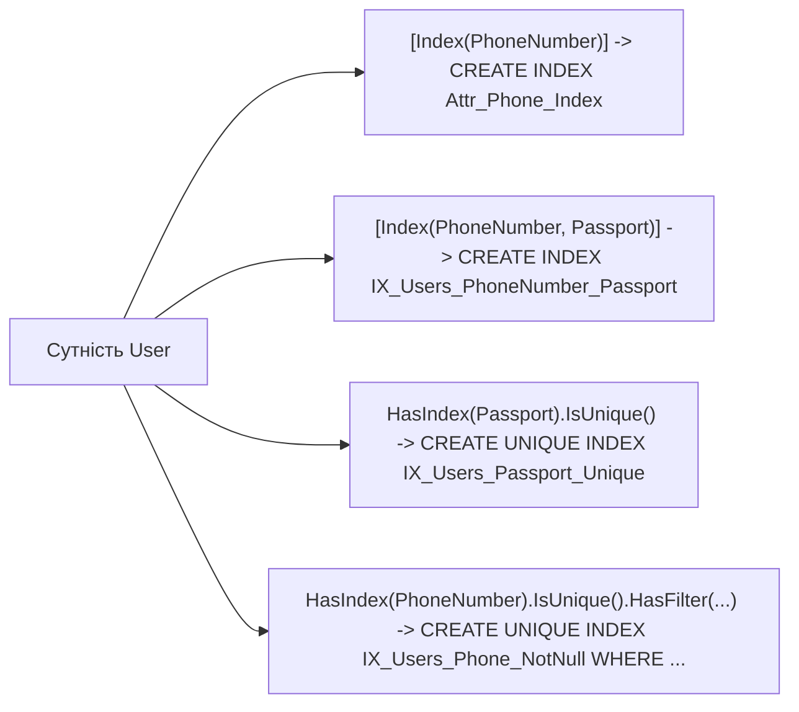

# 2.17. Налаштування індексів

- **Глава:** 03. Створення моделей в EF Core
- **Джерело Metanit:** [https://metanit.com/sharp/efcore/2.17.php](https://metanit.com/sharp/efcore/2.17.php)
- **Код прикладу:** [`Lesson_2_17_Indexes.cs`](../../src/03_ModelsAndMapping/Lesson_2_17_Indexes.cs)
- **Запуск уроку:** `dotnet run --project src/EFCoreMastery.ConsoleApp -- 2.17`
- **Шпаргалка глави:** [Runs.md](Runs.md)

---

## Мета уроку

Навчитися створювати індекси бази даних в EF Core для прискорення пошуку (`SELECT ... WHERE`) та забезпечення унікальності значень за допомогою атрибута `[Index]` і Fluent API (`HasIndex`), включно зі складеними, унікальними, іменованими та фільтрованими (частковими) індексами.

---

## Детальний теоретичний матеріал

**Індекс** у реляційній базі даних — це спеціальна структура даних (зазвичай B-Tree), яка дозволяє СУБД знаходити рядки за значенням одного або кількох стовпців без повного перебору таблиці (Full Table Scan).

За замовчуванням EF Core автоматично створює індекси лише для **первинних** і **зовнішніх ключів**. Усі інші індекси налаштовуються через анотації даних або Fluent API.

### 1. Налаштування індексів за допомогою атрибута `[Index]`

Атрибут `[Index]` знаходиться в просторі імен `Microsoft.EntityFrameworkCore` і застосовується **над класом сутності** (можна вказувати кілька атрибутів `[Index]` для одного класу):

```csharp
using Microsoft.EntityFrameworkCore;

[Index(nameof(PhoneNumber), Name = "Attr_Phone_Index")]
[Index(nameof(PhoneNumber), nameof(Passport))]
public class User
{
    public int Id { get; set; }
    public string? Name { get; set; }
    public string? Passport { get; set; }
    public string? PhoneNumber { get; set; }
}
```

Параметри атрибута `[Index]`:
- **Перший та наступні позиційні параметри:** імена властивостей (зручно передавати через `nameof(...)`), за якими будується простий або складений індекс.
- `IsUnique = true` — робить індекс унікальним.
- `Name = "..."` — задає власне ім'я індексу в БД.

### 2. Налаштування індексів через Fluent API (`HasIndex`)

Fluent API надає повний набір можливостей для конфігурації індексів у методі `OnModelCreating`:

| Можливість | Синтаксис Fluent API |
| :--- | :--- |
| **Звичайний індекс** | `modelBuilder.Entity<User>().HasIndex(u => u.Passport);` |
| **Унікальний індекс** | `modelBuilder.Entity<User>().HasIndex(u => u.Passport).IsUnique();` |
| **Складений індекс** | `modelBuilder.Entity<User>().HasIndex(u => new { u.Passport, u.PhoneNumber });` |
| **Ім'я індексу** | `.HasDatabaseName("IX_Users_Passport_Unique")` |
| **Фільтрований індекс** | `.HasFilter("\"PhoneNumber\" IS NOT NULL")` |

### 3. Фільтровані (часткові) індекси (`HasFilter`)

Іноді потрібно, щоб індекс охоплював не всі рядки таблиці, а лише ті, що відповідають певній умові (наприклад, `IS NOT NULL` або `IsDeleted = 0`). Це:
- зменшує розмір індексу на диску та прискорює операції запису;
- дозволяє реалізувати **унікальність лише для непорожніх значень** (наприклад, у таблиці може бути багато користувачів без телефону `PhoneNumber = NULL`, але якщо телефон вказано, він має бути унікальним).

```csharp
modelBuilder.Entity<User>()
    .HasIndex(u => u.PhoneNumber)
    .IsUnique()
    .HasDatabaseName("IX_Users_Phone_NotNull")
    .HasFilter("\"PhoneNumber\" IS NOT NULL");
```

---

## Діаграма / Архітектура процесу

На діаграмі показано, як різні конфігурації індексів на сутності `User` відображаються на індекси в SQLite:



---

## Покроковий розбір прикладів коду

У файлі [`Lesson_2_17_Indexes.cs`](../../src/03_ModelsAndMapping/Lesson_2_17_Indexes.cs) на одному класі `L2_17.User` поєднано обидва підходи:

1. **Атрибути над `User`:**
   - `[Index(nameof(PhoneNumber), Name = "Attr_Phone_Index")]` — створює звичайний індекс на `PhoneNumber` з іменем `Attr_Phone_Index`.
   - `[Index(nameof(PhoneNumber), nameof(Passport))]` — створює складений індекс з іменем за замовчуванням `IX_Users_PhoneNumber_Passport`.
2. **Fluent API в `OnModelCreating`:**
   - `HasIndex(u => u.Passport).IsUnique().HasDatabaseName("IX_Users_Passport_Unique")` — створює унікальний індекс на `Passport`.
   - `HasIndex(u => u.PhoneNumber).IsUnique().HasDatabaseName("IX_Users_Phone_NotNull").HasFilter("\"PhoneNumber\" IS NOT NULL")` — створює частковий унікальний індекс на `PhoneNumber`.
   - *Зверніть увагу:* на властивості `PhoneNumber` створено **два окремі індекси** (`Attr_Phone_Index` та `IX_Users_Phone_NotNull`), оскільки вони мають різні імена та конфігурації (звичайний vs унікальний фільтрований).
3. **Перевірка створених індексів у SQLite:**
   Запит до `sqlite_master WHERE type='index' AND sql IS NOT NULL` виводить реальні DDL-інструкції:
   ```sql
   CREATE INDEX "Attr_Phone_Index" ON "Users" ("PhoneNumber")
   CREATE UNIQUE INDEX "IX_Users_Passport_Unique" ON "Users" ("Passport")
   CREATE UNIQUE INDEX "IX_Users_Phone_NotNull" ON "Users" ("PhoneNumber") WHERE "PhoneNumber" IS NOT NULL
   CREATE INDEX "IX_Users_PhoneNumber_Passport" ON "Users" ("PhoneNumber", "Passport")
   ```
4. **Перевірка поведінки під час вставки:**
   - Додавання `Alice` і `Bob` з `PhoneNumber = null` проходить успішно, бо фільтрований індекс ігнорує `NULL`.
   - Спроба додати `Clone` з дублем `Passport = "P-100"` блокується індексом `IX_Users_Passport_Unique` і викликає `DbUpdateException` (`UNIQUE constraint failed: Users.Passport`).

---

## Особливості роботи в SQLite

| Аспект | SQLite | MS SQL Server |
| :--- | :--- | :--- |
| **Синтаксис `HasFilter`** | Стандартні подвійні лапки: `"PhoneNumber" IS NOT NULL` (хоча квадратні дужки `[PhoneNumber]` SQLite також приймає). | Квадратні дужки: `[PhoneNumber] IS NOT NULL`. |
| **Поведінка `UNIQUE` з `NULL`** | У SQLite кілька значень `NULL` в унікальному індексі вважаються різними навіть без фільтра (згідно зі стандартом SQL). | У SQL Server звичайний `UNIQUE` індекс дозволяє лише **один** `NULL`, тому `HasFilter("[Col] IS NOT NULL")` є обов'язковим для кількох `NULL`. |
| **Часткові індекси** | Повністю підтримуються (`CREATE UNIQUE INDEX ... WHERE ...`). | Повністю підтримуються (`CREATE UNIQUE NONCLUSTERED INDEX ... WHERE ...`). |

---

## Типові помилки, підводні камені та Best Practices

1. **`HasIndex(...).IsUnique()` vs `HasAlternateKey(...)`.** У 95% випадків для унікальності бізнес-полів (`Email`, `PhoneNumber`, `Slug`) слід використовувати саме `HasIndex(...).IsUnique()`, оскільки він дозволяє стовпцю бути `NULL` (з `HasFilter`) і дозволяє змінювати значення після створення запису.
2. **Порядок стовпців у складеному індексі.** Індекс `(PhoneNumber, Passport)` прискорює пошук за `PhoneNumber` або за парою `(PhoneNumber, Passport)`, але **не** прискорює пошук лише за `Passport`. Ставте найбільш селективний або найчастіше використовуваний у `WHERE` стовпець на перше місце.
3. **Занадто багато індексів.** Кожен індекс прискорює `SELECT`, але сповільнює `INSERT`, `UPDATE` і `DELETE`, оскільки БД мусить оновлювати всі індекси при кожній зміні даних.
4. **Простір імен для `[Index]`.** На відміну від `[Key]` або `[Table]`, атрибут `[Index]` знаходиться безпосередньо в `Microsoft.EntityFrameworkCore`, а не в `System.ComponentModel.DataAnnotations`.

---
<!-- lesson-nav -->
← [2.7. Налаштування ключів](2_07_Keys.md) | [Шпаргалка глави (Runs.md)](Runs.md) | [Зміст курсу (README)](../../README.md) | [2.8. Генерація значень властивостей і стовпців](2_08_ValueGeneration.md) →
