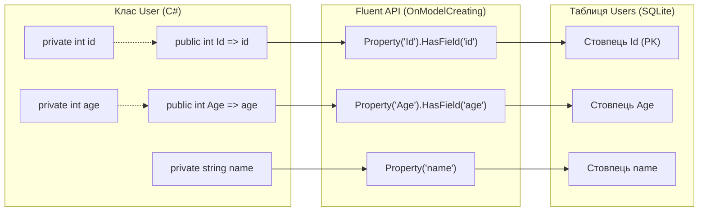

# 2.5. Використання полів сутності

- **Глава:** 03. Створення моделей в EF Core
- **Джерело Metanit:** [https://metanit.com/sharp/efcore/2.5.php](https://metanit.com/sharp/efcore/2.5.php)
- **Код прикладу:** [`Lesson_2_5_EntityFields.cs`](../../src/03_ModelsAndMapping/Lesson_2_5_EntityFields.cs)

---

## Мета уроку

Навчитися налаштовувати в EF Core пряме зіставлення стовпців бази даних із **приватними полями (backing fields)** класу сутності: як у парі з властивістю лише для читання (через `HasField()`), так і взагалі без публічної властивості в класі (через `Property("fieldName")` та `EF.Property<T>()`).

---

## Детальний теоретичний матеріал

### Навіщо потрібна робота з полями в EF Core

В об'єктно-орієнтованому проєктуванні та **Domain-Driven Design (DDD)** часто прагнуть максимально інкапсулювати внутрішній стан сутності:
- заборонити зовнішньому коду напряму змінювати `Id` або інші поля (зробити їх лише для читання, без `set`);
- або взагалі приховати певне поле з публічного API класу, залишивши його доступним лише всередині методів сутності.

За замовчуванням EF Core шукає лише публічні властивості з `get` і `set`. Щоб змусити EF Core працювати з приватними полями, використовується **Fluent API**.

### Два способи налаштування полів у Fluent API

| Сценарій | Оголошення в класі C# | Конфігурація у Fluent API | Як використовувати в LINQ |
| :--- | :--- | :--- | :--- |
| **1. Властивість лише для читання + приватне поле** | `private int id;`<br>`public int Id => id;` | `modelBuilder.Entity<User>().Property("Id").HasField("id");` | Звичайно: `u => u.Id == 1` |
| **2. Лише приватне поле (без властивості)** | `private string name;` | `modelBuilder.Entity<User>().Property("name");` | Через `EF.Property<string>(u, "name")` |

#### 1. Прив'язка властивості до backing field (`HasField`)
Якщо властивість має лише `get` (`public int Id => id;`), без додаткового налаштування EF Core проігнорує її. Але якщо у Fluent API вказати:

```csharp
modelBuilder.Entity<User>().Property("Id").HasField("id");
modelBuilder.Entity<User>().Property("Age").HasField("age");
```

то:
- У таблиці БД створюються стовпці `Id` та `Age` (за іменами властивостей).
- Під час збереження (`SaveChanges()`) і матеріалізації з БД EF Core читає та записує дані **безпосередньо в приватні поля** `id` та `age`, оминаючи відсутність `set`.

> [!NOTE]
> У рядковій формі `Property("Id")` використовується саме назва властивості, оскільки `u => u.Id` також працює для властивостей із `get`. Для `HasField("id")` завжди передається рядок з точним іменем приватного поля.

#### 2. Поле без публічної властивості (`Property("fieldName")`)
Якщо в класі є приватне поле `private string name;`, і ви взагалі не хочете відкривати його назовні навіть для читання:

```csharp
modelBuilder.Entity<User>().Property("name");
```

У цьому випадку:
- EF Core реєструє `"name"` як властивість моделі (подібно до shadow property, але зі збереженням у реальному приватному полі класу).
- У таблиці створюється стовпець `"name"`.
- Звернутися до цього поля в LINQ-запиті (`Where`, `OrderBy`, `Select`) можна за допомогою статичного методу `EF.Property<T>(entity, "name")`:
  ```csharp
  var kate = db.Users.FirstOrDefault(u => EF.Property<string>(u, "name") == "Kate");
  ```

### Режими доступу до полів (`UsePropertyAccessMode`)

EF Core також дозволяє керувати тим, коли саме використовувати поле, а коли властивість (актуально, якщо в `get`/`set` є логіка, а поле все одно є):
- `PropertyAccessMode.Field` — завжди читати і писати напряму в поле (навіть якщо є `get`/`set`).
- `PropertyAccessMode.FieldDuringConstruction` — використовувати поле при матеріалізації, але властивість при звичайній роботі.
- `PropertyAccessMode.PreferField` (типово в EF Core) — використовувати поле, якщо воно відоме, інакше властивість.

---

## Діаграма / Архітектура процесу

На діаграмі показано, як поля класу `User` відображаються на стовпці таблиці `Users` у БД:



---

## Покроковий розбір прикладів коду

У файлі [`Lesson_2_5_EntityFields.cs`](../../src/03_ModelsAndMapping/Lesson_2_5_EntityFields.cs) реалізовано повністю інкапсульовану сутність `L2_5.User`:

1. **Оголошення полів та властивостей:**
   ```csharp
   private int id = 0;
   private string name;
   private int age;

   public int Id => id;
   public int Age => age;
   ```
   - Поле `id` ініціалізовано нулем (`= 0`), щоб прибрати попередження компілятора `CS0649` (*"Field 'id' is never assigned to"*), оскільки його значення заповнює EF Core після вставки в БД.
   - `name` взагалі не має публічної властивості — воно передається через конструктор `User(string name, int age)` і виводиться лише через метод `Print()`.

2. **Налаштування в `ApplicationContext.OnModelCreating`:**
   ```csharp
   modelBuilder.Entity<User>().Property("Id").HasField("id");
   modelBuilder.Entity<User>().Property("Age").HasField("age");
   modelBuilder.Entity<User>().Property("name");
   ```
   - `Id` розпізнається як первинний ключ за умовними угодами, а `HasField("id")` вказує EF Core записувати згенерований БД ідентифікатор прямо в поле `id`.

3. **Збереження та читання в `Run()`:**
   - У першому контексті створюються `Bob` (30) і `Kate` (29) та зберігаються через `db.SaveChanges()`.
   - У другому контексті `db.Users.ToList()` завантажує рядки з SQLite і заповнює приватні поля `id`, `name`, `age`.
   - Виклик `user.Print()` виводить `1. Bob - 30` та `2. Kate - 29`.
   - Пошук через `EF.Property<string>(u, "name") == "Kate"` транслюється в SQL-запит:
     ```sql
     SELECT "u"."Id", "u"."Age", "u"."name"
     FROM "Users" AS "u"
     WHERE "u"."name" = 'Kate'
     LIMIT 1
     ```

---

## Особливості роботи в SQLite

- У таблиці `Users` у SQLite створюються стовпці `"Id"`, `"Age"` та `"name"` (останній — у нижньому регістрі, точно так, як називається приватне поле).
- Якщо потрібно, щоб у базі даних стовпець називався `"Name"` (з великої літери), можна додати `.HasColumnName("Name")` до `modelBuilder.Entity<User>().Property("name").HasColumnName("Name");`.
- Поведінка backing fields у SQLite повністю ідентична MS SQL Server.

---

## Типові помилки, підводні камені та Best Practices

1. **Помилка в рядковому імені поля або властивості.** Оскільки `Property("...")` і `HasField("...")` приймають рядки, одруківка (наприклад, `"_id"` замість `"id"`) не виявиться на етапі компіляції, а призведе до `InvalidOperationException` під час запуску програми.
2. **Використання `nameof()` для зменшення ризику помилок.** Хоча для приватного поля ззовні класу `nameof(User.id)` недоступне через `private`, усередині конфігурації можна використовувати константи або `internal` поля, якщо проєкт великий, або покривати побудову моделі unit-тестом.
3. **Попередження компілятора `CS0649`.** Приватні поля, які змінюються лише через EF Core (наприклад, `id`), варто ініціалізувати значенням за замовчуванням (`= 0;` або `= null!;`), щоб код компілювався без попереджень.
4. **Не плутайте `Property("name")` (backing field) із Shadow Property.** Якщо в класі `User` **є** приватне поле `name`, EF Core автоматично прив'яжеться до нього. Якщо ж такого поля в класі **немає**, то `Property<string>("name")` створить *тіньову властивість* (Shadow Property), значення якої зберігатиметься лише в `ChangeTracker`.
