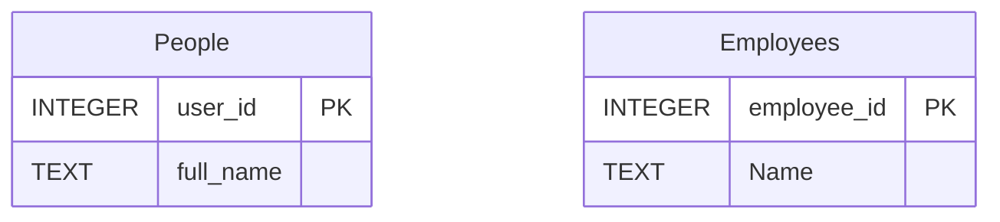

# 2.6. Зіставлення таблиць і стовпців

- **Глава:** 03. Створення моделей в EF Core
- **Джерело Metanit:** [https://metanit.com/sharp/efcore/2.6.php](https://metanit.com/sharp/efcore/2.6.php)
- **Код прикладу:** [`Lesson_2_6_TablesAndColumns.cs`](../../src/03_ModelsAndMapping/Lesson_2_6_TablesAndColumns.cs)

---

## Мета уроку

Навчитися явно задавати імена таблиць (а також схем бази даних) і стовпців у реляційній базі даних за допомогою анотацій даних (`[Table]`, `[Column]`) та Fluent API (`ToTable()`, `HasColumnName()`), а також зрозуміти, як це працює в SQLite порівняно з MS SQL Server.

---

## Детальний теоретичний матеріал

За умовними угодами EF Core:
- ім'я таблиці збігається з назвою властивості `DbSet<T>` у класі контексту (наприклад, `DbSet<User> Users` $\rightarrow$ таблиця `Users`), або з назвою класу, якщо `DbSet<T>` не визначено;
- ім'я кожного стовпця збігається з назвою відповідної властивості класу сутності.

На практиці дуже часто виникає потреба змінити ці імена — наприклад, при підключенні до вже існуючої БД зі стилем іменування `snake_case` (`user_id`, `full_name`) або коли в БД таблиця називається `People`, а в коді C# зручніше працювати з класом `User`.

### Перевизначення імені таблиці

| Підхід | Синтаксис | Підтримка схеми (`schema`) |
| :--- | :--- | :--- |
| **Анотація даних** | `[Table("People")]` над класом | `[Table("People", Schema = "userstore")]` |
| **Fluent API** | `modelBuilder.Entity<User>().ToTable("People");` | `modelBuilder.Entity<User>().ToTable("People", schema: "userstore");` |

Атрибут `[Table]` знаходиться у просторі імен `System.ComponentModel.DataAnnotations.Schema`.

```csharp
using System.ComponentModel.DataAnnotations.Schema;

[Table("People")]
public class User
{
    public int Id { get; set; }
    public string? Name { get; set; }
}
```

### Перевизначення імені стовпця

| Підхід | Синтаксис |
| :--- | :--- |
| **Анотація даних** | `[Column("user_id")]` над властивістю |
| **Fluent API** | `modelBuilder.Entity<User>().Property(u => u.Id).HasColumnName("user_id");` |

Окрім імені стовпця, атрибут `[Column]` (через властивість `TypeName`) та Fluent API (через `HasColumnType()`) дозволяють також задавати точний тип даних стовпця в СУБД, що детальніше розглядається в темах про типи даних.

### Пріоритет при одночасному використанні

Як і скрізь в EF Core, **Fluent API має вищий пріоритет за анотації даних**. Якщо на класі стоїть `[Table("People")]`, але в `OnModelCreating` викликано `.ToTable("Employees")`, у базі даних буде створено таблицю `Employees`.

---

## Діаграма / Архітектура процесу

На діаграмі показано зіставлення C#-класів із фізичними таблицями в обох контекстах уроку:



---

## Покроковий розбір прикладів коду

У файлі [`Lesson_2_6_TablesAndColumns.cs`](../../src/03_ModelsAndMapping/Lesson_2_6_TablesAndColumns.cs) наведено два окремих контексти, що демонструють обидва підходи.

### Крок 1. `AnnotationsContext` — використання `[Table]` та `[Column]`

```csharp
[Table("People")]
public class UserAnnotated
{
    [Column("user_id")]
    public int Id { get; set; }

    [Column("full_name")]
    public string? Name { get; set; }
}
```
Хоча в `AnnotationsContext` властивість називається `public DbSet<UserAnnotated> Users`, у SQLite створюється таблиця `"People"` зі стовпцями `"user_id"` та `"full_name"`:
```sql
CREATE TABLE "People" (
    "user_id" INTEGER NOT NULL CONSTRAINT "PK_People" PRIMARY KEY AUTOINCREMENT,
    "full_name" TEXT NULL
)
```

### Крок 2. `FluentContext` — використання `ToTable()` та `HasColumnName()`

```csharp
modelBuilder.Entity<UserFluent>()
    .ToTable("Employees", schema: "userstore")
    .Property(u => u.Id)
    .HasColumnName("employee_id");
```
- `ToTable("Employees", schema: "userstore")` задає ім'я таблиці `"Employees"` і схему `"userstore"`.
- Метод `ToTable()` повертає `EntityTypeBuilder<UserFluent>`, що дозволяє одразу в ланцюжку викликати `.Property(u => u.Id).HasColumnName("employee_id")`.
- Запит до `sqlite_master` показує, що в SQLite створено таблицю `"Employees"` зі стовпцями `"employee_id"` та `"Name"`.

---

## Особливості роботи в SQLite

| Аспект | SQLite | MS SQL Server / PostgreSQL |
| :--- | :--- | :--- |
| **Схеми БД (`schema`)** | **Не підтримуються!** Якщо передати `schema: "userstore"` у `ToTable()` або `[Table(..., Schema = "...")]`, провайдер SQLite **ігнорує** схему і створює таблицю просто як `"Employees"`. | Повна підтримка схем: створюється таблиця `[userstore].[Employees]` (SQL Server) або `"userstore"."Employees"` (PostgreSQL). |
| **Реєстр імен** | SQLite зазвичай нечутливий до регістру імен таблиць/стовпців у запитах, але зберігає точний регістр із DDL (`"People"`, `"user_id"`). | У SQL Server залежить від collation сервера/БД; у PostgreSQL імена в лапках чутливі до регістру. |

---

## Типові помилки, підводні камені та Best Practices

1. **Використання C#-імен у «сирих» SQL-запитах.** Навіть якщо властивість у `DbContext` називається `Users`, а в класі є `Id`, після `[Table("People")]` та `[Column("user_id")]` у методах `FromSqlRaw` або `ExecuteSqlRaw` потрібно писати `SELECT user_id FROM People`, інакше СУБД поверне помилку *«no such table: Users»*.
2. **Зміна імені таблиці при наявності зовнішніх ключів.** Якщо перейменувати таблицю після створення початкової міграції, EF Core згенерує операцію `RenameTable` у новій міграції, зберігши наявні дані (на відміну від видалення і створення заново).
3. **Очікування роботи `schema` в SQLite.** Якщо ваша бізнес-логіка або тести розраховують на ізоляцію таблиць за різними схемами (`sales.Orders` та `archive.Orders`), пам'ятайте, що в SQLite обидві таблиці потраплять в одну площину і спричинять конфлікт імен `Orders`. Для SQLite краще додавати префікс до імені таблиці (`sales_Orders`).
