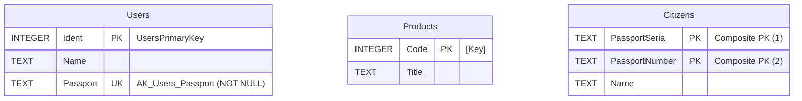

# 2.7. Налаштування ключів

- **Глава:** 03. Створення моделей в EF Core
- **Джерело Metanit:** [https://metanit.com/sharp/efcore/2.7.php](https://metanit.com/sharp/efcore/2.7.php)
- **Код прикладу:** [`Lesson_2_7_Keys.cs`](../../src/03_ModelsAndMapping/Lesson_2_7_Keys.cs)
- **Запуск уроку:** `dotnet run --project src/EFCoreMastery.ConsoleApp -- 2.7`
- **Шпаргалка глави:** [Runs.md](Runs.md)

---

## Мета уроку

Опанувати всі способи налаштування ключів у EF Core: первинних ключів (Primary Keys) за умовними угодами, через атрибут `[Key]` і Fluent API `HasKey()`, налаштування імені обмеження через `HasName()`, створення складених ключів (Composite Keys) та альтернативних унікальних ключів (`HasAlternateKey()`).

---

## Детальний теоретичний матеріал

Кожна звичайна сутність у EF Core (крім Keyless Entity Types) **повинна мати первинний ключ**, який однозначно ідентифікує кожен рядок у таблиці та використовується механізмом `ChangeTracker` для відстеження об'єктів.

### 1. Первинний ключ за умовними угодами (Conventions)

Якщо не вказувати жодних налаштувань, EF Core шукає в класі сутності властивість із назвою:
- `Id` (без урахування регістру)
- або `<Ім'яКласу>Id` (наприклад, `UserId` у класі `User`).

Знайдена властивість автоматично стає первинним ключем (`PRIMARY KEY`).

### 2. Перевизначення первинного ключа

Якщо ключова властивість має нестандартне ім'я (наприклад, `Ident` або `Code`), первинний ключ потрібно вказати явно:

| Підхід | Синтаксис | Можливість задати ім'я обмеження |
| :--- | :--- | :--- |
| **Анотація даних** | `[Key] public int Code { get; set; }` (`System.ComponentModel.DataAnnotations`) | Ні |
| **Fluent API** | `modelBuilder.Entity<User>().HasKey(u => u.Ident).HasName("UsersPrimaryKey");` | Так (`HasName(...)`) |

Метод `HasName("UsersPrimaryKey")` задає ім'я обмеження `CONSTRAINT "UsersPrimaryKey" PRIMARY KEY` у DDL бази даних (замість стандартного `PK_Users`).

### 3. Складені ключі (Composite Primary Keys)

Іноді унікальність рядка визначається не одним стовпцем, а комбінацією кількох (наприклад, серія та номер паспорта, або зв'язкова таблиця `StudentId + CourseId`).

Складений ключ налаштовується через Fluent API методом `HasKey()` з передачею анонімного об'єкта:

```csharp
modelBuilder.Entity<Citizen>()
    .HasKey(c => new { c.PassportSeria, c.PassportNumber });
```

> [!NOTE]
> Традиційно атрибут `[Key]` над двома властивостями одночасно не створює складений ключ у EF Core (починаючи з EF Core 7 з'явився атрибут класу `[PrimaryKey(nameof(PassportSeria), nameof(PassportNumber))]`, проте на Metanit і в класичному EF Core стандартом є Fluent API `HasKey`).

### 4. Альтернативні ключі (Alternate Keys)

**Альтернативний ключ** — це властивість (або набір властивостей), яка не є первинним ключем, але також унікально ідентифікує сутність і може виступати ціллю для зовнішнього ключа (`ForeignKey` / `HasPrincipalKey`) в інших таблицях.

```csharp
modelBuilder.Entity<User>()
    .HasAlternateKey(u => u.Passport);
```

Також можна створювати **складений альтернативний ключ**:
```csharp
modelBuilder.Entity<User>()
    .HasAlternateKey(u => new { u.Passport, u.PhoneNumber });
```

Що робить `HasAlternateKey()` під капотом:
1. У базі даних створюється обмеження `UNIQUE` (наприклад, `CONSTRAINT "AK_Users_Passport" UNIQUE("Passport")`).
2. Усі властивості, що входять до альтернативного ключа, автоматично стають **`NOT NULL`** (навіть якщо в C# вони оголошені як `string?`).
3. У EF Core значення альтернативного ключа після збереження в БД вважається **незмінним** (спроба змінити `user.Passport` у відстежуваного об'єкта призведе до винятку).

---

## Діаграма / Архітектура процесу

На діаграмі зображено структуру таблиць і ключів з обох контекстів уроку:



---

## Покроковий розбір прикладів коду

У файлі [`Lesson_2_7_Keys.cs`](../../src/03_ModelsAndMapping/Lesson_2_7_Keys.cs) реалізовано два контексти.

### Крок 1. `SingleAndAlternateKeyContext` (`HasKey`, `HasName`, `HasAlternateKey`, `[Key]`)

- Для `User` у `OnModelCreating` задано:
  ```csharp
  modelBuilder.Entity<User>()
      .HasKey(u => u.Ident)
      .HasName("UsersPrimaryKey");

  modelBuilder.Entity<User>()
      .HasAlternateKey(u => u.Passport);
  ```
- Для `AnnotatedProduct` використано атрибут `[Key]` над властивістю `Code`.
- Згенерований DDL таблиці `Users` у SQLite:
  ```sql
  CREATE TABLE "Users" (
      "Ident" INTEGER NOT NULL CONSTRAINT "UsersPrimaryKey" PRIMARY KEY AUTOINCREMENT,
      "Name" TEXT NULL,
      "Passport" TEXT NOT NULL,
      CONSTRAINT "AK_Users_Passport" UNIQUE ("Passport")
  )
  ```
  Зверніть увагу, що `Passport` став `TEXT NOT NULL`, хоча в C# оголошений як `string?`.
- У `Run()` додається перший користувач із `Passport = "AB123456"`, після чого викликається `db.ChangeTracker.Clear()` і робиться спроба додати другого користувача з таким самим паспортом. SQLite блокує вставку, і EF Core кидає `DbUpdateException` (`UNIQUE constraint failed: Users.Passport`).

### Крок 2. `CompositeKeyContext` (складений первинний ключ)

- Сутність `Citizen` має властивості `PassportSeria` та `PassportNumber`.
- У `OnModelCreating` викликається:
  ```csharp
  modelBuilder.Entity<Citizen>()
      .HasKey(c => new { c.PassportSeria, c.PassportNumber });
  ```
- Згенерований DDL таблиці `Citizens` у SQLite:
  ```sql
  CREATE TABLE "Citizens" (
      "PassportSeria" TEXT NOT NULL,
      "PassportNumber" TEXT NOT NULL,
      "Name" TEXT NULL,
      CONSTRAINT "PK_Citizens" PRIMARY KEY ("PassportSeria", "PassportNumber")
  )
  ```
- У `Run()` успішно зберігаються два громадянина з однаковою серією `"1234"`, але різними номерами `"345678"` і `"345679"`.

---

## Особливості роботи в SQLite

- Для одиночного цілочисельного первинного ключа (`int Ident`) SQLite автоматично додає `AUTOINCREMENT` до `PRIMARY KEY`.
- Для складеного первинного ключа (`PassportSeria`, `PassportNumber`) або рядкового ключа автогенерація не вмикається — значення потрібно задавати в коді перед `SaveChanges()`.
- Альтернативний ключ у SQLite створює `CONSTRAINT "AK_..." UNIQUE (...)` і робить стовпець `NOT NULL`, так само як у MS SQL Server.

---

## Типові помилки, підводні камені та Best Practices

1. **Плутанина між `HasAlternateKey` та `HasIndex(...).IsUnique()`.** Використовуйте `HasAlternateKey` лише тоді, коли на це поле буде посилатися зовнішній ключ (`FOREIGN KEY`) іншої таблиці або це справжній незмінний природний ключ. Якщо вам просто потрібна унікальність (наприклад, `Email` або `PhoneNumber`, які користувач може змінювати або залишати `NULL`), використовуйте **унікальний індекс** (`HasIndex().IsUnique()`).
2. **Порядок властивостей у складеному ключі.** При пошуку через `db.Citizens.Find(seria, number)` порядок аргументів у `Find()` має **точно відповідати** порядку властивостей в анонімному об'єкті `new { c.PassportSeria, c.PassportNumber }`.
3. **Забутий `Id` без налаштування ключа.** Якщо назвати ключ `UserCode` і не поставити `[Key]` або `HasKey()`, EF Core викине `InvalidOperationException: The entity type '...' requires a primary key to be defined`.

---
<!-- lesson-nav -->
← [2.15. Обов'язкові та необов'язкові властивості](2_15_RequiredAndOptional.md) | [Шпаргалка глави (Runs.md)](Runs.md) | [Зміст курсу (README)](../../README.md) | [2.17. Налаштування індексів](2_17_Indexes.md) →
