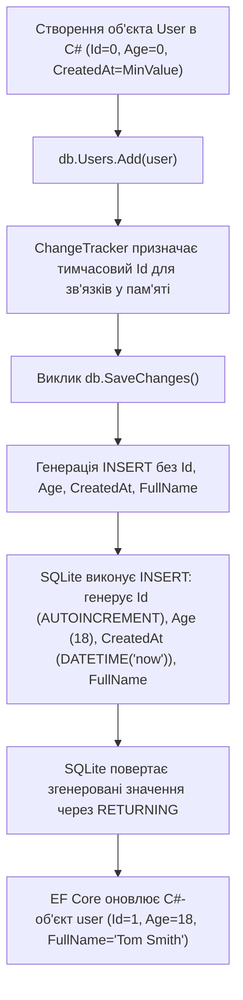

# 2.8. Генерація значень властивостей і стовпців

- **Глава:** 03. Створення моделей в EF Core
- **Джерело Metanit:** [https://metanit.com/sharp/efcore/2.8.php](https://metanit.com/sharp/efcore/2.8.php)
- **Код прикладу:** [`Lesson_2_8_ValueGeneration.cs`](../../src/03_ModelsAndMapping/Lesson_2_8_ValueGeneration.cs)

---

## Мета уроку

Навчитися керувати генерацією значень властивостей і стовпців у EF Core: розуміти, коли значення генеруються автоматично (ключі `int` / `Guid`), як вмикати чи вимикати автогенерацію (`[DatabaseGenerated]`, `ValueGeneratedNever()`, `ValueGeneratedOnAdd()`, `ValueGeneratedOnAddOrUpdate()`), як задавати значення за замовчуванням (`HasDefaultValue`, `HasDefaultValueSql`) та створювати обчислювані стовпці (`HasComputedColumnSql`).

---

## Детальний теоретичний матеріал

Коли ви додаєте нову сутність через `db.Users.Add(user)` і викликаєте `SaveChanges()`, для кожної властивості EF Core вирішує: передати в SQL-запит `INSERT` значення з C#-об'єкта чи дозволити базі даних (або клієнтському генератору) згенерувати значення самостійно.

### 1. Генерація первинних ключів за замовчуванням

За умовними угодами, якщо первинний ключ має тип `int`, `long` або `Guid`, і під час додавання він має значення за замовчуванням CLR (`0` для чисел, `Guid.Empty` для `Guid`), EF Core автоматично налаштовує для нього генерацію при вставці (`ValueGeneratedOnAdd`). Для всіх інших властивостей значення за замовчуванням не генеруються.

### 2. Атрибут `[DatabaseGenerated]` та методи `ValueGenerated*`

Щоб явно змінити стратегію генерації значень для властивості, використовують атрибут `[DatabaseGenerated(DatabaseGeneratedOption.*)]` (простір імен `System.ComponentModel.DataAnnotations.Schema`) або відповідні методи Fluent API:

| Опція `DatabaseGeneratedOption` | Аналог у Fluent API | Поведінка |
| :--- | :--- | :--- |
| **`None`** | `.ValueGeneratedNever()` | Вимикає автогенерацію. Значення (наприклад, `Id`) потрібно завжди задавати вручну перед `SaveChanges()`. |
| **`Identity`** | `.ValueGeneratedOnAdd()` | Значення генерується базою даних лише **один раз** під час вставки (`INSERT`), і надалі при `UPDATE` не змінюється. |
| **`Computed`** | `.ValueGeneratedOnAddOrUpdate()` | Значення генерується базою даних як при вставці (`INSERT`), так і при кожному оновленні (`UPDATE`), наприклад, обчислюваний стовпець або мітка часу оновлення. |

> [!WARNING]
> Якщо вимкнути автогенерацію ключа (`ValueGeneratedNever()`) і додати два об'єкти без явного встановлення `Id`, обидва матимуть `Id = 0`. Другий об'єкт спричинить помилку порушення унікальності `PRIMARY KEY`!

### 3. Значення за замовчуванням (`HasDefaultValue` та `HasDefaultValueSql`)

Якщо властивості не задано значення в C#, база даних може підставити значення за замовчуванням (`DEFAULT` у DDL):

1. **Константне значення (`HasDefaultValue`):**
   ```csharp
   modelBuilder.Entity<User>()
       .Property(u => u.Age)
       .HasDefaultValue(18);
   ```
   У таблиці створюється стовпець із `DEFAULT 18`.
2. **SQL-вираз (`HasDefaultValueSql`):**
   ```csharp
   modelBuilder.Entity<User>()
       .Property(u => u.CreatedAt)
       .HasDefaultValueSql("DATETIME('now')");
   ```
   Дозволяє викликати вбудовані функції СУБД (поточний час, генерація UUID тощо) під час вставки рядка.

> [!NOTE]
> Коли для властивості налаштовано `HasDefaultValue` або `HasDefaultValueSql`, EF Core автоматично позначає її як `ValueGeneratedOnAdd()`. Якщо в C# вона має CLR-значення за замовчуванням (`0` для `int`, `DateTime.MinValue` для `DateTime`, `null` для `string?`), EF Core **не включає** цей стовпець у `INSERT`, щоб спрацював `DEFAULT` у БД, а потім зчитує згенероване значення назад у C#-об'єкт (через `RETURNING`).

### 4. Обчислювані стовпці (`HasComputedColumnSql`)

Обчислюваний стовпець — це стовпець, значення якого СУБД розраховує автоматично на основі інших стовпців того самого рядка:

```csharp
modelBuilder.Entity<User>()
    .Property(u => u.FullName)
    .HasComputedColumnSql("FirstName || ' ' || LastName");
```

За замовчуванням у C# таку властивість роблять лише для читання (`public string? FullName { get; }`), щоб у коді її не можна було змінити вручну. Після `SaveChanges()` EF Core автоматично повертає обчислене значення з БД у властивість `FullName`.

У `HasComputedColumnSql(sql, stored: true)` можна також передати другий параметр `stored: true`, щоб значення фізично зберігалося на диску (`STORED`), а не обчислювалося при кожному читанні (`VIRTUAL`).

---

## Діаграма / Архітектура процесу

Діаграма ілюструє життєвий цикл генерації значень під час `Add()` та `SaveChanges()`:



---

## Покроковий розбір прикладів коду

У файлі [`Lesson_2_8_ValueGeneration.cs`](../../src/03_ModelsAndMapping/Lesson_2_8_ValueGeneration.cs) реалізовано дві частини.

### Частина 1. `DefaultsAndComputedContext`

- Сутність `User` має `Id`, `FirstName`, `LastName`, `FullName` (лише `get`), `Age` та `CreatedAt`.
- У `OnModelCreating` налаштовано:
  - `Age` $\rightarrow$ `.HasDefaultValue(18)`
  - `CreatedAt` $\rightarrow$ `.HasDefaultValueSql("DATETIME('now')")`
  - `FullName` $\rightarrow$ `.HasComputedColumnSql("FirstName || ' ' || LastName")`
- Згенерований DDL у SQLite:
  ```sql
  CREATE TABLE "Users" (
      "Id" INTEGER NOT NULL CONSTRAINT "PK_Users" PRIMARY KEY AUTOINCREMENT,
      "FirstName" TEXT NULL,
      "LastName" TEXT NULL,
      "FullName" TEXT GENERATED ALWAYS AS (FirstName || ' ' || LastName) VIRTUAL,
      "Age" INTEGER NOT NULL DEFAULT 18,
      "CreatedAt" TEXT NOT NULL DEFAULT (DATETIME('now'))
  )
  ```
- У `Run()` ми створюємо `user` лише з `FirstName = "Tom"` і `LastName = "Smith"`.
  - До `SaveChanges()`: `Id=0, Age=0, CreatedAt=0001-01-01, FullName='null'`.
  - Після `SaveChanges()`: `Id=1, Age=18, CreatedAt=<поточний час UTC>, FullName='Tom Smith'`.

### Частина 2. `ManualKeyContext` (відключення автогенерації)

- У класі `ManualUser` над `Id` стоїть `[DatabaseGenerated(DatabaseGeneratedOption.None)]`, а в `OnModelCreating` додатково викликано `.ValueGeneratedNever()`.
- У таблиці `ManualUsers` створюється `"Id" INTEGER NOT NULL CONSTRAINT "PK_ManualUsers" PRIMARY KEY` **без `AUTOINCREMENT`**.
- У `Run()` об'єктам явно задаються ключі `101` та `205`, і вони успішно зберігаються саме з цими ідентифікаторами.

---

## Особливості роботи в SQLite

| Функціональність | MS SQL Server (T-SQL) | SQLite |
| :--- | :--- | :--- |
| **Поточна дата/час у `HasDefaultValueSql`** | `GETDATE()` або `SYSDATETIME()` | `DATETIME('now')` або `CURRENT_TIMESTAMP` (повертає час у UTC!) |
| **Конкатенація рядків у `HasComputedColumnSql`** | `FirstName + ' ' + LastName` | `FirstName \|\| ' ' \|\| LastName` (оператор `+` у SQLite виконує числове додавання!) |
| **Обчислювані стовпці** | Підтримуються (`AS (...)`) | Підтримуються починаючи з SQLite 3.31.0 (`GENERATED ALWAYS AS (...) VIRTUAL` або `STORED`) |
| **Автоінкремент** | `IDENTITY(1,1)` | `AUTOINCREMENT` |

---

## Типові помилки, підводні камені та Best Practices

1. **Проблема «сентинельного» значення `0` у `HasDefaultValue(18)`.** Якщо властивість `int Age` має `HasDefaultValue(18)`, ви **не зможете** зберегти користувача з реальним віком `0` (немовля), бо EF Core вважатиме `0` незаданим значенням і підставить `18` із БД! Для таких випадків використовуйте nullable-тип `int? Age` або встановлюйте значення за замовчуванням прямо в C# (`public int Age { get; set; } = 18;`).
2. **Використання `+` замість `||` у SQLite.** Якщо написати `HasComputedColumnSql("FirstName + ' ' + LastName")` для SQLite, замість склеювання рядків SQLite спробує перетворити імена на числа і поверне `0`!
3. **Забутий `Id` при `ValueGeneratedNever()`.** Завжди гарантуйте унікальність ключа на стороні клієнта, якщо вимкнули автогенерацію в БД.
