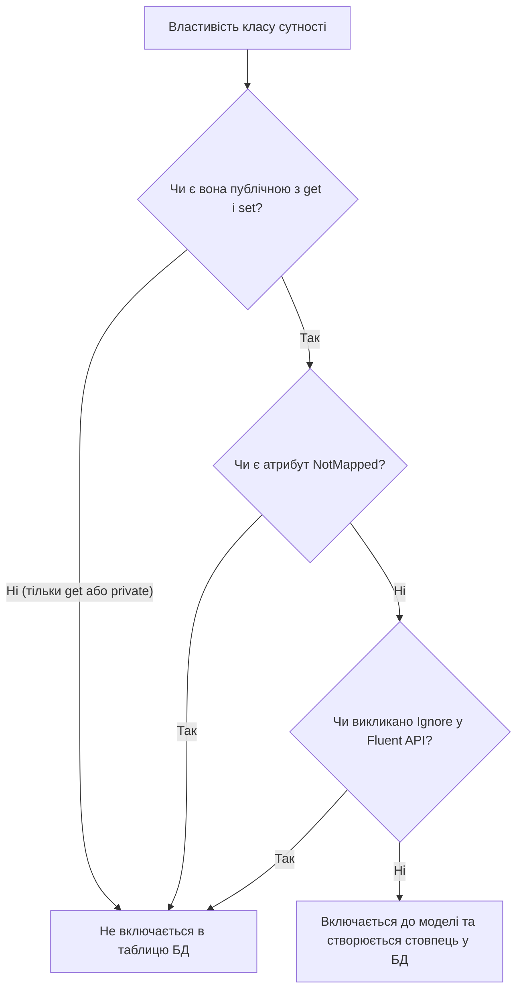

# 3.3. Властивості сутності

- **Глава:** 03. Створення моделей в EF Core
- **Джерело Metanit:** [https://metanit.com/sharp/efcore/2.4.php](https://metanit.com/sharp/efcore/2.4.php)
- **Код прикладу:** [`Lesson_3_03_EntityProperties.cs`](../../src/03_ModelsAndMapping/Lesson_3_03_EntityProperties.cs)
- **Запуск уроку:** `dotnet run --project src/EFCoreMastery.ConsoleApp -- 3.3`
- **Шпаргалка глави:** [Runs.md](Runs.md)

---

## Мета уроку

Розібратися, які властивості C#-класу EF Core автоматично включає до таблиці бази даних, як виключати окремі властивості з моделі за допомогою `[NotMapped]` і `Ignore()`, а також як EF Core взаємодіє з повноцінними властивостями, що використовують приватні поля (`get` / `set` із бізнес-логікою) замість автовластивостей.

---

## Детальний теоретичний матеріал

### Які властивості включаються до моделі за замовчуванням

За умовними угодами EF Core автоматично включає до моделі та зіставляє зі стовпцями таблиці **всі публічні властивості** класу сутності, які відкриті як для читання (`get`), так і для запису (`set`).

При цьому модифікатор доступу `set` може бути навіть `private` або `init` (наприклад, `public string Name { get; private set; }`) — EF Core все одно зможе встановлювати значення такої властивості при матеріалізації даних із БД. Натомість властивості **лише для читання** (без блоку `set`, зокрема expression-bodied властивості на кшталт `public string Summary => $"{Name} ({Age})";`) **автоматично ігноруються** і не створюють стовпців у базі даних.

### Виключення властивості з моделі

Часто в класі сутності потрібні властивості, які мають існувати лише в оперативній пам'яті (тимчасові прапорці UI, токени сесії, кешовані обчислення), але для яких **не потрібно** створювати стовпець у таблиці БД.

Для виключення окремої властивості є два способи:

| Спосіб | Код | Коли краще використовувати |
| :--- | :--- | :--- |
| **Fluent API (`Ignore`)** | `modelBuilder.Entity<User>().Ignore(u => u.Address);` | Коли доменний клас має залишатися чистим від атрибутів БД |
| **Анотація (`[NotMapped]`)** | `[NotMapped] public string? SessionToken { get; set; }` | Коли зручно бачити безпосередньо в класі, що властивість не зберігається в БД |

### Використання полів класу (повноцінні `get` і `set`)

У більшості прикладів використовуються автовластивості (`public string? Name { get; set; }`). Проте властивості не зобов'язані бути автовластивостями. Вони можуть зберігати значення у приватному полі класу та містити власну логіку в блоках `get` і `set` (наприклад, видалення зайвих пробілів `Trim()`, переведення в нижній регістр, валідація тощо):

```csharp
public class User
{
    private string _name = string.Empty;

    public int Id { get; set; }

    public string Name
    {
        get => _name;
        set => _name = value.Trim();
    }

    public int Age { get; set; }
}
```

EF Core коректно працює з такими властивостями: під час запису в БД він читає значення через `get`, а під час читання з БД (матеріалізації) — записує значення через `set` (або безпосередньо в backing field, залежно від налаштувань, див. урок **[3.5](3_05_EntityFields.md)**).

---

## Діаграма / Архітектура процесу

На схемі показано, як EF Core аналізує кожну властивість класу сутності при побудові таблиці:



---

## Покроковий розбір прикладів коду

Розглянемо файл [`Lesson_3_03_EntityProperties.cs`](../../src/03_ModelsAndMapping/Lesson_3_03_EntityProperties.cs):

1. **Сутність `L2_4.User`:**
   - `Name` — повноцінна властивість із приватним полем `_name`, яка в `set` автоматично викликає `value.Trim()`.
   - `Address` — звичайна публічна властивість, але в `OnModelCreating` вона виключена викликом `modelBuilder.Entity<User>().Ignore(u => u.Address)`.
   - `SessionToken` — виключена за допомогою атрибута `[NotMapped]`.
   - `Summary` — обчислювана властивість лише для читання (`=> $"{Name} ({Age} р.)"`), тому EF Core ігнорує її автоматично без додаткових атрибутів.
2. **Збереження та перевірка DDL у `Run()`:**
   - Створюється об'єкт `User` із заповненими `Address` та `SessionToken`.
   - Після `db.SaveChanges()` запит до `sqlite_master` повертає таку схему таблиці:
     ```sql
     CREATE TABLE "Users" (
         "Id" INTEGER NOT NULL CONSTRAINT "PK_Users" PRIMARY KEY AUTOINCREMENT,
         "Name" TEXT NOT NULL,
         "Age" INTEGER NOT NULL
     )
     ```
     Стовпці `Address`, `SessionToken` і `Summary` у таблиці відсутні.
3. **Читання з БД (`AsNoTracking()`):**
   - Використання `.AsNoTracking().Single()` гарантує, що об'єкт буде створено наново з даних БД, а не взято з кешу `ChangeTracker`.
   - Прочитаний об'єкт має `Name = "Tom"`, `Age = 35`, а виключені властивості `Address` та `SessionToken` дорівнюють `null`, оскільки в БД вони не зберігалися.

---

## Особливості роботи в SQLite

- Відбір властивостей, ігнорування через `[NotMapped]` / `Ignore()` та робота з властивостями, що мають `get`/`set` блоки, виконуються на рівні метаданих моделі EF Core і не залежать від конкретного провайдера БД.
- У SQLite для не-nullable рядкової властивості `Name` (`public string Name { ... }`) створюється стовпець `"Name" TEXT NOT NULL`, а для `int Age` — `"Age" INTEGER NOT NULL`.

---

## Типові помилки, підводні камені та Best Practices

1. **Використання виключеної властивості в LINQ-запиті.** Якщо написати `db.Users.Where(u => u.Address == "Kyiv").ToList()`, EF Core викине виняток `InvalidOperationException` під час виконання, оскільки властивість `Address` відсутня в моделі й не може бути трансльована в SQL. Те саме стосується обчислюваних властивостей на кшталт `Summary`.
2. **Зміна стану в `set` при матеріалізації з БД.** Якщо у блоці `set` властивості є побічні ефекти (наприклад, генерується подія, змінюється інша властивість або кидається виняток), пам'ятайте, що EF Core викликатиме цей `set` під час читання рядків із БД (якщо не налаштовано доступ напряму до backing field через `PropertyAccessMode.Field`).
3. **Кешування `ChangeTracker` при тестуванні `[NotMapped]`.** Якщо зберегти об'єкт із заповненим `SessionToken` і одразу прочитати його з того ж контексту без `AsNoTracking()`, `ChangeTracker` поверне той самий екземпляр із пам'яті, де `SessionToken` все ще буде заповнений! Завжди перевіряйте читання через новий `DbContext` або `AsNoTracking()`.

---
<!-- lesson-nav -->
← [3.2. Визначення моделей](3_02_DefiningModels.md) | [Шпаргалка глави (Runs.md)](Runs.md) | [Зміст курсу (README)](../../README.md) | [3.4. Конструктори сутностей](3_04_EntityConstructors.md) →
