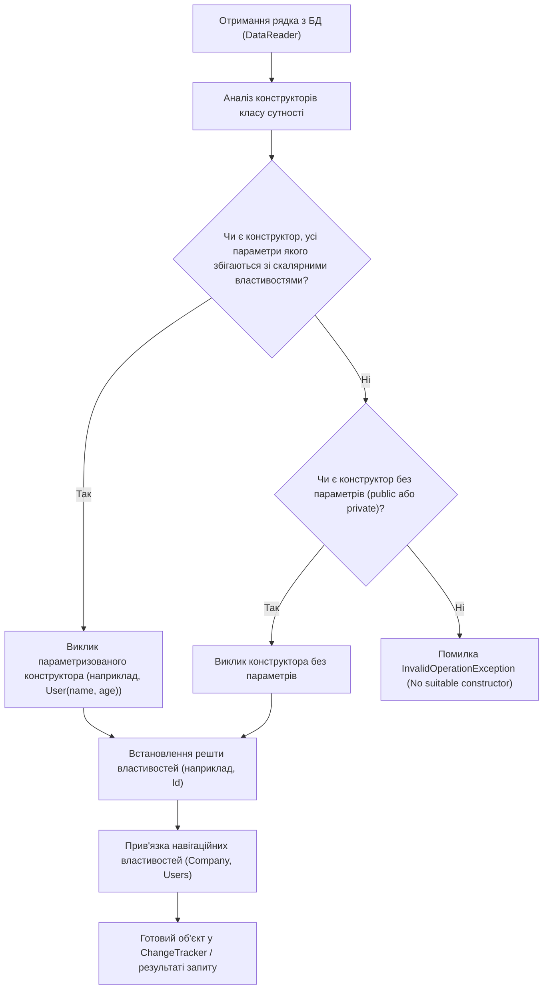

# 3.4. Конструктори сутностей

- **Глава:** 03. Створення моделей в EF Core
- **Джерело Metanit:** [https://metanit.com/sharp/efcore/2.10.php](https://metanit.com/sharp/efcore/2.10.php)
- **Код прикладу:** [`Lesson_3_04_EntityConstructors.cs`](../../src/03_ModelsAndMapping/Lesson_3_04_EntityConstructors.cs)
- **Запуск уроку:** `dotnet run --project src/EFCoreMastery.ConsoleApp -- 3.4`
- **Шпаргалка глави:** [Runs.md](Runs.md)

---

## Мета уроку

Зрозуміти внутрішній механізм **матеріалізації** об'єктів в Entity Framework Core — як саме EF Core створює екземпляри класів сутностей під час читання рядків із бази даних, які правила діють для параметризованих конструкторів (зокрема `private`), та які обмеження існують щодо навігаційних властивостей.

---

## Детальний теоретичний матеріал

### Як EF Core створює об'єкти при читанні з БД

Коли ви виконуєте запит до бази даних (наприклад, `db.Users.ToList()`), база даних повертає набір плоских рядків. Процес перетворення цих рядків на повноцінні C#-об'єкти називається **матеріалізацією**.

Типово, якщо в класі сутності є конструктор без параметрів, EF Core:
1. Викликає конструктор без параметрів (створює «порожній» екземпляр).
2. Присвоює кожній властивості (або backing field) відповідне значення зі стовпця БД.

Однак у сучасному C# та підходах Domain-Driven Design (DDD) класи часто не мають публічного конструктора без параметрів, а натомість вимагають передачі обов'язкових даних через **параметризований конструктор**. EF Core підтримує це «з коробки».

### Правила зв'язування параметрів конструктора (Constructor Binding)

Якщо EF Core знаходить у класі сутності конструктор із параметрами, він передає значення з БД безпосередньо в аргументи цього конструктора замість того, щоб встановлювати відповідні властивості після створення об'єкта.

Щоб конструктор успішно працював з EF Core, мають виконуватися такі вимоги:

| Правило | Опис та приклад |
| :--- | :--- |
| **1. Відповідність імен та типів** | Назва та тип кожного параметра конструктора мають збігатися з відповідною властивістю (або полем) сутності. **Регістр літер ігнорується**: властивість `Name` (`string`) успішно зв'язується з параметром `name` (`string`). |
| **2. Частковий набір параметрів** | Не обов'язково передавати всі властивості через конструктор. Наприклад, `Id` зазвичай не входить до конструктора `User(string name, int age)` — EF Core створить об'єкт через конструктор, а `Id` встановить окремо після цього. |
| **3. Будь-який модифікатор доступу** | Конструктор може бути `public`, `internal`, `protected` або навіть `private`. EF Core використовує Reflection / скомпільовані делегати, тому здатен викликати навіть `private Company() { }`. |
| **4. Кілька конструкторів** | Клас може мати кілька перевантажених конструкторів (наприклад, `private Company()` для EF Core і `public Company(string name)` для розробника). EF Core автоматично обере найбільш підходящий. |
| **5. Обмеження навігаційних властивостей** | **Важливо!** EF Core **НЕ підтримує** передачу навігаційних властивостей (зв'язаних сутностей або колекцій, як-от `Company? company`) у параметри конструктора. Навігаційні властивості завжди встановлюються окремо після створення об'єкта. |

> [!IMPORTANT]
> Якщо клас має **лише** конструктор із параметрами, де хоча б один параметр **не відповідає** жодній скалярній властивості сутності (або є навігаційною властивістю), і при цьому відсутній конструктор без параметрів, EF Core викине виняток `InvalidOperationException: No suitable constructor was found for entity type '...'`.

### Сценарій із приватним конструктором без параметрів

Поширена практика для задоволення вимог C# Nullable Reference Types (`<Nullable>enable</Nullable>`) та інкапсуляції:
- Оголосити `private User() { Name = string.Empty; }` спеціально для EF Core (або ORM/серіалізаторів).
- Оголосити `public User(string name, int age)` для бізнес-логіки.

Якщо ж усі параметри публічного конструктора збігаються з властивостями (як у `User(string name, int age)`), окремий приватний конструктор без параметрів навіть не потрібен — EF Core викличе `User(string, int)` напряму!

---

## Діаграма / Архітектура процесу

На діаграмі показано алгоритм вибору конструктора та матеріалізації сутності в EF Core:



---

## Покроковий розбір прикладів коду

У файлі [`Lesson_3_04_EntityConstructors.cs`](../../src/03_ModelsAndMapping/Lesson_3_04_EntityConstructors.cs) продемонстровано роботу з конструкторами у двох різних сутностях: `User` та `Company`.

### Крок 1. Сутність `User` (тільки параметризований конструктор)

```csharp
public class User
{
    public int Id { get; set; }
    public string Name { get; set; }
    public int Age { get; set; }
    public Company? Company { get; set; }

    public User(string name, int age)
    {
        Name = name;
        Age = age;
        Console.WriteLine($"  [Конструктор User(string, int)] Створено об'єкт {name}, {age}");
    }
}
```
- Зверніть увагу: у `User` взагалі немає конструктора без параметрів.
- Параметри `name` та `age` збігаються за іменем (без урахування регістру) і типом із властивостями `Name` та `Age`.
- Властивості `Id` та `Company` у конструкторі відсутні — EF Core встановить їх після виклику конструктора.

### Крок 2. Сутність `Company` (`private` конструктор без параметрів + `public` конструктор)

```csharp
public class Company
{
    public int Id { get; set; }
    public string Name { get; set; }
    public ICollection<User> Users { get; set; } = new List<User>();

    private Company()
    {
        Name = string.Empty;
    }

    public Company(string name)
    {
        Name = name;
        Console.WriteLine($"  [Конструктор Company(string)] Створено компанію {name}");
    }
}
```
- При створенні об'єкта в нашому коді (`new L2_10.Company("JetBrains")`) викликається публічний конструктор `Company(string)`.
- Під час читання з БД EF Core бачить обидва конструктори: він може обрати як `Company(string name)`, так і `private Company()` (обидва валідні). У прикладі для `User` ми бачимо вивід у консоль із конструктора `User(string, int)` двічі: спочатку при створенні об'єктів перед `SaveChanges()`, а потім — під час читання з БД у новому `DbContext`!

### Крок 3. Чому використовуються два окремих `DbContext`?

У методі `Run()` збереження відбувається в першому блоці `using (var db = new L2_10.ApplicationContext())`, а читання — у другому новому `ApplicationContext`:
- Якби ми читали `db.Users.Include(u => u.Company).ToList()` у тому самому контексті, EF Core повернув би вже закешовані в `ChangeTracker` об'єкти і **не викликав би** конструктор повторно.
- У другому контексті `ChangeTracker` порожній, тому EF Core виконує SQL-запит `SELECT ... FROM Users LEFT JOIN Companies ...` і матеріалізує кожен рядок через конструктор.

---

## Особливості роботи в SQLite

- Матеріалізація через конструктори відбувається повністю на стороні клієнта (всередині EF Core Runtime) після отримання даних від `Microsoft.Data.Sqlite`.
- Тому SQLite не накладає жодних специфічних обмежень на конструктори: усе працює ідентично до SQL Server чи PostgreSQL.

---

## Типові помилки, підводні камені та Best Practices

1. **Передача навігаційної властивості в конструктор.** Спроба написати `public User(string name, Company company)` без конструктора без параметрів призведе до помилки побудови моделі, оскільки EF Core не вміє передавати зв'язані сутності в конструктор.
2. **Неузгоджені імена параметрів.** Якщо властивість називається `FullName`, а параметр конструктора — `name` (або `userName`), EF Core не зможе їх зіставити. Імена мають збігатися з точністю до регістру (`fullName` $\leftrightarrow$ `FullName`).
3. **Забутий `AsNoTracking()` або новий контекст при тестуванні.** Якщо перевіряти виклик конструктора в межах того ж `DbContext`, де об'єкт щойно додали через `Add()`, конструктор при читанні не спрацює через Identity Resolution у `ChangeTracker`.
4. **Побічні ефекти в конструкторі.** Не варто виконувати важкі операції (мережеві запити, запис у файл тощо) всередині конструктора сутності, адже EF Core викликатиме його для **кожного** рядка, повернутого запитом `ToList()`.

---
<!-- lesson-nav -->
← [3.3. Властивості сутності](3_03_EntityProperties.md) | [Шпаргалка глави (Runs.md)](Runs.md) | [Зміст курсу (README)](../../README.md) | [3.5. Використання полів сутності](3_05_EntityFields.md) →
