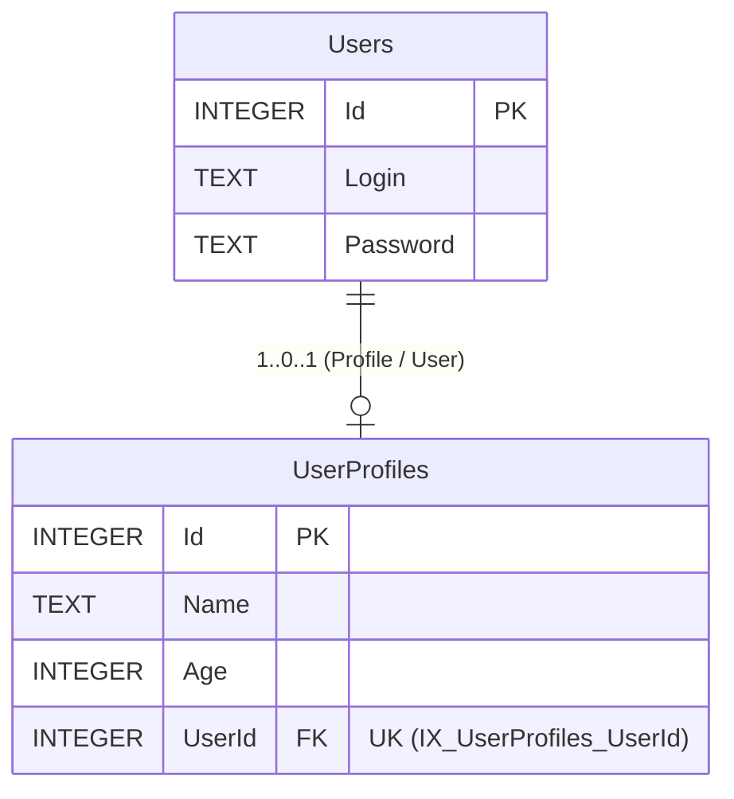

# 3.4. Відношення один до одного

- **Глава:** 04. Відносини між моделями
- **Оригінал на Metanit:** [https://metanit.com/sharp/efcore/3.4.php](https://metanit.com/sharp/efcore/3.4.php)
- **Код прикладу:** [Lesson_3_04_OneToOne.cs](../../src/04_Relations/Lesson_3_04_OneToOne.cs)
- **Запуск уроку:** `dotnet run --project src/EFCoreMastery.ConsoleApp -- 3.4`
- **Шпаргалка глави:** [Runs.md](Runs.md)

## Мета уроку

Навчитися моделювати та виконувати повний цикл CRUD-операцій для відношення **один до одного (One-to-One, 1:1)** в Entity Framework Core на прикладі пари `User` та `UserProfile`, налаштовувати нестандартний зовнішній ключ через Fluent API (`HasOne` / `WithOne` / `HasForeignKey<T>`) та розуміти техніку **об'єднання таблиць (Table Splitting)**.

## Детальний теоретичний матеріал

**Відношення один до одного (1:1)** означає, що один екземпляр головної сутності може бути пов'язаний щонайбільше з одним екземпляром залежної сутності, і навпаки. На практиці таке розділення застосовують, коли:
- Потрібно відокремити часто використовувані облікові дані (`User`: `Login`, `Password`) від рідше запитуваних або важких даних профілю (`UserProfile`: `Name`, `Age`, біографія, аватар).
- Потрібно ізолювати конфіденційні або опціональні атрибути сутності в окремій таблиці.

### Як EF Core визначає головну та залежну сутність у зв'язку 1:1

На відміну від зв'язку 1:N, де колекція однозначно вказує на бік «багато», у зв'язку 1:1 обидві сторони мають одиночні посилальні навігаційні властивості (`UserProfile? Profile` і `User? User`). Щоб визначити, яка сутність є головною, а яка залежною, EF Core шукає **зовнішній ключ**:

1. **За конвенцією:** сутність, у якій оголошено скалярний зовнішній ключ (`public int UserId { get; set; }`), вважається **залежною** (`UserProfile`), а інша (`User`) — **головною**.
2. **Через Fluent API:** якщо ім'я зовнішнього ключа нестандартне (наприклад, `UserKey`) або його взагалі немає в жодному класі, залежну сторону потрібно вказати явно за допомогою узагальненого методу `HasForeignKey<TDependent>`:
   ```csharp
   modelBuilder.Entity<User>()
       .HasOne(u => u.Profile)
       .WithOne(p => p.User)
       .HasForeignKey<UserProfile>(p => p.UserKey);
   ```

### Роль унікального індексу на рівні БД

Фізично таблиця `UserProfiles` виглядає майже так само, як і таблиця в зв'язку 1:N, але з однією критичною відмінністю — для стовпця зовнішнього ключа `UserId` EF Core автоматично створює **унікальний індекс**:

```sql
CREATE UNIQUE INDEX "IX_UserProfiles_UserId" ON "UserProfiles" ("UserId");
```

Саме цей унікальний індекс на рівні СУБД гарантує, що до одного `User` неможливо прив'язати два різних `UserProfile`.

### Об'єднання таблиць (Table Splitting)

EF Core також дозволяє зберігати дві окремі C#-сутності, пов'язані відношенням 1:1, в **одній фізичній таблиці** бази даних (наприклад, `"Users"`). Для цього використовується спільний первинний ключ (`UserProfile.Id` виступає одночасно і PK, і FK на `User.Id`) та однакове ім'я таблиці в `ToTable()`:

```csharp
modelBuilder.Entity<User>()
    .HasOne(u => u.Profile)
    .WithOne(p => p.User)
    .HasForeignKey<UserProfile>(up => up.Id);

modelBuilder.Entity<User>().ToTable("Users");
modelBuilder.Entity<UserProfile>().ToTable("Users");
```

У цьому разі в SQLite створюється лише одна таблиця `"Users"` зі стовпцями обох класів (`Id`, `Login`, `Password`, `Name`, `Age`), а працювати з ними в коді можна як із двома окремими `DbSet<User>` та `DbSet<UserProfile>`.

### Порівняння підходів до моделювання 1:1

| Підхід | Кількість таблиць у БД | Потрібен `Include()`? | Коли обирати |
| :--- | :---: | :---: | :--- |
| **Класичний 1:1** (`Users` + `UserProfiles`) | 2 | Так | Рідко читані або «важкі» дані профілю, опціональний профіль |
| **Table Splitting** (`ToTable("Users")` для обох) | 1 | Так (для другої сутності) | Потрібна 1 таблиця в БД, але два окремі класи сутностей у коді |
| **Owned Type** (`OwnsOne`) | 1 | Ні (вантажиться завжди) | Value Object без власної ідентичності, який завжди потрібен разом із власником |

## Діаграма / Архітектура процесу

ER-діаграма класичного розділеного зв'язку 1:1 (`Users` та `UserProfiles`):



## Покроковий розбір прикладів коду

У файлі [Lesson_3_04_OneToOne.cs](../../src/04_Relations/Lesson_3_04_OneToOne.cs) реалізовано повний життєвий цикл зв'язку 1:1 між `User` та `UserProfile`.

### 1. Моделі та схема БД

- `User` містить `Id`, `Login`, `Password` та навігаційну властивість `UserProfile? Profile`.
- `UserProfile` містить `Id`, `Name`, `Age`, обов'язковий зовнішній ключ `int UserId` та навігаційну властивість `User? User`.
- У SQLite генеруються таблиці `Users`, `UserProfiles` із `FOREIGN KEY("UserId") REFERENCES "Users"("Id") ON DELETE CASCADE` та унікальний індекс `IX_UserProfiles_UserId`.

### 2. Секція 1: Створення та читання

```csharp
var user1 = new User { Login = "login1", Password = "pass1234" };
var user2 = new User { Login = "login2", Password = "5678word2" };
db.Users.AddRange(user1, user2);

var profile1 = new UserProfile { Name = "Tom", Age = 22, User = user1 };
var profile2 = new UserProfile { Name = "Alice", Age = 27, User = user2 };
db.UserProfiles.AddRange(profile1, profile2);

db.SaveChanges();
```

Під час `SaveChanges()` спочатку вставляються записи в `Users`, після чого EF Core підставляє їхні `Id` у `UserId` для `UserProfiles`. У наступному контексті `db.Users.Include(u => u.Profile).ToList()` виконує `LEFT JOIN "UserProfiles"` і виводить об'єднану інформацію (`Login`, `Name`, `Age`).

### 3. Секція 2: Оновлення та каскадне видалення

1. **Оновлення:** знаходимо `alice` разом із профілем (`Include(u => u.Profile)`) та змінюємо `alice.Profile.Age = 28;`.
2. **Видалення:** знаходимо `tom` (`login1`) і видаляємо його через `db.Users.Remove(tom);`. Оскільки `User` є головною сутністю, а `UserProfile.UserId` — не-nullable `int`, видалення `tom` **каскадно видаляє** і `profile1` (`Tom`).
3. Натомість, якби ми видалили лише `UserProfile`, обліковий запис `User` залишився б у базі даних без профілю.
4. У фінальному контексті перевірка `db.Users.Count()` та `db.UserProfiles.Count()` показує, що залишився 1 користувач і 1 профіль (`Alice`, `Age=28`, `Login=login2`).

## Особливості роботи в SQLite

- **Унікальність FK:** при спробі вставити другий `UserProfile` із тим самим `UserId` SQLite негайно поверне помилку `SqliteException: SQLite Error 19: 'UNIQUE constraint failed: UserProfiles.UserId'`.
- **Поведінка при Table Splitting:** якщо ви використовуєте `ToTable("Users")` для обох сутностей, зверніть увагу, що властивості залежної сутності (`Name`, `Age`) у SQLite повинні допускати `NULL` у таблиці (або `UserProfile` має створюватися завжди разом із `User`).

## Типові помилки, підводні камені та Best Practices

- **Забутий тип у `HasForeignKey<TDependent>`:** при налаштуванні 1:1 у Fluent API виклик `.HasForeignKey(p => p.UserId)` без вказання `<UserProfile>` не скомпілюється, адже EF Core не знає, на якій із двох сторін лежить зовнішній ключ. Завжди пишіть `.HasForeignKey<UserProfile>(...)`.
- **Помилка збереження при несинхронізованих посиланнях:** якщо створити `user1` і `profile1`, але забути додати `profile1` у `db.UserProfiles` (або вказати `user1.Profile = profile1`), профіль не збережеться.
- **Оптимізація 1:1:** якщо `User` і `UserProfile` **завжди** читаються й оновлюються разом у кожному запиті, розділення на дві таблиці створює зайвий `JOIN` і додатковий індекс — у такому разі краще розглянути **Owned Types** (урок 3.7) або **Complex Types** (урок 3.12).

---
<!-- lesson-nav -->
← [3.9. Ліниве завантаження (Lazy loading)](3_09_LazyLoading.md) | [Шпаргалка глави (Runs.md)](Runs.md) | [Зміст курсу (README)](../../README.md) | [3.5. Відношення один до багатьох](3_05_OneToMany.md) →
