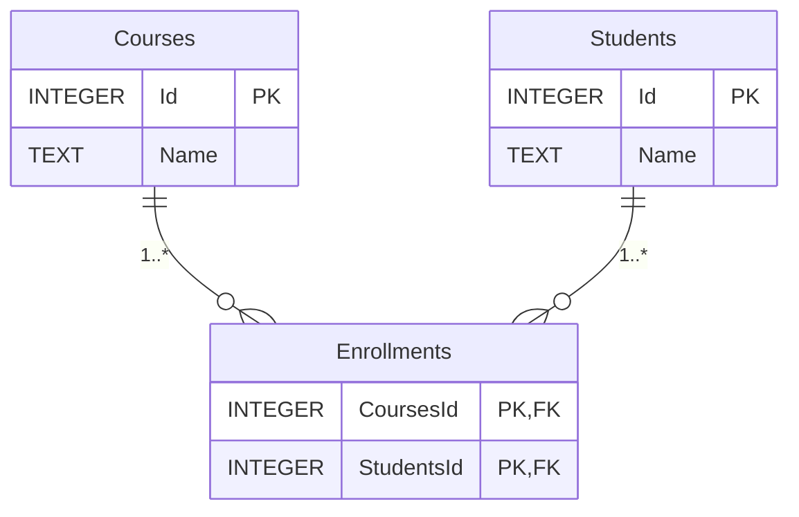

# 3.6. Відношення багато до багатьох

- **Глава:** 04. Відносини між моделями
- **Оригінал на Metanit:** [https://metanit.com/sharp/efcore/3.6.php](https://metanit.com/sharp/efcore/3.6.php)
- **Код прикладу:** [Lesson_3_06_ManyToMany.cs](../../src/04_Relations/Lesson_3_06_ManyToMany.cs)
- **Запуск уроку:** `dotnet run --project src/EFCoreMastery.ConsoleApp -- 3.6`
- **Шпаргалка глави:** [Runs.md](Runs.md)

## Мета уроку

Навчитися моделювати, налаштовувати та змінювати відношення **багато до багатьох (Many-to-Many, M:N)** в Entity Framework Core без створення явного проміжного класу, перейменовувати проміжну таблицю через `UsingEntity()`, а також розуміти, коли та як переходити до явної проміжної сутності з додатковими полями (payload).

## Детальний теоретичний матеріал

**Відношення багато до багатьох (M:N)** виникає, коли кожен об'єкт першої сутності (`Student`) може бути пов'язаний із багатьма об'єктами другої сутності (`Course`), і навпаки.

У реляційних базах даних прямий зв'язок M:N між двома таблицями неможливий — він завжди реалізується через **третю, проміжну таблицю (junction / join table)**, яка містить два зовнішні ключі (на обидві таблиці), що зазвичай утворюють складений первинний ключ.

### 1. Неявна проміжна таблиця (Skip Navigations, EF Core 5+)

Починаючи з EF Core 5.0, якщо проміжна таблиця містить лише зовнішні ключі, у C# **не потрібно** створювати окремий клас зв'язки. Достатньо оголосити колекційні навігаційні властивості з обох боків:

```csharp
public class Course
{
    public int Id { get; set; }
    public string? Name { get; set; }
    public List<Student> Students { get; set; } = new();
}

public class Student
{
    public int Id { get; set; }
    public string? Name { get; set; }
    public List<Course> Courses { get; set; } = new();
}
```

За конвенцією EF Core автоматично створить у БД проміжну таблицю `CourseStudent` зі стовпцями `CoursesId` та `StudentsId`, об'єднаними у складений первинний ключ `PRIMARY KEY ("CoursesId", "StudentsId")`.

### 2. Налаштування проміжної таблиці через `UsingEntity`

Щоб задати власну назву проміжної таблиці (наприклад, `"Enrollments"` замість `"CourseStudent"`), використовують метод `UsingEntity` у Fluent API:

```csharp
modelBuilder.Entity<Course>()
    .HasMany(c => c.Students)
    .WithMany(s => s.Courses)
    .UsingEntity(j => j.ToTable("Enrollments"));
```

### 3. Додавання власних стовпців у проміжну таблицю (Payload)

Якщо зв'язок між студентом і курсом має власні атрибути (наприклад, оцінка `Mark` або дата запису `EnrollmentDate`), необхідно створити явний проміжний клас `Enrollment`:

```csharp
public class Enrollment
{
    public int StudentId { get; set; }
    public Student? Student { get; set; }

    public int CourseId { get; set; }
    public Course? Course { get; set; }

    public int Mark { get; set; }
}
```

### Порівняння підходів до M:N в EF Core

| Критерій | Неявна проміжна таблиця (Skip Navigation) | Явна проміжна сутність (`Enrollment`) |
| :--- | :--- | :--- |
| **Додатковий C#-клас** | Не потрібен | Потрібен (`Enrollment` із двома FK) |
| **Додаткові стовпці (оцінка, дата)** | Неможливо зберігати в моделі | Повноцінна підтримка будь-яких полів (payload) |
| **Простота коду додавання** | `course.Students.Add(tom)` | `db.Enrollments.Add(new Enrollment { ... })` |
| **Ім'я таблиці в БД** | `CourseStudent` (або через `UsingEntity`) | Задається як звичайний `DbSet` / `ToTable` |

Тоді в `OnModelCreating` можна зберегти зручні прямі колекції `Courses` / `Students` (Skip Navigations) і водночас налаштувати `Enrollment` через узагальнений `UsingEntity<Enrollment>(...)`:

```csharp
modelBuilder.Entity<Course>()
    .HasMany(c => c.Students)
    .WithMany(s => s.Courses)
    .UsingEntity<Enrollment>(
        j => j.HasOne(e => e.Student).WithMany(s => s.Enrollments).HasForeignKey(e => e.StudentId),
        j => j.HasOne(e => e.Course).WithMany(c => c.Enrollments).HasForeignKey(e => e.CourseId),
        j =>
        {
            j.Property(e => e.Mark).HasDefaultValue(3);
            j.HasKey(e => new { e.CourseId, e.StudentId });
            j.ToTable("Enrollments");
        });
```

### 4. Видалення та оновлення зв'язків

- Щоб **відписати** студента від курсу, достатньо видалити курс із колекції `student.Courses.Remove(course)` (перед цим обов'язково завантаживши `Courses` через `Include()`) і викликати `SaveChanges()`. Це видалить лише рядок із проміжної таблиці `"Enrollments"`, а сам курс і студент залишаться в БД.
- При видаленні самого `Student` або `Course` усі пов'язані рядки в проміжній таблиці видаляються автоматично завдяки `ON DELETE CASCADE`.

## Діаграма / Архітектура процесу



## Покроковий розбір прикладів коду

У файлі [Lesson_3_06_ManyToMany.cs](../../src/04_Relations/Lesson_3_06_ManyToMany.cs) реалізовано сценарій M:N із перейменуванням проміжної таблиці на `"Enrollments"`.

### 1. Схема БД у SQLite

Після конфігурації `.UsingEntity(j => j.ToTable("Enrollments"))` у SQLite створюються три таблиці:

```sql
CREATE TABLE "Courses" (
    "Id" INTEGER NOT NULL CONSTRAINT "PK_Courses" PRIMARY KEY AUTOINCREMENT,
    "Name" TEXT NULL
);

CREATE TABLE "Students" (
    "Id" INTEGER NOT NULL CONSTRAINT "PK_Students" PRIMARY KEY AUTOINCREMENT,
    "Name" TEXT NULL
);

CREATE TABLE "Enrollments" (
    "CoursesId" INTEGER NOT NULL,
    "StudentsId" INTEGER NOT NULL,
    CONSTRAINT "PK_Enrollments" PRIMARY KEY ("CoursesId", "StudentsId"),
    CONSTRAINT "FK_Enrollments_Courses_CoursesId" FOREIGN KEY ("CoursesId") REFERENCES "Courses" ("Id") ON DELETE CASCADE,
    CONSTRAINT "FK_Enrollments_Students_StudentsId" FOREIGN KEY ("StudentsId") REFERENCES "Students" ("Id") ON DELETE CASCADE
);
```

### 2. Секція 1: Створення зв'язків

```csharp
tom.Courses.AddRange(new[] { algorithms, basics });
alice.Courses.Add(algorithms);
bob.Courses.Add(basics);

db.Students.AddRange(tom, alice, bob);
db.Courses.AddRange(algorithms, basics);
db.SaveChanges();
```

EF Core зберігає трьох студентів, два курси та 4 рядки зв'язків у таблицю `"Enrollments"`.

### 3. Секція 2: Читання курсів із записаними студентами

```csharp
var courses = db.Courses.Include(c => c.Students).ToList();
```

У SQLite цей запит виконує подвійний `LEFT JOIN`: `Courses -> Enrollments -> Students`, за один запит повертаючи курси разом зі списками їхніх студентів (`Алгоритми: Tom, Alice`; `Основи програмування: Tom, Bob`).

### 4. Секція 3: Оновлення зв'язків (відписка та підписка)

```csharp
var alice = db.Students.Include(s => s.Courses).First(s => s.Name == "Alice");
var algorithms = db.Courses.First(c => c.Name == "Алгоритми");
var basics = db.Courses.First(c => c.Name == "Основи програмування");

alice.Courses.Remove(algorithms);
alice.Courses.Add(basics);
db.SaveChanges();
```

Зверніть увагу на `.Include(s => s.Courses)` при завантаженні `alice`! Без нього `alice.Courses` був би порожнім, і `Remove(algorithms)` не зробив би нічого (а `Add(basics)` просто додав би новий запис). Після `SaveChanges()` EF Core виконує `DELETE` одного рядка та `INSERT` іншого рядка в таблиці `"Enrollments"`. У результаті `Alice` переводиться з курсу «Алгоритми» на «Основи програмування».

## Особливості роботи в SQLite

- **Складений первинний ключ:** SQLite повністю підтримує `PRIMARY KEY ("CoursesId", "StudentsId")` без сурогатного `Id`, а також автоматично створює індекс на другому стовпці `IX_Enrollments_StudentsId` для швидкого пошуку курсів конкретного студента.
- **Каскадне видалення:** обидва зовнішні ключі в `"Enrollments"` мають `ON DELETE CASCADE`, що в SQLite працює без жодних конфліктів (на відміну від деяких складних циклічних графів у MS SQL Server).

## Типові помилки, підводні камені та Best Practices

- **Забутий `Include()` перед `Remove()`:** найчастіша помилка при роботі з M:N. Якщо завантажити `alice` без `.Include(s => s.Courses)`, виклик `alice.Courses.Remove(algorithms)` поверне `false` і запис у БД залишиться.
- **Спроба додати дублікатний зв'язок:** якщо `Tom` уже записаний на `algorithms`, повторне додавання `algorithms` у `tom.Courses` і `SaveChanges()` викличе порушення складеного первинного ключа (`UNIQUE constraint failed: Enrollments.CoursesId, Enrollments.StudentsId`).
- **Best Practice:** якщо проміжна таблиця має бізнес-сенс і може розростатися додатковими полями в майбутньому (дата, статус, роль, оцінка), одразу проєктуйте її як явну сутність `Enrollment` через `UsingEntity<Enrollment>(...)` або як два явних зв'язки `1:N`.

---
<!-- lesson-nav -->
← [3.5. Відношення один до багатьох](3_05_OneToMany.md) | [Шпаргалка глави (Runs.md)](Runs.md) | [Зміст курсу (README)](../../README.md) | [3.7. Власні типи (Owned Types)](3_07_OwnedTypes.md) →
