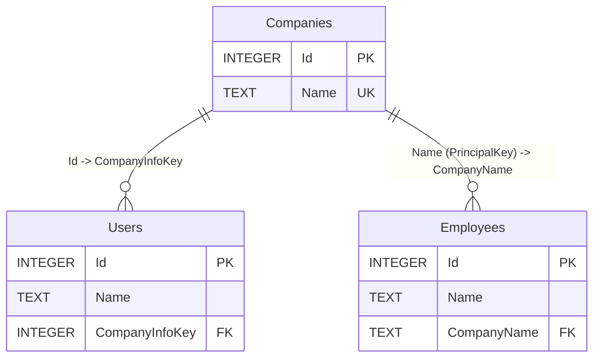

# 3.10. Налаштування зовнішнього ключа через анотації та Fluent API

- **Глава:** 04. Відносини між моделями
- **Оригінал на Metanit:** [https://metanit.com/sharp/efcore/3.10.php](https://metanit.com/sharp/efcore/3.10.php)
- **Код прикладу:** [Lesson_3_10_ForeignKeyConfig.cs](../../src/04_Relations/Lesson_3_10_ForeignKeyConfig.cs)
- **Запуск уроку:** `dotnet run --project src/EFCoreMastery.ConsoleApp -- 3.10`
- **Шпаргалка глави:** [Runs.md](Runs.md)

## Мета уроку

Навчитися явно задавати властивість зовнішнього ключа, коли її назва не відповідає стандартним конвенціям EF Core, за допомогою атрибута `[ForeignKey]` та методів Fluent API (`HasOne`, `HasMany`, `WithOne`, `WithMany`, `HasForeignKey`), а також зв'язувати зовнішній ключ із довільною унікальною властивістю головної сутності через `HasPrincipalKey`.

## Детальний теоретичний матеріал

Стандартні конвенції EF Core вимагають, щоб властивість зовнішнього ключа називалася `<NavProperty>Id` або `<PrincipalClass>Id` (наприклад, `CompanyId`) і посилалася на первинний ключ головної сутності (`Id`). У реальних проєктах, особливо при інтеграції з існуючими базами даних (Database-First або Legacy Schema), імена стовпців та зв'язки можуть не відповідати цим правилам. Для явної конфігурації використовують два механізми.

### 1. Атрибут `[ForeignKey]` (Data Annotations)

Атрибут `[ForeignKey]` з простору імен `System.ComponentModel.DataAnnotations.Schema` дозволяє вказати ім'я властивості, яка виконує роль зовнішнього ключа. Його можна розмістити:

- Над **навігаційною властивістю** (вказуючи ім'я скалярного FK):
  ```csharp
  public int? CompanyInfoKey { get; set; }

  [ForeignKey(nameof(CompanyInfoKey))] // або [ForeignKey("CompanyInfoKey")]
  public Company? Company { get; set; }
  ```
- Над **скалярним зовнішнім ключем** (вказуючи ім'я навігаційної властивості):
  ```csharp
  [ForeignKey(nameof(Company))]
  public int? CompanyInfoKey { get; set; }
  public Company? Company { get; set; }
  ```

Якщо не застосувати `[ForeignKey]` або Fluent API для `CompanyInfoKey`, EF Core проігнорує `CompanyInfoKey` як звичайний стовпець і створить у таблиці ще один тіньовий стовпець `CompanyId`.

### 2. Налаштування через Fluent API

Fluent API в методі `OnModelCreating(ModelBuilder modelBuilder)` надає повний контроль над конфігурацією зв'язку через ланцюжок методів:

- `HasOne(...)` / `HasMany(...)` — задають навігаційну властивість на стороні сутності, для якої викликано `modelBuilder.Entity<T>()`:
  - `HasOne` — для одиночної посилальної навігації (`Company? Company`).
  - `HasMany` — для колекційної навігації (`List<User> Users`).
- `WithOne(...)` / `WithMany(...)` — задають зворотну навігаційну властивість на стороні пов'язаної сутності (аргумент можна не передавати, якщо зворотна навігація відсутня, наприклад `.WithMany()`).
- `HasForeignKey(...)` — явно вказує властивість (або кортеж властивостей для складеного ключа), яка буде зовнішнім ключем.

```csharp
modelBuilder.Entity<User>()
    .HasOne(u => u.Company)
    .WithMany(c => c.Users)
    .HasForeignKey(u => u.CompanyInfoKey);
```

### 3. Прив'язка до альтернативного ключа (`HasPrincipalKey`)

За замовчуванням зовнішній ключ завжди посилається на первинний ключ (`Primary Key`) головної сутності. Проте метод `HasPrincipalKey(...)` у Fluent API дозволяє прив'язати FK до **будь-якої іншої властивості** головної сутності (наприклад, до унікальної назви компанії `Company.Name`, коду ЄДРПОУ, `Email` тощо):

```csharp
modelBuilder.Entity<Employee>()
    .HasOne(e => e.Company)
    .WithMany(c => c.Employees)
    .HasForeignKey(e => e.CompanyName)
    .HasPrincipalKey(c => c.Name);
```

Коли ви викликаєте `HasPrincipalKey(c => c.Name)`:
1. EF Core автоматично робить `Company.Name` **альтернативним ключем (Alternate Key)** у моделі та створює обмеження `UNIQUE` (`AK_Companies_Name`) у базі даних.
2. Властивість `Company.Name` стає обов'язковою (`NOT NULL` на рівні схеми, якщо це необхідно для альтернативного ключа).
3. Зовнішній ключ у `Employees` (`CompanyName`) має збігатися за типом даних із `Company.Name` (`string`).

### Порівняння Data Annotations та Fluent API

| Критерій | `[ForeignKey]` (Анотації) | Fluent API (`HasForeignKey` / `HasPrincipalKey`) |
|---|---|---|
| **Читабельність** | Одразу видно в класі моделі | Винесено в `DbContext` / `IEntityTypeConfiguration` |
| **Залежність домену від EF/Schema** | Доменні класи містять атрибути `System.ComponentModel.DataAnnotations.Schema` | Доменні класи залишаються чистими (POCO) |
| **Підтримка `HasPrincipalKey`** | Ні | Так |
| **Підтримка `OnDelete` та складених FK** | Ні | Так |
| **Пріоритет при конфлікті** | Нижчий | Вищий (перезаписує анотації) |

## Діаграма / Архітектура процесу



## Покроковий розбір прикладів коду

У файлі [Lesson_3_10_ForeignKeyConfig.cs](../../src/04_Relations/Lesson_3_10_ForeignKeyConfig.cs) поєднано обидва сценарії для однієї головної сутності `Company`:

### 1. Конфігурація моделей та `AppContextL3_10`

- `User` має нестандартний nullable зовнішній ключ `int? CompanyInfoKey`, позначений атрибутом `[ForeignKey(nameof(CompanyInfoKey))]` над властивістю `Company`. Додатково в `OnModelCreating` цей зв'язок продубльовано через Fluent API (`HasForeignKey(u => u.CompanyInfoKey)`), що демонструє сумісність і пріоритет Fluent API.
- `Employee` має рядковий зовнішній ключ `string? CompanyName`, який у `OnModelCreating` налаштований через `.HasForeignKey(e => e.CompanyName).HasPrincipalKey(c => c.Name)`.

У SQLite при створенні БД генерується така схема:

```sql
CREATE TABLE "Companies" (
    "Id" INTEGER NOT NULL CONSTRAINT "PK_Companies" PRIMARY KEY AUTOINCREMENT,
    "Name" TEXT NOT NULL,
    CONSTRAINT "AK_Companies_Name" UNIQUE ("Name")
);

CREATE TABLE "Users" (
    "Id" INTEGER NOT NULL CONSTRAINT "PK_Users" PRIMARY KEY AUTOINCREMENT,
    "Name" TEXT NULL,
    "CompanyInfoKey" INTEGER NULL,
    CONSTRAINT "FK_Users_Companies_CompanyInfoKey" FOREIGN KEY ("CompanyInfoKey") REFERENCES "Companies" ("Id")
);

CREATE TABLE "Employees" (
    "Id" INTEGER NOT NULL CONSTRAINT "PK_Employees" PRIMARY KEY AUTOINCREMENT,
    "Name" TEXT NULL,
    "CompanyName" TEXT NULL,
    CONSTRAINT "FK_Employees_Companies_CompanyName" FOREIGN KEY ("CompanyName") REFERENCES "Companies" ("Name")
);
```

### 2. Створення та читання даних (`Run()`)

1. Спочатку створюються та зберігаються компанії `Google` і `Microsoft`, щоб отримати їхні `Id`.
2. Для `User`:
   - `tom` створюється через числовий нестандартний ключ `CompanyInfoKey = google.Id`.
   - `bob` створюється через навігаційну властивість `Company = microsoft`.
3. Для `Employee`:
   - `alice` прив'язується за рядковим ключем `CompanyName = "Google"`.
   - `kate` прив'язується через навігаційну властивість `Company = microsoft` — EF Core сам записує `"Microsoft"` у `kate.CompanyName`.
4. У новому контексті запити `db.Users.Include(u => u.Company)` та `db.Employees.Include(e => e.Company)` завантажують пов'язані компанії через `LEFT JOIN` (оскільки обидва FK є nullable), підтверджуючи, що обидва механізми зв'язування працюють ідентично.

## Особливості роботи в SQLite

- **Обмеження `UNIQUE` та `ALTER TABLE`:** у SQLite обмеження `AK_Companies_Name` (`UNIQUE("Name")`) та `FOREIGN KEY` створюються безпосередньо всередині `CREATE TABLE`. Оскільки SQLite не підтримує додавання або зміну зовнішніх ключів через `ALTER TABLE ... ADD CONSTRAINT`, при використанні міграцій EF Core змушений створювати тимчасову таблицю, копіювати туди дані, видаляти стару таблицю та перейменовувати нову.
- **Чутливість до регістру (Collation):** у SQLite за замовчуванням текстові стовпці використовують порівняння `BINARY` (чутливе до регістру). Якщо `Company.Name` дорівнює `"Google"`, а ви задасте `employee.CompanyName = "google"`, у SQLite спрацює помилка `FOREIGN KEY constraint failed`. У MS SQL Server за стандартної collation `SQL_Latin1_General_CP1_CI_AS` (case-insensitive) такий запис міг би пройти, тому при використанні рядкових `PrincipalKey` у SQLite варто суворо дотримуватися регістру.

## Типові помилки, підводні камені та Best Practices

- **Дублікатні значення в `PrincipalKey`:** якщо ви прив'язали `HasPrincipalKey(c => c.Name)`, то всі компанії в таблиці `Companies` **мусять** мати унікальні непорожні значення `Name`. Спроба вставити дві компанії з назвою `"Google"` призведе до `DbUpdateException` (`UNIQUE constraint failed`).
- **Спроба змінити значення `PrincipalKey` після створення:** альтернативний ключ у моделі EF Core (як і первинний ключ) за замовчуванням вважається незмінним після додавання сутності. Спроба оновити `company.Name` у відстежуваній сутності викличе виняток у Change Tracker (`The property 'Company.Name' is part of a key and so cannot be modified`). Якщо бізнес-логіка передбачає перейменування компанії, краще посилатися на незмінний сурогатний ключ `Id`, а на `Name` просто повісити звичайний унікальний індекс (`HasIndex(c => c.Name).IsUnique()`).
- **Best Practice:** використовуйте `nameof(...)` у `[ForeignKey(nameof(CompanyInfoKey))]` замість магічних рядків `"CompanyInfoKey"`, щоб захистити код від помилок під час рефакторингу.

---
<!-- lesson-nav -->
← [3.1. Зовнішні ключі та навігаційні властивості](3_01_ForeignKeysAndNavigation.md) | [Шпаргалка глави (Runs.md)](Runs.md) | [Зміст курсу (README)](../../README.md) | [3.2. Каскадне видалення](3_02_CascadeDelete.md) →
