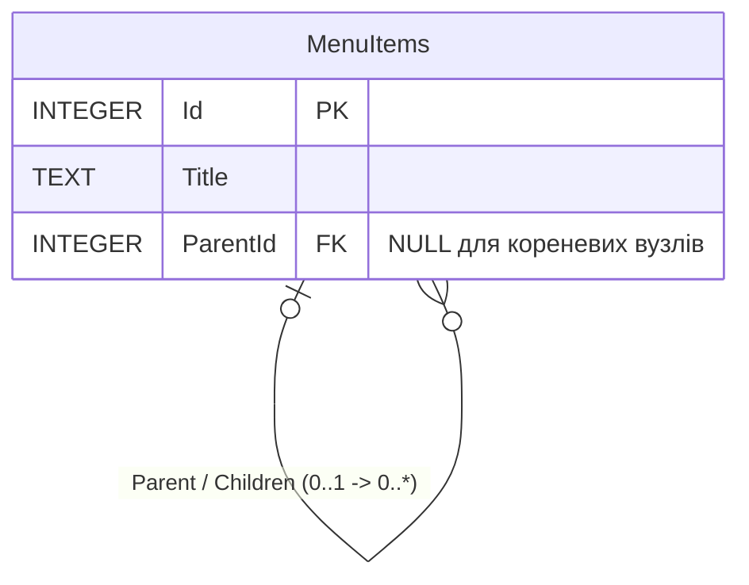
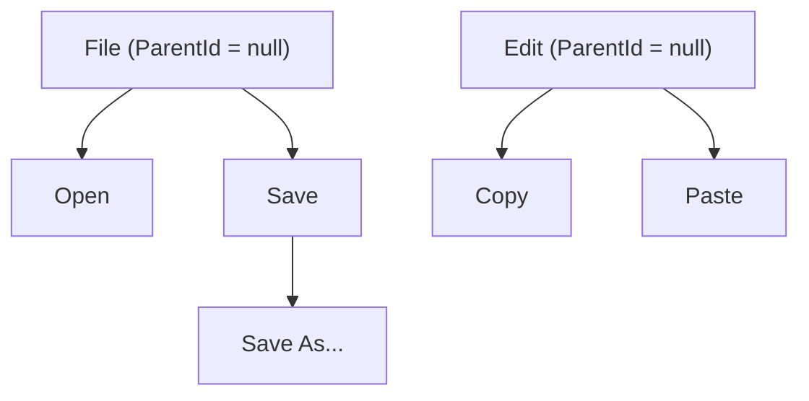

# 3.11. Ієрархічні дані

- **Глава:** 04. Відносини між моделями
- **Оригінал на Metanit:** [https://metanit.com/sharp/efcore/3.11.php](https://metanit.com/sharp/efcore/3.11.php)
- **Код прикладу:** [Lesson_3_11_HierarchicalData.cs](../../src/04_Relations/Lesson_3_11_HierarchicalData.cs)

## Мета уроку

Навчитися моделювати, зберігати та завантажувати **ієрархічні (деревоподібні) структури даних** в Entity Framework Core за допомогою самопосилальних сутностей (Self-Referencing Entities), розуміти, як працює автоматичне зв'язування в контексті (Relationship Fix-up) для побудови дерева довільної глибини та які обмеження має `Include()` для ієрархій.

## Детальний теоретичний матеріал

У багатьох застосунках дані утворюють деревоподібну ієрархію довільної глибини:
- Пункти меню та підменю (`File -> Save -> Save As...`);
- Категорії та підкатегорії товарів;
- Організаційна структура компанії (керівник → підлеглі);
- Коментарі з відповідями (дерево коментарів) або файлова система (каталоги та підкаталоги).

У реляційній моделі та EF Core це реалізується через **самопосилальний зв'язок один до багатьох (`1:N`)**, де одна й та сама сутність (`MenuItem`) виступає і як головна (батьківський вузол), і як залежна (дочірній вузол):

```csharp
public class MenuItem
{
    public int Id { get; set; }
    public string? Title { get; set; }
    public int? ParentId { get; set; }          // Nullable FK!
    public MenuItem? Parent { get; set; }       // Посилання на батька
    public List<MenuItem> Children { get; set; } = new(); // Дочірні елементи
}
```

### Чому `ParentId` обов'язково має бути `int?` (nullable)

У будь-якому дереві існують **кореневі вузли** (верхній рівень ієрархії, наприклад `File` та `Edit`), які не мають батьківського елемента. Якби `ParentId` мав тип `int`, ви не змогли б вставити жодного кореневого запису, бо БД вимагала б посилання на існуючий `Id`. Тому `ParentId` завжди має бути `int?` (і `null` для коренів).

### Стратегії завантаження ієрархічних даних

1. **Завантаження всієї таблиці в один `DbContext` (`db.MenuItems.ToList()`):**
   Коли кількість вузлів у дереві помірна (наприклад, меню сайту, довідник категорій — до кількох тисяч записів), найефективніший спосіб — завантажити всі рядки одним запитом `SELECT * FROM "MenuItems"`. Завдяки механізму **Relationship Fix-up** у Change Tracker EF Core автоматично заповнить усі властивості `Parent` та колекції `Children` на всіх рівнях вкладеності в пам'яті! Після цього достатньо відфільтрувати кореневі елементи (`Where(m => m.ParentId == null)`) і рекурсивно обійти дерево.
2. **Вибіркове завантаження через `Include(m => m.Children)`:**
   Завантажує лише **один** рівень дочірніх елементів (або фіксовану кількість рівнів через `ThenInclude(c => c.Children)`). У SQL неможливо через звичайний `Include()` завантажити невідому наперед глибину вкладеності.
3. **Рекурсивні CTE (`WITH RECURSIVE`) через `FromSqlRaw`:**
   Якщо таблиця величезна (мільйони рядків) і потрібно завантажити лише одне піддерево конкретного вузла, використовують сирий SQL із рекурсивним запитом `WITH RECURSIVE ...`.

## Діаграма / Архітектура процесу

Самопосилальна ER-модель таблиці `MenuItems` та приклад дерева з уроку:



Візуалізація ієрархії пунктів меню з `Lesson_3_11_HierarchicalData.cs`:



## Покроковий розбір прикладів коду

У файлі [Lesson_3_11_HierarchicalData.cs](../../src/04_Relations/Lesson_3_11_HierarchicalData.cs) побудовано трирівневе меню для наочної демонстрації роботи з ієрархією.

### 1. Схема БД у SQLite та додавання вузлів

У SQLite генерується таблиця із зовнішнім ключем на саму себе:

```sql
CREATE TABLE "MenuItems" (
    "Id" INTEGER NOT NULL CONSTRAINT "PK_MenuItems" PRIMARY KEY AUTOINCREMENT,
    "Title" TEXT NULL,
    "ParentId" INTEGER NULL,
    CONSTRAINT "FK_MenuItems_MenuItems_ParentId" FOREIGN KEY ("ParentId") REFERENCES "MenuItems" ("Id")
);
```

Зверніть увагу, що `ON DELETE CASCADE` тут відсутнє (за замовчуванням `ClientSetNull` / `NO ACTION`), оскільки `ParentId` є nullable, а також через ризик циклів при каскадному видаленні.

При створенні даних:
- `file` та `edit` не мають `Parent` (`ParentId = null`).
- `open` і `save` посилаються на `file`.
- `saveAs` посилається на `save` (3-й рівень вкладеності).
- `copy` і `paste` посилаються на `edit`.

EF Core під час `db.SaveChanges()` автоматично виконує топологічне сортування вставок: спочатку корені (`File`, `Edit`), потім 2-й рівень (`Open`, `Save`, `Copy`, `Paste`), а потім 3-й рівень (`Save As...`).

### 2. Секція 1: Завантаження всього дерева через Relationship Fix-up

```csharp
var allItems = db.MenuItems.ToList();
var roots = allItems.Where(m => m.ParentId == null).ToList();

foreach (var root in roots)
{
    PrintTree(root, 0);
}
```

Один SQL-запит `SELECT "m"."Id", "m"."ParentId", "m"."Title" FROM "MenuItems" AS "m"` завантажує всі 7 записів. Change Tracker автоматично пов'язує `Children` для `File`, `Save` та `Edit`. Рекурсивний метод `PrintTree(item, level)` виводить:

```text
- File
  - Open
  - Save
    - Save As...
- Edit
  - Copy
  - Paste
```

### 3. Секція 2: Вибіркове завантаження через `Include(m => m.Children)`

```csharp
var fileMenu = db.MenuItems
    .Include(m => m.Children)
    .FirstOrDefault(m => m.Title == "File");
```

Тут завантажується лише пункт `File` та його безпосередні діти (`Open`, `Save`). Зверніть увагу: колекція `save.Children` (де лежить `Save As...`) у цьому запиті залишиться порожньою, бо `Include` був лише на 1 рівень.

## Особливості роботи в SQLite

- **Видалення батьківських вузлів:** оскільки зовнішній ключ `FK_MenuItems_MenuItems_ParentId` не має `ON DELETE CASCADE`, спроба видалити `File` або `Save`, поки в них є дочірні елементи (якщо діти не завантажені в контекст), викличе помилку `FOREIGN KEY constraint failed`. У MS SQL Server каскадне видалення для самопосилальних таблиць взагалі заборонене на рівні СУБД, а в SQLite EF Core також залишає `ClientSetNull` за замовчуванням.
- **Підтримка `WITH RECURSIVE`:** SQLite повністю підтримує стандартні рекурсивні CTE (`WITH RECURSIVE ...`), що дозволяє ефективно запитувати піддерева будь-якої глибини через `db.MenuItems.FromSqlRaw(...)`.

## Типові помилки, підводні камені та Best Practices

- **Використання `AsNoTracking()` при завантаженні дерева:** якщо ви напишете `db.MenuItems.AsNoTracking().ToList()`, механізм Relationship Fix-up **не заповнить** колекції `Children` у пам'яті (вони залишаться порожніми), оскільки `AsNoTracking` не реєструє сутності в Change Tracker (для цього в EF Core 5+ існує `AsNoTrackingWithIdentityResolution()`).
- **Циклічні посилання в дереві:** завжди перевіряйте бізнес-логіку перед оновленням `ParentId`, щоб вузол не став батьком сам собі або своєму предку — це призведе до нескінченної рекурсії (`StackOverflowException`) при обході дерева в C#.
- **Best Practice:** для невеликих довідників і меню використовуйте завантаження всієї таблиці в один відстежуваний запит (`ToList()`) або `AsNoTrackingWithIdentityResolution()` + фільтрацію `Where(m => m.ParentId == null)` у пам'яті.
