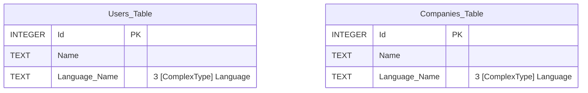

# 3.12. Комплексні типи (Complex Types)

- **Глава:** 04. Відносини між моделями
- **Оригінал на Metanit:** [https://metanit.com/sharp/efcore/3.12.php](https://metanit.com/sharp/efcore/3.12.php)
- **Код прикладу:** [Lesson_3_12_ComplexTypes.cs](../../src/04_Relations/Lesson_3_12_ComplexTypes.cs)

## Мета уроку

Ознайомитися з **комплексними типами (Complex Types)**, які з'явилися в EF Core 8+, навчитися налаштовувати їх через `[ComplexType]` та `ComplexProperty()`, зрозуміти їхню головну перевагу над `Owned Types` (спільне використання одного екземпляра та підтримку `struct`) і нюанси відстеження змін у контексті.

## Детальний теоретичний матеріал

Починаючи з **EF Core 8.0**, у фреймворку з'явилася повноцінна підтримка **комплексних типів (Complex Types)** — легковагого механізму для моделювання об'єктів-значень (*Value Objects*) без обмежень, притаманних `Owned Types`.

### Основні ознаки Complex Types

1. **Відсутність первинного ключа та ідентичності:** комплексний тип не має `Id` і не відстежується в Change Tracker як окрема сутність.
2. **Не мають окремого `DbSet<T>`:** існують лише як властивості інших сутностей (або вкладені всередині інших комплексних типів).
3. **Підтримка як посилальних (`class`), так і значимих (`struct` / `record struct`) типів:** на відміну від `Owned Types`, які можуть бути лише класами.
4. **Спільне використання (Sharing):** один і той самий екземпляр комплексного типу (наприклад, `var csharp = new Language { Name = "C#" };`) можна одночасно присвоїти різним сутностям (`tom.Language = csharp;`, `bob.Language = csharp;`, `microsoft.Language = csharp;`).
5. **Підтримка LINQ-фільтрації:** властивості комплексних типів вільно транслюються в SQL у запитах, наприклад `db.Users.Where(u => u.Language.Name == "C#")`.

### Два способи налаштування

1. **Через атрибут `[ComplexType]`** (`System.ComponentModel.DataAnnotations.Schema`):
   ```csharp
   [ComplexType]
   public class Language
   {
       public required string Name { get; set; }
   }
   ```
2. **Через Fluent API `ComplexProperty()`:**
   ```csharp
   modelBuilder.Entity<User>(builder =>
   {
       builder.ComplexProperty(u => u.Language);
   });
   modelBuilder.Entity<Company>(builder =>
   {
       builder.ComplexProperty(c => c.Language);
   });
   ```

### Порівняння: `Owned Types` vs `Complex Types`

| Критерій | Owned Types (`[Owned]` / `OwnsOne`) | Complex Types (`[ComplexType]` / `ComplexProperty`) |
|---|---|---|
| **Версія EF Core** | З EF Core 2.0 | З EF Core 8.0+ |
| **Підтримка `struct` / `record struct`** | Ні (лише `class`) | Так (`class` та `struct`) |
| **Спільний екземпляр для кількох сутностей** | Ні (виняток або переприв'язка) | Так (безпечне спільне використання) |
| **Внутрішня реалізація в EF Core** | Прихована сутність із тіньовим ключем | Справжній Value Object без ідентичності |
| **Зберігання в БД** | Стовпці з префіксом у таблиці власника | Стовпці з префіксом у таблиці кожної сутності |
| **Окремий запит / `Include()`** | Не потрібен (`Include` автоматичний) | Не потрібен (завантажується автоматично) |

## Діаграма / Архітектура процесу

Відображення спільного комплексного типу `Language` у таблиці `Users` та `Companies`:



## Покроковий розбір прикладів коду

У файлі [Lesson_3_12_ComplexTypes.cs](../../src/04_Relations/Lesson_3_12_ComplexTypes.cs) продемонстровано спільне використання об'єкта `Language` між сутностями `User` і `Company`, а також важливий нюанс зміни спільного об'єкта.

### 1. Моделі та схема БД у SQLite

- Клас `Language` позначений атрибутом `[ComplexType]` і має єдину властивість `required string Name`.
- І `User`, і `Company` містять `public required Language Language { get; set; }`.
- У SQLite створюються дві незалежні таблиці без жодних зовнішніх ключів:

```sql
CREATE TABLE "Users" (
    "Id" INTEGER NOT NULL CONSTRAINT "PK_Users" PRIMARY KEY AUTOINCREMENT,
    "Name" TEXT NOT NULL,
    "Language_Name" TEXT NOT NULL
);

CREATE TABLE "Companies" (
    "Id" INTEGER NOT NULL CONSTRAINT "PK_Companies" PRIMARY KEY AUTOINCREMENT,
    "Name" TEXT NOT NULL,
    "Language_Name" TEXT NOT NULL
);
```

### 2. Секція 1: Спільне використання та зміна в межах одного контексту

```csharp
var csharp = new Language { Name = "C#" };

var tom = new User { Name = "Tom", Language = csharp };
var bob = new User { Name = "Bob", Language = tom.Language };
var microsoft = new Company { Name = "Microsoft", Language = csharp };

db.Users.AddRange(tom, bob);
db.Companies.Add(microsoft);
db.SaveChanges();
```

Спочатку всі три записи зберігаються зі значенням `"C#"`. Потім у тому самому контексті виконується:

```csharp
csharp.Name = "C# (.NET)";
db.SaveChanges();
```

Оскільки в пам'яті `tom.Language`, `bob.Language` та `microsoft.Language` вказують на **один і той самий об'єкт** `csharp`, зміна `csharp.Name` автоматично змінює властивість для всіх трьох сутностей, і `db.SaveChanges()` генерує `UPDATE` для обох таблиць (`Users` і `Companies`).

### 3. Секція 2: Читання в новому контексті

```csharp
using (var db = new AppContextL3_12())
{
    foreach (var u in db.Users.ToList())
        Console.WriteLine($"  User: {u.Name} | Language: {u.Language.Name}");
    foreach (var c in db.Companies.ToList())
        Console.WriteLine($"  Company: {c.Name} | Language: {c.Language.Name}");
}
```

Усі три записи виводять `"C# (.NET)"`. Проте важливо розуміти: у **новому** контексті кожна сутність (`tom`, `bob`, `microsoft`) при матеріалізації з БД отримує **власний окремий екземпляр** `Language`. Тому, якщо в новому контексті змінити `tom.Language.Name = "Шарп"`, це вплине лише на `tom`, а `bob` і `microsoft` залишаться зі старим значенням.

## Особливості роботи в SQLite

- **Плоске зберігання:** у SQLite комплексні типи перетворюються на звичайні скалярні стовпці (`"Language_Name" TEXT NOT NULL`) у таблицях-носіях.
- **Продуктивність:** оскільки немає окремої таблиці `Languages` і зовнішніх ключів, вибірка працює максимально швидко без `JOIN`. Проте якщо назву мови програмування потрібно оновлювати централізовано для тисяч записів, краще все ж використовувати довідкову таблицю зі зв'язком `1:N`.

## Типові помилки, підводні камені та Best Practices

- **Забутий `required` або `null`-значення:** у EF Core 8/9 властивості комплексних типів не могли бути `null` (у EF Core 10+ підтримку nullable complex types розширено). Для надійності та чистоти коду використовуйте модифікатор `required` або ініціалізуйте властивість за замовчуванням (`= new();`), або ж використовуйте `struct` / `record struct`.
- **Побічний ефект спільного посилання (Mutable Value Objects):** якщо ви передаєте один `class Language` кільком сутностям, а потім мутуєте його властивість, це змінить дані всіх сутностей, що посилаються на нього в межах поточного контексту. **Best Practice:** проєктуйте комплексні типи як **незмінні (immutable)** `record` або `readonly record struct` (наприклад, `public record Language(string Name);`), щоб уникнути випадкових побічних ефектів.
