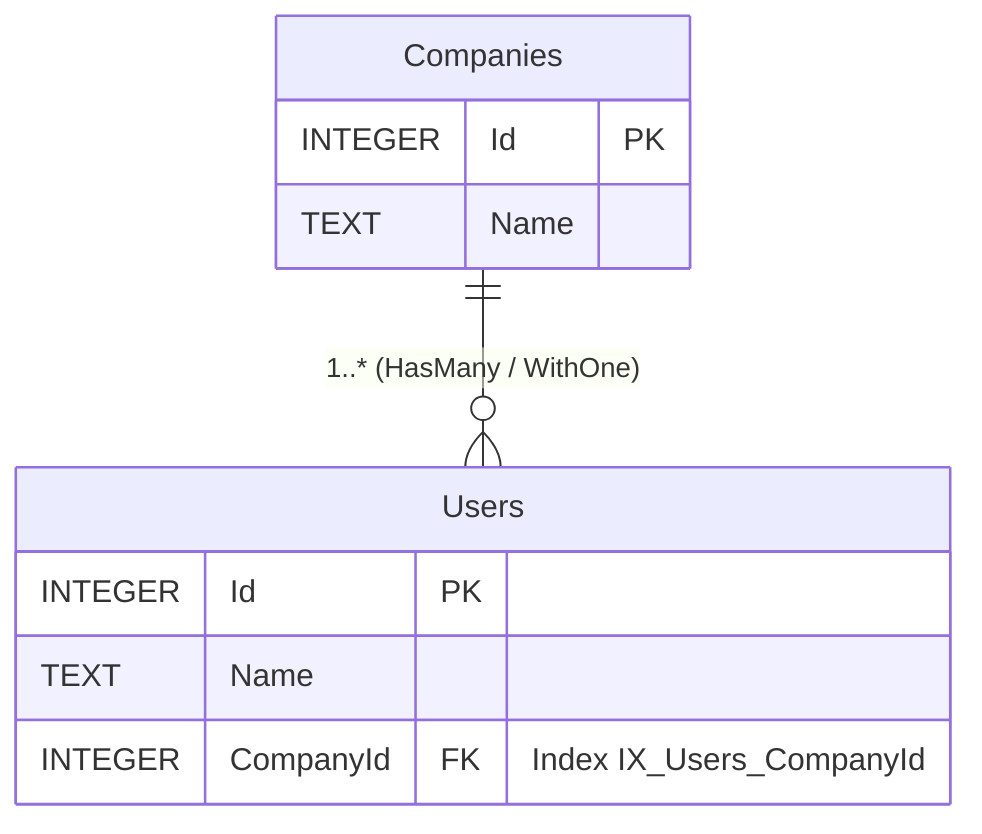

# 3.5. Відношення один до багатьох

- **Глава:** 04. Відносини між моделями
- **Оригінал на Metanit:** [https://metanit.com/sharp/efcore/3.5.php](https://metanit.com/sharp/efcore/3.5.php)
- **Код прикладу:** [Lesson_3_5_OneToMany.cs](../../src/04_Relations/Lesson_3_5_OneToMany.cs)

## Мета уроку

Закріпити повний цикл CRUD-операцій (створення, двостороннє читання, редагування та видалення) для найпоширенішого типу зв'язків у реляційних базах даних — **один до багатьох (One-to-Many, 1:N)** у Entity Framework Core.

## Детальний теоретичний матеріал

**Відношення один до багатьох (1:N)** описує ієрархічний або групуючий зв'язок, у якому один екземпляр головної сутності (`Company`) може бути пов'язаний із довільною кількістю екземплярів залежної сутності (`User`), тоді як кожна залежна сутність належить лише одній головній.

### Варіанти оголошення та налаштування 1:N

1. **Повна двостороння навігація (рекомендовано):**
   - У головній сутності `Company` є колекційна навігація `List<User> Users`.
   - У залежній сутності `User` є скалярний FK `int CompanyId` (або `int?`) і посилальна навігація `Company? Company`.
2. **Одностороння навігація:**
   Можна залишити лише `Company.Users` або лише `User.Company` — EF Core однаково побудує зв'язок 1:N у БД. У Fluent API це налаштовується через `.HasOne(u => u.Company).WithMany()` (без параметра) або `.HasMany(c => c.Users).WithOne()`.

### Повний цикл CRUD у зв'язку 1:N

| Операція | Особливості в EF Core |
|---|---|
| **Create (Створення)** | Можна передати нову компанію через `user.Company = microsoft`, через `microsoft.Users.Add(user)`, або вказати `user.CompanyId = microsoft.Id` для вже збереженої компанії. |
| **Read (Читання)** | З боку залежних: `db.Users.Include(u => u.Company)`. З боку головної: `db.Companies.Include(c => c.Users)`. |
| **Update (Редагування)** | Перенесення запису до іншої головної сутності виконується простою зміною `user.Company = newCompany;` або `user.CompanyId = newCompany.Id;` із подальшим `db.SaveChanges()`. |
| **Delete (Видалення)** | Видалення окремого `User` не впливає на `Company`. Видалення `Company` при не-nullable `int CompanyId` каскадно видалить усіх її `Users`. |

## Діаграма / Архітектура процесу



## Покроковий розбір прикладів коду

У файлі [Lesson_3_5_OneToMany.cs](../../src/04_Relations/Lesson_3_5_OneToMany.cs) крок за кроком демонструється весь CRUD-цикл на моделях `Company` та `User`.

### 1. Секція 1: Додавання даних (`Create`)

```csharp
var microsoft = new Company { Name = "Microsoft" };
var google = new Company { Name = "Google" };
db.Companies.AddRange(microsoft, google);

db.Users.AddRange(
    new User { Name = "Tom", Company = microsoft },
    new User { Name = "Bob", Company = microsoft },
    new User { Name = "Alice", Company = google }
);
db.SaveChanges();
```

`Tom` і `Bob` прив'язуються до `Microsoft`, а `Alice` — до `Google`.

### 2. Секція 2: Читання з обох сторін (`Read`)

У новому контексті виконуються два запити:
- `db.Users.Include(u => u.Company).ToList()` — виводить кожного користувача і назву його компанії (`INNER JOIN` / `LEFT JOIN`).
- `db.Companies.Include(c => c.Users).ToList()` — виводить кожну компанію та список імен її співробітників.

### 3. Секція 3: Редагування (`Update`)

```csharp
var google = db.Companies.First(c => c.Name == "Google");
google.Name = "Alphabet";

var bob = db.Users.First(u => u.Name == "Bob");
bob.Company = google; // Переведення Bob з Microsoft в Alphabet

db.SaveChanges();
```

Під час `SaveChanges()` EF Core генерує два `UPDATE`-запити в межах однієї транзакції: оновлює `Name` для компанії `Google` на `"Alphabet"` і змінює `CompanyId` для `Bob` з `1` на `2`.

### 4. Секція 4: Видалення (`Delete`)

```csharp
var tom = db.Users.First(u => u.Name == "Tom");
db.Users.Remove(tom);
db.SaveChanges();
```

Видаляється лише користувач `Tom`. Після цього фінальний вивід показує, що в `Microsoft` не залишилося жодного користувача (`[]`), а в `Alphabet` тепер двоє співробітників (`[Alice, Bob]`).

## Особливості роботи в SQLite

- **Автоматичний індекс:** для стовпця `CompanyId` у таблиці `Users` SQLite створює індекс `CREATE INDEX "IX_Users_CompanyId" ON "Users" ("CompanyId")`, що суттєво прискорює `JOIN` та пошук користувачів конкретної компанії.
- **Атомарність `SaveChanges()`:** усі зміни (оновлення `Company.Name` + переведення `Bob` в іншу компанію) виконуються в одній неявній транзакції SQLite, тому часткове оновлення неможливе.

## Типові помилки, підводні камені та Best Practices

- **Неініціалізована колекція:** якщо не написати `= new();` (або `= [];`) для `List<User> Users`, спроба додати елемент через `company.Users.Add(user)` призведе до `NullReferenceException`.
- **Дублювання головної сутності при невідстежуваному об'єкті:** якщо ви отримали `google` з `AsNoTracking()` або створили новий екземпляр `new Company { Id = 2, Name = "Google" }` і присвоїли `bob.Company = google` у новому контексті, EF Core може спробувати вставити *нову* компанію замість прив'язки до існуючої. Для прив'язки до існуючої компанії за ID безпечніше використовувати `bob.CompanyId = 2;`.
- **Продуктивність `Include(c => c.Users)`:** якщо у компанії 10 000 співробітників, завантажувати всю колекцію через `Include` для відображення лише кількості співробітників неефективно — краще використати проєкцію `db.Companies.Select(c => new { c.Name, Count = c.Users.Count })`.
