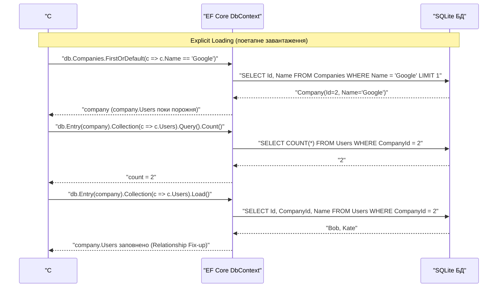

# 3.8. Явне завантаження (Explicit loading)

- **Глава:** 04. Відносини між моделями
- **Оригінал на Metanit:** [https://metanit.com/sharp/efcore/3.8.php](https://metanit.com/sharp/efcore/3.8.php)
- **Код прикладу:** [Lesson_3_8_ExplicitLoading.cs](../../src/04_Relations/Lesson_3_8_ExplicitLoading.cs)
- **Запуск уроку:** `dotnet run --project src/EFCoreMastery.ConsoleApp -- 3.8`
- **Шпаргалка глави:** [Runs.md](Runs.md)

## Мета уроку

Навчитися застосовувати стратегію **явного завантаження (Explicit Loading)** в EF Core за допомогою методів `Load()`, `db.Entry(entity).Collection(...).Load()` та `db.Entry(entity).Reference(...).Load()`, а також використовувати `.Query()` для агрегації та фільтрації пов'язаних записів без завантаження зайвих даних у пам'ять, і розуміти роль локального кешу `DbSet.Local`.

## Детальний теоретичний матеріал

**Explicit Loading (явне завантаження)** — це стратегія, за якої основна сутність спочатку завантажується з бази даних без пов'язаних об'єктів, а пов'язані дані підвантажуються пізніше окремим явним викликом у коді.

Цей підхід зручний, коли:
- Необхідність у пов'язаних даних стає зрозумілою лише після аналізу полів основної сутності (умовне завантаження).
- Потрібно відфільтрувати або порахувати (`Count()`, `Any()`) дочірні записи до їхнього завантаження.
- Не хочеться вмикати глобальний Lazy Loading із `virtual`-проксі.

### Три способи явного завантаження

1. **Через `DbSet.Where(...).Load()` (простір імен `Microsoft.EntityFrameworkCore`):**
   ```csharp
   var company = db.Companies.FirstOrDefault(c => c.Name == "Microsoft");
   if (company != null)
   {
       db.Users.Where(u => u.CompanyId == company.Id).Load();
       // EF Core автоматично заповнить company.Users завдяки Relationship Fix-up!
   }
   ```
   Метод `Load()` виконує запит до БД, завантажує знайдені сутності в Change Tracker контексту і не повертає значення (`void`). Якщо викликати просто `db.Users.Load()`, у контекст завантажиться **вся** таблиця `Users`.

2. **Через `db.Entry(entity).Collection(e => e.NavList).Load()` — для колекцій:**
   Використовується, коли навігаційна властивість представляє колекцію (`List<User>`). При цьому не потрібно вручну писати `Where(u => u.CompanyId == company.Id)` — EF Core сам формує параметризований запит за зовнішнім ключем:
   ```sql
   SELECT "u"."Id", "u"."CompanyId", "u"."Name"
   FROM "Users" AS "u"
   WHERE "u"."CompanyId" = @__p_0
   ```

3. **Через `db.Entry(entity).Reference(e => e.NavProp).Load()` — для одиночних посилань:**
   Використовується, коли навігаційна властивість посилається на один об'єкт (`User.Company`):
   ```csharp
   db.Entry(user).Reference(u => u.Company).Load();
   ```
   Генерується SQL-запит:
   ```sql
   SELECT "c"."Id", "c"."Name"
   FROM "Companies" AS "c"
   WHERE "c"."Id" = @__p_0
   ```

### Метод `.Query()` для фільтрації та агрегації

Обидва методи (`Collection()` і `Reference()`) мають метод `.Query()`, який повертає `IQueryable<T>` для пов'язаних сутностей, **не виконуючи** завантаження одразу:

- **Підрахунок без завантаження об'єктів у пам'ять:**
  ```csharp
  var count = db.Entry(company).Collection(c => c.Users).Query().Count();
  ```
  Виконує `SELECT COUNT(*) FROM "Users" WHERE "CompanyId" = @__p_0`.
- **Вибіркове завантаження з фільтром:**
  ```csharp
  db.Entry(company).Collection(c => c.Users).Query().Where(u => u.Name!.StartsWith("A")).Load();
  ```

### Зведена таблиця методів Explicit Loading

| Метод | Для якого зв'язку | Перевага |
| :--- | :--- | :--- |
| `db.Users.Where(u => u.CompanyId == id).Load()` | Будь-який `DbSet` | Можна завантажити довільну вибірку, EF зв'яже її через Relationship Fix-up |
| `db.Entry(c).Collection(x => x.Users).Load()` | Колекція (`1:N`, `M:N`) | Не потрібно вручну писати `Where` по зовнішньому ключу |
| `db.Entry(u).Reference(x => x.Company).Load()` | Одиночне посилання (`N:1`, `1:1`) | Лаконічно підвантажує один зв'язаний об'єкт |
| `db.Entry(c).Collection(x => x.Users).Query()` | Фільтрація / агрегація | Виконує `Count()`, `Any()`, `Where()` на стороні БД без повного завантаження |

### Повторне звернення до завантажених даних через `.Local`

Важлива деталь із Metanit: якщо ви вже завантажили користувачів у контекст за допомогою `Load()`, а потім напишете `foreach (var u in db.Users)`, EF Core **все одно виконає новий SQL-запит** `SELECT * FROM "Users"`. Щоб прочитати лише вже завантажені в пам'ять контексту об'єкти без жодного SQL-запиту, використовуйте `db.Users.Local`.

## Діаграма / Архітектура процесу

Порівняння Explicit Loading з іншими стратегіями у вигляді `sequenceDiagram`:



## Покроковий розбір прикладів коду

У файлі [Lesson_3_8_ExplicitLoading.cs](../../src/04_Relations/Lesson_3_8_ExplicitLoading.cs) продемонстровано всі три способи Explicit Loading на моделях `Company` та `User`.

### 1. Підготовка даних

У початковому контексті створюються 2 компанії (`Microsoft`, `Google`) та 4 користувачі (`Tom`, `Alice` у Microsoft; `Bob`, `Kate` у Google).

### 2. Секція 1: `DbSet.Where(...).Load()`

```csharp
var company = db.Companies.FirstOrDefault(c => c.Name == "Microsoft");
if (company != null)
{
    db.Users.Where(u => u.CompanyId == company.Id).Load();
    Console.WriteLine($"Компанія: {company.Name}");
    foreach (var u in company.Users)
        Console.WriteLine($"  - {u.Name}");
}
```

1. Перший запит отримує компанію `Microsoft` (`Id = 1`).
2. `db.Users.Where(u => u.CompanyId == company.Id).Load()` завантажує `Tom` та `Alice` у `ChangeTracker`.
3. Оскільки `company` уже відстежується тим самим `DbContext`, EF Core автоматично додає `Tom` і `Alice` у колекцію `company.Users`.

### 3. Секція 2: `Entry().Collection(...).Query().Count()` та `.Load()`

```csharp
var company = db.Companies.FirstOrDefault(c => c.Name == "Google");
if (company != null)
{
    var count = db.Entry(company).Collection(c => c.Users).Query().Count();
    db.Entry(company).Collection(c => c.Users).Load();
    ...
}
```

Тут показано, як спочатку дізнатися кількість співробітників через SQL `COUNT(*)`, а потім явно завантажити саму колекцію `Users`. Для асинхронного коду існують відповідні методи `CountAsync()` та `LoadAsync()`.

### 4. Секція 3: `Entry().Reference(...).Load()`

```csharp
var user = db.Users.FirstOrDefault(u => u.Name == "Bob");
if (user != null)
{
    db.Entry(user).Reference(u => u.Company).Load();
    Console.WriteLine($"{user.Name} працює в {user.Company?.Name}");
}
```

Завантажується `Bob`, після чого `Reference(u => u.Company).Load()` підтягує пов'язану компанію `Google` за `user.CompanyId`.

## Особливості роботи в SQLite

- **Відсутність потреби в `MARS`:** у деяких сценаріях MS SQL Server, якщо ви тримаєте відкритий `DataReader` (наприклад, ітеруєте по `db.Companies` без `.ToList()`) і всередині циклу викликаєте `Entry(c).Collection(...).Load()`, виникає помилка *«There is already an open DataReader associated with this Connection»*, якщо в рядку підключення не вказано `MultipleActiveResultSets=True`. У SQLite важливо також спочатку матеріалізувати зовнішній запит (`.ToList()` або `.FirstOrDefault()`), перш ніж робити вкладені `.Load()`.
- **Параметризовані запити:** усі виклики `Load()` у SQLite виконуються як безпечні параметризовані запити з `@__p_0`.

## Типові помилки, підводні камені та Best Practices

- **Виклик `Entry()` для невідстежуваної сутності (`AsNoTracking`):** якщо об'єкт отримано через `db.Companies.AsNoTracking().FirstOrDefault()`, виклик `db.Entry(company).Collection(...).Load()` викине `InvalidOperationException`, оскільки EF Core не може завантажити навігацію для сутності, що не відстежується контекстом.
- **Перевірка `IsLoaded`:** перед викликом `.Load()` можна перевірити прапорець `if (!db.Entry(company).Collection(c => c.Users).IsLoaded)`, щоб уникнути зайвого повторного SQL-запиту, якщо колекція вже була завантажена раніше.
- **Уникайте `Load()` у циклі:** виклик `Entry(c).Collection(c => c.Users).Load()` усередині `foreach` по 100 компаніях виконає 100 окремих SQL-запитів (проблема N+1). Якщо дані потрібні для всіх елементів списку — використовуйте `Include()`.

---
<!-- lesson-nav -->
← [3.3. Завантаження пов'язаних даних. Метод Include](3_3_EagerLoadingInclude.md) | [Шпаргалка глави (Runs.md)](Runs.md) | [Зміст курсу (README)](../../README.md) | [3.9. Ліниве завантаження (Lazy loading)](3_9_LazyLoading.md) →
