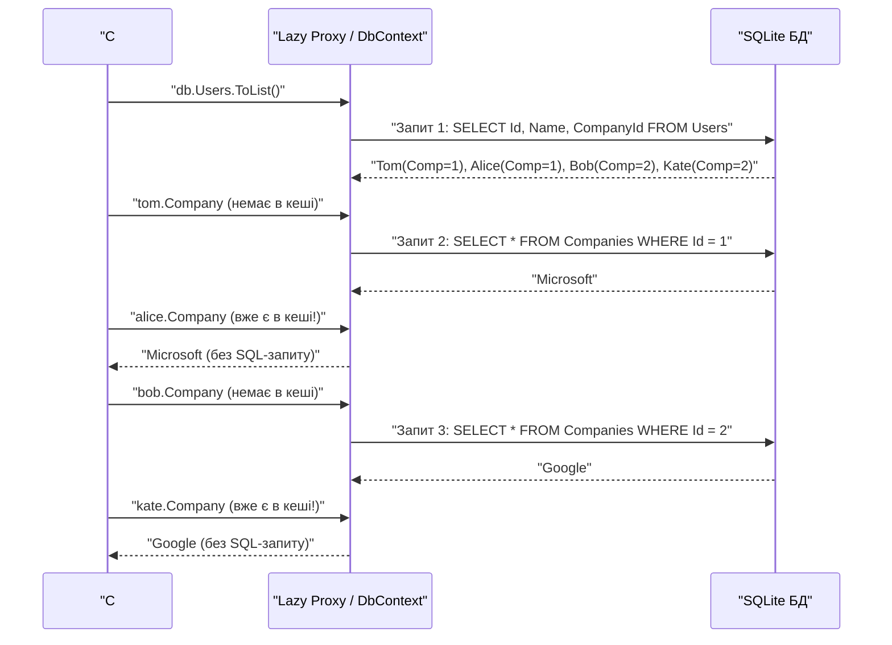

# 3.9. Ліниве завантаження (Lazy loading)

- **Глава:** 04. Відносини між моделями
- **Оригінал на Metanit:** [https://metanit.com/sharp/efcore/3.9.php](https://metanit.com/sharp/efcore/3.9.php)
- **Код прикладу:** [Lesson_3_9_LazyLoading.cs](../../src/04_Relations/Lesson_3_9_LazyLoading.cs)
- **Запуск уроку:** `dotnet run --project src/EFCoreMastery.ConsoleApp -- 3.9`
- **Шпаргалка глави:** [Runs.md](Runs.md)

## Мета уроку

Зрозуміти принцип роботи **лінивого завантаження (Lazy Loading)** в EF Core за допомогою динамічних проксі-класів (`Microsoft.EntityFrameworkCore.Proxies`), вивчити обов'язкові вимоги до конфігурації контексту та моделей, проаналізувати SQL-запити під капотом і навчитися уникати проблеми **N+1 запитів**.

## Детальний теоретичний матеріал

**Lazy Loading (ліниве завантаження)** — це стратегія, за якої пов'язані сутності автоматично й неявно підвантажуються з бази даних у момент першого звернення в C#-коді до навігаційної властивості.

### Чотири обов'язкові умови для проксі-підходу

За замовчуванням у EF Core ліниве завантаження **вимкнене**. Щоб активувати його через динамічні проксі, необхідно виконати всі чотири умови:

1. **Встановити NuGet-пакет `Microsoft.EntityFrameworkCore.Proxies`** (у нашому навчальному проєкті він уже підключений).
2. **Увімкнути проксі в конфігурації `DbContext`:**
   ```csharp
   protected override void OnConfiguring(DbContextOptionsBuilder optionsBuilder)
   {
       optionsBuilder
           .UseLazyLoadingProxies()
           .UseSqlite(SqliteDbHelper.GetConnectionString("ch04_l3_9"));
   }
   ```
3. **Усі класи сутностей мають бути відкритими для наслідування** (`public` і без модифікатора `sealed`), оскільки провайдер проксі в runtime генерує похідні класи (наприклад, `Castle.Proxies.UserProxy : User`).
4. **Усі навігаційні властивості мають бути `virtual`:**
   ```csharp
   public virtual Company? Company { get; set; }
   public virtual List<User> Users { get; set; } = new();
   ```
   Якщо забути `virtual` хоча б для однієї навігаційної властивості, виняток не виникне, але ліниве завантаження для неї не спрацює (вона залишиться `null`).

### Як це працює під капотом і кешування в контексті

Коли ви виконуєте `var users = db.Users.ToList();`:
1. До БД надсилається **лише один** запит: `SELECT "u"."Id", "u"."CompanyId", "u"."Name" FROM "Users" AS "u"`.
2. Для кожного рядка EF Core створює екземпляр згенерованого проксі-класу, який перехоплює виклик `get` навігаційної властивості `Company`.
3. При першому зверненні до `user.Company`:
   - Проксі перевіряє внутрішній кеш поточного `DbContext` (Change Tracker).
   - Якщо компанії з таким `CompanyId` ще немає в контексті — виконується SQL-запит `SELECT "c"."Id", "c"."Name" FROM "Companies" AS "c" WHERE "c"."Id" = @__p_0`.
   - Якщо компанія **вже є в контексті** (наприклад, її завантажив попередній користувач) — **новий SQL-запит не виконується**, а повертається вже закешований об'єкт!

> [!WARNING]
> Проксі використовують дані, які вже завантажені в контекст, і **не перезавантажують** їх повторно з БД, навіть якщо інший користувач змінив запис у базі даних між зверненнями.

### Альтернатива без проксі: `ILazyLoader`

EF Core також підтримує Lazy Loading без пакета `Proxies` (і без `virtual`) через ін'єкцію сервісу `ILazyLoader` у конструктор сутності, проте в реальних проєктах цей підхід використовується рідко, оскільки прив'язує доменні моделі до інфраструктури EF Core.

### Приклад SQL-запитів при Lazy Loading (проблема N+1)

```sql
-- 1-й запит: завантаження списку користувачів
SELECT "u"."Id", "u"."CompanyId", "u"."Name" FROM "Users" AS "u";

-- Наступні N запитів: по одному на кожну унікальну компанію при зверненні до user.Company
SELECT "c"."Id", "c"."Name" FROM "Companies" AS "c" WHERE "c"."Id" = @__p_0;
```

### Порівняння трьох стратегій завантаження

| Стратегія | Коли виконується SQL | Ризик N+1 | Рекомендація для продакшену |
| :--- | :--- | :---: | :--- |
| **Eager (`Include`)** | Одразу, одним `JOIN` (або `AsSplitQuery`) | Немає | Основний вибір у 90% сценаріїв |
| **Explicit (`Load`)** | У момент явного виклику `.Load()` | Контрольований | Коли зв'язок потрібен за умовою або з фільтром `.Query()` |
| **Lazy (`Proxies`)** | Неявно при читанні `virtual`-властивості | **Високий** | Обережно; уникати в ASP.NET Core Web API та серіалізації JSON |

## Діаграма / Архітектура процесу

Візуалізація проблеми **N+1 запитів** при Lazy Loading проти 1 запиту при Eager Loading (`Include`):



## Покроковий розбір прикладів коду

У файлі [Lesson_3_9_LazyLoading.cs](../../src/04_Relations/Lesson_3_9_LazyLoading.cs) продемонстровано обидва напрямки лінивого завантаження: від залежної сутності до головної та від головної до колекції залежних.

### 1. Конфігурація моделей та `AppContextL3_9`

- Класи `Company` та `User` є `public` (не `sealed`).
- Колекція `Company.Users` і посилання `User.Company` позначені як `public virtual`.
- У `AppContextL3_9.OnConfiguring` викликано `.UseLazyLoadingProxies()` перед `.UseSqlite(...)`.

### 2. Секція 1: Ліниве завантаження посилальної властивості `Company`

```csharp
var users = db.Users.ToList();
foreach (var user in users)
{
    Console.WriteLine($"{user.Name} -> {user.Company?.Name}");
}
```

Зверніть увагу: у запиті немає жодного `.Include()`. Незважаючи на це, програма виведе коректні назви компаній для всіх 4 користувачів (`Tom -> Microsoft`, `Alice -> Microsoft`, `Bob -> Google`, `Kate -> Google`). При цьому до SQLite буде виконано 3 запити: 1 для `Users` і 2 для `Companies` (`Microsoft` та `Google`). Для `Alice` і `Kate` компанії вже будуть узяті з кешу контексту.

### 3. Секція 2: Ліниве завантаження колекції `company.Users`

```csharp
var companies = db.Companies.ToList();
foreach (var company in companies)
{
    Console.Write($"{company.Name}: ");
    foreach (var user in company.Users)
        Console.Write($"{user.Name} ");
    Console.WriteLine();
}
```

Перший запит отримує лише 2 компанії. Коли цикл доходить до `foreach (var user in company.Users)`, проксі перехоплює звернення до геттера `Users` і виконує `SELECT ... FROM "Users" WHERE "CompanyId" = @__p_0` окремо для `Microsoft` та окремо для `Google`.

## Особливості роботи в SQLite

- **Локальний файл vs мережева БД:** оскільки SQLite працює в тому ж процесі без мережевих затримок (round-trip latency), проблема N+1 на тестових таблицях із 4–10 рядками майже не відчувається. Однак на реальних обсягах даних (наприклад, 1000 записів) навіть у SQLite виконання 1001 окремого запиту буде в рази повільнішим за один `JOIN` через `Include()`, а на MS SQL Server / PostgreSQL мережеві затримки зроблять такий код критично повільним.
- **Створення нових проксі через `CreateProxy<T>()`:** якщо ви створюєте новий об'єкт через `new User()`, він не є проксі до моменту збереження й повторного завантаження з БД (якщо не використовувати `db.CreateProxy<User>()`).

## Типові помилки, підводні камені та Best Practices

- **`ObjectDisposedException` поза межами `using`:** якщо ви завантажили `var users = db.Users.ToList();`, закрили `DbContext`, а потім у UI або контролері звернулися до `user.Company.Name`, виникне помилка про те, що `DbContext` вже знищено (або властивість поверне `null`, якщо проксі налаштовані ігнорувати від'єднаний контекст).
- **Катастрофа при JSON-серіалізації (API):** якщо повернути сутність із увімкненим Lazy Loading прямо з контролера ASP.NET Core, серіалізатор прочитає кожну властивість, що викличе десятки прихованих SQL-запитів і зациклиться на `Company -> Users -> Company`.
- **Best Practice:** більшість архітекторів .NET **не рекомендують** вмикати Lazy Loading у веб-застосунках та мікросервісах. Віддавайте перевагу явному `Include()` або проєкціям `.Select(...)`, щоб повністю контролювати кількість і структуру SQL-запитів.

---
<!-- lesson-nav -->
← [3.8. Явне завантаження (Explicit loading)](3_8_ExplicitLoading.md) | [Шпаргалка глави (Runs.md)](Runs.md) | [Зміст курсу (README)](../../README.md) | [3.4. Відношення один до одного](3_4_OneToOne.md) →
