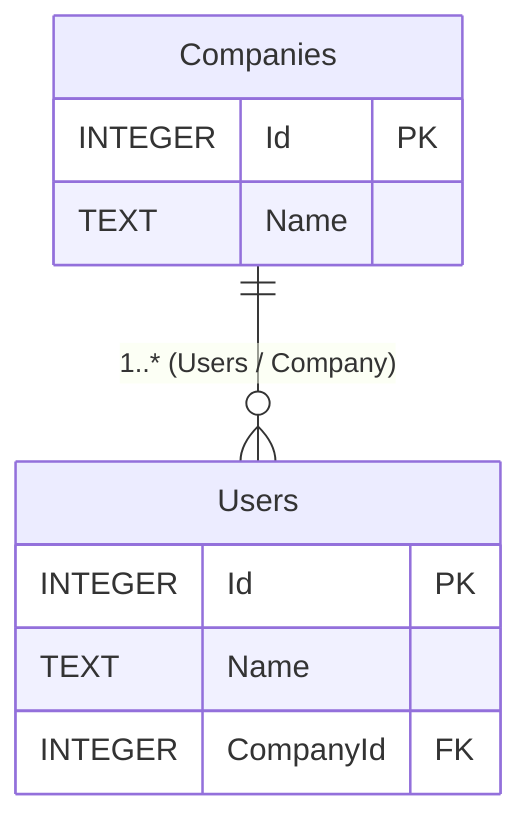
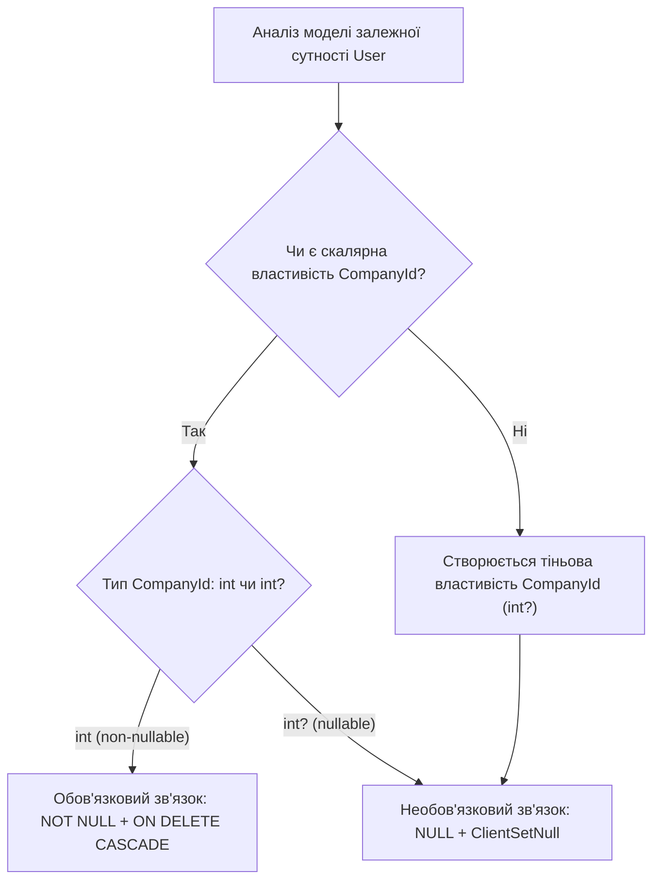

# 4.1. Зовнішні ключі та навігаційні властивості

- **Глава:** 04. Відносини між моделями
- **Оригінал на Metanit:** [https://metanit.com/sharp/efcore/3.1.php](https://metanit.com/sharp/efcore/3.1.php)
- **Код прикладу:** [Lesson_4_01_ForeignKeysAndNavigation.cs](../../src/04_Relations/Lesson_4_01_ForeignKeysAndNavigation.cs)
- **Запуск уроку:** `dotnet run --project src/EFCoreMastery.ConsoleApp -- 4.1`
- **Шпаргалка глави:** [Runs.md](Runs.md)

## Мета уроку

Зрозуміти фундаментальні механізми побудови зв'язків між сутностями в Entity Framework Core: зовнішні ключі (Foreign Keys, FK) та навігаційні властивості (Navigation Properties). Навчитися розрізняти головну (principal) і залежну (dependent) сутності, встановлювати зв'язки різними способами (через навігаційну властивість, через FK, через колекцію головної сутності) та розуміти, як EF Core генерує тіньові властивості, коли FK чи навігація опущені.

## Детальний теоретичний матеріал

У реляційних базах даних зв'язки між таблицями реалізуються через первинні (Primary Key, PK) та зовнішні (Foreign Key, FK) ключі. В об'єктно-орієнтованій моделі C# класи пов'язані між собою посиланнями на інші об'єкти або колекції об'єктів. EF Core поєднує обидва світи за допомогою двох взаємодоповнювальних концепцій:

1. **Навігаційна властивість (Navigation Property)** — властивість C#-класу, яка дозволяє переходити від однієї сутності до іншої в об'єктній моделі:
   - **Посилальна навігація (Reference Navigation)** — посилання на одиночний пов'язаний об'єкт (наприклад, `public Company? Company { get; set; }` у класі `User`).
   - **Колекційна навігація (Collection Navigation)** — колекція пов'язаних об'єктів (наприклад, `public List<User> Users { get; set; } = new();` у класі `Company`).
2. **Зовнішній ключ (Foreign Key, FK)** — скалярна властивість у залежній сутності, яка зберігає значення первинного ключа головної сутності (наприклад, `public int CompanyId { get; set; }`).

### Головна (Principal) та залежна (Dependent) сутності

У будь-якому зв'язку з зовнішнім ключем одна сторона є головною, а інша — залежною:

| Характеристика | Головна сутність (Principal) | Залежна сутність (Dependent) |
|---|---|---|
| **Роль у зв'язку** | Надає первинний або альтернативний ключ, на який посилаються | Містить зовнішній ключ, що вказує на головну сутність |
| **Незалежність існування** | Може існувати без залежних записів | При обов'язковому зв'язку не може існувати без головної сутності |
| **Типова навігація** | Колекція залежних об'єктів (`List<User> Users`) або одиночне посилання (для 1:1) | Посилання на головний об'єкт (`Company? Company`) та скалярний FK (`CompanyId`) |
| **Приклад у уроці** | `Company` | `User` |

### Конвенції іменування зовнішнього ключа

За замовчуванням (Convention-based configuration) EF Core автоматично розпізнає скалярну властивість у залежній сутності як зовнішній ключ, якщо її ім'я відповідає одному з двох шаблонів:

1. `<Ім'я_навігаційної_властивості><Ім'я_ключа_головної_сутності>` — наприклад, навігаційна властивість `Company` + ключ `Id` = `CompanyId`.
2. `<Ім'я_класу_головної_сутності><Ім'я_ключа_головної_сутності>` — наприклад, клас `Company` + ключ `Id` = `CompanyId`.

Якщо навігаційна властивість називається, наприклад, `Employer`, а ключ `Company` називається `Id`, то за першим правилом EF Core очікуватиме `EmployerId`, а за другим — `CompanyId`.

### Три способи встановлення зв'язку в C#

EF Core достатньо гнучкий, щоб ви могли встановлювати зв'язок між об'єктами будь-яким із трьох способів:

1. **Через посилальну навігаційну властивість залежної сутності:**
   ```csharp
   var tom = new User { Name = "Tom", Company = google };
   ```
   Навіть якщо `google` ще не збережений у БД і має `Id == 0`, EF Core автоматично впорядкує `INSERT`-запити під час `SaveChanges()`: спочатку вставить `Company`, отримає згенерований `Id`, а потім підставить його у `CompanyId` для `User`.
2. **Через властивість зовнішнього ключа залежної сутності:**
   ```csharp
   var kate = new User { Name = "Kate", CompanyId = microsoft.Id };
   ```
   Цей спосіб ідеальний, коли головна сутність уже існує в БД і нам відомий лише її `Id` — не потрібно завантажувати весь об'єкт `Company` у пам'ять або викликати `Attach()`. Проте `microsoft.Id` уже має бути відомим (тобто компанія повинна бути збережена в БД до формування `User`).
3. **Через колекційну навігаційну властивість головної сутності:**
   ```csharp
   var google = new Company { Name = "Google", Users = { user1, user2 } };
   db.Companies.Add(google);
   ```
   Додавання `google` у контекст автоматично переводить у стан `Added` і всі пов'язані нові об'єкти в колекції `Users` (досяжність по графу об'єктів).

### Відсутність властивості зовнішнього ключа або навігаційної властивості

Оголошувати зовнішній ключ або обидві навігаційні властивості у C#-класах не обов'язково:

- **Без скалярного FK у класі `User`** (залишається лише `public Company? Company { get; set; }`):
  EF Core автоматично створить **тіньову властивість (Shadow Property)** `CompanyId` типу `int?` (nullable!) та відповідний стовпець у БД. Через nullable-природу тіньового FK каскадне видалення **не** вмикається за замовчуванням (`ON DELETE NO ACTION` / `ClientSetNull`).
- **Без навігаційної властивості `Company` і без `CompanyId` у `User`** (коли у `Company` є лише `public List<User> Users { get; set; }`):
  EF Core все одно розпізнає зв'язок один-до-багатьох на основі колекції `Users` у `Company` і згенерує тіньовий стовпець `"CompanyId" INTEGER` із `FOREIGN KEY` у таблиці `Users`.

Проте явне оголошення скалярного FK (`public int CompanyId { get; set; }`) на практиці значно зручніше: воно дозволяє фільтрувати дані за `u.CompanyId == id` без зайвого `JOIN`, легко змінювати зв'язок за ID та чітко контролювати обов'язковість (`int` vs `int?`).

## Діаграма / Архітектура процесу



Механізм визначення FK та обов'язковості зв'язку за конвенціями EF Core:



## Покроковий розбір прикладів коду

У файлі [Lesson_4_01_ForeignKeysAndNavigation.cs](../../src/04_Relations/Lesson_4_01_ForeignKeysAndNavigation.cs) продемонстровано обидва основні сценарії роботи зі зв'язком `Company` — `User`.

### 1. Визначення моделей та контексту (`AppContextL3_1`)

- `Company` є головною сутністю з `Id`, `Name` та колекційною навігацією `List<User> Users`.
- `User` є залежною сутністю з `Id`, `Name`, обов'язковим зовнішнім ключем `int CompanyId` та посилальною навігацією `Company? Company`.
- Оскільки `CompanyId` має тип `int` (не nullable), при створенні бази даних `SqlServerDbHelper.RecreateSchema(db)` виконує `EnsureDeleted()` та `EnsureCreated()`, генеруючи в SQLite такий DDL:

```sql
CREATE TABLE "Companies" (
    "Id" INTEGER NOT NULL CONSTRAINT "PK_Companies" PRIMARY KEY AUTOINCREMENT,
    "Name" TEXT NULL
);

CREATE TABLE "Users" (
    "Id" INTEGER NOT NULL CONSTRAINT "PK_Users" PRIMARY KEY AUTOINCREMENT,
    "Name" TEXT NULL,
    "CompanyId" INTEGER NOT NULL,
    CONSTRAINT "FK_Users_Companies_CompanyId" FOREIGN KEY ("CompanyId") REFERENCES "Companies" ("Id") ON DELETE CASCADE
);
```

### 2. Секція 1: Встановлення зв'язку через навігаційну властивість

```csharp
var google = new Company { Name = "Google" };
var microsoft = new Company { Name = "Microsoft" };

var tom = new User { Name = "Tom", Company = google };
var bob = new User { Name = "Bob", Company = microsoft };
var alice = new User { Name = "Alice", Company = google };

db.Companies.AddRange(google, microsoft);
db.Users.AddRange(tom, bob, alice);
db.SaveChanges();
```

Під час `db.SaveChanges()` EF Core бачить залежність `User -> Company`:
1. Спочатку вставляє рядки в `"Companies"` (`Google` отримує `Id = 1`, `Microsoft` — `Id = 2`).
2. Отримані `Id` автоматично записує в `tom.CompanyId`, `bob.CompanyId`, `alice.CompanyId`.
3. Вставляє рядки в `"Users"` із відповідними `CompanyId`.

Далі запит `db.Users.Include(u => u.Company).ToList()` виконує `INNER JOIN` (оскільки `CompanyId` є `NOT NULL`) і виводить кожного користувача разом із назвою його компанії.

### 3. Секція 2: Встановлення зв'язку через зовнішній ключ (`CompanyId`)

У новому екземплярі `AppContextL3_1` ми знаходимо `microsoft` (`var microsoft = db.Companies.First(c => c.Name == "Microsoft");`) та створюємо нового користувача, передаючи лише числовий ключ:

```csharp
var kate = new User { Name = "Kate", CompanyId = microsoft.Id };
db.Users.Add(kate);
db.SaveChanges();
```

У третьому контексті (`using (var db = new AppContextL3_1())`) перевіряємо, що після `Include(u => u.Company)` у `kate` коректно заповнюється `kate.Company?.Name` (`Microsoft`), а при запиті з боку компаній `db.Companies.Include(c => c.Users)` ми бачимо згруповані списки співробітників для `Google` (`Tom, Alice`) та `Microsoft` (`Bob, Kate`).

## Особливості роботи в SQLite

- **Увімкнення зовнішніх ключів:** у самому рушії SQLite перевірка `FOREIGN KEY` історично вимкнена за замовчуванням для зворотної сумісності (`PRAGMA foreign_keys = OFF`). Проте провайдер `Microsoft.EntityFrameworkCore.Sqlite` **автоматично виконує `PRAGMA foreign_keys = 1;`** при відкритті кожного з'єднання, тому цілісність посилань і каскадне видалення працюють повноцінно. Якщо ж ви відкриваєте `.db`-файл стороннім клієнтом (наприклад, DB Browser for SQLite), переконайтеся, що прапорець Foreign Keys увімкнений.
- **Типи даних та автоінкремент:** на відміну від MS SQL Server (`INT IDENTITY(1,1)` та `NVARCHAR(MAX)`), у SQLite `int` відображається в `INTEGER`, а `string?` — у `TEXT`, а автогенерація первинного ключа реалізується через `PRIMARY KEY ("Id" AUTOINCREMENT)`.
- **Індекс на зовнішньому ключі:** EF Core автоматично створює індекс `IX_Users_CompanyId` на стовпці зовнішнього ключа для прискорення `JOIN` та каскадного видалення як у SQLite, так і в SQL Server.

## Типові помилки, підводні камені та Best Practices

- **Забутий `Include()` у новому контексті:** якщо ви зберегли `kate` через `CompanyId` і потім прочитали `db.Users.ToList()` у новому `DbContext` без `.Include(u => u.Company)`, властивість `kate.Company` буде `null` (якщо не увімкнено Lazy Loading). У тому ж самому контексті, де `Microsoft` уже відстежується Change Tracker-ом, EF Core автоматично виконає *relationship fixup* і заповнить `kate.Company`.
- **Помилка `FOREIGN KEY constraint failed`:** виникає при спробі вставити `User` із неіснуючим `CompanyId` (наприклад, `CompanyId = 0`, якщо забули зберегти `Company` або не задали навігаційну властивість).
- **Неявний `ON DELETE CASCADE`:** через те що `int CompanyId` не допускає `null`, видалення компанії за замовчуванням видалить усіх її користувачів. Якщо такий зв'язок має бути захищеним від випадкового видалення, використовуйте `int?` або налаштовуйте `DeleteBehavior.Restrict`.
- **Best Practice:** завжди явно оголошуйте і властивість зовнішнього ключа (`CompanyId`), і навігаційну властивість (`Company`), а в головній сутності ініціалізуйте колекцію (`= new();` або `= [];`), щоб уникнути `NullReferenceException` при додаванні елементів.

---
<!-- lesson-nav -->
← [3.13. Ініціалізація бази даних початковими даними](../03_ModelsAndMapping/3_13_DataSeeding.md) | [Шпаргалка глави (Runs.md)](Runs.md) | [Зміст курсу (README)](../../README.md) | [4.2. Налаштування зовнішнього ключа через анотації та Fluent API](4_02_ForeignKeyConfig.md) →
