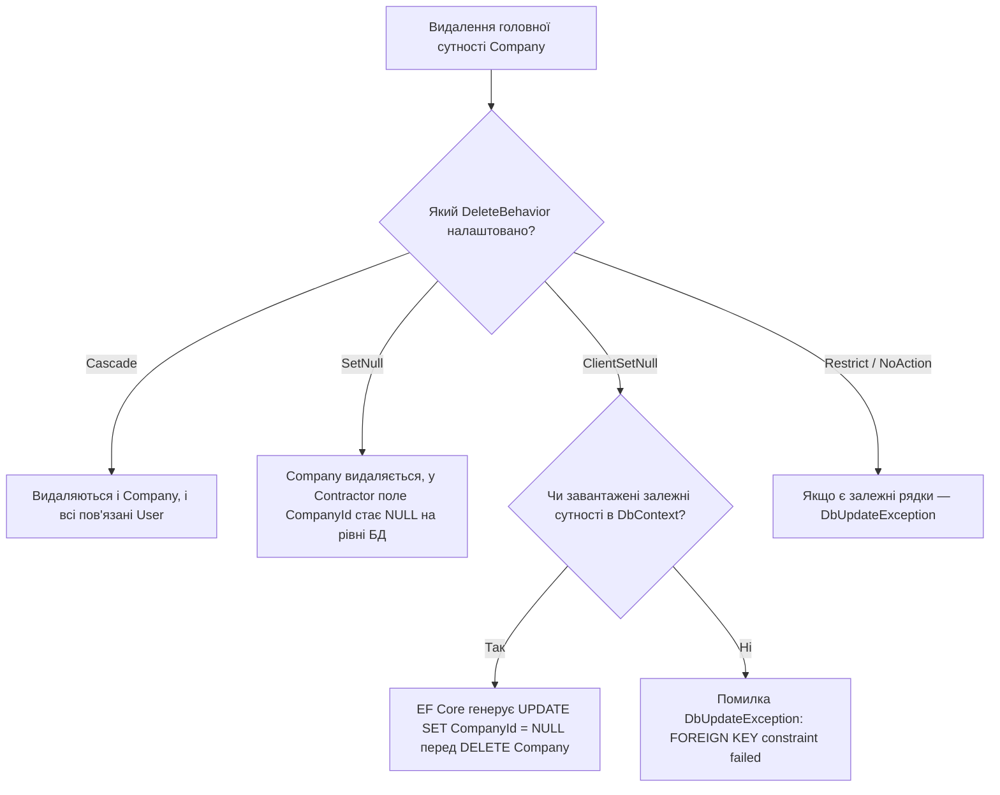

# 4.3. Каскадне видалення

- **Глава:** 04. Відносини між моделями
- **Оригінал на Metanit:** [https://metanit.com/sharp/efcore/3.2.php](https://metanit.com/sharp/efcore/3.2.php)
- **Код прикладу:** [Lesson_4_03_CascadeDelete.cs](../../src/04_Relations/Lesson_4_03_CascadeDelete.cs)
- **Запуск уроку:** `dotnet run --project src/EFCoreMastery.ConsoleApp -- 4.3`
- **Шпаргалка глави:** [Runs.md](Runs.md)

## Мета уроку

Розібратися, як у Entity Framework Core працює каскадне видалення залежних сутностей при видаленні головної сутності, від чого залежить поведінка за замовчуванням (обов'язковість зв'язку) та як гнучко керувати стратегіями видалення за допомогою переліку `DeleteBehavior` у Fluent API.

## Детальний теоретичний матеріал

**Каскадне видалення (Cascade Delete)** — це механізм підтримання посилальної цілісності, за якого видалення головної (principal) сутності автоматично призводить до видалення всіх пов'язаних із нею залежних (dependent) сутностей.

### Поведінка за замовчуванням: обов'язковий vs необов'язковий зв'язок

EF Core визначає стратегію видалення за замовчуванням залежно від того, чи є зв'язок **обов'язковим (Required)** або **необов'язковим (Optional)**:

1. **Обов'язковий зв'язок → `DeleteBehavior.Cascade` (`ON DELETE CASCADE` у БД):**
   Зв'язок вважається обов'язковим у будь-якому з таких випадків:
   - Властивість зовнішнього ключа має не-nullable тип (наприклад, `public int CompanyId { get; set; }`) — навіть якщо сама навігаційна властивість `Company?` допускає `null`!
   - Властивість FK відсутня (тіньовий ключ), а навігаційна властивість оголошена як не-nullable (наприклад, `public Company Company { get; set; }` при увімкнених NRT).
   - Навігаційна властивість (або FK) позначена атрибутом `[Required]`.
2. **Необов'язковий зв'язок → `DeleteBehavior.ClientSetNull` (`ON DELETE NO ACTION` у БД):**
   Зв'язок вважається необов'язковим, якщо:
   - Властивість зовнішнього ключа має nullable тип (`public int? CompanyId { get; set; }`).
   - Властивість FK відсутня, а навігаційна властивість є nullable (`public Company? Company { get; set; }`).

### Значення `DeleteBehavior` у Fluent API

Метод `.OnDelete(DeleteBehavior...)` дозволяє явно змінити поведінку при видаленні для конкретного зв'язку в `OnModelCreating`:

| Значення `DeleteBehavior` | Дія для відстежуваних сутностей (у пам'яті EF Core) | Дія в SQLite / БД (для невідстежуваних сутностей) |
|---|---|---|
| **`Cascade`** | Видаляє залежні сутності при `SaveChanges()` | `ON DELETE CASCADE` (БД сама видаляє дочірні рядки) |
| **`SetNull`** | Встановлює FK у `null` (тільки якщо FK nullable) | `ON DELETE SET NULL` (БД сама зануляє FK) |
| **`Restrict`** | Забороняє видалення; не змінює FK | `ON DELETE RESTRICT` / `NO ACTION` (БД кидає помилку FK) |
| **`ClientSetNull`** *(за замовч. для optional)* | Встановлює FK у `null` для завантажених у контекст об'єктів | `ON DELETE NO ACTION` (якщо дочірні не завантажені — БД кине помилку FK!) |
| **`ClientCascade`** | Видаляє завантажені залежні сутності на клієнті | `ON DELETE NO ACTION` (використовується рідко, наприклад при циклах у SQL Server) |
| **`NoAction`** | Не виконує дій на клієнті | `ON DELETE NO ACTION` (БД поверне помилку за наявності дочірніх рядків) |

> [!IMPORTANT]
> Зверніть увагу на різницю між **`ClientSetNull`** та **`SetNull`**: при `ClientSetNull` EF Core занулює `CompanyId` лише для тих об'єктів, які **вже завантажені** в поточний `DbContext`. Якщо ви видаляєте компанію в новому контексті, не завантажуючи її залежних сутностей, БД відхилить `DELETE` з помилкою `FOREIGN KEY constraint failed`. Натомість `DeleteBehavior.SetNull` генерує в DDL `ON DELETE SET NULL`, і база даних самостійно оновить усі залежні рядки.

## Діаграма / Архітектура процесу



## Покроковий розбір прикладів коду

У файлі [Lesson_4_03_CascadeDelete.cs](../../src/04_Relations/Lesson_4_03_CascadeDelete.cs) в одному контексті `AppContextL3_2` порівнюються дві різні стратегії для однієї головної сутності `Company`:

### 1. Налаштування моделей у `AppContextL3_2`

- `User` має не-nullable ключ `public int CompanyId { get; set; }`. За конвенцією це обов'язковий зв'язок, тому EF Core призначає `DeleteBehavior.Cascade`.
- `Contractor` (підрядник) має nullable ключ `public int? CompanyId { get; set; }`. За замовчуванням це було б `ClientSetNull`, але в `OnModelCreating` ми явно встановлюємо `DeleteBehavior.SetNull`:

```csharp
modelBuilder.Entity<Contractor>()
    .HasOne(c => c.Company)
    .WithMany(comp => comp.Contractors)
    .HasForeignKey(c => c.CompanyId)
    .OnDelete(DeleteBehavior.SetNull);
```

Згенерований SQLite DDL для обох таблиць:

```sql
CREATE TABLE "Users" (
    "Id" INTEGER NOT NULL CONSTRAINT "PK_Users" PRIMARY KEY AUTOINCREMENT,
    "Name" TEXT NULL,
    "CompanyId" INTEGER NOT NULL,
    CONSTRAINT "FK_Users_Companies_CompanyId" FOREIGN KEY ("CompanyId") REFERENCES "Companies" ("Id") ON DELETE CASCADE
);

CREATE TABLE "Contractors" (
    "Id" INTEGER NOT NULL CONSTRAINT "PK_Contractors" PRIMARY KEY AUTOINCREMENT,
    "Name" TEXT NULL,
    "CompanyId" INTEGER NULL,
    CONSTRAINT "FK_Contractors_Companies_CompanyId" FOREIGN KEY ("CompanyId") REFERENCES "Companies" ("Id") ON DELETE SET NULL
);
```

### 2. Виконання видалення та перевірка результату

1. Додаються дві компанії (`Microsoft`, `Google`), четверо штатних працівників (`Users`: Tom і Alice в Microsoft; Bob і Kate в Google) та двоє підрядників (`Contractors`: Freelancer John у Microsoft; Freelancer Sara в Google).
2. Викликається `db.Companies.Remove(microsoft); db.SaveChanges();`.
3. У новому екземплярі `AppContextL3_2` (щоб гарантувати читання саме з БД, а не з кешу Change Tracker) перевіряється стан таблиць:
   - `Tom` та `Alice` **повністю видалені** з таблиці `Users` (спрацювало каскадне видалення).
   - `Freelancer John` **залишився** в таблиці `Contractors`, але його `CompanyId` тепер дорівнює `NULL`.
   - Співробітники та підрядники `Google` не постраждали.

## Особливості роботи в SQLite

- **Множинні каскадні шляхи (Multiple Cascade Paths):** у MS SQL Server часто виникає помилка міграції *«Introducing FOREIGN KEY constraint ... may cause cycles or multiple cascade paths»*, якщо до однієї таблиці ведуть два або більше каскадних шляхи (наприклад, `Company -> Department -> User` і `Company -> User`). **SQLite не має такого обмеження** і дозволяє множинні каскадні шляхи. Проте якщо ви плануєте переносити проєкт на SQL Server, для одного з шляхів варто використовувати `Restrict` або `NoAction`.
- **Масове видалення `ExecuteDelete()` / `ExecuteDeleteAsync()`:** методи прямого SQL-видалення (з EF Core 7+) обходять Change Tracker і виконують чистий `DELETE FROM "Companies" WHERE ...`. У такому разі клієнтські стратегії (`ClientSetNull`, `ClientCascade`) **не спрацюють** — виконаються лише правила, прописані в самому SQLite (`ON DELETE CASCADE` або `ON DELETE SET NULL`).
- **Перевірка `PRAGMA foreign_keys`:** у SQLite каскадні дії `ON DELETE CASCADE` та `ON DELETE SET NULL` працюють виключно тоді, коли увімкнено `PRAGMA foreign_keys = ON`. Провайдер EF Core вмикає це автоматично.

## Типові помилки, підводні камені та Best Practices

- **Ілюзія nullable-навігації:** розробники часто пишуть `public Company? Company { get; set; }` разом із `public int CompanyId { get; set; }` і дивуються, чому при видаленні компанії зникають користувачі. Пам'ятайте: обов'язковість зв'язку визначається передусім типом **зовнішнього ключа** (`int` vs `int?`).
- **Спроба застосувати `DeleteBehavior.SetNull` до не-nullable FK:** якщо `CompanyId` має тип `int` (не `int?`), виклик `.OnDelete(DeleteBehavior.SetNull)` призведе до помилки під час побудови моделі або вставки/видалення, оскільки стовпець `NOT NULL` не може прийняти `NULL`.
- **Best Practice для бізнес-критичних даних:** для фінансових транзакцій, замовлень, аудит-логів або історії дій **завжди вимикайте каскадне видалення** через `.OnDelete(DeleteBehavior.Restrict)` (або використовуйте м'яке видалення — *Soft Delete* через `IsDeleted` і глобальні фільтри запитів), щоб випадкове видалення батьківського запису не знищило історичні дані.

---
<!-- lesson-nav -->
← [4.2. Налаштування зовнішнього ключа через анотації та Fluent API](4_02_ForeignKeyConfig.md) | [Шпаргалка глави (Runs.md)](Runs.md) | [Зміст курсу (README)](../../README.md) | [4.4. Завантаження пов'язаних даних. Метод Include](4_04_EagerLoadingInclude.md) →
