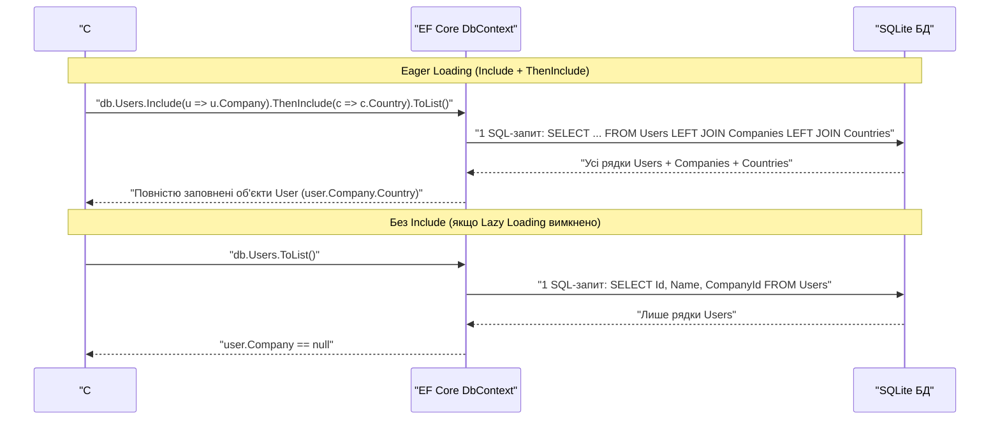

# 4.4. Завантаження пов'язаних даних. Метод Include

- **Глава:** 04. Відносини між моделями
- **Оригінал на Metanit:** [https://metanit.com/sharp/efcore/3.3.php](https://metanit.com/sharp/efcore/3.3.php)
- **Код прикладу:** [Lesson_4_04_EagerLoadingInclude.cs](../../src/04_Relations/Lesson_4_04_EagerLoadingInclude.cs)
- **Запуск уроку:** `dotnet run --project src/EFCoreMastery.ConsoleApp -- 4.4`
- **Шпаргалка глави:** [Runs.md](Runs.md)

## Мета уроку

Опанувати стратегію **жадного завантаження (Eager Loading)** в Entity Framework Core за допомогою методів `Include()` та `ThenInclude()` для отримання зв'язаних сутностей будь-якої глибини вкладеності за один SQL-запит, а також зрозуміти роль кешу контексту (Relationship Fix-up) та методи оптимізації (`AsSplitQuery()`, проєкція).

## Детальний теоретичний матеріал

За замовчуванням EF Core дотримується принципу мінімального завантаження: при запиті `db.Users.ToList()` навігаційні властивості (`Company`, `Position`) залишаються `null`, а колекційні (`Company.Users`) — порожніми, якщо пов'язані об'єкти ще не перебувають у поточному `DbContext`.

У EF Core існують три основні стратегії завантаження пов'язаних даних:

| Стратегія | Механізм | Кількість SQL-запитів | Коли застосовувати |
|---|---|---|---|
| **Eager Loading (Жадне)** | `Include()` / `ThenInclude()` | 1 запит із `JOIN` (або кілька при `AsSplitQuery()`) | Коли заздалегідь відомо, які пов'язані дані потрібні в сценарії |
| **Explicit Loading (Явне)** | `Load()`, `Entry().Collection().Load()`, `Entry().Reference().Load()` | 1 + M запитів (за вимогою) | Коли пов'язані дані потрібні вибірково, після перевірки умов |
| **Lazy Loading (Ліниве)** | `UseLazyLoadingProxies()` + `virtual` | 1 + N запитів (ризик N+1) | Коли звернення до навігації відбувається епізодично і контекст ще відкритий |

### 1. Метод `Include()`

Метод розширення `Include()` (простір імен `Microsoft.EntityFrameworkCore`) вказує EF Core завантажити пов'язану сутність або колекцію першого рівня разом з основною вибіркою:

```csharp
var users = db.Users
    .Include(u => u.Company)
    .ToList();
```

На рівні SQL це транслюється в `LEFT JOIN` (якщо зовнішній ключ nullable, наприклад `int? CompanyId`) або `INNER JOIN` (якщо зовнішній ключ обов'язковий, `int CompanyId`):

```sql
SELECT "u"."Id", "u"."CompanyId", "u"."Name", "u"."PositionId", "c"."Id", "c"."CountryId", "c"."Name"
FROM "Users" AS "u"
LEFT JOIN "Companies" AS "c" ON "u"."CompanyId" = "c"."Id"
```

### 2. Багаторівневе завантаження: `ThenInclude()` та ланцюжок у `Include()`

Коли потрібно спуститися глибше по ієрархії навігаційних властивостей (наприклад, `User -> Company -> Country`), використовують:

- **Ланцюжок `Include().ThenInclude()`:**
  ```csharp
  var users = db.Users
      .Include(u => u.Company)
          .ThenInclude(c => c!.Country)
      .Include(u => u.Position)
      .ToList();
  ```
  Оператор `!` (null-forgiving operator) у `c => c!.Country` потрібен для задоволення компілятора C# (Nullable Reference Types), оскільки `u.Company` має тип `Company?`. На рівні виконання EF Core безпечно обробляє `null`, якщо в користувача немає компанії (`LEFT JOIN`).
- **Прямий шлях у `Include()` (для одиночних посилань):**
  `db.Users.Include(u => u.Company!.Country)` генерує ідентичний SQL з двома `LEFT JOIN`. Проте для колекцій (`Company -> Users -> Position`) без `ThenInclude()` не обійтися, оскільки в `List<User>` не можна звернутися до `.Position` безпосередньо.
- **Кілька гілок в одному запиті:** виклик `.Include(u => u.Position)` після `.ThenInclude(...)` завжди починається знову від кореневої сутності запиту (`User`), а не від `Country`.

### 3. Вплив локального кешу контексту (Relationship Fix-up)

Якщо пов'язані об'єкти (`Company`) уже були додані або завантажені в **той самий** екземпляр `DbContext` раніше:
- Під час `db.Users.ToList()` без `Include()`, EF Core автоматично «зшиє» навігаційні властивості (`user.Company`) з об'єктами, що вже відстежуються в Change Tracker.
- Проте в **новому** `DbContext` (типовий сценарій для веб-застосунків і розділених операцій читання/запису) кеш порожній, тому без `Include()` навігаційні властивості будуть `null`.

### 4. Фільтрований `Include()` (Filtered Include)

Починаючи з EF Core 5+, у `Include` та `ThenInclude` для колекцій можна передавати `.Where()`, `.OrderBy()`, `.Take()`:

```csharp
var companies = db.Companies
    .Include(c => c.Users.Where(u => u.Name!.StartsWith("T")).OrderBy(u => u.Name))
    .ToList();
```

## Діаграма / Архітектура процесу

Порівняння кількості звернень до БД: Eager Loading (`Include`) проти проблеми N+1 при лінивому завантаженні:



## Покроковий розбір прикладів коду

У файлі [Lesson_4_04_EagerLoadingInclude.cs](../../src/04_Relations/Lesson_4_04_EagerLoadingInclude.cs) побудовано трирівневу ієрархію моделей: `Country` ← `Company` ← `User` → `Position`.

### 1. Підготовка даних

У першому блоці `using (var db = new AppContextL3_3())`:
- БД пересоздається через `SqliteDbHelper.RecreateDatabase(db)`.
- Створюються країни (`Ukraine`, `USA`), компанії (`KyivTech`, `Microsoft`), посади (`Developer`, `Manager`) та троє користувачів (`Taras`, `Olena`, `Tom`).
- `db.SaveChanges()` зберігає весь граф. Потім контекст закривається (`Dispose`).

### 2. Секція 1: Без `Include()` навігаційні властивості дорівнюють `null`

```csharp
var usersWithoutInclude = db.Users.ToList();
foreach (var u in usersWithoutInclude)
{
    Console.WriteLine($"{u.Name} -> Company: {u.Company?.Name ?? "NULL (не завантажено)"}");
}
```

Оскільки це **новий** контекст `AppContextL3_3`, Change Tracker порожній. Запит виконує простий `SELECT "u"."Id", "u"."CompanyId", "u"."Name", "u"."PositionId" FROM "Users" AS "u"`, і `u.Company` залишається `null`.

### 3. Секція 2: Жадне завантаження через `Include` + `ThenInclude`

```csharp
var users = db.Users
    .Include(u => u.Company)
        .ThenInclude(c => c!.Country)
    .Include(u => u.Position)
    .ToList();
```

EF Core генерує єдиний SQL-запит до SQLite з трьома `LEFT JOIN` (`Companies`, `Countries`, `Positions`):

```sql
SELECT "u"."Id", "u"."CompanyId", "u"."Name", "u"."PositionId",
       "c"."Id", "c"."CountryId", "c"."Name",
       "c0"."Id", "c0"."Name",
       "p"."Id", "p"."Name"
FROM "Users" AS "u"
LEFT JOIN "Companies" AS "c" ON "u"."CompanyId" = "c"."Id"
LEFT JOIN "Countries" AS "c0" ON "c"."CountryId" = "c0"."Id"
LEFT JOIN "Positions" AS "p" ON "u"."PositionId" = "p"."Id"
```

У результаті за один похід до БД завантажуються всі 4 сутності: `User`, `Company`, `Country` та `Position`.

### 4. Секція 3: Зворотне завантаження колекцій (`Company -> Users`)

```csharp
var companies = db.Companies
    .Include(c => c.Users)
    .ToList();
```

Тут `Include` завантажує колекційну навігаційну властивість `Users` для кожної компанії, виконуючи `LEFT JOIN "Users" AS "u" ON "c"."Id" = "u"."CompanyId"` з `ORDER BY "c"."Id"`, щоб EF Core міг коректно згрупувати рядки користувачів у `List<User>` кожної компанії.

## Особливості роботи в SQLite

- **Тип `JOIN`:** як і в SQL Server, для nullable зовнішніх ключів (`int? CompanyId`) EF Core генерує `LEFT JOIN`, а для non-nullable (`int CountryId`) — може оптимізувати до `INNER JOIN` (особливо при проєкціях або обов'язкових зв'язках).
- **Cartesian Explosion та `.AsSplitQuery()`:** якщо ви завантажуєте одночасно кілька незалежних колекцій (наприклад, `db.Companies.Include(c => c.Users).Include(c => c.Projects)`), один `JOIN`-запит перемножить кількість рядків (декартовий добуток). У SQLite, як і в SQL Server, виклик `.AsSplitQuery()` розбиває такий запит на кілька окремих швидких `SELECT`-ів у межах одного з'єднання.
- **Підтримка `ORDER BY` при групуванні колекцій:** SQLite повністю підтримує сортування за ключем батьківської таблиці, яке EF Core додає автоматично при `Include` на колекцію.

## Типові помилки, підводні камені та Best Practices

- **Ігнорування `Include()` при використанні `.Select(...)`:** якщо ви робите проєкцію в анонімний тип або DTO (наприклад, `db.Users.Select(u => new { u.Name, CompanyName = u.Company!.Name })`), `Include()` **не потрібен і навіть ігнорується** EF Core! Проєкція сама генерує оптимальний `JOIN` і тягне лише потрібні стовпці.
- **Надмірне використання `Include()`:** завантаження великих графів об'єктів «про всяк випадок» перевантажує пам'ять, мережу та CPU. Завантажуйте лише ті гілки, які реально використовуються в методі.
- **Циклічна серіалізація в JSON:** після `db.Companies.Include(c => c.Users)` кожен `User` у `company.Users` має посилання `user.Company` назад на ту саму компанію (Relationship Fix-up). При серіалізації в `System.Text.Json` це викличе `JsonException: A possible object cycle was detected`. Рішення — використовувати DTO або `ReferenceHandler.IgnoreCycles`.

---
<!-- lesson-nav -->
← [4.3. Каскадне видалення](4_03_CascadeDelete.md) | [Шпаргалка глави (Runs.md)](Runs.md) | [Зміст курсу (README)](../../README.md) | [4.5. Явне завантаження (Explicit loading)](4_05_ExplicitLoading.md) →
