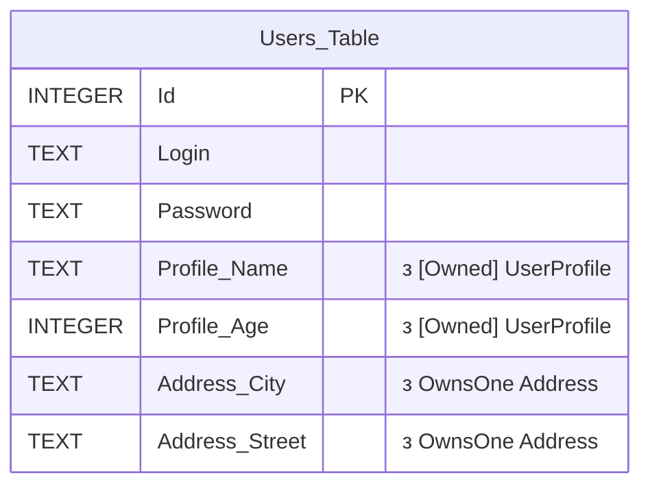

# 4.10. Власні типи (Owned Types)

- **Глава:** 04. Відносини між моделями
- **Оригінал на Metanit:** [https://metanit.com/sharp/efcore/3.7.php](https://metanit.com/sharp/efcore/3.7.php)
- **Код прикладу:** [Lesson_4_10_OwnedTypes.cs](../../src/04_Relations/Lesson_4_10_OwnedTypes.cs)
- **Запуск уроку:** `dotnet run --project src/EFCoreMastery.ConsoleApp -- 4.10`
- **Шпаргалка глави:** [Runs.md](Runs.md)

## Мета уроку

Навчитися моделювати **власні типи (Owned Entity Types)** в Entity Framework Core за допомогою атрибута `[Owned]` та методів Fluent API (`OwnsOne()`), розуміти, як вони зберігаються в таблиці сутності-власника (включаючи вкладені та приватні власні типи), і знати їхні ключові обмеження порівняно зі звичайними сутностями та Complex Types.

## Детальний теоретичний матеріал

За замовчуванням EF Core відображає кожен клас моделі в окрему таблицю. Проте часто певний клас не має самостійної життєвої ідентичності в домені, а лише групує набір атрибутів головної сутності (наприклад, `UserProfile`, `Address`, `Money`, `DateRange`). У Domain-Driven Design (DDD) такі об'єкти називають *Value Objects*, а в EF Core історично для них застосовують механізм **власних типів (Owned Entity Types)**.

### Ключові характеристики Owned Types

1. **Залежність від власника (Owner):** власний тип логічно належить іншій сутності-власнику і не може існувати без неї.
2. **Відсутність власного первинного ключа в коді:** у C#-класі власного типу (`UserProfile`, `Address`) не потрібно оголошувати `Id` — EF Core використовує первинний ключ власника як тіньовий ключ.
3. **Відсутність окремого `DbSet<T>`:** до власного типу не звертаються напряму через `db.UserProfiles` — робота відбувається виключно через сутність-власник (`db.Users`).
4. **Зберігання в одній таблиці з власником (Table Sharing):** за замовчуванням усі властивості власного типу потрапляють у таблицю власника з іменем стовпця за шаблоном `<НазваНавігаційноїВластивості>_<НазваПоля>` (наприклад, `Profile_Name`, `Address_City`).
5. **Автоматичне завантаження:** при запиті `db.Users.ToList()` власні типи завантажуються **автоматично без виклику `Include()`**.

### Два способи налаштування

1. **Через атрибут `[Owned]`** (`Microsoft.EntityFrameworkCore`):
   ```csharp
   [Owned]
   public class UserProfile
   {
       public string? Name { get; set; }
       public int Age { get; set; }
   }
   ```
   Цей атрибут робить тип власним для всіх сутностей, які містять властивість типу `UserProfile`.
2. **Через Fluent API `OwnsOne()`:**
   ```csharp
   modelBuilder.Entity<User>().OwnsOne(u => u.Address);
   ```
   Fluent API також дозволяє:
   - Налаштовувати **приватні власні властивості:** `modelBuilder.Entity<User>().OwnsOne(typeof(UserProfile), "Profile");`
   - Будувати **вкладені власні типи** (наприклад, `User -> UserProfile -> Claim`):
     ```csharp
     modelBuilder.Entity<User>().OwnsOne(u => u.Profile, p =>
     {
         p.OwnsOne(c => c.Name);
         p.OwnsOne(c => c.Age);
     });
     ```
     У такому разі імена стовпців у таблиці формуються за ланцюжком: `Profile_Name_Key`, `Profile_Name_Value`.
   - Виносити колекції власних типів у дочірню таблицю через `OwnsMany(u => u.Addresses)`.

### Порівняння: Owned Types vs Complex Types vs Звичайна сутність 1:1

| Критерій | Owned Type (`OwnsOne`) | Complex Type (`ComplexProperty`, EF 8+) | Звичайна сутність 1:1 |
| :--- | :--- | :--- | :--- |
| **Зберігання за замовчуванням** | Та сама таблиця власника | Та сама таблиця власника | Окрема таблиця |
| **Тіньовий ключ у ChangeTracker** | Так (прив'язаний до власника) | Ні (справжній Value Object) | Власний `Id` (PK) |
| **Спільне використання 1 інстансу у 2 сутностях** | Заборонено (виняток відстеження) | **Дозволено** (семантика значення) | Заборонено в 1:1 |
| **Колекції** | Підтримуються (`OwnsMany`) | Обмежено (JSON / EF 10+) | Повноцінно (`1:N`) |

## Діаграма / Архітектура процесу

Відображення класів `User`, `UserProfile` та `Address` в єдину фізичну таблицю SQLite `Users`:



## Покроковий розбір прикладів коду

У файлі [Lesson_4_10_OwnedTypes.cs](../../src/04_Relations/Lesson_4_10_OwnedTypes.cs) продемонстровано обидва способи оголошення власних типів в одному класі `User`.

### 1. Моделі та контекст `AppContextL3_7`

- `User` — сутність-власник (`DbSet<User> Users`), містить `Profile` та `Address`.
- `UserProfile` позначений атрибутом `[Owned]`.
- `Address` не має атрибутів, але налаштований у `OnModelCreating` через `modelBuilder.Entity<User>().OwnsOne(u => u.Address);`.

У результаті в SQLite створюється **одна** таблиця `"Users"`:

```sql
CREATE TABLE "Users" (
    "Id" INTEGER NOT NULL CONSTRAINT "PK_Users" PRIMARY KEY AUTOINCREMENT,
    "Login" TEXT NULL,
    "Password" TEXT NULL,
    "Profile_Name" TEXT NULL,
    "Profile_Age" INTEGER NULL,
    "Address_City" TEXT NULL,
    "Address_Street" TEXT NULL
);
```

### 2. Секція 1: Збереження Owned Types

```csharp
var user1 = new User
{
    Login = "login1",
    Password = "pass1234",
    Profile = new UserProfile { Name = "Tom", Age = 23 },
    Address = new Address { City = "Kyiv", Street = "Khreshchatyk, 1" }
};
```

Під час `db.SaveChanges()` виконується один `INSERT INTO "Users"` без жодних додаткових таблиць або `FOREIGN KEY`.

### 3. Секція 2: Читання без `Include()`

```csharp
var users = db.Users.ToList();
foreach (var u in users)
{
    Console.WriteLine(
        $"Login: {u.Login} | Name: {u.Profile?.Name}, Age: {u.Profile?.Age} | " +
        $"Address: {u.Address?.City}, {u.Address?.Street}");
}
```

У новому контексті простий виклик `db.Users.ToList()` витягує всі стовпці таблиці `"Users"` і одразу матеріалізує вкладені об'єкти `u.Profile` та `u.Address` без `Include()`.

## Особливості роботи в SQLite

- **Nullable-стовпці для value types:** зверніть увагу на DDL вище — у C# властивість `UserProfile.Age` має тип `int` (non-nullable), але в таблиці SQLite стовпець `"Profile_Age"` має тип `INTEGER NULL`. Це тому, що сама навігаційна властивість `User.Profile` є nullable (`UserProfile?`), і якщо `user.Profile == null`, усі її стовпці в БД мусять приймати `NULL`. Якщо позначити `Profile` атрибутом `[Required]` (або зробити не-nullable), стовпці стануть `NOT NULL`.
- **Перейменування стовпців:** за замовчуванням використовується підкреслення (`Address_City`), що легко змінити через `builder.OwnsOne(u => u.Address, a => a.Property(p => p.City).HasColumnName("City"))`.

## Типові помилки, підводні камені та Best Practices

- **Заборона спільного використання екземпляра (No Sharing):** оскільки під капотом Owned Type все ще відстежується Change Tracker-ом як окрема прихована сутність із тіньовим ключем власника, **один і той самий екземпляр `Address` або `UserProfile` не можна присвоїти двом різним `User`**! Це призведе до помилки або від'єднання від першого користувача. Якщо вам потрібне спільне використання об'єктів-значень, використовуйте **`[ComplexType]`** (урок 3.12).
- **Порожній об'єкт при всіх `NULL` у БД:** якщо в БД усі стовпці `Address_City` і `Address_Street` дорівнюють `NULL`, при читанні `user.Address` буде `null`.
- **Коли обирати `Owned Types`, а коли `1:1`:** якщо дані профілю/адреси завжди потрібні разом із користувачем і не потребують окремого життєвого циклу, використовуйте `Owned` (або `ComplexType`) — це позбавить від зайвих `JOIN`-ів.

---
<!-- lesson-nav -->
← [4.9. Відношення багато до багатьох](4_09_ManyToMany.md) | [Шпаргалка глави (Runs.md)](Runs.md) | [Зміст курсу (README)](../../README.md) | [4.11. Комплексні типи (Complex Types)](4_11_ComplexTypes.md) →
