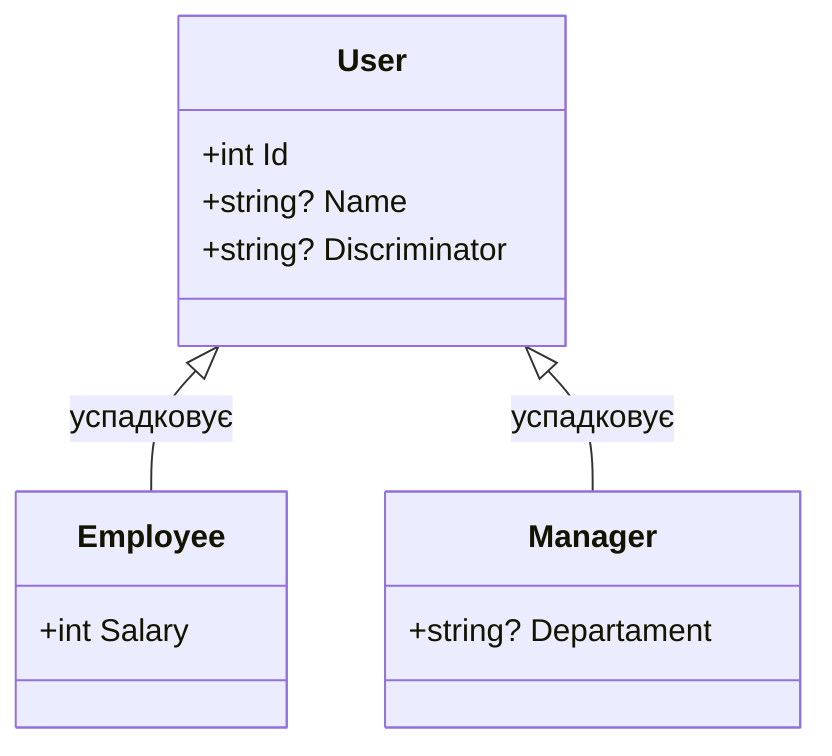
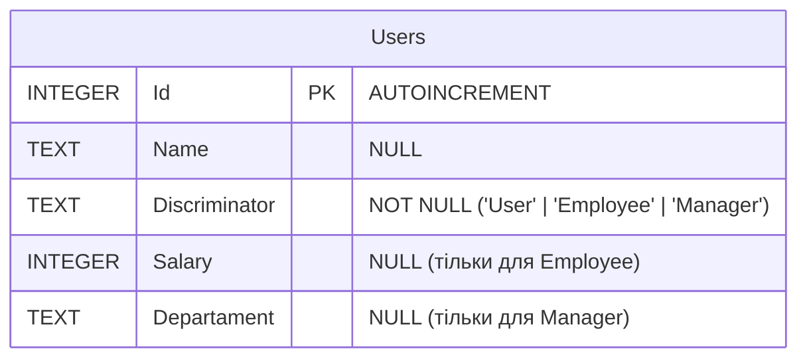
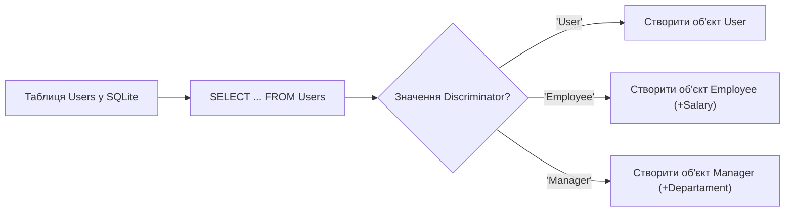

# 4.1. Підхід TPH — Table Per Hierarchy

- **Глава:** 05. Спадкування
- **Оригінал на Metanit:** [https://metanit.com/sharp/efcore/4.1.php](https://metanit.com/sharp/efcore/4.1.php)
- **Код прикладу:** [Lesson_4_01_TphInheritance.cs](../../src/05_Inheritance/Lesson_4_01_TphInheritance.cs)
- **Запуск уроку:** `dotnet run --project src/EFCoreMastery.ConsoleApp -- 4.1`
- **Шпаргалка глави:** [Runs.md](Runs.md)

---

## Мета уроку

Зрозуміти, як Entity Framework Core **за замовчуванням** відображає ієрархію успадкування класів C# у реляційну базу даних за стратегією **TPH (Table Per Hierarchy — «одна таблиця на всю ієрархію»)**. Вивчити роль службового стовпця-дискримінатора (`Discriminator`), способи включення похідних типів до моделі через `DbSet<T>`, явне налаштування через `UseTphMappingStrategy()`, а також проаналізувати реальну схему `sqlite_master` і згенерований SQL для поліморфних і типізованих запитів.

---

## Детальний теоретичний матеріал

### 1. Сутність стратегії TPH (Table Per Hierarchy)

При роботі з об'єктно-орієнтованими ієрархіями класів у реляційних базах даних виникає класична проблема невідповідності парадигм (object-relational impedance mismatch): у C# є успадкування, а в таблицях SQL — ні.

**TPH (Table Per Hierarchy)** — це стратегія відображення, яку Entity Framework Core застосовує **за замовчуванням**. Її головна ідея:
1. Усі класи однієї ієрархії (`User`, `Employee`, `Manager`) зберігаються в **одній спільній таблиці** (`Users`).
2. Таблиця містить **об'єднання всіх властивостей** базового та всіх похідних класів (`Id`, `Name`, `Salary`, `Departament`).
3. Щоб EF Core знав, екземпляр якого саме класу C# потрібно створити (матеріалізувати) під час читання рядка, до таблиці автоматично додається спеціальний службовий стовпець — **дискримінатор (`Discriminator`)**.

```text
Ієрархія C#:                 Таблиця Users у БД:
  User (Id, Name)        ──►  Id | Name   | Discriminator | Salary | Departament
  ├── Employee (+Salary) ──►  1  | Sam    | Employee      | 500    | NULL
  └── Manager (+Dept)    ──►  2  | Robert | Manager       | NULL   | IT
                              3  | Tom    | User          | NULL   | NULL
```

### 2. Включення ієрархії класів у модель EF Core

Щоб усі класи ієрархії потрапили до моделі EF Core і для їхніх специфічних властивостей були створені стовпці в таблиці, у класі контексту `DbContext` визначають властивості `DbSet<T>` для кожного типу ієрархії:

```csharp
public class TphContext : DbContext
{
    public DbSet<User> Users { get; set; } = null!;
    public DbSet<Employee> Employees { get; set; } = null!;
    public DbSet<Manager> Managers { get; set; } = null!;
    // ...
}
```

> **Примітка:** Навіть якщо визначити лише `DbSet<User>`, але похідні типи `Employee` та `Manager` явно зареєструвати в `OnModelCreating` (наприклад, через `modelBuilder.Entity<Employee>()`), EF Core також включить їх до TPH-таблиці. Проте оголошення `DbSet<Employee>` та `DbSet<Manager>` робить запити до конкретних типів максимально зручними (`db.Employees`, `db.Managers`).

### 3. Службовий стовпець `Discriminator` і тіньові властивості

За замовчуванням `Discriminator` створюється як **тіньова властивість (shadow property)** — її немає в C#-класі `User`, але EF Core автоматично керує нею в моделі та в БД:
- Тип у SQLite: `TEXT NOT NULL` (у SQL Server — `nvarchar(max) NOT NULL` або обмежений рядок залежно від конфігурації).
- Значення за замовчуванням: **ім'я класу** без простору імен (`"User"`, `"Employee"`, `"Manager"`).

За потреби розробник може явно додати властивість `Discriminator` до базового класу:

```csharp
public class User
{
    public int Id { get; set; }
    public string? Name { get; set; }
    public string? Discriminator { get; set; }
}
```

> **Важливо (Read-Only поведінка):** Навіть коли `Discriminator` оголошено в класі `User`, на рівні моделі EF Core налаштовує його як **лише для читання після збереження** (`ValueGeneratedOnAdd` / read-only). Ви можете читати `user.Discriminator` після завантаження з БД, але спроба змінити його вручну для існуючого рядка не змінить тип сутності та призведе до помилки або ігнорування під час `SaveChanges()`.

За бажання у Fluent API можна перевизначити ім'я стовпця-дискримінатора або його значення для кожного типу:

```csharp
modelBuilder.Entity<User>()
    .HasDiscriminator<string>("UserType")
    .HasValue<User>("regular_user")
    .HasValue<Employee>("emp")
    .HasValue<Manager>("mgr");
```

### 4. Явне налаштування через `UseTphMappingStrategy()`

Хоча TPH працює автоматично без жодних викликів, починаючи з **EF Core 7.0** з'явився метод `UseTphMappingStrategy()`, який дозволяє явно задекларувати стратегію на базовому типі ієрархії:

```csharp
protected override void OnModelCreating(ModelBuilder modelBuilder)
{
    modelBuilder.Entity<User>().UseTphMappingStrategy();
}
```

Це корисно для:
- самодокументування коду (одразу видно, яку стратегію обрано);
- явного повернення до TPH, якщо базові конвенції або зовнішні конфігурації змінюють стратегію.

### 5. Поведінка обмежень `NULL` / `NOT NULL` у спільній таблиці

Зверніть увагу на критичний нюанс TPH:
- У C#-класі `Employee` властивість `public int Salary { get; set; }` є **non-nullable** (`int`).
- Проте в таблиці `Users` стовпець `"Salary" INTEGER NULL` **дозволяє `NULL`**!

Чому так? Тому що в тій самій таблиці `Users` зберігаються рядки `User` (Tom, Bob) та `Manager` (Robert), які **не мають** властивості `Salary`. Якби стовпець `Salary` мав обмеження `NOT NULL`, база даних відхиляла б вставку будь-якого `User` або `Manager`.

### 6. Як працюють LINQ-запити в TPH

| Запит у C# | Згенерований SQL (спрощено) | Як працює БД |
| :--- | :--- | :--- |
| `db.Users.ToList()` | `SELECT ... FROM "Users"` | Читає всі рядки з однієї таблиці без `JOIN` і без `WHERE`. |
| `db.Employees.ToList()` | `SELECT ... FROM "Users" WHERE "Discriminator" = 'Employee'` | Фільтрує рядки за значенням дискримінатора, обирає лише поля `User` + `Employee`. |
| `db.Managers.ToList()` | `SELECT ... FROM "Users" WHERE "Discriminator" = 'Manager'` | Фільтрує рядки за `'Manager'`, обирає лише поля `User` + `Manager`. |
| `db.Users.OfType<Employee>()` | `SELECT ... FROM "Users" WHERE "Discriminator" = 'Employee'` | Повністю еквівалентний запиту `db.Employees`. |

---

## Діаграма / Архітектура процесу

### 1. Ієрархія класів C# (`classDiagram`)



### 2. Схема таблиці в базі даних (`erDiagram`)

Уся ієрархія проєктується в одну денормалізовану таблицю `Users`:



### 3. Потік матеріалізації рядків при поліморфній вибірці (`flowchart LR`)



---

## Покроковий розбір прикладів коду

У файлі [Lesson_4_01_TphInheritance.cs](../../src/05_Inheritance/Lesson_4_01_TphInheritance.cs) реалізовано повний цикл демонстрації TPH.

### Крок 1. Перевірка реальної схеми SQLite (`sqlite_master`)

Метод `PrintSqliteSchemas(db)` виконує запит до системної таблиці `sqlite_master` і виводить фактичний DDL, створений EF Core:

```sql
CREATE TABLE "Users" (
    "Id" INTEGER NOT NULL CONSTRAINT "PK_Users" PRIMARY KEY AUTOINCREMENT,
    "Name" TEXT NULL,
    "Discriminator" TEXT NOT NULL,
    "Salary" INTEGER NULL,
    "Departament" TEXT NULL
)
```

Зверніть увагу:
- Створена **лише одна таблиця** `"Users"`.
- `"Discriminator" TEXT NOT NULL` — обов'язковий текстовий стовпець.
- `"Salary" INTEGER NULL` — nullable, незважаючи на те, що в `Employee` це `int`.

### Крок 2. Додавання об'єктів різних типів

```csharp
var user1 = new L4_1.User { Name = "Tom" };
var user2 = new L4_1.User { Name = "Bob" };
var employee = new L4_1.Employee { Name = "Sam", Salary = 500 };
var manager = new L4_1.Manager { Name = "Robert", Departament = "IT" };

db.Users.AddRange(user1, user2);
db.Employees.Add(employee);
db.Managers.Add(manager);
db.SaveChanges();
```

Під час `SaveChanges()` EF Core автоматично підставляє ім'я конкретного CLR-типу в стовпець `Discriminator` і виконує 4 команди `INSERT INTO "Users"` (з `NULL` у невластивих для типу стовпцях).

### Крок 3. Аналіз згенерованого SQL через `ToQueryString()`

Виклик `ToQueryString()` без виконання запиту показує точний SQL:

**1) Поліморфний запит `db.Users`:**
```sql
SELECT "u"."Id", "u"."Discriminator", "u"."Name", "u"."Salary", "u"."Departament"
FROM "Users" AS "u"
```

**2) Запит конкретного типу `db.Employees`:**
```sql
SELECT "u"."Id", "u"."Discriminator", "u"."Name", "u"."Salary"
FROM "Users" AS "u"
WHERE "u"."Discriminator" = 'Employee'
```
Зверніть увагу, що `Departament` навіть не включається до `SELECT`, а фільтрація йде по одному стовпцю `Discriminator`.

**3) Запит конкретного типу `db.Managers`:**
```sql
SELECT "u"."Id", "u"."Discriminator", "u"."Name", "u"."Departament"
FROM "Users" AS "u"
WHERE "u"."Discriminator" = 'Manager'
```

### Крок 4. Поліморфна та типізована вибірка

```csharp
foreach (var u in db.Users.AsNoTracking().ToList())
{
    Console.WriteLine($"  Id={u.Id}, Name={u.Name}, Тип={u.GetType().Name}, Discriminator={u.Discriminator}");
}
```

Результат виводу демонструє, що `db.Users` повертає справжні поліморфні екземпляри (`Employee`, `Manager`, `User`), а властивість `u.Discriminator` містить відповідний рядок:
```text
Усі користувачі (db.Users):
  Id=1, Name=Sam, Тип=Employee, Discriminator=Employee
  Id=2, Name=Robert, Тип=Manager, Discriminator=Manager
  Id=3, Name=Tom, Тип=User, Discriminator=User
  Id=4, Name=Bob, Тип=User, Discriminator=User
```

---

## Особливості роботи в SQLite

| Аспект | MS SQL Server (як у Metanit) | SQLite (у цьому проєкті) |
| :--- | :--- | :--- |
| **Тип `Discriminator`** | `nvarchar(max)` або `nvarchar(21)` / обмежений рядок | `TEXT NOT NULL` |
| **Тип рядкових полів (`Name`, `Departament`)** | `nvarchar(max) NULL` | `TEXT NULL` |
| **Автоінкремент ключа `Id`** | `int NOT NULL IDENTITY(1, 1)` | `INTEGER NOT NULL CONSTRAINT "PK_Users" PRIMARY KEY AUTOINCREMENT` |
| **Nullability полів нащадків (`Salary`)** | `int NULL` | `INTEGER NULL` |
| **Поведінка `ToQueryString()`** | Аналогічна (`WHERE [u].[Discriminator] = N'Employee'`) | `WHERE "u"."Discriminator" = 'Employee'` |

---

## Типові помилки, підводні камені та Best Practices

### Плюси та мінуси TPH
- **Плюси:**
  - **Найвища продуктивність** серед усіх трьох стратегій (TPH, TPT, TPC): немає жодних `JOIN` або `UNION ALL`.
  - Проста структура БД (одна таблиця, один первинний ключ, легко посилатися через `FOREIGN KEY` з інших таблиць).
- **Мінуси:**
  - Неможливо задати обмеження `NOT NULL` у БД для властивостей похідних класів (`Salary`), адже інші типи ієрархії не мають цих полів.
  - При великій кількості похідних класів з десятками унікальних властивостей таблиця стає надто «широкою» та розрідженою (багато `NULL`).

### Підводні камені
1. **Спроба змінити `Discriminator` вручну:** не змінюйте `user.Discriminator = "Manager"` для існуючого `Employee`. У реляційній моделі та EF Core зміна типу існуючої сутності в рамках ієрархії не підтримується (потрібно видалити стару сутність і створити нову потрібного типу).
2. **Забуті похідні класи в контексті:** якщо похідний клас не додано як `DbSet<T>` і не згадано в `OnModelCreating`, EF Core не створить для нього стовпців у таблиці.
3. **Відсутність індексу на `Discriminator`:** у великих таблицях (мільйони рядків), де часто виконуються запити до конкретного типу (`db.Employees`), варто додати індекс на `Discriminator` або складений індекс, щоб уникнути повного сканування таблиці (Full Table Scan).

### Best Practices
- Використовуйте **TPH за замовчуванням**, якщо кількість специфічних полів у нащадків невелика і не критична вимога `NOT NULL` на рівні схеми БД.
- Явно викликайте `modelBuilder.Entity<User>().UseTphMappingStrategy();` для прозорості архітектури.
- Якщо два різні похідні класи мають властивості з однаковим ім'ям і типом (наприклад, `Phone` у `Employee` і `Manager`), за замовчуванням EF Core у TPH **спільно використовує один стовпець** або створює окремі (`Employee_Phone`, `Manager_Phone`) — це можна явно контролювати через `.HasColumnName(...)`.

---
<!-- lesson-nav -->
← [3.11. Ієрархічні дані](../04_Relations/3_11_HierarchicalData.md) | [Шпаргалка глави (Runs.md)](Runs.md) | [Зміст курсу (README)](../../README.md) | [4.2. Підхід TPT - Table Per Type](4_02_TptInheritance.md) →
