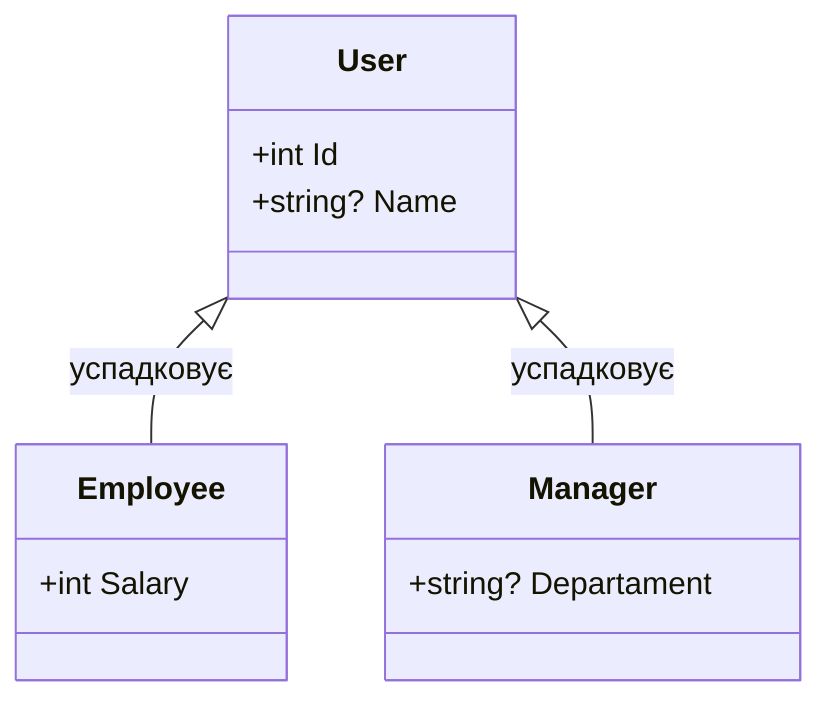
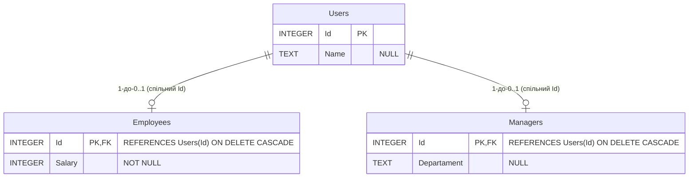
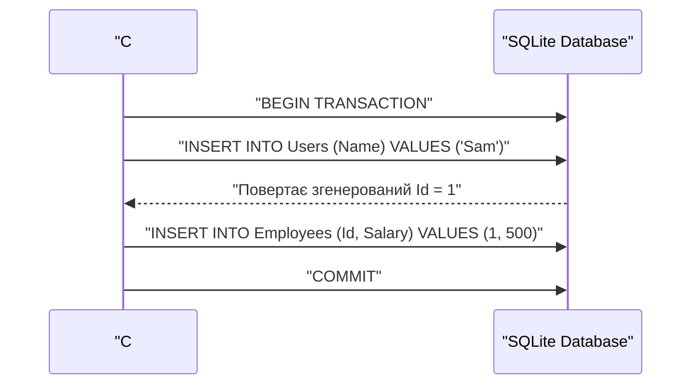

# 4.2. Підхід TPT — Table Per Type

- **Глава:** 05. Спадкування
- **Оригінал на Metanit:** [https://metanit.com/sharp/efcore/4.2.php](https://metanit.com/sharp/efcore/4.2.php)
- **Код прикладу:** [Lesson_4_2_TptInheritance.cs](../../src/05_Inheritance/Lesson_4_2_TptInheritance.cs)

---

## Мета уроку

Опанувати стратегію відображення спадкування **TPT (Table Per Type — «таблиця на кожен тип»)**, вивчити три способи її конфігурації (атрибут `[Table]`, Fluent API `ToTable()` та `UseTptMappingStrategy()`), розібратися в нормалізованій схемі з відносинами `1-до-1` (`PK + FK ON DELETE CASCADE`) і побачити на реальному SQL (`ToQueryString()`), чому TPT генерує `LEFT JOIN` та `INNER JOIN`.

---

## Детальний теоретичний матеріал

### 1. Сутність стратегії TPT (Table Per Type)

На відміну від TPH, де всі класи зливаються в одну таблицю, стратегія **TPT (Table Per Type)** створює **окрему таблицю для кожного класу в ієрархії**:
- Таблиця **`Users`** зберігає лише властивості базового класу `User` (`Id`, `Name`).
- Таблиця **`Employees`** зберігає лише специфічні властивості `Employee` (`Id`, `Salary`).
- Таблиця **`Managers`** зберігає лише специфічні властивості `Manager` (`Id`, `Departament`).

Усі таблиці пов'язані між собою відношенням **«один-до-одного» (1:1)** через спільний первинний ключ `Id`:
- `Employees.Id` є одночасно і `PRIMARY KEY` таблиці `Employees`, і `FOREIGN KEY`, що посилається на `Users(Id)` з каскадним видаленням (`ON DELETE CASCADE`).
- `Managers.Id` так само є `PRIMARY KEY` і `FOREIGN KEY` на `Users(Id)`.

У цій стратегії **стовпець `Discriminator` у БД не створюється**. EF Core визначає конкретний тип сутності за фактом наявності відповідного рядка в дочірній таблиці (`Employees` або `Managers`).

### 2. Три способи налаштування TPT

EF Core пропонує три еквівалентні підходи для ввімкнення TPT:

| Спосіб | Приклад коду | Мінімальна версія EF Core | Коментар |
| :--- | :--- | :--- | :--- |
| **1. Атрибути Data Annotations** | `[Table("Employees")]` над похідним класом | EF Core 5.0+ | Прив'язує доменну модель до імен таблиць БД через `System.ComponentModel.DataAnnotations.Schema`. |
| **2. Fluent API `ToTable()`** | `modelBuilder.Entity<Employee>().ToTable("Employees");` | EF Core 5.0+ | Потрібно викликати `ToTable()` для кожного похідного типу (або базового та похідних). |
| **3. Fluent API `UseTptMappingStrategy()`** | `modelBuilder.Entity<User>().UseTptMappingStrategy();` | **EF Core 7.0+** | Найлаконічніший спосіб: достатньо одного виклику для базового класу — EF Core сам створить таблиці для всіх нащадків. |

### 3. Збереження даних у TPT (`INSERT`)

Оскільки дані одного `Employee` фізично розподілені між двома таблицями, при додаванні нового працівника EF Core виконує **дві послідовні операції вставки** в рамках однієї транзакції `SaveChanges()`:
1. `INSERT INTO "Users" ("Name") VALUES ('Sam');` — база генерує `Id` (наприклад, `1`).
2. `INSERT INTO "Employees" ("Id", "Salary") VALUES (1, 500);` — використовує той самий `Id = 1`.

Аналогічно, видалення `Employee` видаляє рядок із `Users` (а рядок із `Employees` видаляється автоматично або явно завдяки `ON DELETE CASCADE`).

### 4. Як працюють SQL-запити в TPT

| Запит у C# | Що генерує EF Core | Чому саме так |
| :--- | :--- | :--- |
| `db.Users.ToList()` (поліморфний) | `LEFT JOIN "Employees"` + `LEFT JOIN "Managers"` + `CASE WHEN ...` | Потрібно завантажити всіх користувачів (включно з базовими `User`) і визначити їхній тип за `IS NOT NULL` у дочірніх таблицях. |
| `db.Employees.ToList()` (конкретний тип) | `INNER JOIN "Users"` | Властивість `Name` лежить у `Users`, а `Salary` — у `Employees`, тому без `INNER JOIN` зібрати об'єкт неможливо. |
| `db.Managers.ToList()` (конкретний тип) | `INNER JOIN "Users"` | Об'єднує `Users` та `Managers` по `Id` для отримання `Name` і `Departament`. |

---

## Діаграма / Архітектура процесу

### 1. Ієрархія класів C# (`classDiagram`)



### 2. Нормалізована схема таблиць у базі даних (`erDiagram`)



### 3. Логіка вставки сутності `Employee` (`sequenceDiagram`)



---

## Покроковий розбір прикладів коду

У файлі [Lesson_4_2_TptInheritance.cs](../../src/05_Inheritance/Lesson_4_2_TptInheritance.cs) налаштовано обидва варіанти декларації (атрибути `[Table]` на похідних класах і `UseTptMappingStrategy()` у `OnModelCreating`), що гарантує TPT-мапінг.

### Крок 1. Реальна схема таблиць у SQLite (`sqlite_master`)

Метод `PrintSqliteSchemas(db)` виводить DDL усіх трьох таблиць:

```sql
CREATE TABLE "Users" (
    "Id" INTEGER NOT NULL CONSTRAINT "PK_Users" PRIMARY KEY,
    "Name" TEXT NULL
)

CREATE TABLE "Employees" (
    "Id" INTEGER NOT NULL CONSTRAINT "PK_Employees" PRIMARY KEY,
    "Salary" INTEGER NOT NULL,
    CONSTRAINT "FK_Employees_Users_Id" FOREIGN KEY ("Id") REFERENCES "Users" ("Id") ON DELETE CASCADE
)

CREATE TABLE "Managers" (
    "Id" INTEGER NOT NULL CONSTRAINT "PK_Managers" PRIMARY KEY,
    "Departament" TEXT NULL,
    CONSTRAINT "FK_Managers_Users_Id" FOREIGN KEY ("Id") REFERENCES "Users" ("Id") ON DELETE CASCADE
)
```

Ключові спостереження:
- `"Salary" INTEGER NOT NULL` — у TPT стовпець `Salary` нарешті має обмеження **`NOT NULL`**, бо в таблиці `Employees` зберігаються виключно працівники.
- Зовнішні ключі `FK_Employees_Users_Id` та `FK_Managers_Users_Id` забезпечують цілісність посилань і каскадне видалення.

### Крок 2. Додавання даних і збереження

```csharp
var user1 = new L4_2.User { Name = "Tom" };
var user2 = new L4_2.User { Name = "Bob" };
var employee = new L4_2.Employee { Name = "Sam", Salary = 500 };
var manager = new L4_2.Manager { Name = "Robert", Departament = "IT" };

db.Users.AddRange(user1, user2);
db.Employees.Add(employee);
db.Managers.Add(manager);
db.SaveChanges();
```

Після `SaveChanges()` у таблиці `Users` буде 4 рядки (Tom, Bob, Sam, Robert), у таблиці `Employees` — 1 рядок (з `Id` Sam), у таблиці `Managers` — 1 рядок (з `Id` Robert).

### Крок 3. Аналіз згенерованого SQL (`ToQueryString()`)

**1) Поліморфний запит `db.Users`:**
```sql
SELECT "u"."Id", "u"."Name", "e"."Salary", "m"."Departament", CASE
    WHEN "m"."Id" IS NOT NULL THEN 'Manager'
    WHEN "e"."Id" IS NOT NULL THEN 'Employee'
END AS "Discriminator"
FROM "Users" AS "u"
LEFT JOIN "Employees" AS "e" ON "u"."Id" = "e"."Id"
LEFT JOIN "Managers" AS "m" ON "u"."Id" = "m"."Id"
```
Зверніть увагу на віртуальний стовпець `"Discriminator"`, який EF Core обчислює «на льоту» через `CASE WHEN ... IS NOT NULL`:
- Якщо є запис у `Managers` — це `'Manager'`;
- Якщо є запис у `Employees` — це `'Employee'`;
- Інакше (`NULL`) — базовий тип `'User'`.

**2) Запит конкретного типу `db.Employees`:**
```sql
SELECT "u"."Id", "u"."Name", "e"."Salary"
FROM "Users" AS "u"
INNER JOIN "Employees" AS "e" ON "u"."Id" = "e"."Id"
```

**3) Запит конкретного типу `db.Managers`:**
```sql
SELECT "u"."Id", "u"."Name", "m"."Departament"
FROM "Users" AS "u"
INNER JOIN "Managers" AS "m" ON "u"."Id" = "m"."Id"
```

### Крок 4. Результати вибірки

Консольний вивід підтверджує, що попри розподіл даних між трьома таблицями, LINQ-запити повертають ідентичні об'єкти з правильними CLR-типами (`Employee`, `Manager`, `User`).

---

## Особливості роботи в SQLite

| Аспект | MS SQL Server (як у Metanit) | SQLite (у цьому проєкті) |
| :--- | :--- | :--- |
| **Автоінкремент у `Users`** | `[Id] int NOT NULL IDENTITY(1, 1)` | `"Id" INTEGER NOT NULL CONSTRAINT "PK_Users" PRIMARY KEY` (у SQLite `INTEGER PRIMARY KEY` автоматично є псевдонімом `ROWID` і автоінкрементується навіть без ключового слова `AUTOINCREMENT`) |
| **Ключ у дочірніх таблицях** | `[Id] int NOT NULL` (без `IDENTITY`, значення приходить із `Users`) | `"Id" INTEGER NOT NULL CONSTRAINT "PK_Employees" PRIMARY KEY` (значення передається явно з `Users`) |
| **Зовнішній ключ** | `CONSTRAINT [FK_Employees_Users_Id] FOREIGN KEY ([Id]) REFERENCES [Users] ([Id]) ON DELETE CASCADE` | Ідентичний синтаксис у `sqlite_master` |
| **Примітка щодо Metanit** | У статті Metanit наведено `PRIMARY KEY("Id" AUTOINCREMENT)` для всіх таблиць, проте сучасний провайдер EF Core для SQLite не додає `AUTOINCREMENT` у TPT, покладаючись на `ROWID` у `Users` і явну вставку `Id` у дочірні таблиці. |

---

## Типові помилки, підводні камені та Best Practices

### Плюси та мінуси TPT
- **Плюси:**
  - Повністю нормалізована реляційна схема БД (відсутність дублювання даних і зайвих `NULL`).
  - Можливість встановлювати `NOT NULL` і `CHECK`-обмеження для специфічних полів похідних класів (`Salary INTEGER NOT NULL`).
  - Зручно інтегрувати з існуючими (legacy) нормалізованими базами даних.
- **Мінуси:**
  - **Найнижча продуктивність читання** серед трьох стратегій. Поліморфні запити до базового класу генерують `LEFT JOIN` до *всіх* таблиць-нащадків, а запити до конкретного класу — `INNER JOIN` до всіх предків.
  - Повільніші операції запису (`INSERT`/`UPDATE` торкаються кількох таблиць).

### Підводні камені
1. **Ефект «вибуху `JOIN`-ів»:** якщо в ієрархії 10–20 похідних класів (або багаторівневе спадкування `User -> Employee -> SeniorEmployee`), поліморфний запит `db.Users` перетвориться на величезний SQL із десятками `LEFT JOIN`, що різко знижує швидкість і може виснажити оптимізатор запитів СУБД.
2. **Конфлікт при одночасному використанні з TPH:** не забувайте, що виклик `ToTable("...")` лише для *одного* похідного класу може створити часткову або некоректну конфігурацію, тому краще використовувати єдиний виклик `modelBuilder.Entity<User>().UseTptMappingStrategy()`.

### Best Practices
- Обирайте **TPT** лише тоді, коли нормалізація схеми БД та суворі `NOT NULL` обмеження важливіші за максимальну швидкість запитів, а ієрархія має невелику кількість типів і глибину.
- Для високопродуктивних систем із великою кількістю поліморфних запитів розгляньте **TPH** або **TPC**.
