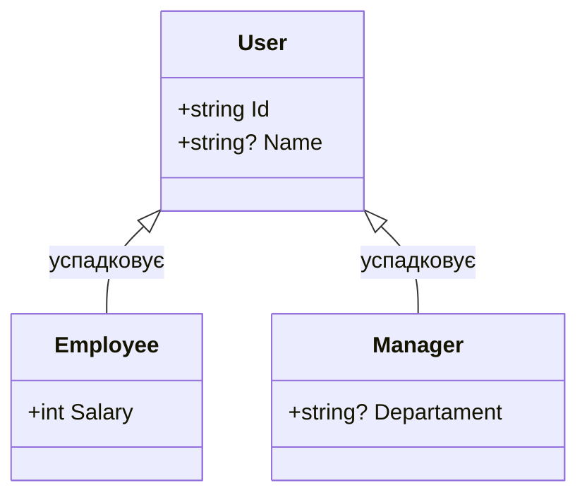
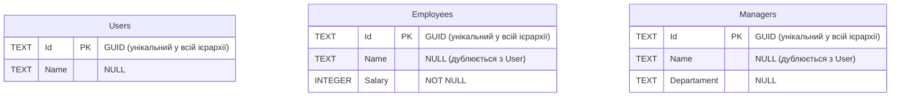
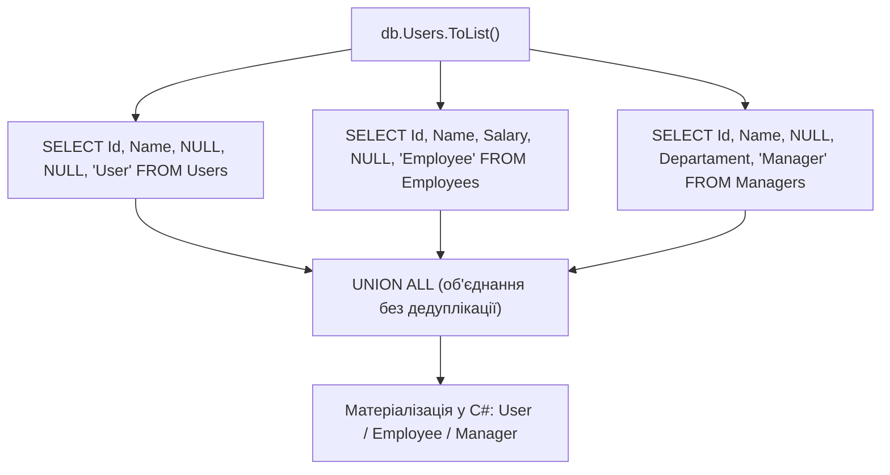

# 4.3. Підхід TPC — Table Per Class

- **Глава:** 05. Спадкування
- **Оригінал на Metanit:** [https://metanit.com/sharp/efcore/4.3.php](https://metanit.com/sharp/efcore/4.3.php)
- **Код прикладу:** [Lesson_4_3_TpcInheritance.cs](../../src/05_Inheritance/Lesson_4_3_TpcInheritance.cs)

---

## Мета уроку

Вивчити стратегію відображення спадкування **TPC (Table Per Concrete Type / Table Per Class)**, додану в **EF Core 7.0**. Зрозуміти принцип зберігання повного набору стовпців (включно з успадкованими) у кожній таблиці без зовнішніх ключів, механізм об'єднання даних через `UNION ALL`, вимоги до глобальної унікальності первинних ключів у межах ієрархії та критичні відмінності між SQL Server (`SEQUENCE`, `UseIdentityColumn`) і SQLite (`Guid` / `string`).

---

## Детальний теоретичний матеріал

### 1. Сутність стратегії TPC (Table Per Concrete Type)

Стратегія **TPC** (інша назва — *Table Per Class*) поєднує окремі таблиці для кожного класу (як у TPT) з відсутністю `JOIN` при вибірці конкретного типу (як у TPH):
- Для кожного конкретного класу ієрархії створюється **власна незалежна таблиця** (`Users`, `Employees`, `Managers`).
- **Кожна таблиця містить усі стовпці**, включно з властивостями, успадкованими від базового класу:
  - `Users`: `Id`, `Name`
  - `Employees`: `Id`, `Name`, `Salary`
  - `Managers`: `Id`, `Name`, `Departament`
- Між таблицями **немає жодних зовнішніх ключів (`FOREIGN KEY`)** і **немає стовпця `Discriminator`**.

> **Примітка для `abstract` базових класів:** Якщо базовий клас `User` оголосити як `abstract class User`, EF Core у стратегії TPC **не створюватиме** таблицю `Users` у БД — таблиці будуть створені лише для конкретних (non-abstract) типів `Employees` та `Managers`. У нашому прикладі `User` не є абстрактним, тому в БД існують усі 3 таблиці.

### 2. Налаштування TPC через `UseTpcMappingStrategy()`

Підтримка TPC з'явилася в **EF Core 7.0**. Стратегія вмикається одним викликом Fluent API для базового типу ієрархії:

```csharp
protected override void OnModelCreating(ModelBuilder modelBuilder)
{
    modelBuilder.Entity<User>().UseTpcMappingStrategy();
}
```

### 3. Чому TPC часто швидший за TPT

| Операція | Стратегія TPT | Стратегія TPC |
| :--- | :--- | :--- |
| **Запит конкретного типу** (`db.Employees`) | Виконує `INNER JOIN "Users"` | Прямий `SELECT` з однієї таблиці `"Employees"` **без жодного `JOIN`** |
| **Поліморфний запит** (`db.Users`) | Виконує множинні `LEFT JOIN` + `CASE WHEN` | Виконує `UNION ALL` між таблицями `"Users"`, `"Employees"`, `"Managers"` |
| **Додавання сутності** (`db.Employees.Add`) | 2 запити `INSERT` (`Users` + `Employees`) | **1 запит `INSERT`** у таблицю `"Employees"` |

Операція `UNION ALL` у SQL просто склеює результати окремих вибірок без перевірки дублікатів (на відміну від `UNION`), що в більшості СУБД працює суттєво швидше за множинні `LEFT JOIN`.

### 4. Проблема генерації первинних ключів у TPC

Це **найважливіша архітектурна особливість** TPC:
> **Контракт EF Core:** Усі сутності в межах однієї ієрархії повинні мати **глобально унікальні значення первинного ключа `Id`**, навіть якщо вони фізично лежать у різних таблицях.

Наприклад, `Employee` у таблиці `Employees` **не може** мати `Id = 1`, якщо в таблиці `Managers` вже є `Manager` з `Id = 1`. Інакше при поліморфному запиті `db.Users` (де всі таблиці об'єднуються через `UNION ALL`) виникне конфлікт ключів у Change Tracker або неоднозначність ідентифікації!

Оскільки в TPC **немає спільної базової таблиці**, як у TPT, стандартний автоінкремент кожної таблиці окремо (`1, 2, 3...`) тут не підходить. Існують три основні стратегії генерації ключів:

#### Стратегія A: Явна генерація на боці клієнта (`Guid` або `string` з `Guid.NewGuid()`)
```csharp
public class User
{
    public string Id { get; set; } = Guid.NewGuid().ToString();
    public string? Name { get; set; }
}
```
Працює **у будь-якій СУБД**, включно з **SQLite**, оскільки гарантує унікальність ключів без участі бази даних.

#### Стратегія B: Послідовності бази даних (`SEQUENCE`) — за замовчуванням у SQL Server
Якщо СУБД підтримує об'єкти `SEQUENCE` (MS SQL Server, PostgreSQL, Oracle), EF Core для `int Id` автоматично створює спільну послідовність `UserSequence` і призначає її як `DEFAULT` для всіх таблиць ієрархії:
```sql
CREATE TABLE [Users] (
    [Id] int NOT NULL DEFAULT (NEXT VALUE FOR [UserSequence]),
    ...
);
CREATE TABLE [Employees] (
    [Id] int NOT NULL DEFAULT (NEXT VALUE FOR [UserSequence]),
    ...
);
```
Таким чином, `User` отримає `Id = 1`, `Employee` — `Id = 2`, `Manager` — `Id = 3`.

#### Стратегія C: Різні діапазони `Identity` (`UseIdentityColumn`) — специфіка SQL Server
У SQL Server можна вручну задати неперетинні діапазони автоінкременту для кожної таблиці:
```csharp
modelBuilder.Entity<User>().UseTpcMappingStrategy();
modelBuilder.Entity<User>().ToTable("Users", tb => tb.Property(e => e.Id).UseIdentityColumn(1, 1));
modelBuilder.Entity<Employee>().ToTable("Employees", tb => tb.Property(e => e.Id).UseIdentityColumn(10000, 1));
modelBuilder.Entity<Manager>().ToTable("Managers", tb => tb.Property(e => e.Id).UseIdentityColumn(20000, 1));
```
**Ризик:** якщо кількість записів `User` колись перевищить `9999`, виникне перетин з діапазоном `Employees` (`10000+`). Крім того, метод `UseIdentityColumn` підтримується не всіма провайдерами (відсутній у SQLite).

---

## Діаграма / Архітектура процесу

### 1. Ієрархія класів C# (`classDiagram`)



### 2. Незалежні таблиці в базі даних (`erDiagram`)

Зверніть увагу на відсутність будь-яких зв'язків (зовнішніх ключів) між таблицями:



### 3. Механіка поліморфного запиту `UNION ALL` (`flowchart TD`)



---

## Покроковий розбір прикладів коду

У файлі [Lesson_4_3_TpcInheritance.cs](../../src/05_Inheritance/Lesson_4_3_TpcInheritance.cs) продемонстровано реалізацію TPC для SQLite з використанням `Guid`-рядків.

### Крок 1. Реальна схема таблиць у SQLite (`sqlite_master`)

Вивід `PrintSqliteSchemas(db)` показує 3 повністю автономні таблиці:

```sql
CREATE TABLE "Users" (
    "Id" TEXT NOT NULL CONSTRAINT "PK_Users" PRIMARY KEY,
    "Name" TEXT NULL
)

CREATE TABLE "Employees" (
    "Id" TEXT NOT NULL CONSTRAINT "PK_Employees" PRIMARY KEY,
    "Name" TEXT NULL,
    "Salary" INTEGER NOT NULL
)

CREATE TABLE "Managers" (
    "Id" TEXT NOT NULL CONSTRAINT "PK_Managers" PRIMARY KEY,
    "Name" TEXT NULL,
    "Departament" TEXT NULL
)
```

Ключові деталі:
- У кожній таблиці є `"Id" TEXT NOT NULL ... PRIMARY KEY` (без `AUTOINCREMENT`) та `"Name" TEXT NULL`.
- Стовпець `"Salary" INTEGER NOT NULL` у `Employees` захищений обмеженням `NOT NULL`.
- Жодних `FOREIGN KEY` між таблицями немає.

### Крок 2. Додавання даних із клієнтським GUID

```csharp
var user1 = new L4_3.User { Name = "Tom" };
var user2 = new L4_3.User { Name = "Bob" };
var employee = new L4_3.Employee { Name = "Sam", Salary = 500 };
var manager = new L4_3.Manager { Name = "Robert", Departament = "IT" };
```

Під час створення кожного об'єкта конструктор ініціалізує `Id = Guid.NewGuid().ToString()`. При виклику `db.SaveChanges()` EF Core робить по одному `INSERT` у відповідну таблицю.

### Крок 3. Аналіз згенерованого SQL (`ToQueryString()`)

**1) Поліморфний запит `db.Users` (`UNION ALL`):**
```sql
SELECT "u0"."Id", "u0"."Name", NULL AS "Salary", NULL AS "Departament", 'User' AS "Discriminator"
FROM "Users" AS "u0"
UNION ALL
SELECT "e"."Id", "e"."Name", "e"."Salary", NULL AS "Departament", 'Employee' AS "Discriminator"
FROM "Employees" AS "e"
UNION ALL
SELECT "m"."Id", "m"."Name", NULL AS "Salary", "m"."Departament", 'Manager' AS "Discriminator"
FROM "Managers" AS "m"
```
Оскільки в SQL операція `UNION ALL` вимагає однакової кількості та порядку стовпців у всіх підзапитах, EF Core:
- підставляє `NULL AS "Salary"` / `NULL AS "Departament"` там, де відповідного стовпця немає;
- додає літерал `'User' AS "Discriminator"`, `'Employee' AS "Discriminator"`, `'Manager' AS "Discriminator"` для миттєвого визначення типу при матеріалізації.

**2) Запит конкретного типу `db.Employees` (без `JOIN`!):**
```sql
SELECT "e"."Id", "e"."Name", "e"."Salary"
FROM "Employees" AS "e"
```
Це ідеально чистий і швидкий SQL-запит до однієї таблиці без `JOIN` і без `WHERE Discriminator = ...`.

**3) Запит конкретного типу `db.Managers` (без `JOIN`!):**
```sql
SELECT "m"."Id", "m"."Name", "m"."Departament"
FROM "Managers" AS "m"
```

---

## Особливості роботи в SQLite

Цей урок має **критичні відмінності** від прикладів Metanit для MS SQL Server:

| Аспект | MS SQL Server | SQLite |
| :--- | :--- | :--- |
| **Підтримка `SEQUENCE`** | Підтримується (`CREATE SEQUENCE [UserSequence]`). EF Core за замовчуванням використовує `SEQUENCE` для `int Id` у TPC. | **Не підтримується.** У SQLite немає об'єктів `SEQUENCE`, тому використання `int Id` без явної генерації не забезпечить унікальності між таблицями. |
| **Рекомендований тип `Id` для TPC** | `int` / `long` (через `SEQUENCE`) або `Guid`. | **`Guid` або `string` (`Guid.NewGuid().ToString()`)**, як показано в [Lesson_4_3_TpcInheritance.cs](../../src/05_Inheritance/Lesson_4_3_TpcInheritance.cs). |
| **Метод `UseIdentityColumn(seed, increment)`** | Доступний (специфічний для провайдера `Microsoft.EntityFrameworkCore.SqlServer`). | **Відсутній** у провайдері `Microsoft.EntityFrameworkCore.Sqlite`. |
| **Стовпець `Name`** | `nvarchar(max) NULL` | `TEXT NULL` |

---

## Типові помилки, підводні камені та Best Practices

### Плюси та мінуси TPC
- **Плюси:**
  - Максимально швидкі запити до конкретних типів (`db.Employees`, `db.Managers`) — без `JOIN` і без фільтрації за дискримінатором.
  - Поліморфні запити (`UNION ALL`) зазвичай значно швидші за `LEFT JOIN` у TPT.
  - Специфічні властивості похідних класів (`Salary`) можуть мати обмеження `NOT NULL` у БД.
- **Мінуси:**
  - Дублювання стовпців базового класу (`Id`, `Name`) в усіх таблицях.
  - **Складність зовнішніх ключів із інших таблиць:** оскільки немає єдиної таблиці `Users` з усіма записами, інші таблиці (наприклад, `Orders`) не можуть мати простий `FOREIGN KEY (UserId) REFERENCES Users(Id)`, якщо замовлення може належати і `Employee`, і `Manager`.

### Підводні камені
1. **Використання автоінкрементного `int Id` у SQLite з TPC:** якщо ви залишите `public int Id { get; set; }` у SQLite з TPC, кожна таблиця почне рахунок із `1`, і у вас з'являться `User(Id=1)`, `Employee(Id=1)`, `Manager(Id=1)`. Це порушує вимогу EF Core щодо унікальності ключів в ієрархії та призведе до помилок Change Tracker при поліморфних запитах (`The instance of entity type '...' cannot be tracked because another instance with the same key value for {'Id'} is already being tracked`).
2. **Зовнішні ключі на базовий клас:** уникайте TPC, якщо інші сутності моделі мають навігаційні посилання (FK) на базовий клас `User`.

### Best Practices
- Використовуйте **TPC** тоді, коли ви переважно запитуєте конкретні типи (`db.Employees`, `db.Managers`), рідко виконуєте поліморфні запити з посиланнями з інших таблиць, а базовий клас часто є `abstract`.
- Для **SQLite** завжди використовуйте `Guid` або `string` (`Guid.NewGuid().ToString()`) як первинний ключ при виборі TPC.
- Якщо ви обираєте між трьома стратегіями:
  - **TPH** — вибір за замовчуванням (найпростіше, найшвидше, але nullable-стовпці нащадків).
  - **TPC** — коли потрібні окремі таблиці без `JOIN` і з `NOT NULL` полями (особливо при `abstract` базовому класі).
  - **TPT** — лише коли сувора нормалізація БД є жорсткою вимогою, а продуктивність запитів вторинна.
