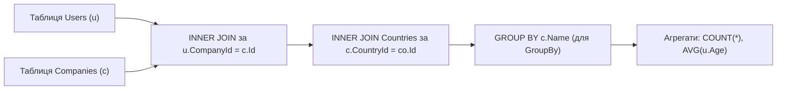

# 5.3. З'єднання та групування таблиць (Join, GroupBy)

- **Глава:** 06. Запити та LINQ to Entities
- **Джерело Metanit:** [Соединение и группировка таблиц](https://metanit.com/sharp/efcore/5.3.php)
- **Код прикладу:** [Lesson_5_03_JoinAndGroupBy.cs](../../src/06_QueriesAndLinq/Lesson_5_03_JoinAndGroupBy.cs)
- **Запуск уроку:** `dotnet run --project src/EFCoreMastery.ConsoleApp -- 5.3`
- **Шпаргалка глави:** [Runs.md](Runs.md)

## Мета уроку

Навчитися явно об'єднувати дві, три та більше таблиць за допомогою методу розширення `Join` та оператора LINQ `join ... on ... equals ...`, а також групувати записи на стороні бази даних за допомогою `GroupBy` (`group ... by ... into`) з подальшим обчисленням агрегатів по кожній групі.

## Детальний теоретичний матеріал

### 1. Явне з'єднання таблиць (`Join` / `join ... equals`)

Хоча за наявності навігаційних властивостей EF Core автоматично формує `JOIN` при використанні `Include()` або `Select()`, у багатьох випадках зручно або необхідно виконати **явне з'єднання** (наприклад, коли між таблицями немає навігаційної властивості або потрібно з'єднати таблиці за нетиповим ключем).

Метод розширення `Join` приймає **чотири параметри**:
1. `inner` — другий набір даних (`db.Companies`), який приєднується до поточного.
2. `outerKeySelector` — селектор ключа з першої таблиці (`u => u.CompanyId`).
3. `innerKeySelector` — селектор ключа з другої таблиці (`c => c.Id`).
4. `resultSelector` — функція проекції `(u, c) => new { ... }`, яка формує результуючий об'єкт із пари знайдених записів.

#### Порівняння Method Syntax та Query Syntax для `Join`

| Аспект | Method Syntax (`Join(...)`) | Query Syntax (`join ... on ... equals`) |
| :--- | :--- | :--- |
| **З'єднання 2 таблиць** | Компактно та зручно | Дуже читабельно |
| **З'єднання 3+ таблиць** | Потребує вкладених анонімних типів `(u, c) => new { u, c }` на кожному кроці | Лінійний, чистий синтаксис без проміжних обгорток |
| **Тип SQL `JOIN`** | Завжди `INNER JOIN` | Завжди `INNER JOIN` |

### 2. Групування даних (`GroupBy` / `group ... by`)

Метод `GroupBy` (або оператор `group u by u.Company!.Name into g`) розбиває вибірку на групи за спільним ключем (`g.Key`). У SQL це транслюється в конструкцію `GROUP BY`.

Над кожною групою `IGrouping<TKey, TElement>` у `Select` можна виконувати агрегатні обчислення:
- `g.Key` — значення ключа групування;
- `g.Count()` — кількість елементів у групі;
- `g.Sum(...)`, `g.Average(...)`, `g.Min(...)`, `g.Max(...)` — агрегати по полю елементів групи.

Для фільтрації **вже згрупованих** даних (SQL-секція `HAVING`) достатньо викликати `.Where(g => g.Count() > 1)` **після** `GroupBy(...)`.

## Діаграма / Архітектура процесу



## Покроковий розбір прикладів коду

У файлі [Lesson_5_03_JoinAndGroupBy.cs](../../src/06_QueriesAndLinq/Lesson_5_03_JoinAndGroupBy.cs) модель розширена третьою сутністю `Country` (`USA`, `Ukraine`), з якою пов'язані компанії (`Microsoft`, `Google` -> `USA`; `SoftServe` -> `Ukraine`).

### 1. З'єднання двох таблиць методом `Join`
```csharp
var users = db.Users.Join(
    db.Companies,
    u => u.CompanyId,
    c => c.Id,
    (u, c) => new
    {
        u.Name,
        Company = c.Name,
        u.Age
    });
```
Згенерований SQLite SQL:
```sql
SELECT "u"."Name", "c"."Name" AS "Company", "u"."Age"
FROM "Users" AS "u"
INNER JOIN "Companies" AS "c" ON "u"."CompanyId" = "c"."Id"
```
У консолі виводяться імена користувачів із назвою їхньої компанії та віком.

### 2. З'єднання трьох таблиць через Query Syntax
```csharp
var users = from user in db.Users
            join company in db.Companies on user.CompanyId equals company.Id
            join country in db.Countries on company.CountryId equals country.Id
            select new
            {
                user.Name,
                Company = company.Name,
                Country = country.Name,
                user.Age
            };
```
У цьому запиті `Users` з'єднується з `Companies`, а результат одразу з'єднується з `Countries`. У SQL генеруються два послідовні `INNER JOIN`. Зверніть увагу: в операторі `join` обов'язково використовується ключове слово `equals` (ліворуч — ключ зовнішньої таблиці, праворуч — ключ приєднаної таблиці), а не оператор `==`.

### 3. Групування (`GroupBy`) з агрегацією
```csharp
var groups = db.Users
    .GroupBy(u => u.Company!.Name)
    .Select(g => new
    {
        CompanyName = g.Key,
        Count = g.Count(),
        AvgAge = g.Average(u => u.Age)
    });
```
Згенерований SQLite SQL:
```sql
SELECT "c"."Name" AS "CompanyName", COUNT(*) AS "Count", AVG(CAST("u"."Age" AS REAL)) AS "AvgAge"
FROM "Users" AS "u"
INNER JOIN "Companies" AS "c" ON "u"."CompanyId" = "c"."Id"
GROUP BY "c"."Name"
```
Кожен рядок результату відповідає одній компанії (`Microsoft`: 2 працівн., середній вік 32.0; `Google`: 2 працівн., середній вік 32.0; `SoftServe`: 1 працівн., середній вік 30.0).

## Особливості роботи в SQLite

| Особливість | SQLite | MS SQL Server |
| :--- | :--- | :--- |
| **Обчислення `AVG`** | `AVG(int)` повертає `REAL`, а EF Core явно додає `CAST("u"."Age" AS REAL)` | `AVG(int)` у T-SQL повертає `int`, тому EF Core кастить до `float` (`CAST(... AS float)`) |
| **Зміна порядку у `join ... equals`** | Порядок `outerKey equals innerKey` суворо фіксований на рівні компілятора C# | Так само (вимога компілятора C#) |
| **`LEFT JOIN` у LINQ** | Потребує комбінації `GroupJoin` + `SelectMany` + `DefaultIfEmpty()` (або в EF Core 10+ нового методу `LeftJoin`) | Аналогічно |

## Типові помилки, підводні камені та Best Practices

- **Повернення неагрегованих елементів групи в `GroupBy`:** У SQLite та інших реляційних СУБД `GROUP BY` дозволяє вибирати лише ключ групування (`g.Key`) та агрегатні функції. Якщо написати `.GroupBy(u => u.CompanyId).Select(g => new { g.Key, Users = g.ToList() })`, у старих версіях EF Core це могло викликати помилку трансляції або проблему N+1. Якщо потрібна саме ієрархія об'єктів, краще завантажити `db.Companies.Include(c => c.Users)`.
- **Порушення порядку ключів у `join ... on ... equals`:** У виразі `join c in db.Companies on user.CompanyId equals company.Id` ліворуч від `equals` має бути змінна із зовнішньої таблиці (`user`), а праворуч — змінна з таблиці, яку приєднуємо (`company`). Перестановка місцями призведе до помилки компіляції.
- **Використовуйте навігаційні властивості там, де вони вже є:** Якщо зв'язок налаштований у моделі, запис `db.Users.Select(u => new { u.Name, Company = u.Company!.Name })` коротший і зрозуміліший за ручний `Join`.

---
<!-- lesson-nav -->
← [5.10. Сортування та проекція з бази даних](5_10_SortingAndProjection.md) | [Шпаргалка глави (Runs.md)](Runs.md) | [Зміст курсу (README)](../../README.md) | [5.4. Операції з множинами: Union, Intersect, Except](5_04_SetOperations.md) →
