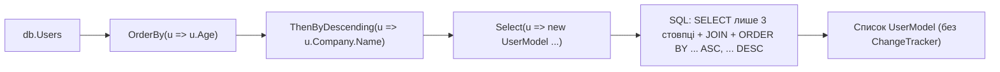

# 5.10. Сортування та проекція з бази даних

- **Глава:** 06. Запити та LINQ to Entities
- **Джерело Metanit:** [Сортировка и проекция из базы данных](https://metanit.com/sharp/efcore/5.10.php)
- **Код прикладу:** [Lesson_5_10_SortingAndProjection.cs](../../src/06_QueriesAndLinq/Lesson_5_10_SortingAndProjection.cs)

## Мета уроку

Навчитися оптимізувати запити за допомогою **проекції (`Select`)** в анонімні типи та власні DTO-класи (без завантаження зайвих стовпців і без `Include`), а також виконувати однорівневе та багаторівневе сортування на стороні бази даних (`OrderBy`, `OrderByDescending`, `ThenBy`, `ThenByDescending`).

## Детальний теоретичний матеріал

### 1. Проекція даних через `Select`

Коли ви виконуєте `db.Users.Include(u => u.Company)`, EF Core завантажує **всі стовпці** обох таблиць і поміщає повні об'єкти сутностей у `ChangeTracker`. У багатьох сценаріях (формування списків в UI, відповіді REST API, звіти) потрібні лише 2–3 поля.

Метод `Select` дозволяє спроектувати запит на новий тип:
1. **В анонімний тип** (`new { u.Name, u.Age, Company = u.Company!.Name }`) — зручно для локального використання всередині одного методу.
2. **У визначений користувачем DTO/ViewModel-клас** (`new UserModel { Name = u.Name, ... }`) — необхідно, якщо результат передається між методами або шарами застосунку.

**Головні переваги проекції `Select`:**
- **Менший обсяг даних по мережі та з диска:** у SQL `SELECT` потрапляють виключно ті стовпці, які згадані всередині лямбда-виразу `Select`.
- **Автоматичний `JOIN` без `Include`:** звернення до навігаційної властивості `u.Company!.Name` у `Select` змушує EF Core самостійно додати потрібний `INNER JOIN` або `LEFT JOIN`.
- **Відсутність відстеження (`NoTracking` за замовчуванням):** оскільки анонімний тип або `UserModel` не є сутністю моделі БД (`DbSet`), `ChangeTracker` не створює для них знімків стану (snapshots), що суттєво економить пам'ять і CPU.

### 2. Сортування даних на стороні БД

Для впорядкування результатів на рівні SQL використовуються такі методи та оператори LINQ:

| Метод (Method Syntax) | Оператор (Query Syntax) | SQL-еквівалент | Призначення |
| :--- | :--- | :--- | :--- |
| `OrderBy(x => x.Prop)` | `orderby x.Prop` | `ORDER BY "Prop" ASC` | Первинне сортування за зростанням |
| `OrderByDescending(x => x.Prop)` | `orderby x.Prop descending` | `ORDER BY "Prop" DESC` | Первинне сортування за спаданням |
| `ThenBy(x => x.Prop2)` | `orderby x.Prop, x.Prop2` | `ORDER BY "Prop" ASC, "Prop2" ASC` | Вторинне сортування за зростанням |
| `ThenByDescending(x => x.Prop2)` | `orderby x.Prop, x.Prop2 descending` | `ORDER BY "Prop" ASC, "Prop2" DESC` | Вторинне сортування за спаданням |

> **Критичне правило:** Ніколи не викликайте `OrderBy` двічі поспіль (`query.OrderBy(u => u.Age).OrderBy(u => u.Name)`), адже другий `OrderBy` **повністю перезапише** перше сортування! Для другого, третього і наступних критеріїв завжди використовуйте `ThenBy` / `ThenByDescending`.

## Діаграма / Архітектура процесу



## Покроковий розбір прикладів коду

У файлі [Lesson_5_10_SortingAndProjection.cs](../../src/06_QueriesAndLinq/Lesson_5_10_SortingAndProjection.cs) база даних наповнюється двома компаніями (`Microsoft`, `Google`) та чотирма користувачами (`Tom` 36, `Bob` 39, `Alice` 28, `Kate` 28 — зверніть увагу на однаковий вік у `Alice` і `Kate` для демонстрації багаторівневого сортування).

### 1. Проекція в анонімний тип (`Select`)
```csharp
var query = db.Users.Select(u => new
{
    u.Name,
    u.Age,
    Company = u.Company!.Name
});
```
Виклик `query.ToQueryString()` демонструє, що EF Core згенерував оптимальний SQL без зайвих полів (`Id`, `CompanyId` не вибираються):
```sql
SELECT "u"."Name", "u"."Age", "c"."Name" AS "Company"
FROM "Users" AS "u"
INNER JOIN "Companies" AS "c" ON "u"."CompanyId" = "c"."Id"
```

### 2. Проекція у визначений DTO-клас (`UserModel`)
```csharp
var users = db.Users
    .Select(u => new UserModel
    {
        Name = u.Name,
        Age = u.Age,
        Company = u.Company!.Name
    })
    .ToList();
```
SQL-запит залишається точно таким самим, але на виході ми отримуємо строго типізовану колекцію `List<UserModel>`, яку можна повертати з методів сервісу чи контролера.

### 3. Однорівневе та багаторівневе сортування
У третьому блоці коду демонструються:
- `db.Users.OrderBy(u => u.Name)` -> `ORDER BY "u"."Name"` (Alice, Bob, Kate, Tom).
- `db.Users.OrderByDescending(u => u.Name)` -> `ORDER BY "u"."Name" DESC` (Tom, Kate, Bob, Alice).
- Багаторівневе сортування:
```csharp
var sorted = db.Users
    .Include(u => u.Company)
    .OrderBy(u => u.Age)
    .ThenByDescending(u => u.Company!.Name)
    .ToList();
```
У цьому прикладі `Alice` (28, Microsoft) і `Kate` (28, Google) мають однаковий вік `28`. Завдяки `ThenByDescending(u => u.Company!.Name)` першою виведеться `Alice` (Microsoft), а другою `Kate` (Google), оскільки в алфавіті спадання `"Microsoft" > "Google"`.

## Особливості роботи в SQLite

| Аспект | SQLite | MS SQL Server |
| :--- | :--- | :--- |
| **Сортування рядків (Collation)** | За замовчуванням `BINARY` (чутливе до регістру: `'B'` йде перед `'a'`). Для ігнорування регістру в ASCII використовують `NOCASE`. | За замовчуванням зазвичай `SQL_Latin1_General_CP1_CI_AS` (нечутливе до регістру `CI`). |
| **Позиція `NULL` при `ASC`** | `NULL` йде **першим** (найменше значення). | `NULL` йде **першим**. |
| **Позиція `NULL` при `DESC`** | `NULL` йде **останнім**. | `NULL` йде **останнім**. |

## Типові помилки, підводні камені та Best Practices

- **Виклик `Include` разом із `Select`:** Якщо ви використовуєте `Select` і проектуєте дані в DTO або анонімний тип, виклик `.Include(...)` зазвичай **ігнорується** (або є зайвим), оскільки формування результуючих стовпців повністю контролюється виразом `Select`.
- **Порядок `OrderBy` і `Select`:** Якщо ви спочатку викликали `Select(u => new UserModel { Name = u.Name })`, то далі можна сортувати лише за полями `UserModel` (`Name`), а не за `u.Age` (бо `Age` вже не існує в проекції). Сортуйте за полями сутності **до** `Select`, або включайте потрібне поле в DTO.
- **Сортування перед пагінацією (`Skip`/`Take`):** У SQLite та інших реляційних БД порядок рядків без `ORDER BY` не гарантований. Перед `Skip`/`Take` завжди додавайте детерміноване сортування (наприклад, `.OrderBy(u => u.Name).ThenBy(u => u.Id)`).
