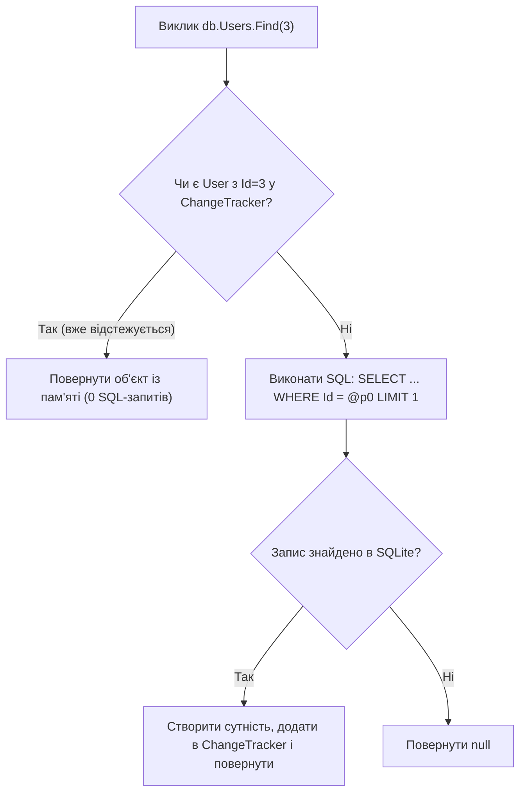

# 5.2. Вибірка та фільтрація (Where, EF.Functions.Like, Find)

- **Глава:** 06. Запити та LINQ to Entities
- **Джерело Metanit:** [Выборка и фильтрация](https://metanit.com/sharp/efcore/5.2.php)
- **Код прикладу:** [Lesson_5_2_Filtering.cs](../../src/06_QueriesAndLinq/Lesson_5_2_Filtering.cs)

## Мета уроку

Навчитися фільтрувати дані на стороні бази даних за допомогою методу й оператора `Where`, застосовувати SQL-шаблони пошуку через `EF.Functions.Like`, розуміти відмінності між `Find`/`FindAsync` та `First`/`FirstOrDefault`/`Single`/`SingleOrDefault`, а також знати особливості роботи оператора `LIKE` у SQLite.

## Детальний теоретичний матеріал

### 1. Фільтрація через `Where` та оператор `where`

Метод `Where` приймає лямбда-вираз типу `Expression<Func<TSource, bool>>` (предикат) і транслює його в SQL-секцію `WHERE`. Кілька послідовних викликів `.Where(a).Where(b)` об'єднуються в один SQL-оператор `WHERE (a) AND (b)`.

Усередині `Where` можна звертатися не лише до скалярних полів самої сутності, а й до **навігаційних властивостей** (наприклад, `u.Company!.Name == "Google"`). При цьому EF Core автоматично додасть необхідний `INNER JOIN` (для обов'язкового зв'язку) або `LEFT JOIN` (для опціонального зв'язку), навіть якщо ви не викликали `Include()`.

### 2. Пошук за шаблоном: `EF.Functions.Like`

Статичний метод `EF.Functions.Like(string matchExpression, string pattern)` (а також перевантаження з третім параметром `escapeCharacter`) призначений для трансляції в SQL-оператор `LIKE`. Він працює **лише у запитах до БД** (виклик у пам'яті поза LINQ to Entities кидає `InvalidOperationException`).

Основні символи підстановки (wildcards) у шаблоні `pattern`:

| Символ | Значення | Приклад шаблону | Підтримка в SQLite |
| :--- | :--- | :--- | :--- |
| `%` | Будь-яка послідовність символів (0 або більше) | `"%Tom%"` ("Tom", "Tomas", "Smith Tom") | Повна |
| `_` | Рівно один довільний символ | `"2_"` ("20", "24", "29") | Повна |
| `[ ]` | Один символ із зазначеного набору | `"[AB]om"` | **Не підтримується** (лише SQL Server) |
| `[ - ]` | Один символ із діапазону | `"[A-C]om"` | **Не підтримується** (лише SQL Server) |
| `[ ^ ]` | Один символ, що НЕ входить до набору | `"[^T]om"` | **Не підтримується** (лише SQL Server) |

Якщо потрібно застосувати `EF.Functions.Like` до **числового поля** (наприклад, `int Age`), у C# його слід привести до рядка через `.ToString()` — EF Core перетворить це на `CAST("u"."Age" AS TEXT) LIKE '2_'`.

### 3. Методи отримання одного об'єкта: `Find` vs `First` vs `Single`

У EF Core існує кілька способів отримати один запис:

| Метод (та Async-версія) | Пошук у кеші `ChangeTracker` | Що робить, якщо записів 0 | Що робить, якщо записів > 1 | Згенерований SQL |
| :--- | :--- | :--- | :--- | :--- |
| `Find(key)` / `FindAsync(key)` | **Так** (спочатку кеш, потім БД) | Повертає `null` | Неможливо (пошук за PK) | `WHERE "Id" = @p0 LIMIT 1` |
| `First()` / `FirstAsync()` | Ні (завжди запит до БД) | Кидає `InvalidOperationException` | Повертає перший | `LIMIT 1` |
| `FirstOrDefault()` / `FirstOrDefaultAsync()` | Ні | Повертає `null` (default) | Повертає перший | `LIMIT 1` |
| `Single()` / `SingleAsync()` | Ні | Кидає `InvalidOperationException` | Кидає `InvalidOperationException` | `LIMIT 2` (перевіряє унікальність) |
| `SingleOrDefault()` / `SingleOrDefaultAsync()` | Ні | Повертає `null` (default) | Кидає `InvalidOperationException` | `LIMIT 2` |

> **Важливо про `Find`:** Метод `Find` визначений на класі `DbSet<T>`, а не в LINQ. Він підтримує також **складені ключі** — тоді аргументи передаються у порядку їх оголошення в моделі: `db.OrderItems.Find(orderId, productId)`.

## Діаграма / Архітектура процесу



## Покроковий розбір прикладів коду

У файлі [Lesson_5_2_Filtering.cs](../../src/06_QueriesAndLinq/Lesson_5_2_Filtering.cs) база даних заповнюється двома компаніями (`Microsoft`, `Google`) та п'ятьма користувачами: `Tom` (36), `Tomas` (24), `Bob` (39), `Alice` (28), `Kate` (25).

### 1. Фільтрація через `Where` та оператор `where`
```csharp
var googleUsers = db.Users
    .Where(u => u.Company!.Name == "Google")
    .ToList();
```
EF Core бачить звернення до `u.Company!.Name` і генерує `INNER JOIN "Companies" AS "c" ON "u"."CompanyId" = "c"."Id"` з умовою `WHERE "c"."Name" = 'Google'`. Оператор `!` (null-forgiving) використовується виключно для задоволення nullable-аналізатора C# і не впливає на SQL. Аналогічний запит у Query Syntax (`from u in db.Users where u.Company!.Name == "Microsoft" select u`) дає точно такий самий SQL.

### 2. Пошук за шаблоном `EF.Functions.Like`
```csharp
var tomQuery = db.Users.Where(u => EF.Functions.Like(u.Name!, "%Tom%"));
```
Згенерований SQLite SQL:
```sql
SELECT "u"."Id", "u"."Age", "u"."CompanyId", "u"."Name"
FROM "Users" AS "u"
WHERE "u"."Name" LIKE '%Tom%'
```
У результаті вибірки повертаються і `Tom`, і `Tomas`.

Далі демонструється пошук за числовим полем `Age` для діапазону `20..29`:
```csharp
var twenties = db.Users
    .Where(u => EF.Functions.Like(u.Age.ToString(), "2_"))
    .ToList();
```
Тут `u.Age.ToString()` транслюється в приведення числа до тексту, а шаблон `"2_"` вимагає, щоб першим символом була `2`, а другим — рівно один будь-який символ (`Tomas` 24, `Alice` 28, `Kate` 25).

### 3. Пошук за первинним ключем через `Find` / `FindAsync`
```csharp
User? user3 = db.Users.Find(3);
User? cachedUser3 = db.Users.Find(3);
Console.WriteLine(ReferenceEquals(user3, cachedUser3)); // True
```
Перший виклик `Find(3)` робить SQL-запит до SQLite і поміщає `Bob` у `ChangeTracker`. Другий виклик `Find(3)` у межах того самого `AppDbContext` знаходить `Bob` у локальному кеші без звернення до бази даних, тому `ReferenceEquals(user3, cachedUser3)` повертає `True`. Асинхронний варіант `FindAsync(1)` повертає `ValueTask<User?>`, що дозволяє не виділяти зайвий об'єкт `Task`, коли сутність уже є в кеші.

## Особливості роботи в SQLite

1. **Обмежені wildcards у `LIKE`:** На відміну від MS SQL Server, SQLite **не підтримує** діапазони `[a-z]`, `[0-9]` або заперечення `[^a]` усередині `LIKE`. Працюють лише `%` та `_`.
2. **Чутливість до регістру:** У SQLite оператор `LIKE` за замовчуванням **нечутливий до регістру** лише для ASCII-символів (`'Tom' LIKE 'tom'` -> `true`), але чутливий для кирилиці/Unicode (якщо не підключена розширена локалізація ICU). Натомість оператор `==` (SQL `=`) використовує `BINARY` collation і є **чутливим до регістру**.
3. **Поведінка `Contains`, `StartsWith`, `EndsWith`:** Замість `EF.Functions.Like` у багатьох випадках достатньо стандартних методів `string.Contains`, `StartsWith`, `EndsWith`, які в SQLite транслюються в `instr(...) > 0` або `LIKE` (залежно від версії EF Core та типу даних).

## Типові помилки, підводні камені та Best Practices

- **Застарілі дані при повторному `Find()`:** Якщо між двома викликами `Find(id)` у тому самому контексті інший процес оновив запис у БД, `Find` поверне стару версію з кешу `ChangeTracker`. Для отримання свіжих даних використовуйте `AsNoTracking().FirstOrDefault(u => u.Id == id)`.
- **`Find` не поєднується з `Include`:** Не можна написати `db.Users.Include(u => u.Company).Find(3)`, оскільки `Find` є методом `DbSet<T>`, а `Include` повертає `IIncludableQueryable<T, P>`. У таких випадках використовуйте `FirstOrDefault(u => u.Id == 3)`.
- **Безпека від SQL-ін'єкцій:** Передавайте шаблон у `EF.Functions.Like` як змінну або параметр — EF Core автоматично параметризує запит (`LIKE @__pattern_0`).
