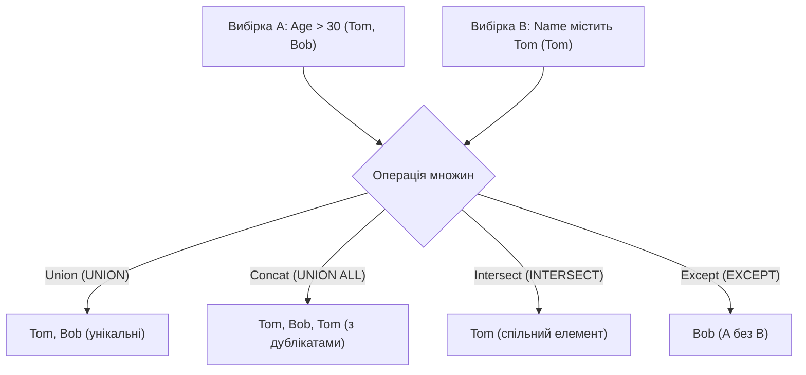

# 5.4. Операції з множинами: Union, Intersect, Except

- **Глава:** 06. Запити та LINQ to Entities
- **Джерело Metanit:** [Операции с множествами](https://metanit.com/sharp/efcore/5.4.php)
- **Код прикладу:** [Lesson_5_4_SetOperations.cs](../../src/06_QueriesAndLinq/Lesson_5_4_SetOperations.cs)

## Мета уроку

Навчитися комбінувати результати двох однорідних вибірок безпосередньо на стороні бази даних за допомогою операцій теорії множин: **об'єднання** (`Union` / `Concat`), **перетину** (`Intersect`) та **різниці** (`Except`), а також зрозуміти, як поєднувати дані з різних таблиць через спільну проекцію `Select`.

## Детальний теоретичний матеріал

Реляційні бази даних працюють із множинами рядків. У LINQ to Entities методи `Union`, `Concat`, `Intersect` та `Except` транслюються у відповідні SQL-оператори, тому обчислення відбувається на боці СУБД без проміжного завантаження даних у пам'ять C#.

**Обов'язкова умова:** Обидві вибірки, до яких застосовується операція з множинами, мають бути **однорідними** — тобто мати однаковий тип елементів у C# і однакову кількість та сумісні типи стовпців у SQL.

| Метод LINQ | SQL-оператор | Дедуплікація | Логіка роботи |
| :--- | :--- | :--- | :--- |
| `Union` | `UNION` | **Так** (видаляє дублікати) | Повертає всі унікальні записи, що є хоча б в одній із двох вибірок ($A \cup B$) |
| `Concat` | `UNION ALL` | **Ні** (зберігає всі рядки) | Склеює результати двох вибірок без перевірки на дублікати |
| `Intersect` | `INTERSECT` | **Так** | Повертає лише ті записи, які присутні в **обох** вибірках одночасно ($A \cap B$) |
| `Except` | `EXCEPT` | **Так** | Повертає записи з першої вибірки, яких **немає** у другій ($A \setminus B$) |

### Об'єднання даних із різних таблиць

Оскільки `db.Users` (`User`) і `db.Companies` (`Company`) мають різні типи, виконати `db.Users.Union(db.Companies)` неможливо — компілятор не дозволить цього через несумісність `IQueryable<User>` та `IQueryable<Company>`.

Рішення — попередньо привести обидві таблиці до **однакового анонімного типу або DTO** через `Select`:
```csharp
var allNames = db.Users.Select(u => new { u.Name })
    .Union(db.Companies.Select(c => new { c.Name }));
```
Головне, щоб імена та типи властивостей в обох `Select` збігалися.

## Діаграма / Архітектура процесу



## Покроковий розбір прикладів коду

У файлі [Lesson_5_4_SetOperations.cs](../../src/06_QueriesAndLinq/Lesson_5_4_SetOperations.cs) у таблиці `Users` є `Tom` (36), `Bob` (39), `Alice` (28), `Kate` (25), а в `Companies` — `Microsoft` і `Google`.

### 1. Об'єднання (`Union`) та об'єднання різних таблиць
```csharp
var unionQuery = db.Users.Where(u => u.Age < 30)
    .Union(db.Users.Where(u => u.Name!.Contains("Tom")));
```
Перша вибірка дає `Alice` (28) та `Kate` (25), друга — `Tom` (36). У SQLite генерується:
```sql
SELECT "u"."Id", "u"."Age", "u"."CompanyId", "u"."Name"
FROM "Users" AS "u"
WHERE "u"."Age" < 30
UNION
SELECT "u0"."Id", "u0"."Age", "u0"."CompanyId", "u0"."Name"
FROM "Users" AS "u0"
WHERE instr("u0"."Name", 'Tom') > 0
```
У результаті отримуємо `Alice`, `Kate`, `Tom`.

Далі демонструється об'єднання імен користувачів та назв компаній через однорідну проекцію `Select(x => new { x.Name })`, що повертає 6 унікальних рядків (`Tom`, `Bob`, `Alice`, `Kate`, `Microsoft`, `Google`).

### 2. Перетин (`Intersect`)
```csharp
var intersectQuery = db.Users.Where(u => u.Age > 30)
    .Intersect(db.Users.Where(u => u.Name!.Contains("Tom")));
```
Перша вибірка містить `Tom` (36) і `Bob` (39). Друга — `Tom` (36). Оператор `INTERSECT` залишає лише спільний елемент — `Tom (36)`.

### 3. Різниця (`Except`)
```csharp
var selector1 = db.Users.Where(u => u.Age > 30);              // Tom (36), Bob (39)
var selector2 = db.Users.Where(u => u.Name!.Contains("Tom")); // Tom (36)
var exceptQuery = selector1.Except(selector2);
```
Оператор `EXCEPT` віднімає другу множину від першої. У результаті залишається лише `Bob (39)`.

## Особливості роботи в SQLite

| Аспект | SQLite | MS SQL Server |
| :--- | :--- | :--- |
| **Підтримка `UNION`, `INTERSECT`, `EXCEPT`** | Нативна підтримка всіх трьох операторів і `UNION ALL` | Нативна підтримка всіх операторів |
| **Трансляція `Contains("Tom")`** | `instr("u"."Name", 'Tom') > 0` (чутливо до регістру!) | `CHARINDEX('Tom', [u].[Name]) > 0` або `LIKE` (залежно від collation, часто нечутливо до регістру) |
| **Сортування (`ORDER BY`) у підзапитах** | SQLite не дозволяє `ORDER BY` у першому операнді `UNION` без обгортки в підзапит; `OrderBy` треба ставити **після** `Union`/`Intersect`/`Except` | Аналогічне правило T-SQL |

## Типові помилки, підводні камені та Best Practices

- **`Union` vs `Concat` (продуктивність):** `Union`, `Intersect` і `Except` змушують БД виконувати дедуплікацію (додаткове сортування або хешування). Якщо ви точно знаєте, що вибірки не перетинаються (або дублікати допустимі), використовуйте `Concat` (`UNION ALL`) — він працює значно швидше.
- **Сортування до об'єднання:** Виклик `db.Users.Where(...).OrderBy(u => u.Name).Union(...)` може не зберегти порядок або спричинити помилку/попередження. Завжди застосовуйте `.OrderBy(...)` **після** операції над множинами.
- **Збереження `Id` у проекції:** Якщо в `Union` із різних таблиць включити лише `{ Name }`, а у двох різних таблицях є однакове ім'я (наприклад, користувач `Google` і компанія `Google`), `Union` об'єднає їх в один рядок. Якщо потрібно розрізняти походження запису, додайте поле-маркер: `new { Type = "User", u.Name }`.
