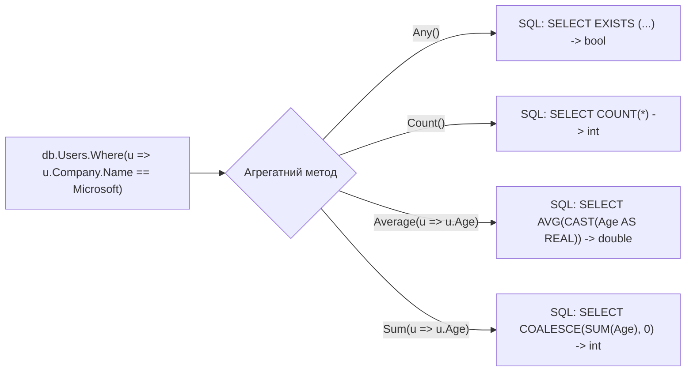

# 5.5. Агрегатні операції (Any, All, Count, Sum, Min, Max, Average)

- **Глава:** 06. Запити та LINQ to Entities
- **Джерело Metanit:** [Агрегатные операции](https://metanit.com/sharp/efcore/5.5.php)
- **Код прикладу:** [Lesson_5_5_Aggregates.cs](../../src/06_QueriesAndLinq/Lesson_5_5_Aggregates.cs)
- **Запуск уроку:** `dotnet run --project src/EFCoreMastery.ConsoleApp -- 5.5`
- **Шпаргалка глави:** [Runs.md](Runs.md)

## Мета уроку

Навчитися виконувати скалярні агрегатні обчислення (`Any`, `All`, `Count`, `Sum`, `Min`, `Max`, `Average` та їхні `Async`-версії) безпосередньо на стороні бази даних SQLite, розуміючи, як кожен метод транслюється в SQL та як уникнути типових помилок на порожніх вибірках.

## Детальний теоретичний матеріал

Агрегатні операції LINQ to Entities відносяться до методів **негайного виконання (Immediate Execution)**: вони одразу надсилають SQL-запит до бази даних і повертають одне скалярне значення (`bool`, `int`, `long`, `double`, `decimal` тощо), не завантажуючи самі сутності в пам'ять і не залучаючи `ChangeTracker`.

### Огляд усіх агрегатних методів

| Метод (та Async-версія) | Призначення | SQL-еквівалент у SQLite | Поведінка на порожній таблиці |
| :--- | :--- | :--- | :--- |
| `Any()` / `Any(predicate)` | Перевіряє, чи існує хоча б один рядок | `SELECT EXISTS (SELECT 1 FROM ... WHERE ...)` | Повертає `false` |
| `All(predicate)` | Перевіряє, чи **всі** рядки задовольняють умову | `SELECT NOT EXISTS (SELECT 1 ... WHERE NOT (...))` | Повертає `true` (вакуумна істина!) |
| `Count()` / `Count(predicate)` | Підраховує кількість рядків (`int`) | `SELECT COUNT(*) FROM ...` | Повертає `0` |
| `LongCount()` | Підраховує кількість рядків (`long`) | `SELECT COUNT(*) FROM ...` | Повертає `0L` |
| `Sum(selector)` | Сума значень стовпця | `SELECT COALESCE(SUM(...), 0)` | Повертає `0` (завдяки `COALESCE`) |
| `Min(selector)` | Мінімальне значення | `SELECT MIN(...)` | Кидає `InvalidOperationException` для не-nullable `int`! |
| `Max(selector)` | Максимальне значення | `SELECT MAX(...)` | Кидає `InvalidOperationException` для не-nullable `int`! |
| `Average(selector)` | Середнє арифметичне | `SELECT AVG(CAST(... AS REAL))` | Кидає `InvalidOperationException` для не-nullable `int`! |

> **Зверніть увагу на `All(predicate)`:** Через трансляцію в `NOT EXISTS (... WHERE NOT (condition))` метод `All` на **порожній** таблиці поверне `true`, оскільки не знайдено жодного рядка, який порушує умову.

## Діаграма / Архітектура процесу



## Покроковий розбір прикладів коду

У файлі [Lesson_5_5_Aggregates.cs](../../src/06_QueriesAndLinq/Lesson_5_5_Aggregates.cs) таблиця `Users` містить 4 записи: `Tom` (36, Microsoft), `Bob` (39, Google), `Alice` (28, Microsoft), `Kate` (25, Google).

### 1. Перевірка умов: `Any` та `All`
```csharp
bool hasGoogleUsers = db.Users.Any(u => u.Company!.Name == "Google");
bool allMicrosoft = db.Users.All(u => u.Company!.Name == "Microsoft");
```
Для `Any` SQLite виконує:
```sql
SELECT EXISTS (
    SELECT 1
    FROM "Users" AS "u"
    INNER JOIN "Companies" AS "c" ON "u"."CompanyId" = "c"."Id"
    WHERE "c"."Name" = 'Google')
```
Результат: `hasGoogleUsers = true`, `allMicrosoft = false`.

### 2. Підрахунок: `Count`
```csharp
int totalUsers = db.Users.Count();
int tomUsers = db.Users.Count(u => u.Name!.Contains("Tom"));
```
Другий виклик генерує `SELECT COUNT(*) FROM "Users" AS "u" WHERE instr("u"."Name", 'Tom') > 0` і повертає `1` (лише `Tom`).

### 3. Мінімум, максимум та середнє: `Min`, `Max`, `Average`
```csharp
int minAge = db.Users.Min(u => u.Age); // 25
int maxAge = db.Users.Max(u => u.Age); // 39
double avgMicrosoftAge = db.Users
    .Where(u => u.Company!.Name == "Microsoft")
    .Average(u => u.Age); // (36 + 28) / 2 = 32.0
```
Для `Average` по цілочисельному полю `Age` провайдер SQLite генерує:
```sql
SELECT AVG(CAST("u"."Age" AS REAL))
FROM "Users" AS "u"
INNER JOIN "Companies" AS "c" ON "u"."CompanyId" = "c"."Id"
WHERE "c"."Name" = 'Microsoft'
```

### 4. Сума значень: `Sum`
```csharp
int sumAll = db.Users.Sum(u => u.Age); // 128
int sumMicrosoft = db.Users
    .Where(u => u.Company!.Name == "Microsoft")
    .Sum(u => u.Age); // 64
```
SQLite-запит використовує `COALESCE(SUM("u"."Age"), 0)`, що гарантує повернення `0` замість `NULL`, якщо під умову `Where` не потрапить жодного запису.

## Особливості роботи в SQLite

| Особливість | SQLite | MS SQL Server |
| :--- | :--- | :--- |
| **`Average` для `int`** | `AVG(CAST(col AS REAL))` -> `double` | `AVG(CAST(col AS float))` -> `double` |
| **Агрегати над `decimal`** | SQLite зберігає `decimal` як `TEXT` і не підтримує `SUM`/`AVG`/`MIN`/`MAX` над `decimal` напряму в БД без явного приведення або обчислення на клієнті | Повна нативна підтримка `DECIMAL`/`MONEY` на боці сервера |
| **`SUM` порожньої вибірки** | SQL `SUM()` повертає `NULL`, тому EF Core додає `COALESCE(..., 0)` | Аналогічно `SUM()` повертає `NULL`, EF Core додає `COALESCE(..., 0)` |

## Типові помилки, підводні камені та Best Practices

- **Використовуйте `Any()` замість `Count() > 0`:** `Count() > 0` змушує БД порахувати **всі** рядки, що відповідають умові, тоді як `Any()` (`EXISTS`) зупиняється одразу на першому знайденому збігу.
- **Пастка порожньої вибірки для `Min`, `Max`, `Average`:** Якщо таблиця порожня (або фільтр `Where` не знайшов жодного рядка), `db.Users.Min(u => u.Age)` кине `InvalidOperationException: Nullable object must have a value`, бо SQL `MIN()` повертає `NULL`, який неможливо записати в `int`. Безпечний прийом — привести селектор до nullable:
  ```csharp
  int minAge = db.Users.Min(u => (int?)u.Age) ?? 0;
  ```
- **Поєднання фільтра та агрегату:** Замість `db.Users.Where(u => ...).Count()` можна писати коротше: `db.Users.Count(u => ...)`. Але для `Sum`, `Min`, `Max`, `Average` умова завжди задається через попередній `.Where(...)`.

---
<!-- lesson-nav -->
← [5.4. Операції з множинами: Union, Intersect, Except](5_4_SetOperations.md) | [Шпаргалка глави (Runs.md)](Runs.md) | [Зміст курсу (README)](../../README.md) | [5.7. Відстеження об'єктів та AsNoTracking](5_7_TrackingAndAsNoTracking.md) →
