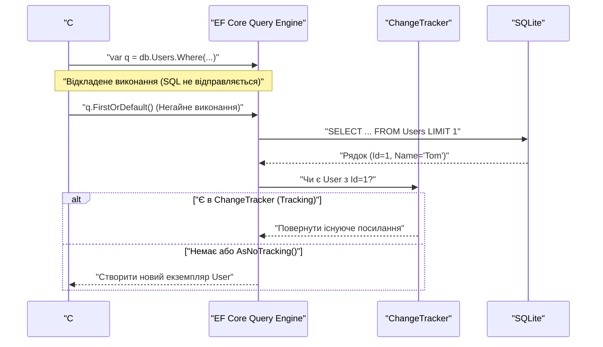

# 5.8. Виконання запитів (відкладене та негайне виконання)

- **Глава:** 06. Запити та LINQ to Entities
- **Джерело Metanit:** [Выполнение запросов](https://metanit.com/sharp/efcore/5.8.php)
- **Код прикладу:** [Lesson_5_8_QueryExecution.cs](../../src/06_QueriesAndLinq/Lesson_5_8_QueryExecution.cs)
- **Запуск уроку:** `dotnet run --project src/EFCoreMastery.ConsoleApp -- 5.8`
- **Шпаргалка глави:** [Runs.md](Runs.md)

## Мета уроку

Детально розібратися в життєвому циклі виконання LINQ-запитів в EF Core: розрізняти **відкладене (Deferred)** та **негайне (Immediate)** виконання, розуміти роль кешування скомпільованих запитів, а також механізм **Identity Resolution** (як `ChangeTracker` поводиться при отриманні рядків із БД для відстежуваних і невідстежуваних запитів).

## Детальний теоретичний матеріал

### 1. Відкладене та негайне виконання (Deferred vs Immediate Execution)

Під час написання LINQ-виразу (`var query = db.Users.Where(u => u.Id > 0).OrderBy(u => u.Name);`) EF Core **не надсилає** запит до бази даних. Це називається **відкладеним виконанням (Deferred Execution)**: змінна `query` містить лише дерево виразів `IQueryable<User>`.

**Коли запит виконується негайно (Immediate Execution)?**
SQL-запит формується (або береться з внутрішнього кешу EF Core) і відправляється до БД у момент, коли код починає **споживати результати**:
1. Перебір у циклі `foreach` або `await foreach` (через `AsAsyncEnumerable()`).
2. Виклик методів матеріалізації колекції: `ToList()` / `ToListAsync()`, `ToArray()` / `ToArrayAsync()`, `ToDictionary()` / `ToDictionaryAsync()`, `ToHashSet()`.
3. Виклик методів отримання одного елемента: `First()`, `FirstOrDefault()`, `Single()`, `SingleOrDefault()`, `Last()`, `LastOrDefault()` (та їхніх `Async`-версій).
4. Виклик агрегатних методів: `Count()`, `LongCount()`, `Any()`, `All()`, `Sum()`, `Min()`, `Max()`, `Average()`.

> **Кешування запитів:** EF Core кешує скомпільований план трансляції LINQ -> SQL у пам'яті. При повторному виконанні того самого шаблону запиту (навіть із різними значеннями параметрів) дерево виразів не компілюється заново.

### 2. Що відбувається після отримання рядків із БД (Identity Resolution)

Коли база даних повернула табличні рядки, подальша поведінка EF Core залежить від того, чи є запит відстежуваним:

| Сценарій | Сутність із таким PK вже є в `ChangeTracker`? | Дії EF Core |
| :--- | :--- | :--- |
| **Відстежуваний запит** (за замовчуванням) | **Так** | Повертає посилання на **існуючий** об'єкт із `ChangeTracker`. Значення з БД **не перезаписують** поточні властивості об'єкта, щоб не втратити незбережені зміни користувача! |
| **Відстежуваний запит** (за замовчуванням) | **Ні** | Створює новий об'єкт, реєструє його в `ChangeTracker` і повертає його. |
| **Невідстежуваний запит** (`AsNoTracking()`) | Не перевіряється | Завжди створює **новий** незалежний екземпляр об'єкта із даними з БД і не додає його в `ChangeTracker`. |

## Діаграма / Архітектура процесу



## Покроковий розбір прикладів коду

У файлі [Lesson_5_8_QueryExecution.cs](../../src/06_QueriesAndLinq/Lesson_5_8_QueryExecution.cs) в таблиці `Users` через `HasData` міститься один запис: `{ Id = 1, Name = "Tom" }`.

### 1. Відкладене та негайне виконання
```csharp
IQueryable<User> deferredQuery = db.Users.Where(u => u.Id > 0);
// Тут SQL ще не виконувався!

var usersList = deferredQuery.ToList(); // Запит #1: SELECT ...
int count = deferredQuery.Count();      // Запит #2: SELECT COUNT(*) ...
```
Зверніть увагу: хоча `deferredQuery` — одна змінна, виклик `ToList()` і `Count()` запускає **два окремих SQL-запити** до SQLite. Якщо вам потрібні і список, і його розмір, достатньо взяти `usersList.Count` без додаткового запиту `Count()` до БД.

### 2. Два відстежувані запити повертають одне й те саме посилання
```csharp
var user1 = db.Users.FirstOrDefault();
var user2 = db.Users.FirstOrDefault();

user1!.Name = "Bob";
Console.WriteLine($"User1: {user1.Name}, User2: {user2!.Name}"); // Bob, Bob
Console.WriteLine(ReferenceEquals(user1, user2)); // True
```
Перший `FirstOrDefault()` завантажує `Tom (Id=1)` із SQLite і кладе його в `ChangeTracker`. Другий `FirstOrDefault()` все ж **виконує SQL-запит** до SQLite (на відміну від `Find()`!), отримує рядок з `Id=1`, але під час матеріалізації бачить, що `Id=1` уже є в `ChangeTracker`, і повертає **те саме посилання** `user1`. Тому зміна `user1.Name = "Bob"` миттєво відображається і в `user2.Name`.

### 3. Відстежуваний запит + `AsNoTracking()` створюють різні об'єкти
```csharp
var user1 = db.Users.FirstOrDefault();
var user2 = db.Users.AsNoTracking().FirstOrDefault();

user1!.Name = "Bob";
Console.WriteLine($"User1: {user1.Name}, User2: {user2!.Name}"); // Bob, Tom
Console.WriteLine(ReferenceEquals(user1, user2)); // False
```
Тут `user2` отримано через `AsNoTracking()`, тому EF Core ігнорує `ChangeTracker` і створює окремий екземпляр `User` зі свіжими даними з БД (`"Tom"`). Зміни в `user1` жодним чином не впливають на `user2`, і `ReferenceEquals(user1, user2)` повертає `False`.

## Особливості роботи в SQLite

- **Блокування зчитувача (`SqliteDataReader`) під час `foreach`:** Якщо перебирати `db.Users` у циклі `foreach (var u in db.Users)` (без `.ToList()`), `SqliteDataReader` тримає з'єднання зайнятим до завершення циклу. Спроба викликати `db.SaveChanges()` всередині такого `foreach` на тому самому контексті може призвести до помилки або винятку. Завжди викликайте `.ToList()` перед тим, як змінювати та зберігати сутності в циклі.
- **Швидкість повторних запитів:** У SQLite локальні запити виконуються за частки мілісекунди, але у високонавантажених сценаріях важливо пам'ятати, що `FirstOrDefault()` **завжди** звертається до файлу БД, тоді як `Find()` спершу перевіряє `ChangeTracker`.

## Типові помилки, підводні камені та Best Practices

- **«Застарілі» дані в довгоживучому `DbContext`:** Якщо хтось змінив рядок у БД зовнішнім процесом, а ваш `DbContext` уже має цю сутність у `ChangeTracker`, повторний відстежуваний запит поверне **старі значення з пам'яті**, а не нові з БД! Рішення: тримайте час життя `DbContext` коротким (один `DbContext` на один бізнес-запит / HTTP-запит) або використовуйте `AsNoTracking()`.
- **Подвійне виконання запиту:** Не пишіть `if (query.Any()) { var list = query.ToList(); }` — це робить два SQL-запити. Краще одразу `var list = query.ToList(); if (list.Count > 0) { ... }`.
- **Замикання змінних у відкладених запитах:** Якщо ви зміните локальну змінну, використану в `Where(u => u.Age > minAge)`, **до** виклику `ToList()`, то при виконанні запиту використається **нове** значення `minAge`.

---
<!-- lesson-nav -->
← [5.7. Відстеження об'єктів та AsNoTracking](5_7_TrackingAndAsNoTracking.md) | [Шпаргалка глави (Runs.md)](Runs.md) | [Зміст курсу (README)](../../README.md) | [5.6. IEnumerable та IQueryable](5_6_IEnumerableVsIQueryable.md) →
