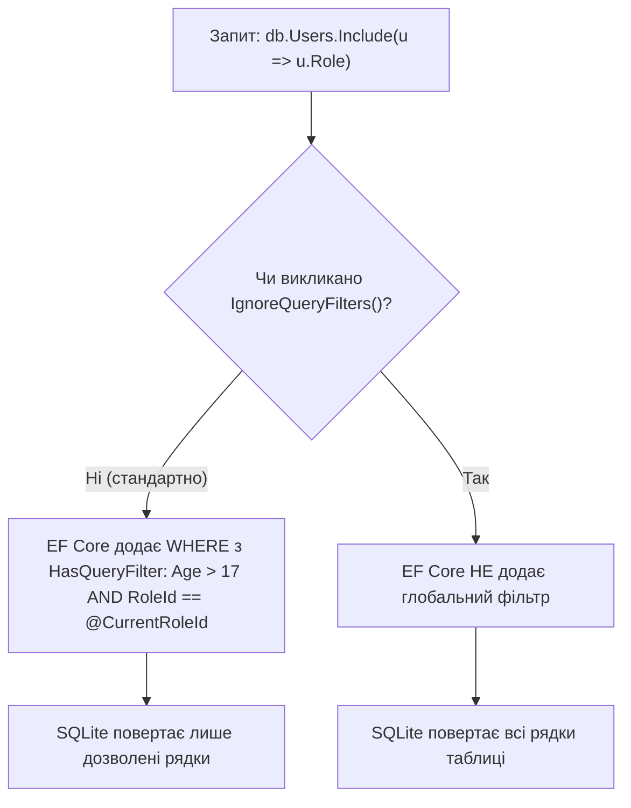

# 5.9. Фільтри запитів рівня моделі (HasQueryFilter)

- **Глава:** 06. Запити та LINQ to Entities
- **Джерело Metanit:** [Фильтры запросов уровня модели](https://metanit.com/sharp/efcore/5.9.php)
- **Код прикладу:** [Lesson_5_9_GlobalQueryFilters.cs](../../src/06_QueriesAndLinq/Lesson_5_9_GlobalQueryFilters.cs)

## Мета уроку

Навчитися визначати глобальні фільтри запитів на рівні моделі (`HasQueryFilter`) у методі `OnModelCreating` для реалізації патернів **Soft Delete** (м'яке видалення) та **Multi-Tenancy** (ізоляція даних за орендарем або роллю), розуміти їхню взаємодію з агрегатами та зв'язками, а також вміти тимчасово вимикати їх за допомогою `IgnoreQueryFilters()`.

## Детальний теоретичний матеріал

### 1. Що таке глобальний фільтр запитів (Model-Level Query Filter)

**Фільтр запитів рівня моделі** — це LINQ-предикат, який конфігурується в метаданих сутності через `modelBuilder.Entity<T>().HasQueryFilter(predicate)` у методі `OnModelCreating`.

Після налаштування EF Core **автоматично** додає цей предикат у секцію `WHERE` **кожного** LINQ-запиту, що звертається до цієї сутності:
- звичайних вибірок (`Where`, `ToList`, `FirstOrDefault`, `SingleOrDefault`);
- пошуку за ключем (`Find`, `FindAsync`);
- агрегатних функцій (`Count`, `Min`, `Max`, `Any`, `Sum`, `Average`);
- навігаційних завантажень (`Include`, `ThenInclude`);
- масових операцій (`ExecuteUpdate`, `ExecuteDelete`).

### 2. Динамічна параметризація від екземпляра `DbContext`

Глобальний фільтр може посилатися на властивості самого класу `DbContext` (наприклад, `CurrentRoleId` або `TenantId`). EF Core не «зашиває» це значення назавжди при першій побудові моделі — натомість він компілює вираз як параметр запиту (`@__ef_filter__CurrentRoleId_0`), значення якого береться з поточного екземпляра `DbContext` під час кожного виконання запиту.

### 3. Тимчасове відключення фільтра (`IgnoreQueryFilters`)

Коли в окремому сценарії (наприклад, панель адміністратора, аудит, міграція даних) потрібно отримати **всі** записи, включно з прихованими фільтром, до запиту додають метод розширення `.IgnoreQueryFilters()`:
```csharp
var allUsers = db.Users.IgnoreQueryFilters().ToList();
```
Цей метод вимикає **всі** глобальні фільтри моделі для поточного запиту (включно з фільтрами на зв'язаних сутностях, завантажених через `Include`).

## Діаграма / Архітектура процесу



## Покроковий розбір прикладів коду

У файлі [Lesson_5_9_GlobalQueryFilters.cs](../../src/06_QueriesAndLinq/Lesson_5_9_GlobalQueryFilters.cs) в `AppDbContext` оголошено властивість `public int CurrentRoleId { get; set; }`, а в `OnModelCreating` задано глобальний фільтр:
```csharp
modelBuilder.Entity<User>()
    .HasQueryFilter(u => u.Age > 17 && u.RoleId == CurrentRoleId);
```
У базі даних створено дві ролі (`user` Id=1, `admin` Id=2) та 4 користувачі: `Tom` (17, user), `Bob` (18, user), `Alice` (19, admin), `Sam` (20, admin).

### 1. Запит із активним `HasQueryFilter` (`CurrentRoleId = 2`)
```csharp
using (var db = new AppDbContext { CurrentRoleId = 2 })
{
    var query = db.Users.Include(u => u.Role);
    Console.WriteLine(query.ToQueryString());
    // ...
    int minFilteredAge = db.Users.Min(u => u.Age);
}
```
Згенерований SQLite SQL:
```sql
SELECT "u"."Id", "u"."Age", "u"."Name", "u"."RoleId", "r"."Id", "r"."Name"
FROM "Users" AS "u"
INNER JOIN "Roles" AS "r" ON "u"."RoleId" = "r"."Id"
WHERE "u"."Age" > 17 AND "u"."RoleId" = @__ef_filter__CurrentRoleId_0
```
У вибірку потрапляють лише `Alice` (19, admin) та `Sam` (20, admin). Відповідно, `db.Users.Min(u => u.Age)` повертає `19`, хоча в базі є `Tom` з віком `17`.

### 2. Відключення фільтра через `IgnoreQueryFilters()`
```csharp
using (var db = new AppDbContext { CurrentRoleId = 2 })
{
    int minAllAge = db.Users.IgnoreQueryFilters().Min(u => u.Age); // 17
    var allUsers = db.Users.IgnoreQueryFilters().Include(u => u.Role).ToList();
}
```
Після додавання `.IgnoreQueryFilters()` умова `WHERE` зникає, `Min` повертає `17`, а `ToList()` завантажує всіх 4 користувачів (`Tom`, `Bob`, `Alice`, `Sam`).

## Особливості роботи в SQLite

- У SQLite глобальні фільтри транслюються у стандартні параметризовані умови `WHERE` (наприклад, `@__ef_filter__CurrentRoleId_0`).
- Завдяки параметризації план запиту кешується EF Core один раз, навіть якщо різні HTTP-запити створюють `AppDbContext` з різними значеннями `CurrentRoleId`.

## Типові помилки, підводні камені та Best Practices

- **Перезапис фільтра:** У класичному API виклик другого `HasQueryFilter(...)` для тієї самої сутності **перезапише** попередній. Завжди об'єднуйте кілька умов в одному виразі через `&&` (наприклад, `!u.IsDeleted && u.TenantId == CurrentTenantId`).
- **Пастка обов'язкового зв'язку (`INNER JOIN` + `HasQueryFilter`):** Якщо у `Order` є обов'язковий зв'язок (`int UserId`) на `User`, а на `User` накладено фільтр Soft Delete (`!u.IsDeleted`), то при запиті до `db.Orders.Include(o => o.User)` замовлення видалених користувачів можуть зникнути через `INNER JOIN`! Рішення: або накласти аналогічний фільтр на `Order` (`o => !o.User!.IsDeleted`), або зробити зовнішній ключ опціональним (`int? UserId`).
- **Сирі SQL-запити (`FromSqlRaw`):** Глобальні фільтри моделі застосовуються до LINQ-композиції поверх `FromSql`, але **не** додаються всередину вашого сирого SQL-рядка, якщо ви не використовуєте подальшу LINQ-фільтрацію.
