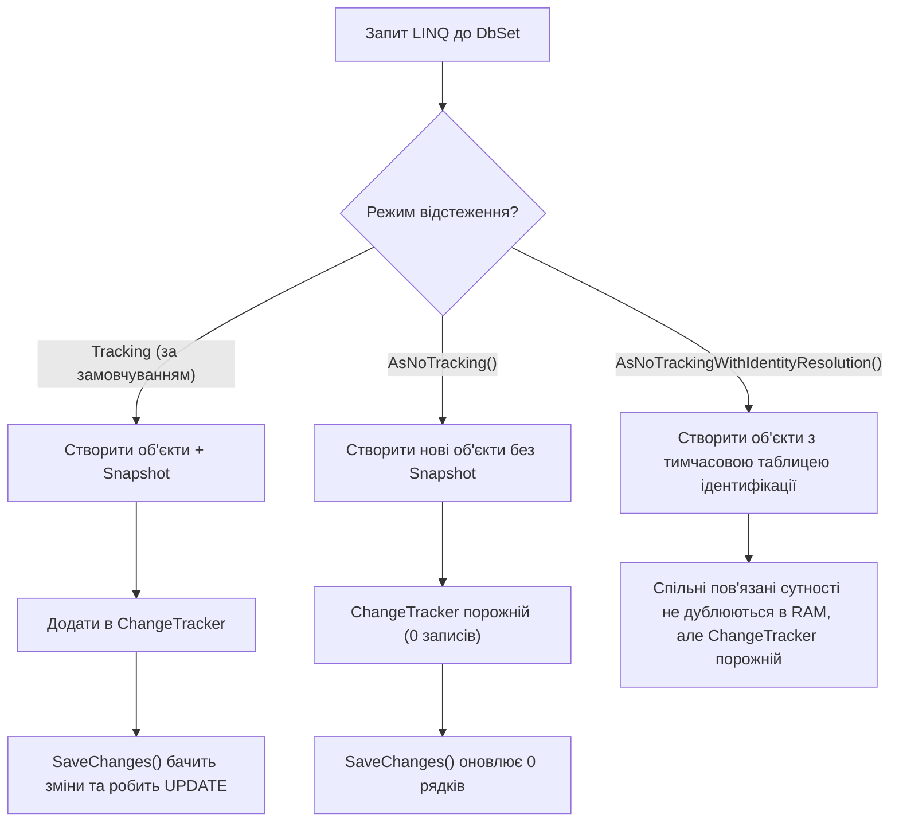

# 6.7. Відстеження об'єктів та AsNoTracking

- **Глава:** 06. Запити та LINQ to Entities
- **Джерело Metanit:** [Отслеживание объектов и AsNoTracking](https://metanit.com/sharp/efcore/5.7.php)
- **Код прикладу:** [Lesson_6_07_TrackingAndAsNoTracking.cs](../../src/06_QueriesAndLinq/Lesson_6_07_TrackingAndAsNoTracking.cs)
- **Запуск уроку:** `dotnet run --project src/EFCoreMastery.ConsoleApp -- 6.7`
- **Шпаргалка глави:** [Runs.md](Runs.md)

## Мета уроку

Розібратися, як працює механізм відстеження змін (`ChangeTracker`) в EF Core, чому відстеження створює накладні витрати у запитах «лише для читання», а також навчитися вимикати його точково (`AsNoTracking`, `AsNoTrackingWithIdentityResolution`) або глобально (`ChangeTracker.QueryTrackingBehavior`), і за потреби повертати через `AsTracking()`.

## Детальний теоретичний матеріал

### 1. Відстежувані запити (Tracking) — поведінка за замовчуванням

Коли EF Core виконує запит, що повертає сутності моделі (наприклад, `db.Users.FirstOrDefault()`), контекст автоматично вмикає режим **відстеження (Tracking)**:
- Кожна завантажена сутність реєструється в `db.ChangeTracker` зі статусом `EntityState.Unchanged`.
- EF Core зберігає внутрішній знімок початкових значень (snapshot) усіх властивостей.
- Якщо ви зміните властивість (`user.Age = 18`) і викличете `db.SaveChanges()`, `ChangeTracker` порівняє поточні значення зі знімком, виявить зміну і згенерує SQL `UPDATE` лише для зміненого стовпця.

**Ціна відстеження:** Для сценаріїв, де дані лише відображаються (GET-ендпоінти API, звіти, таблиці), створення знімків і підтримка графа зв'язків у `ChangeTracker` витрачають зайву оперативну пам'ять і процесорний час.

### 2. Режими відстеження в EF Core

| Режим | Метод | Реєстрація в `ChangeTracker` | Узгодження однакових сутностей (Identity Resolution) | Коли використовувати |
| :--- | :--- | :--- | :--- | :--- |
| **Tracking** (за замовчуванням) | `AsTracking()` | **Так** | **Так** (один екземпляр на PK) | Коли планується зміна та виклик `SaveChanges()` |
| **NoTracking** | `AsNoTracking()` | **Ні** | **Ні** (можуть створюватися дублікати пов'язаних об'єктів у пам'яті) | Швидке читання плоских списків або 1-рівневих даних |
| **NoTrackingWithIdentityResolution** | `AsNoTrackingWithIdentityResolution()` | **Ні** | **Так** (тимчасова мапа ключів на час запиту) | Read-only запити з `Include`, де кілька записів посилаються на одну спільну сутність (наприклад, 1000 `User` з 1 `Company`) |

### 3. Три способи керування відстеженням

1. **Для конкретного запиту:**
   ```csharp
   var users = db.Users.AsNoTracking().ToList();
   ```
2. **Для всього екземпляра `DbContext` (через `ChangeTracker` або в `OnConfiguring`):**
   ```csharp
   db.ChangeTracker.QueryTrackingBehavior = QueryTrackingBehavior.NoTracking;
   // Або в OnConfiguring / AddDbContext:
   optionsBuilder.UseSqlServer(...).UseQueryTrackingBehavior(QueryTrackingBehavior.NoTracking);
   ```
3. **Повторне увімкнення для окремого запиту (якщо глобально стоїть `NoTracking`):**
   ```csharp
   var trackedUser = db.Users.AsTracking().FirstOrDefault();
   ```

## Діаграма / Архітектура процесу



## Покроковий розбір прикладів коду

У файлі [Lesson_6_07_TrackingAndAsNoTracking.cs](../../src/06_QueriesAndLinq/Lesson_6_07_TrackingAndAsNoTracking.cs) база даних містить 4 користувачі (`Tom` 36, `Bob` 39, `Alice` 28, `Kate` 25).

### 1. Стандартний відстежуваний запит
```csharp
var user = db.Users.FirstOrDefault();
if (user is not null)
{
    user.Age = 18;
    Console.WriteLine($"Відстежується сутностей у ChangeTracker: {db.ChangeTracker.Entries().Count()}"); // 1
    db.SaveChanges();
}
```
Оскільки запит відстежуваний, `db.ChangeTracker.Entries().Count()` дорівнює `1`. Зміна `user.Age = 18` фіксується автоматично, і `SaveChanges()` виконує `UPDATE "Users" SET "Age" = 18 WHERE "Id" = 1`.

### 2. Невідстежуваний запит із `AsNoTracking()`
```csharp
var user = db.Users.AsNoTracking().FirstOrDefault();
if (user is not null)
{
    user.Age = 99;
    Console.WriteLine($"Відстежується сутностей у ChangeTracker: {db.ChangeTracker.Entries().Count()}"); // 0
    int affected = db.SaveChanges(); // 0
}
```
Після `AsNoTracking()` у `ChangeTracker` залишається `0` записів. Зміна `user.Age = 99` відбувається лише в оперативній пам'яті, тому `db.SaveChanges()` повертає `0` (жодного SQL `UPDATE` не надсилається), а в БД залишається вік `18`.

### 3. Глобальний `NoTracking` та точкове повернення через `AsTracking()`
```csharp
db.ChangeTracker.QueryTrackingBehavior = QueryTrackingBehavior.NoTracking;
var user = db.Users.FirstOrDefault(); // не відстежується!
// ...
var trackedUser = db.Users.AsTracking().FirstOrDefault(); // відстежується!
```
Після встановлення `QueryTrackingBehavior.NoTracking` усі наступні запити цього контексту автоматично працюють без відстеження. Проте виклик `.AsTracking()` перевизначає глобальну поведінку для конкретного запиту, і `ChangeTracker.Entries().Count()` стає рівним `1`.

## Особливості роботи в SQLite

- Сама SQL-команда `SELECT`, яку EF Core надсилає до SQLite, **абсолютно однакова** для `Tracking` та `AsNoTracking()`. Уся економія відбувається на рівні .NET-процесу (відсутність алокації `InternalEntityEntry` та словників у `ChangeTracker`).
- При читанні великих довідників або журналів подій із SQLite (тисячі рядків) `AsNoTracking()` помітно зменшує споживання пам'яті та навантаження на Garbage Collector.

## Типові помилки, підводні камені та Best Practices

- **Запити з проекцією `Select` не потребують `AsNoTracking()`:** Якщо ви проектуєте результат у DTO або анонімний тип (`Select(u => new UserDto { ... })`), EF Core і так **не відстежує** ці об'єкти. Але якщо всередині `Select` ви повертаєте саму сутність моделі (наприклад, `Select(u => u.Company)`), то така сутність **буде** відстежуватися, якщо не додати `AsNoTracking()`.
- **Оновлення об'єкта, завантаженого з `AsNoTracking()`:** Якщо ви все ж вирішили змінити та зберегти невідстежувану сутність, потрібно явно прикріпити її до контексту через `db.Users.Update(user)` (оновить усі поля) або `db.Attach(user)` з ручним позначенням змінених властивостей.
- **Дублювання графа об'єктів при `AsNoTracking()` + `Include()`:** Якщо завантажити 100 користувачів однієї компанії через `db.Users.Include(u => u.Company).AsNoTracking()`, EF Core створить **100 окремих екземплярів** `Company` у пам'яті. Щоб уникнути цього без увімкнення `ChangeTracker`, використовуйте `AsNoTrackingWithIdentityResolution()`.

---
<!-- lesson-nav -->
← [6.6. Агрегатні операції (Any, All, Count, Sum, Min, Max, Average)](6_06_Aggregates.md) | [Шпаргалка глави (Runs.md)](Runs.md) | [Зміст курсу (README)](../../README.md) | [6.8. Виконання запитів (відкладене та негайне виконання)](6_08_QueryExecution.md) →
