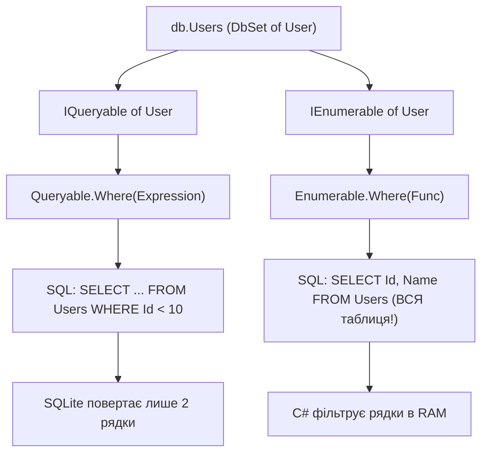

# 6.9. IEnumerable та IQueryable

- **Глава:** 06. Запити та LINQ to Entities
- **Джерело Metanit:** [IEnumerable и IQueryable](https://metanit.com/sharp/efcore/5.6.php)
- **Код прикладу:** [Lesson_6_09_IEnumerableVsIQueryable.cs](../../src/06_QueriesAndLinq/Lesson_6_09_IEnumerableVsIQueryable.cs)
- **Запуск уроку:** `dotnet run --project src/EFCoreMastery.ConsoleApp -- 6.9`
- **Шпаргалка глави:** [Runs.md](Runs.md)

## Мета уроку

Зрозуміти фундаментальну різницю між інтерфейсами `IEnumerable<T>` та `IQueryable<T>` в Entity Framework Core: як тип змінної або повертаного значення впливає на вибір перевантаження методів LINQ (`Enumerable.Where` проти `Queryable.Where`), де саме відбувається фільтрація (у пам'яті клієнта чи на боці БД) і чому це критично для продуктивності.

## Детальний теоретичний матеріал

Незважаючи на те, що `IQueryable<T>` успадковується від `IEnumerable<T>`, їхня поведінка у LINQ to Entities принципово відрізняється, і вони не є взаємозамінними з погляду продуктивності.

### Порівняльна таблиця `IEnumerable<T>` vs `IQueryable<T>`

| Характеристика | `IEnumerable<T>` | `IQueryable<T>` |
| :--- | :--- | :--- |
| **Простір імен** | `System.Collections.Generic` | `System.Linq` |
| **Клас методів розширення** | `System.Linq.Enumerable` (LINQ to Objects) | `System.Linq.Queryable` (LINQ to Entities) |
| **Тип предиката у `Where`** | `Func<T, bool>` (звичайний скомпільований делегат) | `Expression<Func<T, bool>>` (дерево виразів) |
| **Де виконується фільтрація** | У пам'яті застосунку (після вивантаження таблиці з БД) | На стороні СУБД (у SQL-секції `WHERE`) |
| **Напрямок руху по даних** | Тільки вперед (forward-only перебір) | Доступ до віддаленого джерела з можливістю оптимізації всього дерева запиту |
| **Споживання пам'яті та мережі** | Високе (вивантажуються зайві рядки й стовпці) | Мінімальне (передаються лише відфільтровані рядки) |
| **Динамічне додавання умов** | Кожен `.Where()` створює новий ітератор у пам'яті | Кожен `.Where()` добудовує єдине дерево виразів, яке компілюється в один `WHERE ... AND ...` |

### Чому так відбувається?

Клас `DbSet<T>` реалізує `IQueryable<T>`. Проте якщо ви присвоїте `db.Users` змінній типу `IEnumerable<User>` (або повернете `IEnumerable<User>` із методу репозиторію), компілятор C# під час виклику `.Where(...)` обере метод `Enumerable.Where(this IEnumerable<T> source, Func<T, bool> predicate)`.

Оскільки `Func<T, bool>` — це скомпільований IL-код, EF Core не може зазирнути всередину нього і перекласти на SQL. Тому EF Core змушений виконати простий `SELECT "u"."Id", "u"."Name" FROM "Users" AS "u"` без `WHERE`, завантажити **всі** рядки таблиці у пам'ять, і вже там застосувати лямбда-функцію.

Натомість при роботі з `IQueryable<User>` викликається `Queryable.Where`, який приймає `Expression<Func<T, bool>>`. Усі умови (`Where`, `OrderBy`, `Skip`, `Take`, `Select`) накопичуються в дереві виразів і під час матеріалізації (`ToList()`) транслюються в один оптимізований SQL-запит.

## Діаграма / Архітектура процесу



## Покроковий розбір прикладів коду

У файлі [Lesson_6_09_IEnumerableVsIQueryable.cs](../../src/06_QueriesAndLinq/Lesson_6_09_IEnumerableVsIQueryable.cs) у БД через `HasData` додано 3 користувачі: `Tom (Id=1)`, `Bob (Id=2)`, `Alice (Id=15)`.

### 1. `IEnumerable<User>` — фільтрація на стороні клієнта
```csharp
IEnumerable<User> userIEnum = db.Users;
var users = userIEnum.Where(u => u.Id < 10).ToList();
```
Тут `userIEnum.Where(...)` викликає `Enumerable.Where`. До SQLite надходить запит без `WHERE`:
```sql
SELECT "u"."Id", "u"."Name"
FROM "Users" AS "u"
```
Усі 3 записи (`Tom`, `Bob`, `Alice`) читаються з БД, і вже в пам'яті C# відсіюється `Alice (Id=15)`. На тестовій таблиці з 3 рядків різниця непомітна, але на таблиці з мільйоном записів це призведе до вичерпання пам'яті.

### 2. `IQueryable<User>` — фільтрація на стороні БД
```csharp
IQueryable<User> userIQuer = db.Users;
var query = userIQuer.Where(u => u.Id < 10);
Console.WriteLine(query.ToQueryString());
```
`ToQueryString()` показує, що умова `Id < 10` потрапила безпосередньо в SQL:
```sql
SELECT "u"."Id", "u"."Name"
FROM "Users" AS "u"
WHERE "u"."Id" < 10
```
SQLite повертає лише `Tom` і `Bob`.

### 3. Динамічне нашарування умов на `IQueryable`
```csharp
IQueryable<User> dynamicQuery = db.Users;
dynamicQuery = dynamicQuery.Where(u => u.Id < 10);
dynamicQuery = dynamicQuery.Where(u => u.Name == "Tom");
```
Такий прийом широко використовується для побудови фільтрів пошуку (коли умови додаються через `if (!string.IsNullOrEmpty(name))`). EF Core об'єднує обидва `Where` в один SQL-запит:
```sql
SELECT "u"."Id", "u"."Name"
FROM "Users" AS "u"
WHERE "u"."Id" < 10 AND "u"."Name" = 'Tom'
```

## Особливості роботи в SQLite

- У SQLite при запиті з `IQueryable` та умовою `WHERE "u"."Id" < 10` рушій використовує B-Tree індекс первинного ключа `Id` і миттєво зупиняє сканування на значенні `10`, навіть якщо в таблиці мільйони рядків.
- При використанні `IEnumerable` відбувається повний прохід по таблиці (Full Table Scan), а потім десереалізація всіх рядків у .NET-об'єкти.

## Типові помилки, підводні камені та Best Practices

- **Приховане перетворення в `IEnumerable` у методах-репозиторіях:** Якщо метод має сигнатуру `public IEnumerable<User> GetUsers() => _db.Users;`, то будь-яке подальше `.Where(...)` чи `.Take(10)` у сервісі виконуватиметься **в пам'яті**, а не в SQL! Для відкладеної композиції запитів повертайте `IQueryable<User>` або приймайте параметри фільтрації всередині методу.
- **Коли `AsEnumerable()` справді потрібен:** Якщо частину фільтрації неможливо перекласти в SQL (наприклад, виклик складної бібліотечної C#-функції), спочатку максимально звузьте вибірку через `IQueryable` (`Where`, `OrderBy`, `Take`), потім явно викличте `.AsEnumerable()`, і вже після нього застосовуйте C#-логіку.
- **Обережно з `var` та явними типами:** `var query = db.Users;` має тип `DbSet<User>` (який реалізує `IQueryable<User>`), тому тут усе гаразд. Проблема виникає лише при явному вказанні типу `IEnumerable<User>` або виклику `.AsEnumerable()` / `.ToList()` раніше, ніж потрібно.

---
<!-- lesson-nav -->
← [6.8. Виконання запитів (відкладене та негайне виконання)](6_08_QueryExecution.md) | [Шпаргалка глави (Runs.md)](Runs.md) | [Зміст курсу (README)](../../README.md) | [6.10. Фільтри запитів рівня моделі (HasQueryFilter)](6_10_GlobalQueryFilters.md) →
