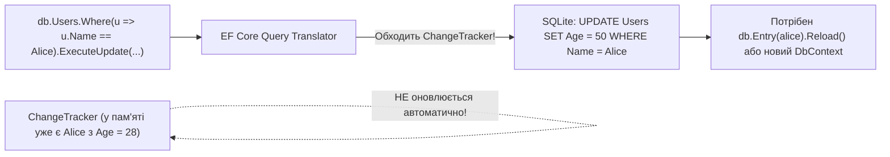

# 6.11. Масове оновлення та видалення. ExecuteUpdate і ExecuteDelete

- **Глава:** 06. Запити та LINQ to Entities
- **Джерело Metanit:** [Массовое обновление и удаление. ExecuteUpdate и ExecuteDelete](https://metanit.com/sharp/efcore/5.11.php)
- **Код прикладу:** [Lesson_6_11_BulkExecuteUpdateDelete.cs](../../src/06_QueriesAndLinq/Lesson_6_11_BulkExecuteUpdateDelete.cs)
- **Запуск уроку:** `dotnet run --project src/EFCoreMastery.ConsoleApp -- 6.11`
- **Шпаргалка глави:** [Runs.md](Runs.md)

## Мета уроку

Навчитися виконувати високоефективне масове оновлення та видалення записів у базі даних одним SQL-запитом (`ExecuteUpdate` / `ExecuteUpdateAsync` та `ExecuteDelete` / `ExecuteDeleteAsync`) без завантаження сутностей у пам'ять, а також розуміти ключовий наслідок цього підходу — **обхід `ChangeTracker`**.

## Детальний теоретичний матеріал

### 1. Проблема класичного підходу (`Load -> Modify -> SaveChanges`)

Традиційно для оновлення або видалення записів в EF Core потрібно було:
1. Виконати `SELECT` і завантажити сутності в пам'ять (`ChangeTracker`).
2. Змінити властивості в циклі або викликати `RemoveRange(...)`.
3. Викликати `db.SaveChanges()`.

Якщо потрібно оновити 10 000 рядків (наприклад, підвищити ціни на 5% або видалити застарілі сесії), завантаження всіх 10 000 об'єктів у RAM і генерація тисяч окремих команд створюють величезне навантаження.

### 2. Методи `ExecuteUpdate` та `ExecuteDelete` (EF Core 7.0+)

Починаючи з EF Core 7.0, для будь-якого `IQueryable<T>` доступні методи масових операцій (разом з асинхронними версіями `ExecuteUpdateAsync` і `ExecuteDeleteAsync`):

- **`ExecuteUpdate(setPropertyCalls)`** — транслює LINQ-вибірку (`Where`, `Skip`, `Take` тощо) у єдину SQL-команду `UPDATE` і повертає `int` (кількість оновлених рядків).
  - Метод приймає делегат `s => s.SetProperty(propertySelector, valueExpression)`.
  - `SetProperty` можна викликати **ланцюжком** для одночасного оновлення кількох стовпців.
  - Другий параметр `SetProperty` може бути як константою/змінною (`_ => "Tomas"`), так і виразом на основі поточного значення в БД (`u => u.Age + 10`).
- **`ExecuteDelete()`** — транслює LINQ-вибірку у єдину SQL-команду `DELETE FROM` і повертає `int` (кількість видалених рядків).

### 3. Порівняння `SaveChanges()` vs `ExecuteUpdate` / `ExecuteDelete`

| Критерій | Класичний `SaveChanges()` | `ExecuteUpdate` / `ExecuteDelete` |
| :--- | :--- | :--- |
| **Завантаження сутностей у пам'ять** | Обов'язкове (`SELECT`) | **Не потрібне** (одразу `UPDATE` / `DELETE`) |
| **Виклик `SaveChanges()`** | Обов'язковий | **Не потрібен** (виконується негайно) |
| **Взаємодія з `ChangeTracker`** | Повна синхронізація | **Повністю обходить `ChangeTracker`** |
| **Глобальні фільтри (`HasQueryFilter`)** | Враховуються при завантаженні | Враховуються (можна вимкнути через `IgnoreQueryFilters()`) |
| **Транзакційність** | В одній транзакції на `SaveChanges()` | Виконується в поточній транзакції або створює власну |
| **Підтримка складних зв'язків** | Оновлює цілий граф об'єктів | Працює лише з **однією таблицею** за виклик |

## Діаграма / Архітектура процесу



## Покроковий розбір прикладів коду

У файлі [Lesson_6_11_BulkExecuteUpdateDelete.cs](../../src/06_QueriesAndLinq/Lesson_6_11_BulkExecuteUpdateDelete.cs) база даних ініціалізується 4 користувачами: `Tom` (36), `Bob` (39), `Alice` (28), `Kate` (25).

### 1. Масове оновлення через `ExecuteUpdate`
```csharp
// Збільшити Age на 1 для всіх
int updatedAll = db.Users.ExecuteUpdate(s => s.SetProperty(u => u.Age, u => u.Age + 1));

// Оновити кілька властивостей за умовою Where
int updatedTom = db.Users
    .Where(u => u.Name == "Tom")
    .ExecuteUpdate(s => s
        .SetProperty(u => u.Age, u => u.Age + 10)
        .SetProperty(u => u.Name, _ => "Tomas"));
```
Другий виклик генерує в SQLite такий SQL:
```sql
UPDATE "Users" AS "u"
SET "Name" = 'Tomas',
    "Age" = "u"."Age" + 10
WHERE "u"."Name" = 'Tom'
```
Усі зміни відбуваються одним зверненням до файлу БД без жодного `SELECT`.

### 2. Розсинхронізація з `ChangeTracker`
```csharp
var trackedAlice = db.Users.First(u => u.Name == "Alice"); // Age = 29 (після +1)

db.Users.Where(u => u.Name == "Alice")
    .ExecuteUpdate(s => s.SetProperty(u => u.Age, _ => 50));

// У пам'яті все ще 29!
Console.WriteLine(trackedAlice.Age);

db.Entry(trackedAlice).Reload(); // Тепер 50
```
Оскільки `trackedAlice` була завантажена в `ChangeTracker` **до** виклику `ExecuteUpdate`, її властивість `Age` у пам'яті залишається застарілою (`29`). Щоб синхронізувати об'єкт у пам'яті зі станом у БД, викликається `db.Entry(trackedAlice).Reload()` (або запит виконується в новому екземплярі `DbContext`).

### 3. Масове видалення через `ExecuteDelete`
```csharp
int deleted = db.Users.Where(u => u.Name == "Bob").ExecuteDelete();
```
SQLite виконує:
```sql
DELETE FROM "Users" AS "u"
WHERE "u"."Name" = 'Bob'
```
Функція повертає `1` (кількість видалених рядків).

## Особливості роботи в SQLite

| Аспект | SQLite | MS SQL Server |
| :--- | :--- | :--- |
| **Синтаксис `UPDATE`** | `UPDATE "Users" AS "u" SET ... WHERE ...` | `UPDATE [u] SET ... FROM [Users] AS [u] WHERE ...` |
| **Синтаксис `DELETE`** | `DELETE FROM "Users" AS "u" WHERE ...` | `DELETE [u] FROM [Users] AS [u] WHERE ...` |
| **Каскадне видалення** | Працює за умови `PRAGMA foreign_keys = ON` (EF Core вмикає це за замовчуванням для SQLite) | Працює на рівні обмежень `FK` у схемі |

## Типові помилки, підводні камені та Best Practices

- **Застарілі дані в `ChangeTracker`:** Ніколи не поєднуйте в одному методі завантаження сутностей із подальшим `ExecuteUpdate`/`ExecuteDelete` по тій самій таблиці без `Reload()` або `ChangeTracker.Clear()`, інакше при подальшому `SaveChanges()` ви можете випадково перезаписати нові дані в БД старими значеннями з пам'яті.
- **Оптимістичне блокування (`ConcurrencyCheck` / `RowVersion`) та аудит-інтерцептори:** Оскільки `ExecuteUpdate` і `ExecuteDelete` обходять `ChangeTracker` і `SaveChanges()`, інтерцептори `SaveChangesInterceptor` (які часто використовують для автоматичного заповнення `UpdatedAt` або Soft Delete) **не спрацюють**! Поля аудиту в `ExecuteUpdate` потрібно оновлювати явно через `.SetProperty(...)`.
- **Оновлення лише однієї таблиці:** Не можна в одному `ExecuteUpdate` змінити поля і `User`, і `Company`. Для кожної таблиці виконується окремий виклик.

---
<!-- lesson-nav -->
← [6.10. Фільтри запитів рівня моделі (HasQueryFilter)](6_10_GlobalQueryFilters.md) | [Шпаргалка глави (Runs.md)](Runs.md) | [Зміст курсу (README)](../../README.md) | [7.1. Виконання SQL-запитів (FromSqlRaw, FromSqlInterpolated, SqlQuery, ExecuteSqlRaw)](../07_SqlAndStoredProcedures/7_01_RawSqlQueries.md) →
