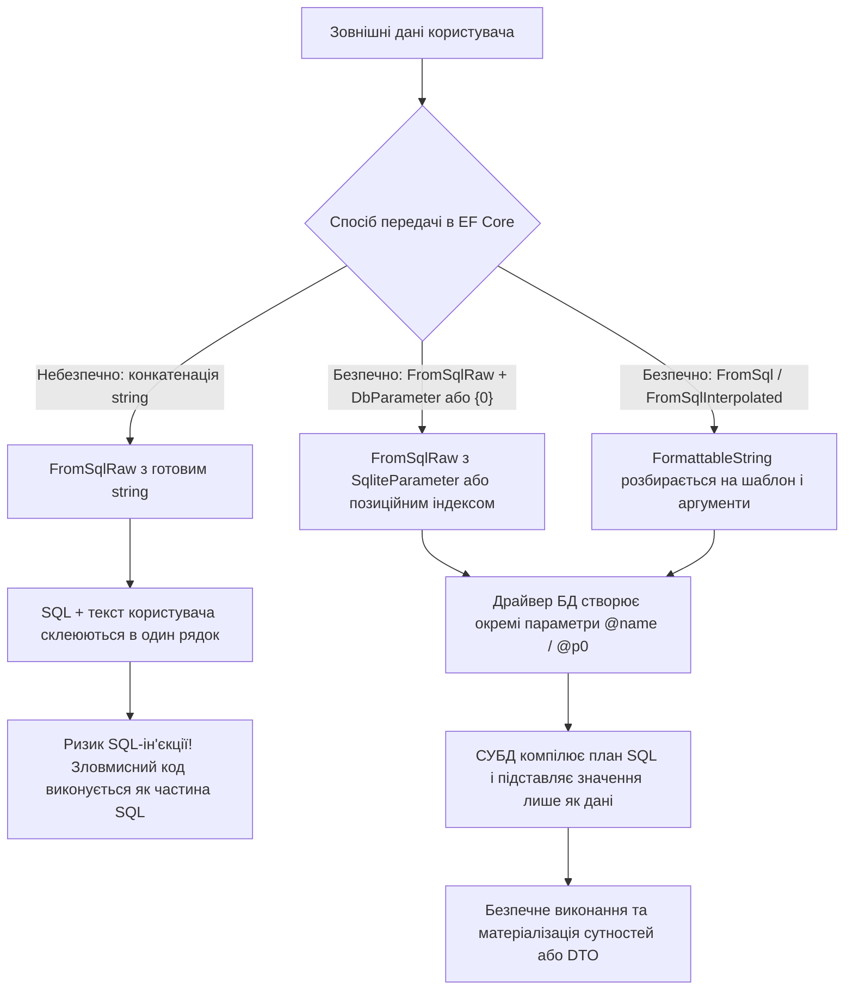
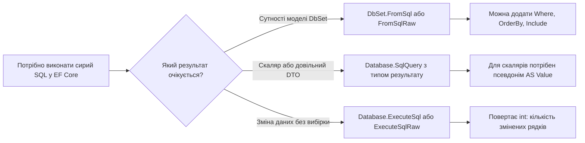

# 6.1. Виконання SQL-запитів (FromSqlRaw, FromSqlInterpolated, SqlQuery, ExecuteSqlRaw)

- **Глава:** 07. SQL в Entity Framework Core
- **Джерело Metanit:** [https://metanit.com/sharp/efcore/6.1.php](https://metanit.com/sharp/efcore/6.1.php)
- **Код прикладу:** [Lesson_6_1_RawSqlQueries.cs](../../src/07_SqlAndStoredProcedures/Lesson_6_1_RawSqlQueries.cs)
- **Запуск уроку:** `dotnet run --project src/EFCoreMastery.ConsoleApp -- 6.1`
- **Шпаргалка глави:** [Runs.md](Runs.md)

---

## Мета уроку

Навчитися виконувати прямі («сирі») SQL-запити в Entity Framework Core у всіх основних сценаріях:
- вибірка сутностей моделі (`FromSqlRaw`, `FromSqlInterpolated`, `FromSql`) та їх композиція з LINQ-операторами (`OrderBy`, `Where`, `Include`);
- безпечна параметризація запитів проти SQL-ін'єкцій через `SqliteParameter` / `SqlParameter`, позиційні плейсхолдери `{0}` та `FormattableString`;
- отримання скалярних значень і довільних DTO-об'єктів без реєстрації `DbSet<T>` за допомогою `Database.SqlQuery<T>`;
- виконання DML-команд (`INSERT`, `UPDATE`, `DELETE`) за допомогою `ExecuteSqlRaw`, `ExecuteSqlInterpolated`, `ExecuteSql` та їхніх асинхронних версій.

---

## Детальний теоретичний матеріал

Попри гнучкість **LINQ to Entities**, на практиці виникають ситуації, коли виправдано писати SQL-запити вручну:
- запит має дуже складну аналітичну структуру (віконні функції, CTE, специфічні `JOIN`-и);
- EF Core генерує неоптимальний план виконання або надлишковий SQL;
- необхідно використати специфічні конструкції або розширення конкретної СУБД.

EF Core надає цілий набір методів для роботи із сирим SQL, які поділяються на **запити вибірки** (`DbSet<T>.FromSql*`, `Database.SqlQuery<T>`) та **команди модифікації даних** (`Database.ExecuteSql*`).

### 1. Методи вибірки сутностей: `FromSqlRaw`, `FromSqlInterpolated` та `FromSql`

Для отримання сутностей, які вже входять до моделі `DbContext` (мають відповідний `DbSet<TEntity>`), використовуються методи розширення `DbSet<TEntity>`:

- **`FromSqlRaw(string sql, params object[] parameters)`** — приймає звичайний рядок SQL та опціональний масив параметрів (`DbParameter` або значення для позиційних заповнювачів `{0}`, `{1}`, ...).
- **`FromSqlInterpolated(FormattableString sql)`** — приймає інтерпольований рядок типу `FormattableString`. Компілятор C# передає його не як готовий `string`, а як структуру із шаблоном і масивом аргументів, що дозволяє EF Core автоматично створити безпечні параметри `@p0`, `@p1` тощо.
- **`FromSql(FormattableString sql)`** *(з'явився в EF Core 7+)* — короткий сучасний синонім `FromSqlInterpolated`, який також приймає виключно `FormattableString` і гарантує параметризацію.

#### Обов'язкові правила та обмеження `FromSql*`:
1. **Відповідність структурі сутності:** SQL-запит повинен повертати всі стовпці, необхідні для матеріалізації `TEntity` (первинний ключ і всі обов'язкові властивості, якщо не використовується часткова проєкція після нього).
2. **Жодного ручного підвантаження зв'язків у SQL:** у самому SQL-рядку не слід робити `JOIN` для заповнення навігаційних властивостей. Для цього поверх `FromSql*` викликають `.Include(...)`.
3. **Композиція з LINQ:** оскільки `FromSqlRaw` / `FromSqlInterpolated` / `FromSql` повертають `IQueryable<TEntity>`, до них можна дописувати `Where`, `OrderBy`, `Skip`, `Take`, `Select`, `Include`. EF Core обгорне ваш SQL у підзапит `FROM (...) AS "c"` і сформує єдиний SQL-запит до БД.
4. **Відсутність крапки з комою `;`:** якщо планується композиція з LINQ, сирий SQL-рядок **не повинен** закінчуватися `;`, інакше підзапит усередині `FROM (...)` буде синтаксично некоректним.
5. **Відстеження змін (`ChangeTracker`):** за замовчуванням завантажені сутності відстежуються контекстом так само, як і при звичайному LINQ-запиті. За потреби лише для читання додавайте `.AsNoTracking()`.

### 2. Передача параметрів і захист від SQL-ін'єкцій

Існує три безпечні способи передавати зовнішні дані в запит:

1. **Явний провайдер-специфічний параметр (`SqliteParameter` / `SqlParameter`):**
   Використовується іменований параметр у SQL (`@name`) та об'єкт параметра, переданий другим аргументом у `FromSqlRaw`. Для SQLite це `SqliteParameter` із `Microsoft.Data.Sqlite`, для MS SQL Server — `SqlParameter` із `Microsoft.Data.SqlClient`.
2. **Позиційні плейсхолдери (`{0}`, `{1}`):**
   У `FromSqlRaw("... WHERE Age > {0}", minAge)` EF Core сам перетворює `{0}` на параметризований `DbParameter` (`@p0`), а не підставляє значення як текст.
3. **Інтерполяція `FormattableString` (`FromSqlInterpolated` / `FromSql`):**
   У виклику `db.Users.FromSql($"... WHERE Name LIKE {pattern} AND Age > {ageLimit}")` змінні `pattern` та `ageLimit` перетворюються на `@p0` і `@p1` на рівні драйвера БД.

> **Критично важливо:** якщо створити `string sql = $"... {userInput}"` заздалегідь і передати його в `FromSqlRaw(sql)`, параметризації **не відбудеться** — це пряма вразливість до SQL-ін'єкції!

### 3. Вибірка скалярів і довільних DTO: `Database.SqlQuery<T>`

До EF Core 8 для виконання SQL, який повертає одне число або DTO без `DbSet`, доводилося використовувати `ADO.NET` або фіктивні `Keyless` сутності. Починаючи з **EF Core 8**, доступний метод:

- **`db.Database.SqlQuery<T>(FormattableString sql)`** (а також `SqlQueryRaw<T>(string sql, params object[] parameters)`).

Він повертає `IQueryable<T>` (можна комбінувати з `Where`, `OrderBy`, `Single()`, `ToListAsync()` тощо) і підтримує два сценарії:
- **Скалярні типи** (`int`, `string`, `double`, `DateTime` тощо): результуючий стовпець у SQL-запиті обов'язково повинен мати псевдонім `Value` (наприклад, `SELECT COUNT(*) AS Value FROM Users`).
- **Довільні класи/записи DTO**, не зареєстровані в `DbContext`: імена стовпців (або їхні псевдоніми `AS ...`) мають збігатися з іменами властивостей DTO. Такі об'єкти не відстежуються в `ChangeTracker`.

### 4. Команди модифікації даних: `ExecuteSqlRaw`, `ExecuteSqlInterpolated` та `ExecuteSql`

Коли потрібно виконати `INSERT`, `UPDATE`, `DELETE` або DDL-інструкцію без повернення рядків таблиці, використовують методи властивості `db.Database`:

- `ExecuteSqlRaw(string sql, params object[] parameters)` / `ExecuteSqlRawAsync(...)`
- `ExecuteSqlInterpolated(FormattableString sql)` / `ExecuteSqlInterpolatedAsync(...)`
- `ExecuteSql(FormattableString sql)` / `ExecuteSqlAsync(...)` *(EF Core 7+)*

Усі вони повертають `int` — кількість рядків, зачеплених командою в базі даних.

### 5. Порівняльна таблиця методів

| Метод | Де викликається | Призначення | Тип результату | Композиція LINQ | Захист від SQL-ін'єкцій |
| :--- | :--- | :--- | :--- | :--- | :--- |
| `FromSqlRaw` | `DbSet<TEntity>` | Вибірка сутностей моделі | `IQueryable<TEntity>` | Так | Лише через `{0}` або `DbParameter` |
| `FromSqlInterpolated` / `FromSql` | `DbSet<TEntity>` | Вибірка сутностей моделі | `IQueryable<TEntity>` | Так | Автоматична (`FormattableString` -> `@p0`) |
| `SqlQuery<T>` | `db.Database` | Вибірка скалярів і довільних DTO | `IQueryable<T>` | Так (EF Core 8+) | Автоматична (`FormattableString` -> `@p0`) |
| `SqlQueryRaw<T>` | `db.Database` | Вибірка скалярів і DTO із сирого рядка | `IQueryable<T>` | Так (EF Core 8+) | Лише через `{0}` або `DbParameter` |
| `ExecuteSqlRaw` | `db.Database` | Команди `INSERT`, `UPDATE`, `DELETE` | `int` (кількість рядків) | Ні | Лише через `{0}` або `DbParameter` |
| `ExecuteSqlInterpolated` / `ExecuteSql` | `db.Database` | Команди `INSERT`, `UPDATE`, `DELETE` | `int` (кількість рядків) | Ні | Автоматична (`FormattableString` -> `@p0`) |

---

## Діаграма / Архітектура процесу

Нижче показано, як різні способи формування SQL-запиту проходять через EF Core та чому параметризація захищає від SQL-ін'єкцій:



Також корисно бачити дерево вибору потрібного методу залежно від типу операції:



---

## Покроковий розбір прикладів коду

У файлі [Lesson_6_1_RawSqlQueries.cs](../../src/07_SqlAndStoredProcedures/Lesson_6_1_RawSqlQueries.cs) реалізовано повний цикл роботи із сирим SQL на базі SQLite (`lesson_6_1_raw_sql`).

### Крок 1. Моделі, DTO та початкове наповнення БД
- Визначено сутності `Company` (`Id`, `Name`, `Users`) та `User` (`Id`, `Name`, `Age`, `CompanyId`, `Company`), а також окремий клас `CompanyStatDto` (`CompanyName`, `UserCount`, `AverageAge`), якого **немає** в `ApplicationContext` як `DbSet`.
- Метод `SqliteDbHelper.RecreateDatabase(db)` перестворює базу, після чого додаються дві компанії (`Microsoft`, `Google`) і 6 користувачів (`Tom`, `Bob`, `Alice`, `Kate`, `Tomas`, `Tomek`).

### Крок 2. `FromSqlRaw` у поєднанні з `OrderBy` та `Include`
```csharp
var companies = db.Companies
    .FromSqlRaw("SELECT * FROM Companies")
    .OrderBy(c => c.Name)
    .ToList();
```
EF Core не просто виконує `SELECT * FROM Companies`, а обгортає його в підзапит і додає сортування на боці SQLite:
```sql
SELECT "c"."Id", "c"."Name"
FROM (
    SELECT * FROM Companies
) AS "c"
ORDER BY "c"."Name"
```
Аналогічно у другому запиті:
```csharp
var usersWithCompany = db.Users
    .FromSqlRaw("SELECT * FROM Users")
    .Include(u => u.Company)
    .ToList();
```
EF Core будує `LEFT JOIN "Companies"` автоматично на рівні обгортки, підвантажуючи навігаційну властивість `Company` без ручного `JOIN` у вихідному SQL-рядку.

### Крок 3. Передача параметрів у `FromSqlRaw`
Демонструються два способи:
1. Через **`SqliteParameter`**:
   ```csharp
   SqliteParameter nameParam = new("@name", "%Tom%");
   var tomUsers = db.Users
       .FromSqlRaw("SELECT * FROM Users WHERE Name LIKE @name", nameParam)
       .ToList();
   ```
   У результаті повертаються `Tom`, `Tomas` і `Tomek`.
2. Через **позиційний плейсхолдер `{0}`**:
   ```csharp
   int minAge = 30;
   var olderUsers = db.Users
       .FromSqlRaw("SELECT * FROM Users WHERE Age > {0}", minAge)
       .ToList();
   ```
   EF Core автоматично трансформує `{0}` у параметр `@p0 = 30`.

### Крок 4. Безпечна інтерполяція через `FromSql` (`FromSqlInterpolated`)
```csharp
string pattern = "%Tom%";
int ageLimit = 30;
var filteredUsers = db.Users
    .FromSql($"SELECT * FROM Users WHERE Name LIKE {pattern} AND Age > {ageLimit}")
    .ToList();
```
У SQLite відправляється параметризований запит:
```sql
-- @p0 = '%Tom%'
-- @p1 = 30
SELECT * FROM Users WHERE Name LIKE @p0 AND Age > @p1
```
Обидві умови виконуються безпечно на боці БД, повертаючи `Tom` (36) і `Tomek` (42).

### Крок 5. Вибірка скалярів і DTO через `Database.SqlQuery<T>`
- **Скалярне значення:**
  ```csharp
  int totalUsers = db.Database
      .SqlQuery<int>($"SELECT COUNT(*) AS Value FROM Users")
      .Single();
  ```
  Псевдонім `AS Value` обов'язковий, щоб EF Core знав, з якого стовпця зчитати скаляр типу `int`.
- **Агрегований DTO (`CompanyStatDto`):**
  ```csharp
  var stats = db.Database
      .SqlQuery<CompanyStatDto>($"""
          SELECT
              c.Name AS CompanyName,
              COUNT(u.Id) AS UserCount,
              COALESCE(AVG(u.Age), 0.0) AS AverageAge
          FROM Companies c
          LEFT JOIN Users u ON u.CompanyId = c.Id
          GROUP BY c.Name
          ORDER BY UserCount DESC
          """)
      .ToList();
  ```
  Кожен псевдонім (`CompanyName`, `UserCount`, `AverageAge`) точно збігається з властивостями `CompanyStatDto`.

### Крок 6. Модифікація даних через `ExecuteSqlRaw` та `ExecuteSql`
Послідовно виконуються `INSERT` (`Apple`), `UPDATE` (`Apple` -> `Apple Inc.`), `DELETE` (`Apple Inc.`) через `ExecuteSqlRaw` з `{0}`/`{1}`, а також `INSERT` (`JetBrains`) через інтерпольований `ExecuteSql($"...")`. Кожен виклик повертає `1` — кількість змінених рядків. Наприкінці `db.Companies.AsNoTracking().ToList()` підтверджує наявність у БД `Microsoft`, `Google` і `JetBrains`.

---

## Особливості роботи в SQLite

| Аспект | MS SQL Server (Metanit) | SQLite (цей проєкт) |
| :--- | :--- | :--- |
| Клас явного параметра | `SqlParameter` (`Microsoft.Data.SqlClient`) | `SqliteParameter` (`Microsoft.Data.Sqlite`) |
| Чутливість `LIKE` до регістру | Залежить від `COLLATE` (за замовчуванням CI) | Нечутливий для ASCII, але **чутливий** для Unicode (кирилиці) |
| Результат `AVG(...)` на порожній вибірці | `NULL` | `NULL` (у прикладі використано `COALESCE(AVG(u.Age), 0.0)` для безпечного мапінгу в `double`) |
| Типізація стовпців | Сувора типізація (`int`, `nvarchar`, `float`) | Динамічна типізація (SQLite Affinity), але EF Core мапить згідно з типом `T` |
| Ідентифікатори в згенерованому SQL | Квадратні дужки `[Companies]` | Подвійні лапки `"Companies"` |

---

## Типові помилки, підводні камені та Best Practices

1. **Конкатенація рядків замість `FormattableString`:**
   - *Помилка:* `var sql = $"SELECT * FROM Users WHERE Name = '{input}'"; db.Users.FromSqlRaw(sql);`
   - *Наслідок:* вразливість до SQL-ін'єкції.
   - *Best Practice:* завжди використовуйте `FromSql($"...")` / `FromSqlInterpolated($"...")` або `FromSqlRaw("... {0}", input)`.

2. **Крапка з комою `;` наприкінці SQL-запиту:**
   - *Помилка:* `db.Users.FromSqlRaw("SELECT * FROM Users;").OrderBy(u => u.Age).ToList();`
   - *Наслідок:* EF Core сформує `FROM (SELECT * FROM Users;) AS "u"`, що викличе синтаксичну помилку SQLite.
   - *Best Practice:* не ставте `;` у запитах, до яких застосовується LINQ-композиція.

3. **Розсинхронізація `ChangeTracker` після `ExecuteSql*`:**
   - *Підводний камінь:* `ExecuteSqlRaw` та `ExecuteSql` звертаються напряму до БД в обхід `ChangeTracker`. Якщо сутності вже були завантажені в поточний `DbContext`, їхні властивості в пам'яті залишаться старими.
   - *Best Practice:* після масового оновлення чи видалення через `ExecuteSql*` викликайте `db.ChangeTracker.Clear()` або виконуйте такі команди в окремому контексті.

4. **Неповний набір стовпців у `FromSql*`:**
   - Якщо таблиця `Users` має обов'язкові стовпці (`Id`, `Age`, `CompanyId`), то `SELECT Name FROM Users` у `db.Users.FromSqlRaw(...)` завершиться помилкою матеріалізації. Для вибірки окремих полів використовуйте `.Select(...)` після `FromSql*` або `db.Database.SqlQuery<T>`.

---
<!-- lesson-nav -->
← [5.11. Масове оновлення та видалення. ExecuteUpdate і ExecuteDelete](../06_QueriesAndLinq/5_11_BulkExecuteUpdateDelete.md) | [Шпаргалка глави (Runs.md)](Runs.md) | [Зміст курсу (README)](../../README.md) | [6.2. Збережені функції (SQLite UDF / HasDbFunction адаптація)](6_2_StoredFunctions.md) →
